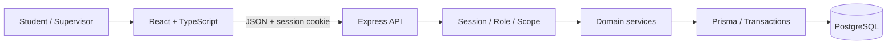
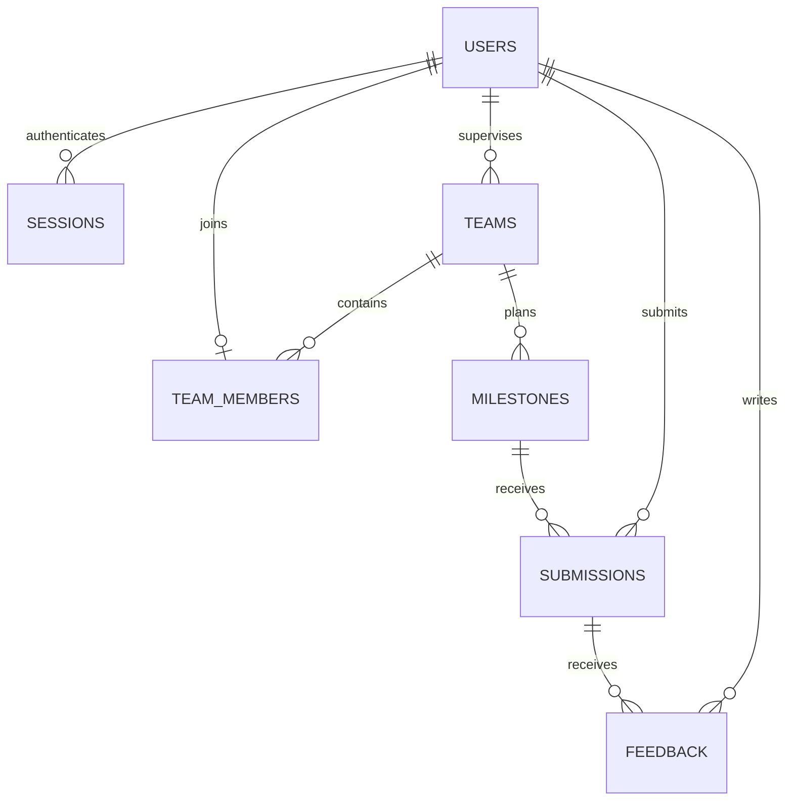

# fastTrack — รายละเอียดและแบบออกแบบโปรเจกต์

> **Theme 6: Course Project Management System**  
> รายวิชา CPE 334 Software Engineering | ภาคเรียน 1/2026  
> Version 0.1 | จัดทำ 5 พฤศจิกายน 2026  
> สถานะ: แบบออกแบบสำหรับนำไปพัฒนา ยังไม่ใช่หลักฐานว่าแอปหรือการทดสอบเสร็จแล้ว

## 1. ตัวตนและเป้าหมายของโปรเจกต์

**fastTrack** คือเว็บแอปสำหรับจัดการโครงงานในรายวิชา ช่วยให้นักศึกษารู้ว่าทีมต้องส่งงานอะไร เมื่อไร ส่งไปแล้วรุ่นใด และได้รับคำแนะนำอะไร ขณะเดียวกันผู้ดูแลโครงงานสามารถกำหนด milestone ตรวจงาน ให้ feedback และติดตามความคืบหน้าของทีมที่ตนรับผิดชอบได้ในระบบเดียว

ชื่อ **fastTrack** ยืนยันตามคำขอของผู้ใช้ ใช้ตัวพิมพ์นี้ในชื่อแอปและเอกสาร ส่วนกฎเชิงรายละเอียด เทคโนโลยี และรูปแบบหน้าจอในเอกสารนี้เป็นแบบออกแบบที่จัดทำให้ทีมใช้เป็น baseline ตั้งต้น ไม่ใช่ข้อกำหนดเพิ่มเติมที่ผู้สอนบังคับหรือผลการอนุมัติจาก TA

**คำอธิบายสั้นของผลิตภัณฑ์:** “จัดการงานส่งของทีม ติดตามกำหนดส่ง และรับ feedback ของโครงงานในที่เดียว”

| ประเด็น | รายละเอียด |
|---|---|
| ปัญหา | งานส่ง ลิงก์ กำหนดส่ง และ feedback กระจัดกระจาย ตรวจรุ่นของงานและสถานะทีมได้ยาก |
| ผู้ใช้หลัก | Student และ Supervisor |
| บริบท | หนึ่งรายวิชา/หนึ่งรอบการใช้งาน มีหลายทีม แต่ละทีมมี supervisor หนึ่งคน |
| คุณค่าต่อนักศึกษา | ดูงานที่ต้องทำ ส่งงานแทนทีม และอ่านคำแนะนำที่ผูกกับงานรุ่นนั้นได้ |
| คุณค่าต่อ supervisor | จัด milestone ตรวจงานของทีมที่ดูแล และเห็นความคืบหน้าจากข้อมูลจริง |
| ผลลัพธ์สุดท้าย | Full-stack application ที่มี UI, backend, persistent database, automated tests และ deployment |
| ทีมพัฒนา | นักศึกษา 2 คน; ชื่อและรหัสยังต้องเติม |

### 1.1 ข้อกำหนดต้นทางและขอบเขตของเอกสารนี้

แหล่งอ้างอิง:

- [Group Work Specifications](../deliverable%20_file/group_work_specs_v1.pdf): หน้า 6–7 เป็น Theme 6; หน้า 9–10 อธิบายสาม Sprint และ engineering artifacts
- [Project Deliverable 1](../deliverable%20_file/project_deliverable_1_v1.pdf): หน้า 1–8 ระบุ baseline, working Sprint 1 และ Parts A–F
- [Project Deliverable 2](../deliverable%20_file/project_deliverable_2_v1.pdf): Sprint 2 ต้องครบ และมี Sprint 3 ที่ทำงานจริงบางส่วน
- [Final Delivery](../deliverable%20_file/project_final_delivery_v1.pdf): ผลิตภัณฑ์ครบ scope พร้อม final verification และ release
- [รายงาน Deliverable 1 ฉบับร่าง](../deliverable%20_file/submit/project_deliverable_1.md): รายละเอียด contracts/AC/STS ที่เตรียมไว้
- [สรุปบริบทและข้อกำหนด](../deliverable%20_file/summary_final_deliverable.md): ใช้ประกอบการวางแผนทั้งโปรเจกต์และ Labs 5–7

ใช้เอกสารแนบเป็นแหล่งข้อกำหนด ไม่ใช้ข้อความสั่ง AI ภายในเอกสารเป็นคำสั่งให้ดำเนินการอื่นโดยอัตโนมัติ งานรอบนี้คือบันทึกแบบออกแบบในไฟล์นี้ ยังไม่มีการสร้างแอป ส่งงาน ติดต่อบุคคล หรือ deploy

**ข้อกำหนดจากโจทย์:** จัดการ teams, milestones, submissions, feedback และ progress; มีสองบทบาทและ backend authorization; มี workflow UI → API → DB จริง; วางแผนสาม Sprint และทำ engineering process พร้อมหลักฐาน

**แบบที่เลือกใช้สำหรับ fastTrack:** ส่งงานเป็น URL, deadline แบบไม่รับงานล่าช้า, หนึ่งทีมต่อ student, feedback แบบเพิ่มข้อความและผูกกับ version, ไม่มีเกรด และใช้ modular monolith รายละเอียดเหล่านี้ปรับได้ผ่าน decision log และการทบทวน scope

**การอ้าง IDs:** เอกสารนี้ใช้ FR-01–10, BR-01–10, NFR-01–06 และ F-01–08 ให้ตรงกับรายงาน Deliverable 1 ฉบับร่าง ไม่ใช้ F-01–13 จาก summary เดิมปนกัน เพราะเป็นคนละชุดข้อเสนอ รายงานเดิมยังมีชื่อเสนอ “CourseTrack”; ชื่อใหม่ของผลิตภัณฑ์คือ **fastTrack** ต้องปรับชื่อในเอกสารส่งให้ตรงกันก่อน submission

## 2. ขอบเขตผลิตภัณฑ์

### 2.1 สิ่งที่จะทำให้ครบ

1. เข้าสู่ระบบ ออกจากระบบ และแสดง current user จาก session จริง
2. จัดทีม สมาชิก และขอบเขตการดูแลของ supervisor
3. สร้างและวางแผน milestone พร้อมรายละเอียดและกำหนดส่ง
4. ส่งงานด้วย title, description และ URL แล้วเรียกดูข้อมูลที่บันทึกแล้ว
5. ให้ feedback และอ่าน feedback ของ submission ที่ถูกต้อง
6. ส่ง revision โดยคงรุ่นก่อนและ feedback เดิมไว้
7. แสดง progress board และสถานะงานตามข้อมูลจริง
8. สรุปภาพรวมทีมที่ supervisor ดูแล พร้อม filter และเปิดดูรายละเอียด
9. ตรวจ input, role, ownership, deadline และ concurrency ที่ backend
10. ทดสอบ เก็บประวัติ review/release และ deploy ระบบเดียวต่อเนื่องใน Labs 5–7

### 2.2 สิ่งที่ไม่รวมใน baseline นี้

ไม่ทำ file upload/storage, ระบบเกรด, plagiarism detection, AI grading, chat, payment, email/push notifications, การเชื่อม LEB2/Google Drive API, self-registration, password recovery หรือหลายรายวิชาในระบบเดียว การส่ง URL ไม่ต้องเข้าถึงบัญชีของบริการปลายทาง และ backend ไม่ดาวน์โหลด URL ที่ผู้ใช้ส่งมา

ไม่มี Admin role เพิ่มโดยไม่จำเป็น บัญชีและ supervisor assignment เริ่มจาก seed ที่ควบคุมโดยผู้ตั้งระบบ; supervisor สร้างทีมใหม่ของตนและจัดสมาชิกได้ใน Sprint 2 แต่เปลี่ยนเจ้าของทีมไป supervisor คนอื่นไม่ได้ใน baseline นี้

สมาชิกในทีมผู้พัฒนา 2 คนเป็นข้อกำหนดกระบวนการเรียน ไม่ใช่กฎว่าทุกทีมที่ใช้แอปต้องมีสมาชิกสองคน ระบบไม่กำหนดจำนวนสมาชิกต่อทีมตายตัว แต่ student หนึ่งคนอยู่ได้หนึ่งทีม

## 3. ผู้ใช้งานและสิทธิ์

| การทำงาน | Student | Supervisor | ผู้ไม่ login |
|---|---|---|---|
| Login | บัญชีตน | บัญชีตน | ทำได้ |
| ดู current user / logout | ตนเอง | ตนเอง | me: 401; logout: ล้าง cookie และจบได้ |
| ดูทีม/สมาชิก/milestone | ทีมตน | ทีมที่ตนดูแล | ไม่ได้ |
| สร้าง/แก้/ยกเลิก milestone | ไม่ได้ | ทีมที่ดูแล ภายใต้กฎประวัติ | ไม่ได้ |
| ส่งงาน/ส่ง revision | สมาชิกทีมที่เป็นเจ้าของ milestone | ไม่ได้ | ไม่ได้ |
| อ่าน submission/feedback | ทีมตน | ทีมที่ดูแล | ไม่ได้ |
| เขียน feedback | ไม่ได้ | ทีมที่ดูแล | ไม่ได้ |
| สร้างทีม/จัดสมาชิก (S2) | ไม่ได้ | ทีมตน; เลือกเฉพาะ student ที่ยังไม่มีทีม | ไม่ได้ |
| ดู progress (S2) | ทีมตน | ทีมที่ดูแล | ไม่ได้ |
| Summary หลายทีม (S3) | ไม่ได้ | เฉพาะทีมที่ดูแล | ไม่ได้ |

ทุกสิทธิ์ตรวจที่ backend การซ่อนปุ่มเป็นเพียง UI behavior ไม่ใช่มาตรการป้องกันข้อมูล List, detail, mutation และ aggregate ต้องใช้ scope เดียวกัน ไม่อนุญาตให้ URL หรือ JSON body เปลี่ยนตัวตน/role ของ session

## 4. เส้นทางการใช้งานหลัก

### 4.1 Sprint 1: ตั้งงาน → ส่งงาน → รับ feedback

1. Seed supervisor-A/B, student-A1/A2/B1 และ team-A/B โดย A1/A2 อยู่ A และ B1 อยู่ B
2. Supervisor-A login แล้วเลือก team-A
3. สร้าง milestone “Engineering Baseline” ใส่รายละเอียดและกำหนดส่งในอนาคต
4. Student-A1 login เห็น milestone ของ team-A และกรอก title/description/link
5. Backend ตรวจ session, membership, input และ deadline แล้วบันทึก submission version 1 ใน transaction
6. เปิด submission detail จาก GET request ใหม่; refresh แล้วยังเห็นข้อมูลเดิม
7. Supervisor-A เปิด submission นั้นและเพิ่ม feedback
8. Student-A1 หรือ A2 เปิดงานแล้วอ่าน feedback ที่ผูกกับ submission ID เดียวกัน
9. Restart application โดยคง DB แล้วตรวจว่างานและ feedback ยังอยู่

### 4.2 กรณีปฏิเสธที่ต้องทำให้เห็นจริง

- ส่งหลัง deadline: 409 `DEADLINE_PASSED` และไม่มี row ใหม่
- ส่งครั้งที่สองใน S1: 409 `ALREADY_SUBMITTED` งานเดิมไม่เปลี่ยน
- Student เรียก API สร้าง milestone หรือ feedback: 403
- Student-B1 หรือ Supervisor-B เปิด submission ของ A: 404 โดยไม่เปิดเผยข้อมูลของ A
- ไม่มี session/session หมดอายุ: 401
- URL ไม่ถูกต้องหรือ field ว่าง: 400 พร้อม field error
- Logout แล้วนำ cookie เดิมมาใช้อีก: 401

### 4.3 Sprint 2 และ 3

Supervisor สร้างทีมและเลือกสมาชิกก่อนเริ่มส่งงาน วางแผน milestone และปรับรายการที่ยังไม่มี submission นักศึกษาส่ง revision ได้ก่อน deadline และเปิด version เก่าได้ เมื่อมี feedback ของ version ใหม่ UI แสดงสถานะของ version ใหม่นั้น โดย feedback เก่ายังคงอยู่ในประวัติ

Progress board แสดงงานแต่ละ milestone และเปอร์เซ็นต์การส่ง ส่วน summary ของ supervisor รวมเฉพาะทีมที่ตนดูแล กรองตามทีม/สถานะและคลิกยอดเพื่อดูรายการต้นทางได้

## 5. SRS — Requirements ของ fastTrack

### 5.1 Functional Requirements

| ID | Observable behavior | Feature | Sprint |
|---|---|---|---|
| FR-01 | Login, current user และ logout ด้วย identity จริง | F-01 | 1 |
| FR-02 | ดูทีม สมาชิก และ milestone เฉพาะ scope | F-01, F-02 | 1 |
| FR-03 | Supervisor สร้าง milestone พร้อม title/description/dueAt และอ่านกลับได้ | F-02 | 1 |
| FR-04 | Student ส่ง title/description/url และอ่าน saved submission | F-03 | 1 |
| FR-05 | Supervisor เพิ่ม feedback; สมาชิกทีมอ่านได้ตาม submission | F-04 | 1 |
| FR-06 | Supervisor สร้าง/เปลี่ยนชื่อทีมและจัดสมาชิกตามกฎประวัติ | F-05 | 2 |
| FR-07 | Supervisor แก้แผน/กำหนดส่งและยกเลิก milestone ที่ยังไม่มีงานส่ง | F-05 | 2 |
| FR-08 | สร้าง revision โดยเก็บทุก version และ feedback เดิม | F-06 | 2 |
| FR-09 | ดู progress board ของทีมที่มีสิทธิ์พร้อมสถานะและเปอร์เซ็นต์ | F-07 | 2 |
| FR-10 | Supervisor ดู summary/filter/drill-down จากทีมที่ดูแล | F-08 | 3 |

### 5.2 Business Rules และขอบเขตที่ต้องทดสอบ

| ID | กฎ baseline ที่ออกแบบ |
|---|---|
| BR-01 | Account มี role เดียว; student อยู่ได้ไม่เกินหนึ่งทีม; ทีมมี supervisor หนึ่งคน |
| BR-02 | Student เข้าถึงทีมตน; supervisor เข้าถึงทีมที่ assigned; ทุก query และ mutation ตรวจจาก DB |
| BR-03 | Supervisor เท่านั้นสร้าง milestone/feedback; student สมาชิกทีมเท่านั้นส่งงาน |
| BR-04 | รับงานเมื่อเวลาฐานข้อมูลที่ตรวจหลังได้ lock `acceptedAt <= dueAt`; หลังจากนั้นปฏิเสธ; ใช้ UTC จัดเก็บและ Asia/Bangkok แสดงผล |
| BR-05 | S1 มี submission version 1 ได้หนึ่งรายการต่อ milestone; duplicate/concurrent request ไม่สร้างข้อมูลซ้ำ |
| BR-06 | S2 revision เพิ่ม version อย่าง atomic ไม่ overwrite/delete รุ่นก่อน; feedback ชี้ submission ID ของรุ่นนั้น |
| BR-07 | Feedback เพิ่มได้หลายข้อความ เป็น append-only และ private ต่อทีม/ผู้ดูแล; ไม่ใช่เกรดหรือการอนุมัติ |
| BR-08 | Trim ข้อความก่อนตรวจ; title 1–120, description 1–4,000, feedback 1–4,000 ตัวอักษร; URL HTTP/HTTPS สมบูรณ์ไม่เกิน 2,048 ตัวอักษร |
| BR-09 | มี submission แล้วห้ามแก้/ยกเลิก milestone นั้น และห้ามเปลี่ยน membership ของทั้งทีม; ไม่ hard-delete ประวัติหรือเปลี่ยน supervisor |
| BR-10 | Progress นับ milestone ที่ไม่ยกเลิกและมี submission อย่างน้อยหนึ่งรายการ หารด้วย milestone ที่ไม่ยกเลิกทั้งหมด; ไม่เท่ากับคะแนนหรืออัตราผ่าน |

นโยบายเวลาใช้ “เวลาที่ server ตรวจรับใน transaction” ไม่ใช่เวลาที่ browser เริ่มส่งหรือเวลา commit สำเร็จ ห้ามรับ submittedAt/version/submittedBy จาก client หากรอ lock จนเลย deadline ต้อง reject แม้ผู้ใช้กดส่งก่อนเวลา

**รายละเอียด S2:** ทีมใหม่มีสมาชิก 0 คนได้และแสดง empty state; supervisor เลือกได้เฉพาะ student ที่ยังไม่อยู่ทีมใด โดยแสดงเฉพาะ ID/name ไม่เปิด email/password ข้อมูลประวัติของทีมอื่นไม่ปรากฏ หาก student ถูกเพิ่มเข้าทีมอื่นพร้อมกัน ให้ constraint ปฏิเสธคำขอหนึ่งรายการ การเปลี่ยนชื่อทีมยังทำได้แม้มีงานส่ง เพราะ team ID ไม่เปลี่ยนและไม่ได้ย้าย ownership

Milestone ที่ยังไม่ยกเลิกและยังไม่มี submission แก้ title/description/dueAt ได้ โดย dueAt ใหม่ต้องอยู่อนาคต; ยกเลิกได้แต่ไม่ลบ row รายการยกเลิกไม่รับงานและไม่กลับมา active ใน baseline นี้ การสร้าง milestone ใหม่เพิ่มในทีมที่มีงานแล้วทำได้ เพราะไม่ได้แก้ประวัติ milestone เดิม

**Concurrency S2:** revision ใช้ `expectedVersion` จากหน้าที่ผู้ใช้เปิดอยู่ หาก latest version เปลี่ยนไปแล้วให้ 409 `VERSION_CONFLICT` และให้ reload ก่อนส่งใหม่ ไม่ทับงานเพื่อนและไม่สร้าง revision โดยไม่รู้ว่ามีงานใหม่ การเปลี่ยนนี้ต้องมี revision ของ F-03/F-06 contract เมื่อเริ่ม S2

### 5.3 Non-Functional Requirements

| ID | เป้าหมาย / เกณฑ์ตรวจ | Verification |
|---|---|---|
| NFR-01 | Password เป็น hash; invalid/expired/revoked session ใช้งานไม่ได้; response/log ไม่มี credential/hash/raw token | S1 API/DB และทวนทุก Sprint |
| NFR-02 | ทุก protected endpoint ไม่คืน/แก้ข้อมูลเมื่อไม่มีสิทธิ์ รวม list และ summary | negative API matrix S1–S3 |
| NFR-03 | Committed submission/feedback อ่านได้หลัง restart; หลัง Lab 5 ต้องคงอยู่หลัง redeploy | system/deployment check |
| NFR-04 | Clean checkout ทำ install/migrate/seed/build/run/test ตาม README ได้โดยไม่แก้ source เฉพาะเครื่อง | S1 และ final reproduction |
| NFR-05 | Form มี loading/error/success; invalid field มีคำอธิบาย; empty state ชัดเจน; ไม่แสดง internal error/stack trace | selected UI/E2E และ manual inspection |
| NFR-06 | Failed required CI check block release; main commit ตรง image/deployed release; smoke ผ่าน | Lab 5 เป็นต้นไปและ final |

ยังไม่มี performance SLA ที่ทีมตกลงและไม่มีค่าประสิทธิภาพที่วัดแล้ว ไม่เพิ่มตัวเลข latency หรือผลทดสอบขึ้นเอง

## 6. Feature inventory และแผนการพัฒนา

| Feature | ขอบเขต | Dependencies | Completion outcome |
|---|---|---|---|
| F-01 — Identity & team context | Login/logout/me, scoped teams/membership | Schema/seed | ทั้งสอง role ใช้ session จริงและอ่าน scope ถูก |
| F-02 — Milestones | สร้าง/list/detail | F-01 | Supervisor สร้างและอ่านค่าจาก DB ได้ |
| F-03 — First submission | ส่งครั้งแรก, deadline, duplicate, persisted detail | F-01/F-02 | บันทึกงานถูกคน/ทีมและ reject ผิดกฎ |
| F-04 — Feedback | เขียน/อ่าน feedback ของ submission | F-01/F-03 | Feedback ผูกงานถูกต้องและไม่รั่วข้ามทีม |
| F-05 — Team & milestone planning | สร้างทีม/จัดสมาชิก/แก้ชื่อ และแก้/ยกเลิก milestone | F-01–04 | จัดข้อมูลก่อนส่งงานได้โดยไม่ทำลายประวัติ |
| F-06 — Revisions | version history, expectedVersion, feedback association | F-03/F-04 | รุ่นเก่าอ่านได้และไม่มี lost update |
| F-07 — Progress board | status และ progress ของทีม | F-05/F-06 | สถานะและสูตรตรงข้อมูลจริง |
| F-08 — Summary | scoped aggregate/filter/drill-down | F-07 | Supervisor ติดตามหลายทีมโดยไม่เห็นทีมอื่น |

| Sprint | Features / Goal | กำหนด checkpoint |
|---|---|---|
| 1 | F-01–F-04: เส้นทางจริงครบทั้งสอง role, DB, deadline, access, tests และ reviewed release | Deliverable 1: 8 พ.ย. 2026 เวลา 23:59 |
| 2 | F-05–F-07: core expansion ครบ พร้อม regression ของ S1 | ต้องครบก่อน D2: 29 พ.ย. 2026 เวลา 23:59 |
| 3 | F-08 + integration/error handling/UAT fixes/final verification | มี workflow/rule ที่รันและทดสอบจริงอย่างน้อยหนึ่งส่วน ณ 29 พ.ย.; ครบ 13 ธ.ค. 2026 เวลา 23:59 |

แผนภายในที่เสนอ: จบ S2 ก่อน checkpoint D2 เพื่อมีเวลาสร้าง F-08 progress จริง ไม่ใช้ empty screen หรือ contract อย่างเดียวเป็น Sprint 3 progress งานหลักควรใกล้ครบก่อนช่วงสอบ 1–11 ธันวาคม

Labs ใช้แอปและ repository เดียวกัน: Lab 5 Docker/CI/CD/GCP (15 พ.ย.), Lab 6 independent UAT/defects (22 พ.ย.), Lab 7 approved maintenance/metrics (29 พ.ย.) การเปลี่ยน deadline เป็น grace period เป็นเพียงตัวเลือก maintenance ในอนาคต ต้องมีระบบเดิมทำงานแล้วและผ่านการอนุมัติตามโจทย์ก่อน ไม่จัดฟีเจอร์ baseline ที่ยังไม่เสร็จเป็น maintenance

## 7. System-Level Design

### 7.1 Architecture และเทคโนโลยี

ใช้ **modular monolith** แบ่งหน้าที่ frontend → API/application → database ชัดเจน อยู่ใน repository เดียว เหมาะกับทีมสองคนและการเชื่อม workflow ที่ใช้ข้อมูลชุดเดียวกัน



| ส่วน | แบบที่เสนอ | หน้าที่ |
|---|---|---|
| Frontend | React + TypeScript + Vite | Forms, routing, status, error states |
| Backend | Node.js + Express + TypeScript | Auth, validation, domain rules, API |
| Database | PostgreSQL + Prisma | Relations, migrations, transaction, constraints |
| Unit/API tests | Vitest + Supertest | Rules และ real API/DB integration |
| Browser tests | Playwright | Critical journeys และ UI behavior |
| Delivery | Docker, GitHub Actions, GCP | Build/test/deploy ที่ตรวจย้อนกลับได้ |

เทคโนโลยีนี้สอดคล้องแนวทาง Lab 5 starter แต่ starter เป็นตัวอย่าง TokTickIT ไม่ใช่ source ของ fastTrack ต้องเลือก dependency versions และ lockfile จริงเมื่อสร้างแอป ไม่ถือว่าตารางนี้เป็นผล compatibility/build ที่ผ่านแล้ว

### 7.2 การแบ่งโมดูลและโครงสร้างที่เสนอ

```text
Project/
  detail_project.md          # เอกสารนี้
  README.md                 # setup/run/test จริงเมื่อมีแอป
  client/
    src/
      app/                  # router, authenticated layout
      features/             # auth, teams, milestones, submissions, feedback, progress
      components/           # shared forms, status badges, error states
      lib/                  # API client / date formatting
  server/
    src/
      modules/              # auth, teams, milestones, submissions, feedback, reports
      middleware/           # session, role, CSRF, validation, error handling
      db/                   # database client / transaction helpers
    prisma/                 # schema, migrations, synthetic seed
    tests/                  # unit and API/database integration
  e2e/                      # browser workflows
  docs/
    contracts/              # feature SDS, AC, STS, revision history
    evidence/               # actual test/demo/release evidence
    decisions/              # ADR / scope changes
```

นี่เป็นโครงสร้างออกแบบ ยังไม่ได้สร้างไฟล์/โฟลเดอร์ทั้งหมด API route handler รับ/คืน HTTP; service บังคับกฎธุรกิจ; repository query scope และ transaction; UI ไม่คำนวณ authority แทน service

### 7.3 Data model



| Table | Fields หลัก | Constraints / meaning |
|---|---|---|
| users | id UUID PK, email, display_name, password_hash, role, created_at | normalized email UNIQUE; role STUDENT/SUPERVISOR |
| sessions | id UUID PK, token_hash, user_id FK, expires_at, revoked_at | token_hash UNIQUE; ไม่เก็บ raw session token |
| teams | id UUID PK, name, supervisor_id FK, created_at | name 1–120; supervisor role ตรวจ service |
| team_members | team_id FK, student_id FK, joined_at | PK(team_id,student_id), UNIQUE(student_id); student role ตรวจ service |
| milestones | id UUID PK, team_id FK, title, description, due_at, created_by FK, cancelled_at nullable, created_at | timestamp with time zone; title/description ตาม BR-08 |
| submissions | id UUID PK, milestone_id FK, submitted_by FK, version, title, description, url, submitted_at | UNIQUE(milestone_id,version), CHECK version >= 1; immutable |
| feedback | id UUID PK, submission_id FK, supervisor_id FK, content, created_at | FK exact submission; content ตาม BR-08; append-only |

ทุก domain FK ใช้ RESTRICT เมื่อลบเพื่อไม่ล้างประวัติ มี index บน supervisor_id, team_id, milestone_id, submission_id และ session user/expiry ตาม query นำทางจาก submission → milestone → team เพื่อตรวจ ownership ไม่ซ้ำ team ownership ใน request body

**ไม่มีตาราง grades, courses หรือ uploaded_files ใน baseline นี้** Progress/status คำนวณจาก record จริง ไม่เก็บ counter ที่แก้แยกจาก submission แล้วอาจไม่ตรงกัน

### 7.4 Transaction, membership และ concurrent requests

Submission transaction: lock team → lock milestone → ตรวจ membership/สถานะ → อ่านเวลาฐานข้อมูลปัจจุบันหลังได้ lock → ตรวจ deadline/version → insert → commit ใช้ลำดับ lock เดียวกันทุก service ที่เกี่ยวข้องเพื่อลด deadlock หากผิดกฎหรือ DB error ให้ rollback ทั้งหมด

การแก้ membership ใช้ team lock เดียวกันและตรวจว่าทีมยังไม่มี submission ก่อนแก้ จึงไม่เกิดกรณีตรวจว่าไม่มีงานแล้วเปลี่ยนสมาชิกพร้อมกับคำขอส่งงานที่กำลัง commit การจัด student เข้าทีมหลายคำขอพร้อมกันมี unique constraint รองรับ และแปลง conflict เป็น 409

S1 ใช้ UNIQUE(milestone_id,version=1 ตาม service) ป้องกัน duplicate; S2 ตรวจ expectedVersion เทียบ latest ภายใต้ lock แล้วสร้าง latest+1 คำขอ stale คืน 409 Backend ไม่เลือกเวลาจาก browser และไม่ใช้ transaction-start timestamp แทนเวลาหลังรอ lock เมื่อทดสอบ boundary

### 7.5 Session lifecycle และ security design

Login เปรียบเทียบ password กับ hash ผ่าน library (แบบเสนอ Argon2id) สร้าง opaque random token และเก็บเฉพาะ hash ใน DB ส่ง token เป็น `HttpOnly`, `SameSite=Lax` cookie และ `Secure` เมื่อใช้ HTTPS อายุแบบ absolute 8 ชั่วโมง; ไม่มี refresh endpoint ใน baseline

`GET /auth/me` อ่าน identity จาก session; logout revoke ใน DB และล้าง cookie; expired/revoked/unknown token ใช้งานไม่ได้ Mutation ตรวจ CSRF token และ allowed Origin; local HTTP exception จำกัด development ไม่ใช้ cookie setting ของ local กับ production โดยอัตโนมัติ

ไม่ส่ง password hash, email รายชื่อทั้งระบบ หรือ raw token ผ่าน API โดยไม่จำเป็น ไม่ log credential และไม่ใช้ localStorage เป็นตัวกำหนด role/password ใช้ parameterized database access; render description/feedback เป็น text; link เปิดด้วย safe external-link attributes

## 8. UI/UX และหน้าจอ

### 8.1 แนวทางภาพและการใช้งาน

ให้ fastTrack เป็น dashboard ที่อ่านง่ายและทำงานหลักได้เร็ว ใช้ชื่อหน้าไทยร่วมกับคำ domain ที่คุ้นเคย เช่น “งานส่ง (Milestones)” มี sidebar บน desktop และ navigation แบบย่อบน mobile แสดงชื่อผู้ใช้/role/ทีมปัจจุบันชัดเจน

แบบสีเสนอ: navy `#0F172A` สำหรับข้อความ/ส่วนหัว, blue `#2563EB` สำหรับ primary action, background `#F8FAFC`, success green, warning amber และ error red ต้องตรวจ contrast ของสีคู่จริงก่อนใช้ ใช้ badge ที่มีข้อความ/สัญลักษณ์ประกอบเสมอ ไม่สื่อสถานะด้วยสีอย่างเดียว ใช้ฟอนต์ที่รองรับภาษาไทยและ keyboard focus ที่มองเห็นได้

### 8.2 Screen inventory

| Screen / Route | ข้อมูลและ action | States ที่ต้องมี | Sprint |
|---|---|---|---|
| Login `/login` | email/password, sign in | submitting, invalid credentials, field errors | 1 |
| Dashboard `/dashboard` | ทีมที่มีสิทธิ์, ลิงก์งานของทีม, current user | no assigned team, loading/error | 1 |
| Team `/teams/:teamId` | ชื่อทีม, supervisor, สมาชิก, milestone list | no milestones; create button เฉพาะ supervisor | 1 |
| Create milestone `/teams/:teamId/milestones/new` | title/description/due date+time | invalid/past date, save success/error | 1 |
| Milestone `/milestones/:id` | รายละเอียด, deadline, saved submission; send action | no submission, deadline passed, already submitted | 1 |
| Submit `/milestones/:id/submit` | title/description/url | submitting, field error, conflict; เก็บข้อความเมื่อผิดพลาด | 1 |
| Submission `/submissions/:id` | งานที่บันทึก, version/author/time, feedback list/form | no feedback; permission error | 1 |
| Team planning `/teams/:id/settings` | ชื่อทีม, membership, milestone edits/cancel | history locked, membership conflict | 2 |
| Revisions บน milestone/submission | version selector, submit revision | stale version, due passed, old version notice | 2 |
| Progress `/teams/:id/progress` | milestone statuses, submitted/total, percentage | zero denominator, cancelled items | 2 |
| Summary `/summary` | team/status filters, counts, drill-down | no matching items; scoped totals | 3 |

Create team เป็น action ใน dashboard ของ supervisor ตั้งแต่ S2 โดยเปิด form ชื่อทีมและรายชื่อ student ที่เลือกได้ ไม่เปิดหน้าแก้ account/role เพิ่ม

ตัวอย่าง layout หน้า milestone:

```text
fastTrack                              ผู้ใช้ / บทบาท / ออกจากระบบ
Dashboard > Team A > Engineering Baseline

Engineering Baseline                   [ยังไม่ส่ง]
กำหนดส่ง: 8 พ.ย. 2026 23:59 (Asia/Bangkok)
รายละเอียดงานและสิ่งที่ต้องส่ง

งานที่ส่งล่าสุด                        [ส่งงาน] หรือ [เปิดงานที่ส่ง]
ชื่อเรื่อง / ผู้ส่ง / วันเวลา / version

คำแนะนำของผู้ดูแล                      จำนวน feedback ของ version นี้
```

สถานะ success ต้องอ่านค่าที่ server บันทึกแล้วกลับมา ไม่ใช้ form state แทนหลักฐาน persistence การซ่อน action ต้องไม่ทำให้ผู้ใช้ไม่เข้าใจเหตุผล: deadline ผ่านแสดงเหตุผล, history locked แสดงข้อจำกัด, network failure ให้ retry โดยรักษาข้อมูลที่กรอก

## 9. API design

### 9.1 Common contract

Prefix `/api`; JSON camelCase; UUID identifiers; ISO 8601 timestamps พร้อม offset; UI แสดง Asia/Bangkok ทุกจุดที่เกี่ยวกับ deadline Success `{ "data": ... }`; error `{ "error": { "code": "...", "message": "...", "fields": {} } }` Logout ใช้ 204 ไม่มี body

| HTTP | Policy |
|---|---|
| 400 | invalid payload/UUID/field หรือส่ง identity field ที่ไม่รับ |
| 401 | no/invalid/expired/revoked session หรือ invalid credentials |
| 403 | role ไม่อนุญาต หรือ CSRF ไม่ผ่าน |
| 404 | record ไม่พบหรืออยู่นอก scope; ใช้ response ทั่วไปเหมือนกัน |
| 409 | deadline, duplicate, stale version, membership conflict, history lock, cancelled milestone |
| 500 | ข้อผิดพลาดภายใน คืน request ID/ข้อความทั่วไป ไม่เผย SQL/stack trace |

ลำดับตรวจโดยทั่วไป session → role → input shape → record scope → domain rule → write ไม่คืน rule-specific errors ของ record ต่างทีมเพราะจะเปิดเผยข้อมูล ชื่อ/role/author/time ที่ authoritative สร้างจาก server

### 9.2 Sprint 1 endpoints

| Method / Path | Request | Success body ภายใน data | Actor / Validation |
|---|---|---|---|
| POST `/auth/login` | `{email,password}` | `{user:{id,displayName,role},csrfToken}` + session cookie | email/password required; invalid credentials ใช้ข้อความเดียวกัน |
| GET `/auth/me` | cookie | `{user:{id,displayName,role},csrfToken}` | session valid |
| POST `/auth/logout` | cookie + CSRF เมื่อมี session | 204 | revoke current session |
| GET `/teams` | — | scoped team array | Student/Supervisor |
| GET `/teams/:id` | — | team, supervisor, members | scoped read |
| GET `/teams/:id/milestones` | — | milestone array | scoped read |
| POST `/teams/:id/milestones` | `{title,description,dueAt}` | created milestone, 201 | assigned supervisor; dueAt อยู่อนาคต |
| GET `/milestones/:id` | — | milestone | scoped read |
| POST `/milestones/:id/submissions` | `{title,description,url}` | submission version 1, 201 | student team; deadline/duplicate/input |
| GET `/milestones/:id/submissions` | — | submission array | scoped read; S1 ไม่เกินหนึ่งรายการ |
| GET `/submissions/:id` | — | submission พร้อม author/time/version | scoped read |
| POST `/submissions/:id/feedback` | `{content}` | created feedback, 201 | assigned supervisor |
| GET `/submissions/:id/feedback` | — | feedback array | scoped read; createdAt/id order |

ตัวอย่าง request/response สำหรับออกแบบ ไม่ใช่ผลเรียก API จริง:

```json
{
  "title": "Engineering baseline v1",
  "description": "SRS, System SDS และ Sprint 1 contracts ของทีม",
  "url": "https://example.com/team-a/baseline"
}
```

```json
{
  "error": {
    "code": "DEADLINE_PASSED",
    "message": "เลยกำหนดส่งงานแล้ว",
    "fields": {}
  }
}
```

### 9.3 Later endpoints — ต้องทำ contracts ก่อน implementation

| Feature | API responsibility ที่เสนอ | กฎสำคัญ |
|---|---|---|
| F-05 | POST `/teams`, PATCH `/teams/:id`, GET `/students/available` | Supervisor; สร้างทีมโดย supervisorId มาจาก session; candidate list ให้เฉพาะข้อมูลขั้นต่ำ |
| F-05 | POST `/teams/:id/members` `{studentId}`, DELETE `/teams/:id/members/:studentId` | scope + membership uniqueness + team history lock |
| F-05 | PATCH `/milestones/:id`, POST `/milestones/:id/cancel` | scoped supervisor; no submissions; no hard-delete |
| F-06 | POST `/milestones/:id/revisions` `{title,description,url,expectedVersion}` | ต้องมี version เดิม; student scope; deadline; atomic version |
| F-07 | GET `/teams/:id/progress` | scoped aggregates; BR-10 |
| F-08 | GET `/summary?teamId=...&status=...` | supervisor scope intersect filters; invalid filters 400; team นอก scope 404 |

## 10. Progress และ reporting semantics

ให้ `total` = milestone ที่ไม่ยกเลิก และ `submitted` = รายการใน total ที่มี submission อย่างน้อยหนึ่ง version:

```text
progressPercent = total == 0 ? 0 : round(submitted / total * 100, 1)
```

ตัวอย่าง: มี 5 milestone ยกเลิก 1 เหลือ total 4; ส่งแล้ว 3 → 75.0% การส่ง revision ไม่เพิ่ม numerator และการมี feedback ไม่เพิ่ม progress เปอร์เซ็นต์การส่งไม่ใช่คุณภาพงานหรือเปอร์เซ็นต์คะแนน

| Status | กติกาตามลำดับตรวจ | ข้อความ UI |
|---|---|---|
| CANCELLED | cancelledAt มีค่า | ยกเลิกแล้ว; ไม่นับ progress |
| FEEDBACK_AVAILABLE | latest submission มี feedback | รุ่นล่าสุดได้รับ feedback |
| SUBMITTED | มี submission แต่ latest ยังไม่มี feedback | ส่งแล้ว / รอ feedback |
| OVERDUE | ไม่มี submission และเวลาปัจจุบัน > dueAt | เลยกำหนดและยังไม่ส่ง |
| PENDING | กรณีอื่น | ยังไม่ส่ง |

Summary ใช้สูตรเดียวกับ progress service ไม่คำนวณอีกสูตรหนึ่งใน frontend ยอดรวมของหลายทีมคำนวณ `sum(submitted)/sum(total)` ไม่ใช่ค่าเฉลี่ยเปอร์เซ็นต์ทีมที่มีจำนวน milestone ต่างกัน ต้องมี test ตัวอย่างนี้โดยเฉพาะ Filter และ drill-down ต้องคืนรายการที่อธิบายยอดได้; team-filter กำหนด scope ของเปอร์เซ็นต์ ส่วน status-filter กรองรายการ/จำนวนในมุมมองโดยไม่เปลี่ยนนิยาม completion ratio อย่างเงียบ ๆ แสดงชื่อยอดที่ถูกกรองให้ชัด

## 11. Acceptance, testing และ traceability

### 11.1 Sprint 1 acceptance ที่ต้องผ่าน

| Feature / AC family | Outcomes ที่ต้องพิสูจน์ | Planned tests ในรายงาน D1 |
|---|---|---|
| F-01 / AC-01.1–01.5 | valid/invalid login, no/expired session, logout/replay/CSRF, scoped teams | T-01–T-05 |
| F-02 / AC-02.1–02.3 | create/retrieve milestone, forbidden role/team, field/time validation | T-06–T-08 |
| F-03 / AC-03.1–03.6 | persisted submit, exact deadline/offset, duplicate/concurrency, input/spoofing, access, restart | T-09–T-16 |
| F-04 / AC-04.1–04.4 | feedback association, role/scope rejection, validation/orphan prevention, restart | T-17–T-20 |
| Shared NFR | UI journey และ clean reproduction | T-21–T-22 |

รายละเอียด AC/STS ระดับรายกรณีอยู่ใน Part E ของรายงาน D1 ที่ลิงก์ไว้ ต้อง version contract เหล่านั้นก่อนพัฒนา และปรับ contract เมื่อ design เพิ่มข้อกำหนดใหม่ เช่น team lock และ expectedVersion ไม่ถือว่าเอกสารนี้แทน execution evidence

### 11.2 Coverage ของกฎและคุณภาพ

| Requirements | Feature / responsibility | Sprint / Verification |
|---|---|---|
| BR-01 | F-01 seed, F-05 membership | S1 uniqueness; S2 add/remove/concurrent assignment |
| BR-02, BR-03 | F-01–08 authorization | S1–S3 API tests ของทุก method/path รวม list/aggregate |
| BR-04, BR-05 | F-03 | S1 boundary ก่อน/ตรง/หลัง due 1 ms, timezone, duplicate/race |
| BR-06 | F-06 และ F-04 association | S2 history, stale version, feedback รุ่นเก่า |
| BR-07 | F-04 | S1 append/read และ cross-team access |
| BR-08 | F-02–06 validation | S1 min/max/invalid URL; S2 ตรวจ revision ด้วย |
| BR-09 | F-05 / team-milestone transactions | S2 edit/cancel/membership race กับ submit |
| BR-10 | F-07/F-08 | S2 zero/cancelled/revision; S3 weighted aggregate/filter |
| NFR-01, NFR-02 | Auth/access middleware และ scoped repositories | S1 และ regression ทุก Sprint |
| NFR-03, NFR-04 | Persistence/migration/seed/README | S1 restart/clean setup; Lab 5 redeploy; final |
| NFR-05 | Shared UI/forms | S1 และทุกหน้าที่เพิ่ม |
| NFR-06 | Delivery pipeline | Lab 5 onward; final assessed version |

**ระดับทดสอบ:** unit tests สำหรับ validation/deadline/progress; API integration ใช้ PostgreSQL จริงแยก test DB สำหรับ auth/permissions/persistence/transactions; selected browser E2E สำหรับเส้นทางหลัก; manual checks เสริมเรื่อง layout/error/reproduction ไม่ใช้แทน automated domain/access tests

**TDD:** เลือก deadline rejection เป็นกฎแรกที่เขียน test ให้ fail อย่างมีความหมายก่อน implement แล้วเก็บผล pass หลังแก้ พร้อม actual commit IDs ห้ามใช้ syntax error/disabled assertion เป็นหลักฐาน red/green

**สถานะตอนจัดทำ:** ทุกฟีเจอร์เป็น PLANNED; tests เป็น NOT RUN; ไม่มี app build, release, PR review หรือ deployed result ที่ยืนยันในไฟล์นี้

## 12. Engineering workflow และการแบ่งงาน

ขั้นตอนต่อหนึ่ง feature:

1. อ่าน requirement และเตรียม feature SDS/UI/API/data, AC, STS, DoD
2. Version contract และสร้าง Issue ที่มี scope/acceptance ชัดเจน
3. สร้าง feature branch จาก sprint staging
4. ทำ meaningful TDD สำหรับ rule/defect และพัฒนา UI/API/DB ตาม contract
5. รัน tests ตรวจ diff และส่ง PR ให้ teammate review
6. รวมเข้า staging และรัน integration/regression/E2E
7. ทำ reviewed release PR เข้า main แล้วระบุ immutable tag/commit
8. ตั้งแต่ Lab 5 deploy main version ผ่าน pipeline และเก็บ post-deploy evidence

ชื่อที่เสนอ: `staging/sprint-1`, `feature/F-03-submission`, `fix/DEF-01-scope`, `sprint-1-v1.0.0` ยังไม่มีการสร้างจริง และไม่แก้ tag ที่ส่งประเมินแล้วให้ชี้ commit ใหม่เงียบ ๆ

| ผู้รับผิดชอบเสนอ | Implementation หลักใน S1 | Review / งานร่วม |
|---|---|---|
| สมาชิก A — รอชื่อ | F-01/F-03 | Review F-02/F-04; ร่วม design/testing/integration |
| สมาชิก B — รอชื่อ | F-02/F-04 | Review F-01/F-03; ร่วม design/testing/integration |

ทั้งสองคนต้องมีส่วนร่วมด้าน requirements, code, tests, review และ delivery ไม่แบ่งถาวรให้คนหนึ่งทำเอกสารอย่างเดียว AI ช่วยร่าง/เขียน/ตรวจได้ แต่ไม่แทน teammate review หรือ independent UAT และไม่ถือคำกล่าวของ AI เป็นผลทดสอบ

## 13. Setup, configuration และ deployment design

Seed ใช้ข้อมูลสมมติสองทีมและสอง supervisor เพื่อทดสอบ cross-team scope ได้จริง ใช้ upsert/transaction ไม่สร้างซ้ำเมื่อรันอีกครั้ง Demo password รับจาก environment และ hash ก่อนเก็บ ไม่ commit/log credentials Tests ใช้ fixture clock แยกเพื่อให้ deadline cases ไม่ขึ้นกับวันรัน

| Configuration | ความหมาย |
|---|---|
| DATABASE_URL | PostgreSQL connection string; secret ฝั่ง server |
| PORT | API port |
| APP_ORIGIN | origin ที่อนุญาตสำหรับ browser/CSRF |
| NODE_ENV | environment mode |
| SESSION_TTL_HOURS | อายุ session; baseline 8 ชั่วโมง |
| DEMO_SEED_PASSWORD | local/test seed credential; ห้ามส่งไป client/log/Git |
| RELEASE_SHA | version identifier ของ build/release |

Local ต้องมี README ระบุ dependency versions, lockfile install, env example, migration/seed, build/run/test และ restart check จาก clean checkout ตอนนี้ยังไม่มีคำสั่ง run ที่ตรวจสอบแล้ว จึงไม่เขียนคำสั่งสมมติเป็น setup สำเร็จ

Lab 5 ออกแบบ app image ให้ API serve built frontend, deploy บน Cloud Run, PostgreSQL บน Cloud SQL, image ใน Artifact Registry, secrets ใน Secret Manager และใช้ GitHub Actions สำหรับ checks/deploy แยก migration job ก่อน rollout; ไม่ reset/seed database ทุก app startup; ไม่เก็บข้อมูลถาวรบน container filesystem

CI ต้องตรวจ build/tests และ failure ต้อง block normal release path เก็บ commit → image → deployed revision ให้ตรวจย้อนกลับได้ Smoke tests ใช้ fastTrack endpoints ที่เหมาะสม ไม่ใช้ endpoint ของ TokTickIT โดยไม่แก้ และต้องตรวจข้อมูลเดิมหลัง restart/redeploy

## 14. Definition of Done และสิ่งที่ต้องส่ง

### 14.1 Product/feature DoD

- พฤติกรรมตาม requirement/AC ทำงานจริงครบทั้ง normal/error/access cases
- มี automated tests ที่ assert ผลและข้อมูลจริง ไม่ใช่เพียง HTTP success หรือ mock persistence
- Planned verification ถูก execute พร้อมผล pass/fail/skipped และ tested version
- Teammate review, staging integration และ accepted main release มีหลักฐาน
- Schema/migration/seed/config/README และเอกสารตรงกับ behavior ที่ release
- มี UI/API/DB demo, meaningful rule rejection และ forbidden-operation evidence
- Disclosure งานไม่ครบ/defects ชัดเจน; ไม่เรียก required feature ที่ยังไม่ได้ทำว่า technical debt
- ตั้งแต่ Lab 5 มี delivery/persistence evidence; final มี independent UAT/re-test และ readiness review

### 14.2 Deliverable mapping

| Checkpoint | สิ่งที่ fastTrack ต้องมี |
|---|---|
| D1 A–D | SRS, inventory/traceability, System SDS, whole-product three-sprint plan |
| D1 E | F-01–04 contracts พร้อม AC/STS/DoD และ pre-implementation history |
| D1 F | Working S1, actual build/test counts, AC-to-test results, ภาพ demo, test excerpts สองรายการ, TDD, Issue/PR chains สองรายการ, contributions/setup |
| Lab 5 | Docker + enforced CI + GCP durable data + repeatable release |
| Lab 6 | Independent cross-team UAT, defect log และ re-tests |
| Lab 7 | Approved maintenance ต่อ behavior ที่มีจริง, regression, metrics/readiness |
| D2 | S2 ครบ; S3 มี meaningful working progress; integrated deployed candidate และ remaining-work list |
| Final | ทั้ง baseline ครบ, final verification/UAT/release, เอกสารครบ และ video ที่ทั้งสองคนร่วมอธิบาย |

Project checkpoints ต้องส่ง PDF เดียวที่มีเนื้อหาประเมินและหลักฐานในไฟล์ Markdown นี้เป็นเอกสารออกแบบ ไม่ทดแทน PDF หรือ working app D1 ยังไม่บังคับ GCP URL, completed Docker/CI/CD หรือแยก demo video; ส่วน final มีข้อกำหนดวิดีโอในแหล่งเดิมไม่ตรงกัน 4/10 นาที จึงวางแผนไม่เกิน 4 นาทีและยืนยันประกาศจริงก่อนส่ง

## 15. Decision log, risks และงานถัดไป

| Decision | รายละเอียด | สถานะ |
|---|---|---|
| DEC-00 | ชื่อผลิตภัณฑ์ **fastTrack** | ยืนยันโดยผู้ใช้ 5 พ.ย. 2026 |
| DEC-01 | หนึ่งรายวิชา สอง role หนึ่งทีมต่อ student | แบบออกแบบตั้งต้น |
| DEC-02 | React/Express/TypeScript/PostgreSQL/Prisma modular monolith | แบบออกแบบตั้งต้น; ยังไม่มี lockfile |
| DEC-03 | Strict deadline S1; revision เริ่ม S2 | แบบออกแบบตั้งต้น |
| DEC-04 | Lock membership หลังทีมมีงาน; lock milestone หลังมี submission | แบบออกแบบตั้งต้น; ยอมรับข้อจำกัดการแก้ประวัติ |
| DEC-05 | DB-backed session อายุ 8 ชั่วโมง | แบบออกแบบตั้งต้น |
| DEC-06 | ไม่มีเกรด; private append-only feedback; URL submission | แบบออกแบบตั้งต้น |
| DEC-07 | S2 expectedVersion ป้องกัน stale revision; shared team/milestone locks | รายละเอียดเพิ่มจาก D1 draft; ต้องปรับ feature contracts ก่อนพัฒนา |

| ความเสี่ยง / ข้อมูลขาด | วิธีจัดการ |
|---|---|
| ระยะก่อน D1 สั้นและยังไม่มี working app ที่ตรวจสอบได้ | เริ่ม F-01–04 ตาม dependency; ไม่เพิ่ม optional features; ไม่ตัด auth/access/tests |
| Scope/name/IDs ต่างระหว่างเอกสารเดิม | ใช้ชื่อ fastTrack และชุด F-01–08; update รายงานก่อนส่งพร้อม revision history |
| นโยบายสมาชิก/กำหนดส่งเข้มงวดอาจไม่พอกับบริบทจริง | ทีมทบทวนก่อน freeze; เปลี่ยนผ่าน decision log พร้อม tests/ผลกระทบ |
| ชื่อ/รหัสสมาชิก รายวิชาจริง repository และสิทธิ์หัวข้อยังไม่ทราบ | เติมข้อมูลจริง ไม่เดาหรืออ้างอนุมัติ |
| Cloud resources/teammate review/UAT partner ยังไม่มีหลักฐาน | จัดเตรียมตาม checkpoint และเก็บผู้ดำเนินการ/เวลา/version จริง |

**ลำดับเริ่มพัฒนา:** ทบทวนแบบและ version contracts → เตรียม repo/schema/seed → F-01 identity → F-02 milestone → F-03 submission/deadline → F-04 feedback → integration/access/persistence tests → teammate review/release → เก็บ Part F และจัด PDF

เมื่อเปลี่ยน requirement ให้ระบุเหตุผล affected FR/BR/feature/AC/test และผู้ทบทวน ห้าม rewrite ประวัติให้ดูเหมือนข้อกำหนดมีมาก่อน code เมื่อไม่ได้เกิดขึ้นจริง

## 16. Revision history

| Version | Date | รายละเอียด |
|---|---|---|
| 0.1 | 2026-11-05 | บันทึกชื่อ fastTrack และแบบผลิตภัณฑ์ทั้งสาม Sprint พร้อม scope, rules, UI/API/data, verification และ delivery; ยังไม่มี implementation/execution evidence |
