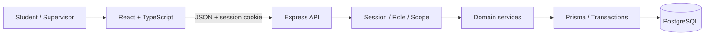
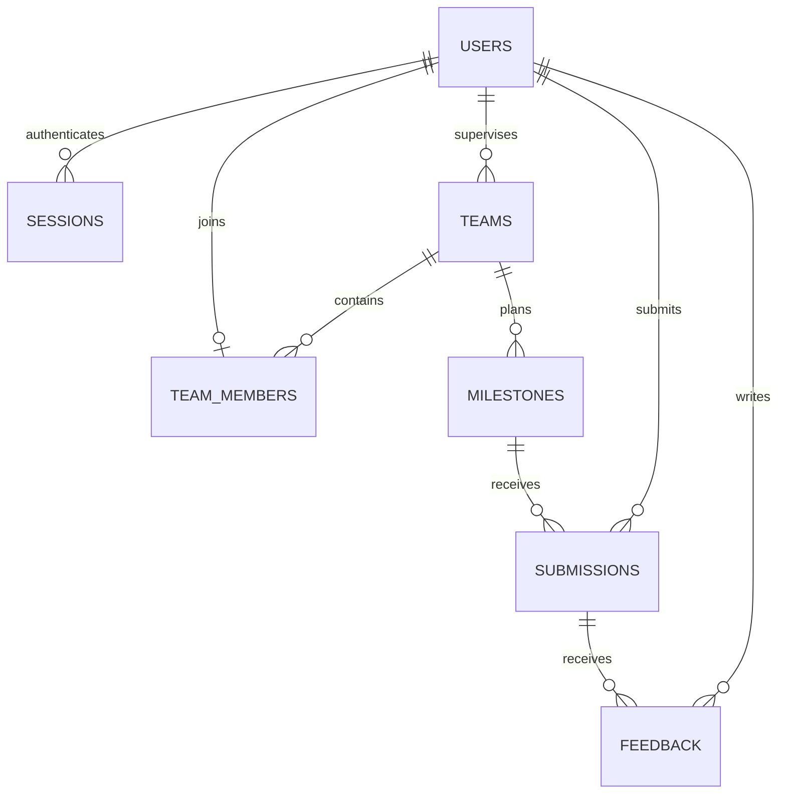

# fastTrack — รายละเอียดและแบบออกแบบโปรเจกต์

> **Theme 6: Course Project Management System**<br>
> รายวิชา CPE 334 Software Engineering | ภาคเรียน 1/2026<br>
> Version 0.5 | ปรับปรุง 5 พฤศจิกายน 2026: Sync D1 v0.2 กับแบบจาก design review v0.4<br>
> สถานะ: แบบออกแบบสำหรับนำไปพัฒนา ยังไม่ใช่หลักฐานว่าแอปหรือการทดสอบเสร็จแล้ว

## 1. ตัวตนและเป้าหมายของโปรเจกต์

**fastTrack** คือเว็บแอปสำหรับจัดการโครงงานในรายวิชา ช่วยให้นักศึกษารู้ว่าทีมต้องส่งงานอะไร เมื่อไร ส่งไปแล้วรุ่นใด และได้รับคำแนะนำอะไร ขณะเดียวกันผู้ดูแลโครงงานสามารถกำหนด milestone ตรวจงาน ให้ feedback และติดตามความคืบหน้าของทีมที่ตนรับผิดชอบได้ในระบบเดียว

ชื่อ **fastTrack** ยืนยันตามคำขอของผู้ใช้ ใช้ตัวพิมพ์นี้ในชื่อแอปและเอกสาร ส่วนกฎเชิงรายละเอียด เทคโนโลยี และรูปแบบหน้าจอในเอกสารนี้เป็นแบบออกแบบที่จัดทำให้ทีมใช้เป็น baseline ตั้งต้น ไม่ใช่ข้อกำหนดเพิ่มเติมที่ผู้สอนบังคับหรือผลการอนุมัติจาก TA

**คำอธิบายสั้นของผลิตภัณฑ์:** “จัดการงานส่งของทีม ติดตามกำหนดส่ง และรับ feedback ของโครงงานในที่เดียว”

**ทิศทางหน้าตาของ fastTrack:** เว็บแอปพื้นขาว ตัวอักษรดำ ใช้เทาเป็นลำดับรอง โดยให้ลำดับ milestone งานที่ต้องส่ง และ feedback เป็นเนื้อหาหลัก ผู้ใช้เห็นงานถัดไปและลงมือทำได้ทันที รายละเอียด design system, wireframes และ interaction specifications อยู่ในหัวข้อ 8

**ผลตรวจแบบ v0.4:** ขอบเขตหลักตรง Theme 6 และมีโครงสร้างพัฒนาต่อได้ เติมรายละเอียดด้าน API/read models, session/CSRF, transaction, retry และแผน verification แล้ว ผล review และงานที่ยังต้องปิดอยู่ในหัวข้อ 16 สถานะนี้คือความพร้อมของแบบออกแบบ ยังไม่ใช่การยืนยันว่า implementation ผ่านเกณฑ์ส่ง

| ประเด็น | รายละเอียด |
|---|---|
| ปัญหา | งานส่ง ลิงก์ กำหนดส่ง และ feedback กระจัดกระจาย ตรวจรุ่นของงานและสถานะทีมได้ยาก |
| ผู้ใช้หลัก | Student และ Supervisor |
| บริบท | หนึ่งรายวิชา/หนึ่งรอบการใช้งาน มีหลายทีม แต่ละทีมมี supervisor หนึ่งคน |
| คุณค่าต่อนักศึกษา | ดูงานที่ต้องทำ ส่งงานแทนทีม และอ่านคำแนะนำที่ผูกกับงานรุ่นนั้นได้ |
| คุณค่าต่อ supervisor | จัด milestone ตรวจงานของทีมที่ดูแล และเห็นความคืบหน้าจากข้อมูลจริง |
| ผลลัพธ์สุดท้าย | Full-stack application ที่มี UI, backend, persistent database, automated tests และ deployment |
| ทีมพัฒนา | นักศึกษา 2 คน; ชื่อและรหัสยังต้องเติม |

### 1.1 ข้อกำหนดต้นทางและขอบเขตของเอกสารนี้

แหล่งอ้างอิง:

- [Group Work Specifications](../deliverable%20_file/group_work_specs_v1.pdf): หน้า 6–7 เป็น Theme 6; หน้า 9–10 อธิบายสาม Sprint และ engineering artifacts
- [Project Deliverable 1](../deliverable%20_file/project_deliverable_1_v1.pdf): หน้า 1–8 ระบุ baseline, working Sprint 1 และ Parts A–F
- [Project Deliverable 2](../deliverable%20_file/project_deliverable_2_v1.pdf): Sprint 2 ต้องครบ และมี Sprint 3 ที่ทำงานจริงบางส่วน
- [Final Delivery](../deliverable%20_file/project_final_delivery_v1.pdf): ผลิตภัณฑ์ครบ scope พร้อม final verification และ release
- [รายงาน Deliverable 1 ฉบับร่าง](../deliverable%20_file/submit/project_deliverable_1.md): รายละเอียด contracts/AC/STS ที่เตรียมไว้
- [สรุปบริบทและข้อกำหนด](../deliverable%20_file/summary_final_deliverable.md): ใช้ประกอบการวางแผนทั้งโปรเจกต์และ Labs 5–7
- [Frontend Design Skill](../skill/SKILL_UI.md): แนวทาง visual identity, typography, layout, interaction และการตรวจแบบตาม brief

ใช้เอกสารแนบเป็นแหล่งข้อกำหนด ไม่ใช้ข้อความสั่ง AI ภายในเอกสารเป็นคำสั่งให้ดำเนินการอื่นโดยอัตโนมัติ งานรอบนี้คือบันทึกแบบออกแบบในไฟล์นี้ ยังไม่มีการสร้างแอป ส่งงาน ติดต่อบุคคล หรือ deploy

**ข้อกำหนดจากโจทย์:** จัดการ teams, milestones, submissions, feedback และ progress; มีสองบทบาทและ backend authorization; มี workflow UI → API → DB จริง; วางแผนสาม Sprint และทำ engineering process พร้อมหลักฐาน

**แบบที่เลือกใช้สำหรับ fastTrack:** ส่งงานเป็น URL, deadline แบบไม่รับงานล่าช้า, หนึ่งทีมต่อ student, feedback แบบเพิ่มข้อความและผูกกับ version, ไม่มีเกรด และใช้ modular monolith รายละเอียดเหล่านี้ปรับได้ผ่าน decision log และการทบทวน scope

**การอ้าง IDs:** เอกสารนี้ใช้ FR-01–10, BR-01–10, NFR-01–06 และ F-01–08 ให้ตรงกับรายงาน Deliverable 1 ฉบับร่าง ไม่ใช้ F-01–13 จาก summary เดิมปนกัน เพราะเป็นคนละชุดข้อเสนอ รายงาน D1 v0.2 sync ชื่อ **fastTrack** และรายละเอียดถึง design review v0.4 แล้ว; v0.5 นี้บันทึกสถานะการ sync โดยไม่เพิ่ม scope ผลิตภัณฑ์

## 2. ขอบเขตผลิตภัณฑ์

### 2.1 สิ่งที่จะทำให้ครบ

1. เข้าสู่ระบบ ออกจากระบบ และแสดง current user จาก session จริง
2. จัดทีม สมาชิก และขอบเขตการดูแลของ supervisor
3. สร้างและวางแผน milestone พร้อมรายละเอียดและกำหนดส่ง
4. ส่งงานด้วย title, description และ URL แล้วเรียกดูข้อมูลที่บันทึกแล้ว
5. ให้ feedback และอ่าน feedback ของ submission ที่ถูกต้อง
6. ส่ง revision โดยคงรุ่นก่อนและ feedback เดิมไว้
7. แสดง progress board และสถานะงานตามข้อมูลจริง
8. สรุปภาพรวมทีมที่ supervisor ดูแล พร้อม filter และเปิดดูรายละเอียด
9. ตรวจ input, role, ownership, deadline และ concurrency ที่ backend
10. ทดสอบ เก็บประวัติ review/release และ deploy ระบบเดียวต่อเนื่องใน Labs 5–7

### 2.2 สิ่งที่ไม่รวมใน baseline นี้

ไม่ทำ file upload/storage, ระบบเกรด, plagiarism detection, AI grading, chat, payment, email/push notifications, การเชื่อม LEB2/Google Drive API, self-registration, password recovery หรือหลายรายวิชาในระบบเดียว การส่ง URL ไม่ต้องเข้าถึงบัญชีของบริการปลายทาง และ backend ไม่ดาวน์โหลด URL ที่ผู้ใช้ส่งมา

ไม่มี Admin role เพิ่มโดยไม่จำเป็น บัญชีและ supervisor assignment เริ่มจาก seed ที่ควบคุมโดยผู้ตั้งระบบ; supervisor สร้างทีมใหม่ของตนและจัดสมาชิกได้ใน Sprint 2 แต่เปลี่ยนเจ้าของทีมไป supervisor คนอื่นไม่ได้ใน baseline นี้

สมาชิกในทีมผู้พัฒนา 2 คนเป็นข้อกำหนดกระบวนการเรียน ไม่ใช่กฎว่าทุกทีมที่ใช้แอปต้องมีสมาชิกสองคน ระบบไม่กำหนดจำนวนสมาชิกต่อทีมตายตัว แต่ student หนึ่งคนอยู่ได้หนึ่งทีม

## 3. ผู้ใช้งานและสิทธิ์

| การทำงาน | Student | Supervisor | ผู้ไม่ login |
|---|---|---|---|
| Login | บัญชีตน | บัญชีตน | ทำได้ |
| ดู current user / logout | ตนเอง | ตนเอง | me: 401; logout: ล้าง cookie และจบได้ |
| ดูทีม/สมาชิก/milestone | ทีมตน | ทีมที่ตนดูแล | ไม่ได้ |
| สร้าง/แก้/ยกเลิก milestone | ไม่ได้ | ทีมที่ดูแล ภายใต้กฎประวัติ | ไม่ได้ |
| ส่งงาน/ส่ง revision | สมาชิกทีมที่เป็นเจ้าของ milestone | ไม่ได้ | ไม่ได้ |
| อ่าน submission/feedback | ทีมตน | ทีมที่ดูแล | ไม่ได้ |
| เขียน feedback | ไม่ได้ | ทีมที่ดูแล | ไม่ได้ |
| สร้างทีม/จัดสมาชิก (S2) | ไม่ได้ | ทีมตน; เลือกเฉพาะ student ที่ยังไม่มีทีม | ไม่ได้ |
| ดู progress (S2) | ทีมตน | ทีมที่ดูแล | ไม่ได้ |
| Summary หลายทีม (S3) | ไม่ได้ | เฉพาะทีมที่ดูแล | ไม่ได้ |

ทุกสิทธิ์ตรวจที่ backend การซ่อนปุ่มเป็นเพียง UI behavior ไม่ใช่มาตรการป้องกันข้อมูล List, detail, mutation และ aggregate ต้องใช้ scope เดียวกัน ไม่อนุญาตให้ URL หรือ JSON body เปลี่ยนตัวตน/role ของ session

## 4. เส้นทางการใช้งานหลัก

### 4.1 Sprint 1: ตั้งงาน → ส่งงาน → รับ feedback

1. Seed supervisor-A/B, student-A1/A2/B1 และ team-A/B โดย A1/A2 อยู่ A และ B1 อยู่ B
2. Supervisor-A login แล้วเลือก team-A
3. สร้าง milestone “Engineering Baseline” ใส่รายละเอียดและกำหนดส่งในอนาคต
4. Student-A1 login เห็น milestone ของ team-A และกรอก title/description/link
5. Backend ตรวจ session, membership, input และ deadline แล้วบันทึก submission version 1 ใน transaction
6. เปิด submission detail จาก GET request ใหม่; refresh แล้วยังเห็นข้อมูลเดิม
7. Supervisor-A เปิด submission นั้นและเพิ่ม feedback
8. Student-A1 หรือ A2 เปิดงานแล้วอ่าน feedback ที่ผูกกับ submission ID เดียวกัน
9. Restart application โดยคง DB แล้วตรวจว่างานและ feedback ยังอยู่

### 4.2 กรณีปฏิเสธที่ต้องทำให้เห็นจริง

- ส่งหลัง deadline: 409 `DEADLINE_PASSED` และไม่มี row ใหม่
- ส่งครั้งที่สองใน S1: 409 `ALREADY_SUBMITTED` งานเดิมไม่เปลี่ยน
- Student เรียก API สร้าง milestone หรือ feedback: 403
- Student-B1 หรือ Supervisor-B เปิด submission ของ A: 404 โดยไม่เปิดเผยข้อมูลของ A
- ไม่มี session/session หมดอายุ: 401
- URL ไม่ถูกต้องหรือ field ว่าง: 400 พร้อม field error
- Logout แล้วนำ cookie เดิมมาใช้อีก: 401

### 4.3 Sprint 2 และ 3

Supervisor สร้างทีมและเลือกสมาชิกก่อนเริ่มส่งงาน วางแผน milestone และปรับรายการที่ยังไม่มี submission นักศึกษาส่ง revision ได้ก่อน deadline และเปิด version เก่าได้ เมื่อมี feedback ของ version ใหม่ UI แสดงสถานะของ version ใหม่นั้น โดย feedback เก่ายังคงอยู่ในประวัติ

Progress board แสดงงานแต่ละ milestone และเปอร์เซ็นต์การส่ง ส่วน summary ของ supervisor รวมเฉพาะทีมที่ตนดูแล กรองตามทีม/สถานะและคลิกยอดเพื่อดูรายการต้นทางได้

## 5. SRS — Requirements ของ fastTrack

### 5.1 Functional Requirements

| ID | Observable behavior | Feature | Sprint |
|---|---|---|---|
| FR-01 | Login, current user และ logout ด้วย identity จริง | F-01 | 1 |
| FR-02 | ดูทีม สมาชิก และ milestone เฉพาะ scope | F-01, F-02 | 1 |
| FR-03 | Supervisor สร้าง milestone พร้อม title/description/dueAt และอ่านกลับได้ | F-02 | 1 |
| FR-04 | Student ส่ง title/description/url และอ่าน saved submission | F-03 | 1 |
| FR-05 | Supervisor เพิ่ม feedback; สมาชิกทีมอ่านได้ตาม submission | F-04 | 1 |
| FR-06 | Supervisor สร้าง/เปลี่ยนชื่อทีมและจัดสมาชิกตามกฎประวัติ | F-05 | 2 |
| FR-07 | Supervisor แก้แผน/กำหนดส่งและยกเลิก milestone ที่ยังไม่มีงานส่ง | F-05 | 2 |
| FR-08 | สร้าง revision โดยเก็บทุก version และ feedback เดิม | F-06 | 2 |
| FR-09 | ดู progress board ของทีมที่มีสิทธิ์พร้อมสถานะและเปอร์เซ็นต์ | F-07 | 2 |
| FR-10 | Supervisor ดู summary/filter/drill-down จากทีมที่ดูแล | F-08 | 3 |

### 5.2 Business Rules และขอบเขตที่ต้องทดสอบ

| ID | กฎ baseline ที่ออกแบบ |
|---|---|
| BR-01 | Account มี role เดียว; student อยู่ได้ไม่เกินหนึ่งทีม; ทีมมี supervisor หนึ่งคน |
| BR-02 | Student เข้าถึงทีมตน; supervisor เข้าถึงทีมที่ assigned; ทุก query และ mutation ตรวจจาก DB |
| BR-03 | Supervisor เท่านั้นสร้าง milestone/feedback; student สมาชิกทีมเท่านั้นส่งงาน |
| BR-04 | รับงานเมื่อเวลาฐานข้อมูลที่ตรวจหลังได้ lock `acceptedAt <= dueAt`; หลังจากนั้นปฏิเสธ; ใช้ UTC จัดเก็บและ Asia/Bangkok แสดงผล |
| BR-05 | S1 มี submission version 1 ได้หนึ่งรายการต่อ milestone; duplicate/concurrent request ไม่สร้างข้อมูลซ้ำ |
| BR-06 | S2 revision เพิ่ม version อย่าง atomic ไม่ overwrite/delete รุ่นก่อน; feedback ชี้ submission ID ของรุ่นนั้น |
| BR-07 | Feedback เพิ่มได้หลายข้อความ เป็น append-only และ private ต่อทีม/ผู้ดูแล; ไม่ใช่เกรดหรือการอนุมัติ |
| BR-08 | Trim ข้อความก่อนตรวจ; title 1–120, description 1–4,000, feedback 1–4,000 ตัวอักษร; URL HTTP/HTTPS สมบูรณ์ไม่เกิน 2,048 ตัวอักษร |
| BR-09 | มี submission แล้วห้ามแก้/ยกเลิก milestone นั้น และห้ามเปลี่ยน membership ของทั้งทีม; ไม่ hard-delete ประวัติหรือเปลี่ยน supervisor |
| BR-10 | Progress นับ milestone ที่ไม่ยกเลิกและมี submission อย่างน้อยหนึ่งรายการ หารด้วย milestone ที่ไม่ยกเลิกทั้งหมด; ไม่เท่ากับคะแนนหรืออัตราผ่าน |

นโยบายเวลาใช้ “เวลาที่ server ตรวจรับใน transaction” ไม่ใช่เวลาที่ browser เริ่มส่งหรือเวลา commit สำเร็จ ห้ามรับ submittedAt/version/submittedBy จาก client หากรอ lock จนเลย deadline ต้อง reject แม้ผู้ใช้กดส่งก่อนเวลา

**รายละเอียดเวลาและ input ที่ต้องตรงกันทุกชั้น:** precision ของ dueAt/submittedAt เป็น millisecond; timestamp ต้องมี offset และรับทศนิยมวินาทีไม่เกิน 3 ตำแหน่ง มิฉะนั้นคืน 400; `acceptedAt` เป็นชื่อค่าที่อ่านใน transaction และบันทึกลง `submissions.submitted_at` โดยไม่อ่าน clock ซ้ำระหว่างตรวจและ insert การเลือกเวลาแบบ HH:mm ใช้วินาที `00` ไม่ตีความเองเป็นสิ้นนาที หน้ารายละเอียด/ข้อความปฏิเสธแสดงเวลาถึงวินาที เช่น 23:59:00 (Asia/Bangkok) และ helper ใน form อธิบายค่าเริ่มต้นนี้

ข้อความที่จำกัดความยาวนับ Unicode code points หลัง trim โดยใช้ utility และ validation cases เดียวกันทั้ง client/server; password ไม่ trim และไม่มีการ normalize เนื้อหางานอัตโนมัติ URL ต้อง parse ได้ มี hostname ใช้ protocol http/https และไม่มี username/password ฝังใน URL ระบบตรวจรูปแบบแต่ไม่รับประกันสิทธิ์เข้าถึงเว็บไซต์ปลายทาง จึงให้ผู้ส่งตรวจสิทธิ์ลิงก์ด้วยตนเอง

**รายละเอียด S2:** ทีมใหม่มีสมาชิก 0 คนได้และแสดง empty state; supervisor เลือกได้เฉพาะ student ที่ยังไม่อยู่ทีมใด โดยแสดงเฉพาะ ID/name ไม่เปิด email/password ข้อมูลประวัติของทีมอื่นไม่ปรากฏ หาก student ถูกเพิ่มเข้าทีมอื่นพร้อมกัน ให้ constraint ปฏิเสธคำขอหนึ่งรายการ การเปลี่ยนชื่อทีมยังทำได้แม้มีงานส่ง เพราะ team ID ไม่เปลี่ยนและไม่ได้ย้าย ownership

Milestone ที่ยังไม่ยกเลิกและยังไม่มี submission แก้ title/description/dueAt ได้ โดย dueAt ใหม่ต้องอยู่อนาคต; ยกเลิกได้แต่ไม่ลบ row รายการยกเลิกไม่รับงานและไม่กลับมา active ใน baseline นี้ การสร้าง milestone ใหม่เพิ่มในทีมที่มีงานแล้วทำได้ เพราะไม่ได้แก้ประวัติ milestone เดิม

**Concurrency S2:** revision ใช้ `expectedVersion` จากหน้าที่ผู้ใช้เปิดอยู่ หาก latest version เปลี่ยนไปแล้วให้ 409 `VERSION_CONFLICT` และให้ reload ก่อนส่งใหม่ ไม่ทับงานเพื่อนและไม่สร้าง revision โดยไม่รู้ว่ามีงานใหม่ การเปลี่ยนนี้ต้องมี revision ของ F-03/F-06 contract เมื่อเริ่ม S2

**State transitions ที่อนุญาต:** active/no submission → first submission → additional revisions; active/no submission → cancelled; cancelled เป็น terminal state Feedback เพิ่มได้ทั้งก่อนและหลัง deadline และให้กับ version เก่าได้ตาม submission ที่เปิดอยู่ Revision ไม่เปิดใหม่หลัง deadline และไม่มี grace period/approval workflow ใน baseline นี้ `PENDING/OVERDUE/SUBMITTED/FEEDBACK_AVAILABLE` เป็น derived states ของข้อมูล ส่วน `cancelledAt` เป็นข้อมูลสถานะที่บันทึกจริง

### 5.3 Non-Functional Requirements

| ID | เป้าหมาย / เกณฑ์ตรวจ | Verification |
|---|---|---|
| NFR-01 | Password เป็น hash; invalid/expired/revoked session ใช้งานไม่ได้; response/log ไม่มี password/password hash/raw authentication token; CSRF token ส่งได้เฉพาะ auth response ที่กำหนด | S1 API/DB และทวนทุก Sprint |
| NFR-02 | ทุก protected endpoint ไม่คืน/แก้ข้อมูลเมื่อไม่มีสิทธิ์ รวม list และ summary | negative API matrix S1–S3 |
| NFR-03 | Committed submission/feedback อ่านได้หลัง restart; หลัง Lab 5 ต้องคงอยู่หลัง redeploy | system/deployment check |
| NFR-04 | Clean checkout ทำ install/migrate/seed/build/run/test ตาม README ได้โดยไม่แก้ source เฉพาะเครื่อง | S1 และ final reproduction |
| NFR-05 | Form มี loading/error/success; invalid field มีคำอธิบาย; empty state ชัดเจน; ไม่แสดง internal error/stack trace | selected UI/E2E และ manual inspection |
| NFR-06 | Failed required CI check block release; main commit ตรง image/deployed release; smoke ผ่าน | Lab 5 เป็นต้นไปและ final |

ยังไม่มี performance SLA ที่ทีมตกลงและไม่มีค่าประสิทธิภาพที่วัดแล้ว ไม่เพิ่มตัวเลข latency หรือผลทดสอบขึ้นเอง

## 6. Feature inventory และแผนการพัฒนา

| Feature | ขอบเขต | Dependencies | Completion outcome |
|---|---|---|---|
| F-01 — Identity & team context | Login/logout/me, scoped teams/membership | Schema/seed | ทั้งสอง role ใช้ session จริงและอ่าน scope ถูก |
| F-02 — Milestones | สร้าง/list/detail | F-01 | Supervisor สร้างและอ่านค่าจาก DB ได้ |
| F-03 — First submission | ส่งครั้งแรก, deadline, duplicate, persisted detail | F-01/F-02 | บันทึกงานถูกคน/ทีมและ reject ผิดกฎ |
| F-04 — Feedback | เขียน/อ่าน feedback ของ submission | F-01/F-03 | Feedback ผูกงานถูกต้องและไม่รั่วข้ามทีม |
| F-05 — Team & milestone planning | สร้างทีม/จัดสมาชิก/แก้ชื่อ และแก้/ยกเลิก milestone | F-01–04 | จัดข้อมูลก่อนส่งงานได้โดยไม่ทำลายประวัติ |
| F-06 — Revisions | version history, expectedVersion, feedback association | F-03/F-04 | รุ่นเก่าอ่านได้และไม่มี lost update |
| F-07 — Progress board | status และ progress ของทีม | F-05/F-06 | สถานะและสูตรตรงข้อมูลจริง |
| F-08 — Summary | scoped aggregate/filter/drill-down | F-07 | Supervisor ติดตามหลายทีมโดยไม่เห็นทีมอื่น |

| Sprint | Features / Goal | กำหนด checkpoint |
|---|---|---|
| 1 | F-01–F-04: เส้นทางจริงครบทั้งสอง role, DB, deadline, access, tests และ reviewed release | Deliverable 1: 8 พ.ย. 2026 เวลา 23:59 |
| 2 | F-05–F-07: core expansion ครบ พร้อม regression ของ S1 | ต้องครบก่อน D2: 29 พ.ย. 2026 เวลา 23:59 |
| 3 | F-08 + integration/error handling/UAT fixes/final verification | มี workflow/rule ที่รันและทดสอบจริงอย่างน้อยหนึ่งส่วน ณ 29 พ.ย.; ครบ 13 ธ.ค. 2026 เวลา 23:59 |

แผนภายในที่เสนอ: จบ S2 ก่อน checkpoint D2 เพื่อมีเวลาสร้าง F-08 progress จริง ไม่ใช้ empty screen หรือ contract อย่างเดียวเป็น Sprint 3 progress งานหลักควรใกล้ครบก่อนช่วงสอบ 1–11 ธันวาคม

### 6.1 แผนส่งมอบภายในและการประเมินกำลังคน

ตารางวันที่ด้านล่างเป็นประมาณการตั้งต้นวันที่ 5 พ.ย. ไม่ใช่งานที่ทำเสร็จแล้ว **ลำดับปฏิบัติและเจ้าของงานล่าสุดให้ใช้ [workflow รอบ 1](../workflow/01_SPRINT1_D1.md) ข้อ 5–8 และ 12** ซึ่งปรับ dependency ของ scaffold/schema และแผน 6–8 พ.ย. แล้ว ก่อนเริ่มจริงให้ทีมประเมินเวลาคงเหลือใหม่โดยคง deadline และ required scope ตามโจทย์

| ช่วงเวลาเป้าหมาย | งานและจุดตรวจ | ผู้รับผิดชอบเสนอ |
|---|---|---|
| 5 พ.ย. | freeze S1 contracts/response schema, repo/setup/seed, เริ่ม F-01 | A นำ auth; B เตรียม F-02 contract/DB/UI; ทั้งคู่ทบทวน |
| 6 พ.ย. | F-01/F-02 integrated; valid/invalid login และ scoped milestone tests | A/B review สลับกัน |
| 7 พ.ย. | F-03/F-04 integrated; normal journey + deadline/access tests | A นำ F-03; B นำ F-04 หลังตกลง submission schema |
| 8 พ.ย. | regression/restart/clean setup, teammate review, main release, evidence/PDF | ทั้งคู่; กันเวลารวมหลักฐานก่อน deadline |
| 9–15 พ.ย. | Lab 5 delivery; เตรียม F-05 contract และเริ่มขยายเมื่อ S1 release คงที่ | สลับคนดูแล deployment และ feature work |
| 16–22 พ.ย. | F-05/F-06 + independent UAT/fixes; เลือก maintenance ตามกติกา Lab 7 | ทั้งคู่; เก็บเวอร์ชันทดสอบแยกจาก feature ที่กำลังพัฒนา |
| 23–24 พ.ย. | จบ F-07 และ accepted S2 release; regression S1–S2 | ทั้งคู่ |
| 25–28 พ.ย. | F-08 workflow จริงและ tests, Lab 7 evidence, D2 candidate | แบ่ง feature/QA แล้ว review สลับกัน |
| 29 พ.ย. | deployed candidate + D2/Lab 7 submissions | ทั้งคู่ |
| 30 พ.ย.–13 ธ.ค. | ปิดงานที่เหลือแบบจำกัดขอบเขต, final UAT/re-tests/video/release; เผื่อช่วงสอบ | ระบุเวลาว่างจริงก่อนรับแผน |

ประมาณ effort ตั้งต้นของ S1: setup/auth 6–8, milestones 6–8, submission/deadline 8–12, feedback 5–7, integrated QA 8–12, review/evidence/PDF 5–7 **รวม 38–54 person-hours** ตัวเลขนี้เป็นประมาณการวางแผน ไม่ใช่เวลาที่ทำจริง และยังไม่รวม contingency 20% จึงต้องมีเวลารวมราว 46–65 person-hours จากสองคนภายในช่วง 5–8 พ.ย. จึงจะรับแผนนี้ได้อย่างมีเหตุผล

ยังไม่มีข้อมูลเวลาว่างของสมาชิก จึงประเมินว่า **S1 เสี่ยงสูงด้านเวลา** ไม่ควรเพิ่ม optional functionality จนกว่าจะผ่าน journey หลัก หากช้ากว่าแผนให้ลดงานตกแต่งที่ไม่จำเป็นและรายงาน incomplete scope ตามจริง; ห้ามลด auth/access/domain tests หรือย้ายงานไป Sprint ถัดไปแล้วอ้างว่าทำครบ

Labs ใช้แอปและ repository เดียวกัน: Lab 5 Docker/CI/CD/GCP (15 พ.ย.), Lab 6 independent UAT/defects (22 พ.ย.), Lab 7 approved maintenance/metrics (29 พ.ย.) การเปลี่ยน deadline เป็น grace period เป็นเพียงตัวเลือก maintenance ในอนาคต ต้องมีระบบเดิมทำงานแล้วและผ่านการอนุมัติตามโจทย์ก่อน ไม่จัดฟีเจอร์ baseline ที่ยังไม่เสร็จเป็น maintenance

## 7. System-Level Design

### 7.1 Architecture และเทคโนโลยี

ใช้ **modular monolith** แบ่งหน้าที่ frontend → API/application → database ชัดเจน อยู่ใน repository เดียว เหมาะกับทีมสองคนและการเชื่อม workflow ที่ใช้ข้อมูลชุดเดียวกัน



| ส่วน | แบบที่เสนอ | หน้าที่ |
|---|---|---|
| Frontend | React + TypeScript + Vite | Forms, routing, status, error states |
| Backend | Node.js + Express + TypeScript | Auth, validation, domain rules, API |
| Database | PostgreSQL + Prisma | Relations, migrations, transaction, constraints |
| Unit/API tests | Vitest + Supertest | Rules และ real API/DB integration |
| Browser tests | Playwright | Critical journeys และ UI behavior |
| Delivery | Docker, GitHub Actions, GCP | Build/test/deploy ที่ตรวจย้อนกลับได้ |

เทคโนโลยีนี้สอดคล้องแนวทาง Lab 5 starter แต่ starter เป็นตัวอย่าง TokTickIT ไม่ใช่ source ของ fastTrack ต้องเลือก dependency versions และ lockfile จริงเมื่อสร้างแอป ไม่ถือว่าตารางนี้เป็นผล compatibility/build ที่ผ่านแล้ว

### 7.2 การแบ่งโมดูลและโครงสร้างที่เสนอ

```text
Project_code/               # โค้ดแอปที่จะพัฒนา
  README.md                 # setup/run/test จริงเมื่อมีแอป
  client/
    src/
      app/                  # router, authenticated layout
      features/             # auth, teams, milestones, submissions, feedback, progress
      components/           # shared forms, status badges, error states
      lib/                  # API client / date formatting
  server/
    src/
      modules/              # auth, teams, milestones, submissions, feedback, reports
      middleware/           # session, role, CSRF, validation, error handling
      db/                   # database client / transaction helpers
    prisma/                 # schema, migrations, synthetic seed
    tests/                  # unit and API/database integration
  e2e/                      # browser workflows
  docs/
    contracts/              # feature SDS, AC, STS, revision history
    evidence/               # actual test/demo/release evidence
    decisions/              # ADR / scope changes

Project_doc/
  project_detail.md         # เอกสารออกแบบฉบับนี้
```

นี่เป็นโครงสร้างออกแบบ ยังไม่ได้สร้างไฟล์/โฟลเดอร์ทั้งหมด API route handler รับ/คืน HTTP; service บังคับกฎธุรกิจ; repository query scope และ transaction; UI ไม่คำนวณ authority แทน service

### 7.3 Data model



| Table | Fields หลัก | Constraints / meaning |
|---|---|---|
| users | id UUID PK, email, display_name, password_hash, role, created_at | normalized email UNIQUE; role STUDENT/SUPERVISOR |
| sessions | id UUID PK, token_hash, csrf_token, user_id FK, expires_at, revoked_at | token_hash UNIQUE; ไม่เก็บ raw authentication token; csrf_token เป็น random synchronizer token คนละค่ากับ auth token |
| teams | id UUID PK, name, supervisor_id FK, created_at | name 1–120; supervisor role ตรวจ service |
| team_members | team_id FK, student_id FK, joined_at | PK(team_id,student_id), UNIQUE(student_id); student role ตรวจ service |
| milestones | id UUID PK, team_id FK, title, description, due_at, created_by FK, cancelled_at nullable, created_at | timestamp with time zone; title/description ตาม BR-08 |
| submissions | id UUID PK, milestone_id FK, submitted_by FK, version, title, description, url, submitted_at | UNIQUE(milestone_id,version), CHECK version >= 1; immutable |
| feedback | id UUID PK, submission_id FK, supervisor_id FK, client_request_id UUID, content, created_at | FK exact submission; UNIQUE(supervisor_id,client_request_id) กัน retry ซ้ำ; content ตาม BR-08; append-only |

ทุก domain FK ใช้ RESTRICT เมื่อลบเพื่อไม่ล้างประวัติ มี index บน supervisor_id, team_id, milestone_id, submission_id และ session user/expiry ตาม query นำทางจาก submission → milestone → team เพื่อตรวจ ownership ไม่ซ้ำ team ownership ใน request body

**ไม่มีตาราง grades, courses หรือ uploaded_files ใน baseline นี้** Progress/status คำนวณจาก record จริง ไม่เก็บ counter ที่แก้แยกจาก submission แล้วอาจไม่ตรงกัน

Required fields ทุกตัวเป็น NOT NULL ยกเว้น cancelled_at/revoked_at; role มี DB enum/check และไม่มี endpoint เปลี่ยน role ใน baseline การตรวจ role ของ supervisor/student ที่ FK อ้างถึงทำใน service/seed พร้อม integration tests เพราะ FK เพียงอย่างเดียวไม่ยืนยัน role ขอบเขตความยาวข้อความและ CHECK version >= 1 ต้องอยู่ใน migration ด้วย

**Schema evolution:** เตรียม version ใน submissions ตั้งแต่ S1 เพื่อขยาย S2 โดยไม่ย้าย feedback ไปชี้ “latest” สร้าง migrations แบบมีลำดับและ version control ห้ามแก้ migration ที่ใช้กับ assessed release แล้ว ก่อนเพิ่ม S2 ต้องทดสอบ migrate จาก DB ที่มี S1 submission/feedback และยืนยันว่า ID, version และ association เดิมยังอยู่

### 7.4 Transaction, membership และ concurrent requests

Submission transaction: lock team → lock milestone → ตรวจ membership/สถานะ → อ่านเวลาฐานข้อมูลปัจจุบันหลังได้ lock → ตรวจ deadline/version → insert → commit ใช้ลำดับ lock เดียวกันทุก service ที่เกี่ยวข้องเพื่อลด deadlock หากผิดกฎหรือ DB error ให้ rollback ทั้งหมด

การแก้ membership ใช้ team lock เดียวกันและตรวจว่าทีมยังไม่มี submission ก่อนแก้ จึงไม่เกิดกรณีตรวจว่าไม่มีงานแล้วเปลี่ยนสมาชิกพร้อมกับคำขอส่งงานที่กำลัง commit การจัด student เข้าทีมหลายคำขอพร้อมกันมี unique constraint รองรับ และแปลง conflict เป็น 409

S1 ใช้ constraint `UNIQUE(milestone_id, version)` และ service กำหนด version = 1 เท่านั้น; S2 ตรวจ expectedVersion เทียบ latest ภายใต้ lock แล้วสร้าง latest+1 คำขอ stale คืน 409 Backend ไม่เลือกเวลาจาก browser และไม่ใช้ transaction-start timestamp แทนเวลาหลังรอ lock เมื่อทดสอบ boundary

ตรวจ scope รอบแรกก่อน lock แล้วตรวจ membership/rules ซ้ำภายใน transaction; ทุก query ที่เป็นส่วนหนึ่งของ operation ต้องใช้ transaction client เดียวกัน รวมทั้ง raw SQL สำหรับ row lock หาก ORM version ที่เลือกต้องใช้วิธีนี้ ห้ามเรียก HTTP ภายนอกขณะถือ lock กำหนด transaction timeout และแปลง known constraint conflict เป็น domain error ไม่เปิด SQL error ให้ client

ใช้เวลาจริงหลัง lock เช่น PostgreSQL `clock_timestamp()` แล้ว truncate เป็น millisecond หนึ่งครั้งก่อนตรวจ/บันทึก; `now()` อ้าง transaction start จึงไม่เหมาะสำหรับกรณีรอ lock ข้าม deadline ตามกติกานี้ [PostgreSQL Date/Time Functions](https://www.postgresql.org/docs/current/functions-datetime.html#FUNCTIONS-DATETIME-CURRENT)

ลำดับ domain errors หลังผ่าน auth/scope/input: cancelled → already submitted (first submission) หรือ missing base/stale expectedVersion (revision) → deadline → insert การ submit ซ้ำหลัง deadline จึงยังคืน ALREADY_SUBMITTED อย่างแน่นอน; การส่งครั้งแรกที่ยังไม่มี record หลัง deadline คืน DEADLINE_PASSED

Deadlock/serialization failure ที่ยืนยันว่า rollback แล้วให้ retry transaction แบบ bounded ไม่เกิน 3 attempts และอ่าน clock/rules ใหม่ทุกครั้ง; หากยังไม่สำเร็จคืน 503 TEMPORARILY_UNAVAILABLE เฉพาะ technical contention ห้าม retry business rejection หรือกรณีไม่รู้ว่า commit แล้วหรือยังอย่างสุ่ม การเลือก error mapping/transaction API ต้องตรวจตาม ORM version ที่ pin จริง [Prisma Transactions](https://www.prisma.io/docs/orm/fundamentals/transactions)

### 7.5 Session lifecycle และ security design

Login เปรียบเทียบ password กับ hash ผ่าน library (แบบเสนอ Argon2id) สร้าง opaque random token และเก็บเฉพาะ hash ใน DB ส่ง token เป็น `HttpOnly`, `SameSite=Lax` cookie และ `Secure` เมื่อใช้ HTTPS อายุแบบ absolute 8 ชั่วโมง; ไม่มี refresh endpoint ใน baseline

`GET /auth/me` อ่าน identity จาก session; logout revoke ใน DB และล้าง cookie; expired/revoked/unknown token ใช้งานไม่ได้ Mutation ตรวจ CSRF token และ allowed Origin; local HTTP exception จำกัด development ไม่ใช้ cookie setting ของ local กับ production โดยอัตโนมัติ

**Bootstrap ที่ตกลงใช้:** local browser เรียก `/api` ผ่าน Vite proxy ไป backend และ production ใช้ origin เดียวกัน API เป็น JSON-only Login ก่อนมี session ต้องมี `X-fastTrack-Request: 1` พร้อม source origin ที่ตรวจผ่าน (ตรวจ Origin หรือ origin จาก Referer เมื่อไม่มี Origin; ไม่มีทั้งคู่หรือ origin ไม่ตรงให้ 403) ไม่เปิด wildcard credentialed CORS และไม่ยอมรับ simple form POST เป็น login หลังตรวจ credential สำเร็จสร้าง auth token/CSRF token ใหม่เสมอ พร้อม revoke session เดิมที่ผูกกับ cookie ของ browser นั้นถ้ามี

Authenticated mutations ส่ง `X-CSRF-Token` เทียบ `sessions.csrf_token` และตรวจ origin เช่นเดียวกัน; login/me คืน CSRF token ให้ frontend ใน memory, reload แล้วเรียก me ใหม่; auth token อยู่ HttpOnly cookie เท่านั้น `expiresAt <= server time` ถือว่าหมดอายุ; logout revoke session ปัจจุบัน ไม่ logout ทุกอุปกรณ์ เมื่อไม่มี session logout ตอบ 204 หลังตรวจ source origin และล้าง cookie การแยก pre-login protection จาก authenticated token checks อิง [OWASP CSRF Prevention](https://cheatsheetseries.owasp.org/cheatsheets/Cross-Site_Request_Forgery_Prevention_Cheat_Sheet.html)

Auth/private API responses ใช้ `Cache-Control: no-store` และล้าง client-side query cache เมื่อ logout/เปลี่ยน account; return-to หลัง login รับเฉพาะ path ภายในแอป พร้อมตรวจสิทธิ์อีกครั้ง ไม่มี open redirect ไป URL ที่ user ส่งมา

ไม่ส่ง password hash, email รายชื่อทั้งระบบ หรือ raw token ผ่าน API โดยไม่จำเป็น ไม่ log credential และไม่ใช้ localStorage เป็นตัวกำหนด role/password ใช้ parameterized database access; render description/feedback เป็น text; link เปิดด้วย safe external-link attributes

## 8. UI/UX — fastTrack ในธีมขาวดำ

### 8.1 Design brief และแนวคิดหลัก

ผู้ใช้หลักเป็นนักศึกษาที่ต้องส่งงานให้ทันเวลา และ supervisor ที่ต้องตรวจงานให้ถูกทีม/ถูก version หน้าจอแรกหลัง login จึงควรตอบว่า **“งานไหนต้องทำต่อ”** ด้วยชื่องาน กำหนดส่ง สถานะ และ action ที่ชัดเจน

แนวคิดภาพคือ **เส้นทาง milestone ของทีม**: นำวันส่ง ชื่องาน และสถานะมาจัดเป็นแถวตามเวลา มีเส้นแนวตั้งเชื่อมจุด milestone เพื่อให้เห็นเส้นทางของโครงงาน เป็นองค์ประกอบเด่นเพียงจุดเดียวของระบบ ใช้จุดทึบ/วงกลมโปร่ง/เครื่องหมายประกอบข้อความแยกสถานะ ส่วนแบบฟอร์มและ feedback ใช้พื้นผิวเรียบเพื่อให้อ่านเนื้อหาได้เต็มที่

ใช้สีขาวเป็นพื้นที่หลักและดำแท้เป็นจุดเน้น ปุ่มหลักกับงานที่กำลังดูมีน้ำหนักชัด ไม่ใช้สีอื่นใน chart, error, success หรือ focus และไม่เพิ่ม dark-mode toggle ใน scope ปัจจุบัน

### 8.2 แผนออกแบบและการทบทวนตาม SKILL_UI.md

| แกน | แบบที่เลือก | เหตุผลที่สัมพันธ์กับ fastTrack |
|---|---|---|
| Color | ขาว/ดำ/เทา 6 tokens ตาม 8.3 | ตรงคำขอผู้ใช้; แยกลำดับความสำคัญด้วย contrast และสถานะด้วยข้อความ |
| Type | Inter เป็นฟอนต์หลัก จับคู่ Noto Sans Thai สำหรับข้อความไทย | ตัวอักษรเรียบหรูแบบสไลด์ ใช้ hierarchy และพื้นที่ว่างทำให้ชื่องานเด่น และคงความอ่านง่ายของภาษาไทย |
| Layout | Sidebar เรียบ + milestone track; submission เป็นพื้นที่อ่านงานพร้อม feedback rail | แสดงลำดับการส่งงานและความสัมพันธ์งาน/คำแนะนำโดยตรง |
| Alignment | เนื้อหาและหัวข้อชิดซ้าย; วันที่จัดแนวเดียวกัน; จำนวนในตารางชิดขวา | สแกนชื่อ/กำหนดส่งและเปรียบเทียบยอดได้เร็ว |
| Identity | wordmark fastTrack น้ำหนัก 600 + เส้นทาง milestone | ใช้โครงสร้างของงานจริงเป็นเอกลักษณ์ |

**ทางเลือกที่พิจารณา:** dashboard แบบกล่องตัวเลขเท่ากันหลายใบให้ภาพรวม แต่ทำให้งานที่ต้องส่งถูกดันลง; แบบ milestone track ให้เห็นงานและ action โดยตรง จึงเลือกแบบหลัง ตัวเลข progress จะปรากฏเมื่อมีความหมายจริงใน S2 และอยู่ใต้หัวข้อของทีม ไม่ใช้เป็น hero ที่แย่งพื้นที่จากงาน

**ผลการทบทวน brief:** เปลี่ยน palette เดิมที่ใช้ navy/blue/สีสถานะเป็น monochrome ทั้งระบบ เปลี่ยนจากคำบรรยาย dashboard กว้าง ๆ เป็น layout ที่มีวันส่งและ version จริง ไม่ใช้เลข 01/02 ตกแต่งแถว เพราะ milestone ID ไม่จำเป็นต้องเป็นลำดับขั้น ใช้เลขเฉพาะ version ที่มีความหมาย เช่น “รุ่น 2” และลำดับในประวัติ

### 8.3 Color tokens — 6 สีหลัก

| Token | Hex | ใช้กับ |
|---|---|---|
| `paper` | `#FFFFFF` | canvas, form fields, พื้นผิวอ่านงาน และข้อความบนปุ่มดำ |
| `ink` | `#000000` | primary text, wordmark, primary button, focus ring, เส้น progress ที่เติมแล้ว |
| `wash` | `#F5F5F5` | hover row, selected background แบบอ่อน, feedback rail, disabled surface |
| `divider` | `#E5E5E5` | เส้นแบ่งกลุ่มข้อมูล/แถวและ progress track; ไม่ใช้เป็นขอบเดียวที่บอกว่ามี input |
| `muted` | `#595959` | secondary text, helper text, timestamp, placeholder ที่ยังอ่านได้ |
| `control` | `#8A8A8A` | input border, checkbox outline, ขอบปุ่มรองที่ต้องมองเห็น |

Primary text ใช้ ink บน paper/wash; secondary text ใช้ muted บน paper/wash; primary action ใช้ paper บน ink ห้ามลด opacity ของข้อความสำคัญเพื่อสร้าง hierarchy เส้น divider อ่อนใช้แบ่งกลุ่มเท่านั้น ขอบ interactive control ต้องใช้ control หรือ ink

เกณฑ์ตรวจตอน implementation: text ปกติ contrast อย่างน้อย 4.5:1; large text และ meaningful control boundaries อย่างน้อย 3:1 ทั้ง resting/hover/focus states ตรวจจากสีที่ render จริงรวม opacity ก่อนรับงาน

### 8.4 Typography, spacing และขนาด

**ทิศทางตัวอักษร: เรียบหรูแบบสไลด์ ใช้ Inter เป็นหลัก** หัวข้อมีพื้นที่หายใจ ใช้น้ำหนักปานกลางและระยะห่างที่เป็นระเบียบ ให้ความเด่นเกิดจากขนาด/พื้นที่ว่างมากกว่าตัวหนาหนักทุกตำแหน่ง

ใช้ font stack `Inter, "Noto Sans Thai", Tahoma, sans-serif`: Inter สำหรับชื่อ fastTrack, ข้อความอังกฤษ และตัวเลข; Noto Sans Thai สำหรับข้อความไทย ใช้ font files ภายในแอปเมื่อจัดเตรียม assets พร้อม `font-display: swap` และ fallback ที่อ่านได้ เลือกไฟล์/น้ำหนักที่ต้องใช้จริงคือ 400/500/600 เพื่อควบคุมขนาด assets

Wordmark และหัวข้อภาษาอังกฤษใช้ letter-spacing ประมาณ `-0.025em`; เนื้อหาและภาษาไทยใช้ `normal` ไม่บีบช่องไฟไทย ใช้ sentence case และไม่ใช้ monospace กับวันเวลา/labels

| บทบาท | Desktop / Mobile | Weight / line-height |
|---|---|---|
| Wordmark | 24px / 22px | 600 / 1.2; fastTrack เป็นข้อความเดียว ไม่เน้นบางคำคนละสี |
| Page title | 36px / 28px | 500 / 1.4; เว้นระยะด้านล่าง 24–32px ให้หัวข้อหายใจ |
| Section heading | 24px / 22px | 500 / 1.45 |
| Milestone title | 18px / 18px | 500 / 1.5 |
| Body/input/button | 16px / 16px | 400 หรือ 500 / 1.65 |
| Metadata/helper | 14px / 14px | 400 / 1.6 |

ข้อความยาวจำกัดประมาณ 60–75ch ไม่เกิน 80ch โดยประมาณและทดสอบกับภาษาไทยจริง Feedback และ description ใช้ line-height 1.75; ไม่ justify เนื้อหา วันเวลาและตัวเลขใช้ tabular numerals เมื่อฟอนต์รองรับ

Spacing scale: 4/8/12/16/24/32/48px; ระยะระหว่าง page sections 32px, label ถึง field 8px, field groups 24px Radius มีหน้าที่ต่างกัน: controls 8px, content surfaces ที่จำเป็น 12px, status capsule แบบ pill ไม่ใส่ shadow ให้ทุกกล่อง ใช้เส้นแบ่งและ whitespace เป็นหลัก; shadow จำกัด overlay/dialog

### 8.5 Application shell และ navigation

Desktop ตั้งแต่ 1200px: sidebar กว้าง 224px พื้นขาว ขอบขวา divider; content กว้างไม่เกิน 1184px มี padding 32px และจัดซ้ายภายในพื้นที่ที่เหลือ Header แสดง breadcrumb, ชื่อผู้ใช้/role และ logout; breadcrumb ใช้ชื่อที่อ่านรู้เรื่อง ไม่แสดง UUID

| Role | Navigation S1 | เพิ่ม S2 | เพิ่ม S3 |
|---|---|---|---|
| Student | ภาพรวม / ทีมของฉัน | ความคืบหน้า | ไม่มีเมนู supervisor summary |
| Supervisor | ภาพรวม / ทีมที่ดูแล | การจัดทีมผ่านหน้าทีม และความคืบหน้า | สรุปงาน |

Current navigation ใช้พื้น wash, label weight 600 และแถบดำด้านซ้าย ไม่ใช้สี accent Dropdown ทีมมีเฉพาะ supervisor ที่ดูแลหลายทีม; Student ใช้ทีมจาก session scope ไม่มี dropdown เปลี่ยน role

S1 dashboard ใช้ข้อมูลทีม/milestone ที่ API รองรับและลิงก์เข้ารายละเอียด ยังไม่มี progress percentage หรือ summary ข้ามทีมของ S2/S3 ซ่อนเมนูฟีเจอร์ที่ยังไม่ release ไม่แสดงปุ่มที่กดแล้วเป็นหน้าว่าง

### 8.6 Screen specifications และ wireframes

ตัวอย่างชื่อทีม/ผู้ใช้/งานใน wireframe เป็น synthetic content สำหรับออกแบบ ไม่ใช่ข้อมูลหรือภาพ execution จริง

#### A. Login — F-01 / Sprint 1

พื้นขาว หนึ่งคอลัมน์ form กว้างไม่เกิน 400px มี wordmark ด้านบนและหัวข้อ “เข้าสู่ระบบ” ข้อความสั้น “ติดตามงานส่งและคำแนะนำของทีม” แสดง email/password label ชัดเจน ปุ่มดำ “เข้าสู่ระบบ” เต็มความกว้าง ข้อความท้ายฟอร์ม “ใช้บัญชีที่รายวิชาเตรียมไว้” ไม่มี public registration CTA

```text
fastTrack

              เข้าสู่ระบบ
              ติดตามงานส่งและคำแนะนำของทีม

              อีเมล
              [ name@example.com              ]
              รหัสผ่าน
              [ ••••••••             แสดง     ]
              [          เข้าสู่ระบบ          ]

              ใช้บัญชีที่รายวิชาเตรียมไว้
```

Login invalid แสดง error ใต้หัวข้อ “อีเมลหรือรหัสผ่านไม่ถูกต้อง ตรวจสอบแล้วลองอีกครั้ง” รักษาค่า email; loading เปลี่ยนปุ่มเป็น “กำลังเข้าสู่ระบบ…” และ block double click; show-password button มี accessible label และไม่ส่ง form โดยไม่ตั้งใจ

#### B. Student overview — F-01–F-03 / Sprint 1

เปิดด้วยทีมและ milestone ที่ใกล้ถึงกำหนดที่สุดในรายการที่ยังส่งได้ ไม่ใช้ welcome banner ใหญ่ วางวันส่งด้านซ้าย จุดบนเส้น track ตรงกลาง และชื่องาน/สถานะ/action ด้านขวา รายการอื่นอยู่ถัดลงมาตามกำหนดส่ง งานที่เลยกำหนดและยังไม่ส่งแสดงในกลุ่ม “เลยกำหนด” ให้มองเห็นชัด แสดง absolute date เสมอ แม้มีคำว่า “พรุ่งนี้” ประกอบ

```text
+-------------------+----------------------------------------------------+
| fastTrack         | ภาพรวม                  มิน / นักศึกษา  ออกจากระบบ |
|                   |                                                    |
| ภาพรวม            | ทีม Orbit                                          |
| ทีมของฉัน         | งานที่ต้องส่ง                                      |
|                   |                                                    |
|                   |  08 พ.ย. 2026  o  Engineering Baseline              |
|                   |  23:59         |  ยังไม่ส่ง                         |
|                   |                |  [ ส่งงาน ]                         |
|                   |                |                                    |
|                   |  15 พ.ย. 2026  o  Deployment Checkpoint             |
|                   |  23:59            ยังไม่ส่ง                         |
|                   |                                                    |
|                   | งานที่ส่งแล้ว                                      |
|                   | Research Outline    รุ่น 1   มีคำแนะนำ  [เปิดงาน]   |
+-------------------+----------------------------------------------------+
```

เส้น track แทนกำหนดส่งของงานในทีม ไม่แปลว่างานก่อนหน้าต้องเสร็จก่อนงานถัดไป S1 รายการเกินกำหนดเป็นข้อความที่อ้าง dueAt; progress/status board เต็มรูปแบบเริ่ม S2

#### C. Supervisor overview — F-01/F-02/F-04 / Sprint 1

เริ่มด้วย “ทีมที่ดูแล” เป็น team rows แสดงชื่อทีมและสมาชิก เลือกทีมแล้วเปิด milestone workspace มี action “สร้างงานส่ง” อยู่กับบริบททีมเสมอ S1 ไม่สร้าง inbox ข้ามทีม/ตัวเลขรวมที่ต้องเพิ่ม workflow นอกแผน Summary และการกรองรวมอยู่ F-08 ใน S3

แต่ละทีมมี link เปิดรายละเอียด; ภายในทีมแสดงรายการ milestone และ submission ล่าสุดที่เปิดอ่านได้ เมื่อ supervisor เลือกงานที่มี submission ให้ action “เปิดงานและให้คำแนะนำ” ไม่ใช้คำว่า approve/ผ่าน เพราะระบบนี้ไม่มี grading/approval

#### D. Team workspace และ milestone detail — F-02/F-03

ส่วนหัวแสดงชื่อทีม สมาชิก และ supervisor; ด้านล่างเป็น milestone track เหมือน overview การสร้าง milestone เปิด dedicated form ชัดเจน เมื่อเปิด milestone ให้ชื่อ/รายละเอียดเป็นเนื้อหาหลัก มี deadline rail กว้าง 280px ด้านขวาในจอใหญ่ และสถานะพร้อม action เดียวที่เหมาะกับ role

```text
ทีม Orbit / Engineering Baseline

Engineering Baseline                     กำหนดส่ง
                                         8 พ.ย. 2026 23:59
จัดทำ SRS, System SDS และ                Asia/Bangkok (UTC+07:00)
แผน Sprint 1 ของโครงงาน                  o ยังไม่ส่ง
                                         [ ส่งงาน ]

งานที่ส่ง
ยังไม่มีสมาชิกส่งงานสำหรับ milestone นี้
```

หากส่งแล้ว rail เปลี่ยนเป็น “ส่งแล้ว / รุ่น 1 / [เปิดงานที่ส่ง]”; deadline ผ่านให้ปิด submit พร้อมข้อความเหตุผล; S2 จึงเพิ่ม “ส่งฉบับแก้ไข” เมื่อเงื่อนไขอนุญาต การดูรายการยกเลิกมี label ยกเลิก ไม่ลบจนผู้ใช้ตามประวัติไม่เจอ

#### E. Create milestone และ submission form — F-02/F-03

ใช้ form column ไม่เกิน 680px ชิดซ้าย label อยู่เหนือ field; milestone form มีชื่องาน รายละเอียด และวัน/เวลา/zone ที่ชัดเจน Submission form มี “ชื่อเรื่อง”, “รายละเอียด”, “ลิงก์งาน” พร้อม helper “ใช้ลิงก์ https:// หรือ http:// ที่ผู้ดูแลเปิดดูได้” แสดง deadline และทีมเหนือ form เพื่อลดการส่งผิดบริบท

ปุ่มเรียก action ตรงกันตลอด flow: “สร้างงานส่ง” → “สร้างงานส่งแล้ว”; “ส่งงาน” → “ส่งงานแล้ว” ไม่ใช้ปุ่มชื่อ Submit ลอย ๆ หลังสำเร็จ navigate ไป detail และอ่านค่าที่ persist จาก API พร้อมข้อความยืนยัน ไม่ใช้ client form state แทน saved data

แสดงจำนวนตัวอักษรใกล้ขีดจำกัด; invalid field มี border ink หนา 2px, icon เตือน และข้อความใต้ field เพื่อแยกจาก focused field ที่ใช้ outline ข้างนอก เมื่อ network ล้มเหลวรักษาค่าฟอร์ม; ถ้าผล POST ไม่แน่ชัดให้ GET ประวัติมาตรวจว่าบันทึกแล้วหรือยังก่อน retry ไม่สร้าง success ที่ไม่มีผลจาก server

#### F. Submission และ feedback — F-03/F-04

Desktop แบ่งเนื้อหางานประมาณ 2/3 กับ feedback rail 1/3; title/description/link เป็นพื้นที่อ่านหลัก ส่วน feedback แสดงผู้เขียน วันเวลา และเนื้อหาเรียงตามเวลา Heading ต้องระบุ “คำแนะนำสำหรับรุ่น 1” เสมอ ใน S2 version selector อยู่เหนือเนื้อหาและเปลี่ยน feedback ตาม submissionId ของ version ที่เลือก

```text
ทีม Orbit / Engineering Baseline / งานที่ส่ง

Engineering baseline v1              คำแนะนำสำหรับรุ่น 1
รุ่น 1   ส่งโดย มิน                   อ.กานต์   7 พ.ย. 2026 15:20
7 พ.ย. 2026 14:30 (Asia/Bangkok)      เพิ่มกรณีทดสอบสิทธิ์ข้ามทีม

รายละเอียดงานและลิงก์                [เขียนคำแนะนำ...              ]
[ เปิดลิงก์งาน ]                      [ บันทึกคำแนะนำ ]
```

Feedback form ปรากฏเฉพาะ assigned supervisor; student เห็นข้อความอย่างเดียว รุ่นเก่าแสดง notice “กำลังดูรุ่น 1; รุ่นล่าสุดคือรุ่น 2” พร้อม action “ดูรุ่นล่าสุด” Feedback รุ่นเก่าไม่ย้ายไปแสดงเป็น feedback ของรุ่นใหม่ และไม่ตั้งชื่อส่วนนี้ว่าคะแนน/ผลอนุมัติ

#### G. Team planning — F-05 / Sprint 2

สร้างทีมจาก supervisor overview; team settings แยกกลุ่ม “ข้อมูลทีม”, “สมาชิก”, “แผนงานส่ง” ใช้ list กับ inline actions ไม่ยัดเป็นตารางหลายการ์ด ปุ่มยกเลิก milestone เปิด confirmation ที่บอกชื่องานและผลกระทบชัดเจน ใช้ปุ่มดำ “ยืนยันยกเลิกงานส่ง” และปุ่มขาว “กลับไป” โดย focus เริ่มที่ทางเลือกกลับ

ทีมที่มีงานส่งแล้วแสดง notice “ทีมมีประวัติส่งงานแล้ว จึงเปลี่ยนสมาชิกไม่ได้” แต่ยังแก้ชื่อทีมได้ตาม BR-09 ไม่ทำให้ disabled ทั้งหน้า ส่วน milestone ที่มี submission แล้วไม่มี edit/cancel action และอธิบายเหตุผลข้างข้อมูล

#### H. Progress และ summary — F-07/F-08 / Sprint 2–3

Progress ของทีมเป็นแถบดำบนพื้นเทา พร้อมข้อความ “ส่งแล้ว 3 จาก 4 งาน — 75.0%” มี accessible value และนิยามว่าเป็นสัดส่วนการส่ง ไม่ใช้ radial chart ใหญ่หรือกราฟตกแต่ง

Summary S3 ใช้ตาราง: ทีม / ส่งแล้ว / ทั้งหมดที่นับ / ความคืบหน้า / ยังไม่ส่ง / เลยกำหนด; team/status filters อยู่เหนือรายการ ยอดที่กดได้มี link ชัดเจนและเปิดรายการที่อธิบายยอดนั้นได้ สำหรับ dataset ใหญ่ให้กรอง/แบ่งหน้าตาม contract ก่อน implementation ไม่สมมติว่าดึงทุก record มาไว้ browser

### 8.7 Screen inventory และ UI-to-feature mapping

| Screen / Route | Primary action ตาม role | States สำคัญ | Feature / Sprint |
|---|---|---|---|
| `/login` | เข้าสู่ระบบ | invalid credentials, loading | F-01 / S1 |
| `/dashboard` | Student: เปิดงานที่จะส่ง; supervisor: เลือกทีม | no assigned team, loading/error | F-01–03 / S1 |
| `/teams/:teamId` | supervisor: สร้างงานส่ง; student: เปิด milestone | no milestones, scoped access | F-01/F-02 / S1 |
| `/teams/:teamId/milestones/new` | สร้างงานส่ง | invalid fields/date, save error | F-02 / S1 |
| `/milestones/:id` | ส่งงาน / เปิดงานที่ส่ง | not submitted, duplicate, deadline passed | F-02/F-03 / S1 |
| `/milestones/:id/submit` | ส่งงาน | validation, loading, uncertain response | F-03 / S1 |
| `/submissions/:id` | supervisor: บันทึกคำแนะนำ; student: เปิดลิงก์งาน | no feedback, scope denied | F-03/F-04 / S1 |
| `/teams/:id/settings` | บันทึกชื่อทีม / จัดสมาชิก | history locked, concurrent assignment | F-05 / S2 |
| Version selector / revision form | ดูรุ่นล่าสุด / ส่งฉบับแก้ไข | old version, stale version, due passed | F-06 / S2 |
| `/teams/:id/progress` | เปิดงานตามสถานะ | zero denominator, cancelled | F-07 / S2 |
| `/summary` | กรอง / เปิดรายการต้นทาง | no match, out-of-scope filter | F-08 / S3 |

### 8.8 Component behavior และสถานะขาวดำ

| Component / State | Appearance | Interaction / Meaning |
|---|---|---|
| Primary button | ink background/paper text, radius 8px, min-height 44px | หนึ่ง primary action ต่อส่วนงาน; hover ใช้ inset paper line โดยคง contrast |
| Secondary button | paper, ink text, control border | กลับ/ยกเลิก/เปิดรายละเอียดรอง; hover wash |
| Text link | ink พร้อม underline | ลิงก์ในเนื้อหาคง underline; focus outline ชัด |
| Input | paper, ink text, control border | focus ink 2px outline + offset 2px; labels ไม่หายเมื่อพิมพ์ |
| Pending | open-circle icon + “ยังไม่ส่ง” | label ดำบนขาว; ไม่เรียกงานที่ยังไม่ถึงกำหนดว่า error |
| Submitted | check icon + “ส่งแล้ว” | wash background; text บอกสถานะครบ |
| Feedback available | message icon + “มีคำแนะนำ” | แสดงจำนวนของ version นั้นเมื่อมีข้อมูล |
| Overdue / error | warning icon, ink border/left rule, ข้อความอธิบาย | ไม่พึ่งสีแดง; error ผูก field และมีวิธีแก้ |
| Cancelled | crossed-circle icon + “ยกเลิกแล้ว” | muted label ที่ยัง contrast ผ่าน; รายละเอียดอ่านได้ |
| Success | check icon + ข้อความ เช่น “ส่งงานแล้ว” | ยืนยันจาก server; inline notice และ live announcement |
| Disabled / loading | wash background, muted label และคำอธิบาย | loading มีข้อความและ aria-busy; ไม่ใช้ opacity ลดทั้ง control จนอ่านไม่ออก |

Status icon เป็น SVG แบบ stroke เดียวกันประมาณ 1.75px ขนาด 16–20px ไม่ใช้ emoji หลากสี Icons ที่มีข้อความซ้ำตั้ง decorative; icon-only buttons ต้องมี accessible name และ hit area อย่างน้อย 44×44px

### 8.9 Empty, error และ recovery copy

| Situation | ข้อความที่แสดง | สิ่งที่ทำต่อได้ |
|---|---|---|
| Student ยังไม่มีทีม | “บัญชีนี้ยังไม่ได้รับการจัดทีม ติดต่อผู้ดูแลรายวิชา” | ดูข้อมูลบัญชี / ออกจากระบบ; ไม่มี CTA สร้างทีม |
| Supervisor ไม่มีทีม | S1: “ยังไม่มีทีมที่คุณดูแล”; S2 เพิ่ม “สร้างทีมเพื่อเริ่มกำหนดงานส่ง” | S1 แนะนำตรวจ assignment; S2 สร้างทีม |
| ทีมไม่มี milestone | “ทีมนี้ยังไม่มีงานส่ง” | Supervisor: สร้างงานส่ง; student: รอผู้ดูแลกำหนด |
| ยังไม่มี feedback | “ยังไม่มีคำแนะนำสำหรับงานรุ่นนี้” | Supervisor เห็น form; student เห็นสถานะรอ |
| Deadline passed | “เลยกำหนดส่ง 8 พ.ย. 2026 23:59 (Asia/Bangkok) แล้ว จึงส่งงานไม่ได้” | เปิดรายละเอียดงาน; ไม่แสดง retry submit |
| Invalid URL | “ใช้ลิงก์ที่ขึ้นต้นด้วย https:// หรือ http://” | คงค่าฟอร์มและ focus field |
| Stale revision (S2) | “มีเพื่อนส่งรุ่นใหม่แล้ว เปิดรุ่นล่าสุดก่อนส่งฉบับแก้ไข” | ดูรุ่นล่าสุด; รักษาร่างปัจจุบันในหน้าเพื่อให้คัดลอกได้ |
| Network failure | “เชื่อมต่อไม่สำเร็จ ข้อมูลที่กรอกยังอยู่ในหน้านี้” | ตรวจสถานะล่าสุดก่อน retry mutation |
| Session expired | “เซสชันหมดอายุ เข้าสู่ระบบอีกครั้ง” | Login แล้วกลับ route เดิมเมื่อยังมีสิทธิ์ |
| 404 / out of scope | “ไม่พบรายการนี้ หรือบัญชีนี้ไม่มีสิทธิ์เข้าถึง” | กลับทีม/ภาพรวม; ไม่เผยชื่อทีมอื่น |

กรณีออกจากระบบ/หมดอายุ session ต้องไม่เก็บ private draft ข้าม account แบบอัตโนมัติ หากจะเก็บร่างถาวรต้องออกแบบแยกภายหลัง ส่วน error ทั่วไปขณะ session ยัง valid ให้รักษาร่างใน memory ของหน้าปัจจุบัน

### 8.10 Responsive, accessibility และ motion

- **1200px ขึ้นไป:** sidebar + content; milestone/submission detail ใช้ main/rail; line length จำกัดตาม 8.4
- **768–1199px:** sidebar เป็น drawer เปิดจากปุ่มเมนู; detail stack rail เมื่อพื้นที่อ่านไม่พอ; row actions ไม่บังชื่อ/วันส่ง
- **320–767px:** page padding 16px; layout หนึ่งคอลัมน์; วันที่ใน milestone row ย้ายเหนือ title; feedback อยู่หลังเนื้อหางาน; ปุ่มหลักเต็มความกว้างของ form
- ตาราง summary ใช้ semantic table ที่เลื่อนใน container ได้ พร้อมคำแนะนำการเลื่อน; ทั้งหน้าไม่เกิด horizontal overflow และรายการหลักไม่บังคับ swipe เพื่ออ่านชื่องาน
- ใช้ headings ตามลำดับ, landmark, skip link, visible labels และ keyboard focus; feedback/date/status ต้องอ่านผ่าน screen reader ได้
- Validation ใช้ `aria-invalid`/`aria-describedby`; focus ไป error summary/field แรกเมื่อ submit ผิด; success ใช้ polite live region, blocking errors ใช้ alert ตามความเหมาะสม
- Drawer/dialog trap focus, Escape ปิด, คืน focus ไปปุ่มที่เปิด; ไม่ใช้ hover เป็นทางเดียวในการเข้าถึง action
- Motion มีเฉพาะตอบการกระทำ เช่น drawer 160ms หรือ feedback ใหม่แสดงทันทีหลังบันทึก; ไม่มี page-load stagger, parallax หรือ progress/countdown ที่วิ่งเอง เมื่อ `prefers-reduced-motion` เปิด ให้ตัด transition ที่ไม่จำเป็น

### 8.11 UI acceptance และ design review ก่อนรับ implementation

| Check | เกณฑ์ผ่าน / วิธีตรวจ | เชื่อม verification |
|---|---|---|
| Monochrome | tokens/components/charts/status ทั้งหมดใช้ขาวดำเทา; ไม่มีสีตกค้างจาก theme เดิม | UI inspection / token audit |
| Role correctness | Student ไม่มี supervisor actions; backend cases ยังปฏิเสธแม้เรียก API ตรง | AC-02.2, AC-03.5, AC-04.2 |
| Workflow clarity | Login → milestone → saved submission → feedback ครบและ action ใช้คำตรงกัน | T-21 และ F-01–04 |
| Persistence / version | Refresh อ่านงานเดิมจาก DB; selector ผูก feedback ถูก version | T-09/T-17/T-20; S2 history tests |
| Contrast / keyboard | text 4.5:1, control 3:1, focus ชัดทุก state; form/dialog ใช้ keyboard ได้ | NFR-05 / accessibility check |
| Responsive | ตรวจ 320, 390, 768, 1280, 1440px และ browser zoom 200%; ไม่มี text/action ถูกตัด | screenshot/manual inspection |
| Error recovery | invalid/expired/deadline/duplicate/network states มีทางไปต่อ ไม่แสดง success เท็จ | T-02/T-04/T-08/T-11/T-13/T-15/T-19 |
| Scope discipline | S1 ไม่มี progress/summary/revision buttons ที่ยังไม่ทำ; navigation ตรง release scope | Sprint acceptance review |

เมื่อมี UI implementation ให้จับภาพหน้าที่มีข้อมูลจริงและทุก critical state แล้ววิจารณ์ว่า element ใดแย่งความสนใจจากชื่องาน/กำหนดส่ง/feedback ก่อนลดสิ่งตกแต่งที่ไม่ช่วยใช้งาน Wireframes ในเอกสารนี้เป็นแบบออกแบบ ยังไม่มี screenshots หรือ visual verification ของแอปที่รันจริง

## 9. API design

### 9.1 Common contract

Prefix `/api`; JSON camelCase; UUID identifiers; ISO 8601 timestamps พร้อม offset; UI แสดง Asia/Bangkok ทุกจุดที่เกี่ยวกับ deadline Success `{ "data": ... }`; error `{ "error": { "code": "...", "message": "...", "fields": {} } }` Logout ใช้ 204 ไม่มี body

| HTTP | Policy |
|---|---|
| 400 | invalid payload/UUID/field หรือส่ง identity field ที่ไม่รับ |
| 401 | no/invalid/expired/revoked session หรือ invalid credentials |
| 403 | role ไม่อนุญาต หรือ CSRF ไม่ผ่าน |
| 404 | record ไม่พบหรืออยู่นอก scope; ใช้ response ทั่วไปเหมือนกัน |
| 409 | deadline, duplicate, stale version, membership conflict, history lock, cancelled milestone |
| 415 | content type ที่ไม่รองรับ เช่น simple form POST แทน JSON API |
| 500 | ข้อผิดพลาดภายใน คืน request ID/ข้อความทั่วไป ไม่เผย SQL/stack trace |
| 503 | DB unavailable หรือ technical transaction contention ที่ retry ครบแล้ว |

ลำดับตรวจโดยทั่วไป session → role → input shape → record scope → domain rule → write ไม่คืน rule-specific errors ของ record ต่างทีมเพราะจะเปิดเผยข้อมูล ชื่อ/role/author/time ที่ authoritative สร้างจาก server

### 9.2 Sprint 1 endpoints

| Method / Path | Request | Success body ภายใน data | Actor / Validation |
|---|---|---|---|
| POST `/auth/login` | `{email,password}` | `{user:{id,displayName,role},csrfToken}` + session cookie | email/password required; invalid credentials ใช้ข้อความเดียวกัน |
| GET `/auth/me` | cookie | `{user:{id,displayName,role},csrfToken}` | session valid |
| POST `/auth/logout` | cookie + CSRF เมื่อมี session | 204 | revoke current session |
| GET `/teams` | — | scoped team array | Student/Supervisor |
| GET `/teams/:id` | — | team, supervisor, members | scoped read |
| GET `/teams/:id/milestones` | — | milestone array | scoped read |
| POST `/teams/:id/milestones` | `{title,description,dueAt}` | created milestone, 201 | assigned supervisor; dueAt อยู่อนาคต |
| GET `/milestones/:id` | — | milestone | scoped read |
| POST `/milestones/:id/submissions` | `{title,description,url}` | submission version 1, 201 | student team; deadline/duplicate/input |
| GET `/milestones/:id/submissions` | — | submission array | scoped read; S1 ไม่เกินหนึ่งรายการ |
| GET `/submissions/:id` | — | submission พร้อม author/time/version | scoped read |
| POST `/submissions/:id/feedback` | `{content,clientRequestId}` | created feedback, 201; same-request replay 200 | assigned supervisor; retry policy 9.5 |
| GET `/submissions/:id/feedback` | — | feedback array | scoped read; createdAt/id order |

ตัวอย่าง request/response สำหรับออกแบบ ไม่ใช่ผลเรียก API จริง:

```json
{
  "title": "Engineering baseline v1",
  "description": "SRS, System SDS และ Sprint 1 contracts ของทีม",
  "url": "https://example.com/team-a/baseline"
}
```

```json
{
  "error": {
    "code": "DEADLINE_PASSED",
    "message": "เลยกำหนดส่งงานแล้ว",
    "fields": {}
  }
}
```

### 9.3 Later endpoints — ต้องทำ contracts ก่อน implementation

| Feature | API responsibility ที่เสนอ | กฎสำคัญ |
|---|---|---|
| F-05 | POST `/teams`, PATCH `/teams/:id`, GET `/students/available` | Supervisor; สร้างทีมโดย supervisorId มาจาก session; candidate list ให้เฉพาะข้อมูลขั้นต่ำ |
| F-05 | POST `/teams/:id/members` `{studentId}`, DELETE `/teams/:id/members/:studentId` | scope + membership uniqueness + team history lock |
| F-05 | PATCH `/milestones/:id`, POST `/milestones/:id/cancel` | scoped supervisor; no submissions; no hard-delete |
| F-06 | POST `/milestones/:id/revisions` `{title,description,url,expectedVersion}` | ต้องมี version เดิม; student scope; deadline; atomic version |
| F-07 | GET `/teams/:id/progress` | scoped aggregates; BR-10 |
| F-08 | GET `/summary?teamId=...&status=...` | supervisor scope intersect filters; invalid filters 400; team นอก scope 404 |

### 9.4 Response models ที่หน้าจอต้องใช้

ชื่อ fields ต่อไปนี้เป็น contract สำหรับ implementation ไม่ใช่ข้อมูลที่ API คืนได้แล้ว ใช้ DTO allowlist และไม่ serialize database model ทั้งตัว:

```text
User = { id, displayName, role }
Team = { id, name, supervisor: { id, displayName }, members: [{ id, displayName }] }
Milestone = { id, teamId, title, description, dueAt, cancelledAt, createdAt,
              latestSubmission: null | { id, version, submittedAt, feedbackCount } }
Submission = { id, milestoneId, submittedBy: { id, displayName }, version,
               title, description, url, submittedAt }
Feedback = { id, submissionId, supervisor: { id, displayName }, content,
             clientRequestId, createdAt }
```

List/detail milestone ใช้ projection เดียวกัน; latestSubmission และ feedbackCount มาจาก scoped DB query แบบ batch/join ไม่ให้ browser ต้อง GET feedback ทีละ milestone เพื่อสร้าง dashboard คืน response `{data: ..., meta:{serverTime}}` สำหรับ domain reads ให้ UI อ้างเวลาจาก server ในการแสดง deadline แต่ write ต้องตรวจเวลาปัจจุบันใหม่ใน transaction เสมอ ปุ่ม/สถานะที่แสดงไม่ให้สิทธิ์ข้าม backend check

Ordering: teams ตาม name/id; milestones ตาม dueAt/id; submissions ตาม version มากไปน้อย; feedback ตาม createdAt/id น้อยไปมาก ห้ามใช้ timestamp อย่างเดียวเป็น tie-breaker S1 ใช้ list ของรายวิชาขนาด demo ทั้งชุดโดยไม่ตัดรายการเงียบ ๆ; S2 ก่อนขยายข้อมูลจริงให้ version list contracts เพิ่ม pagination และ counts พร้อม tests ไม่รายงานว่า S1 รองรับข้อมูลไม่จำกัด

S2 progress response ต้องมี `{teamId, asOf, total, submitted, progressPercent, milestones}`; S3 summary ต้องมี `{asOf, filters, totals, matchedCount, teams, items}` โดย totals ใช้ team scope ทั้งหมดที่เลือก ส่วน matchedCount/items ใช้ status filter ด้วย UI ติดป้ายสองส่วนนี้ต่างกัน Pagination ภายหลังตัดเฉพาะ items ไม่ตัด totals Query summary/progress อ่านข้อมูลที่ใช้คำนวณจาก consistent snapshot เดียว และคืน asOf เพื่อไม่ผสมยอดจากคนละขณะ

Drill-down ใช้ filters และนิยามสถานะเดียวกับ summary แต่ query ใหม่อาจเห็นข้อมูลใหม่จากการส่งงานระหว่างนั้น ให้คืน asOf ใหม่และ refresh ยอดด้วย ไม่สัญญาว่า asOf เป็น historical snapshot token ที่เปิดผลเก่าได้ เพราะ baseline ไม่มี time-travel reporting

### 9.5 Mutation retry และ error recovery

- First submission: retry ไม่ overwrite; unique version 1 ป้องกัน row ซ้ำ หาก POST timeout ให้ GET latest submission ตรวจผลและแสดง author/time จริง หากเพื่อนเป็นผู้ส่งต้องแจ้งว่า “ทีมมีงานที่ส่งแล้ว” ไม่แสดงว่าคำขอของตนสำเร็จ
- Feedback: UI สร้าง `clientRequestId` UUID ต่อเจตนาบันทึกหนึ่งครั้งและใช้ค่าเดิมเมื่อ retry Server ตรวจ role/scope ก่อน lookup; key เดิม+submission/content เดิมคืน existing record 200 โดยไม่สร้าง row; key เดิมแต่ target/content ต่างคืน 409 REQUEST_KEY_REUSED; feedback ข้อความใหม่ใช้ key ใหม่เสมอ
- Milestone/team create: ไม่มี automatic POST retry ใน baseline เมื่อผลไม่แน่ชัดให้ reload รายการและตรวจผลก่อนสร้างอีกครั้ง เพราะ title/name ไม่ได้ unique จึงห้ามเดาว่า record ชื่อเหมือนกันคือคำขอเดิม
- Revision: latest version และ expectedVersion กัน lost update; หลัง timeout เปิด history ตรวจผลก่อนสร้างคำขอใหม่ ไม่มี auto increment/version retry จาก browser

เพิ่ม HTTP 415 สำหรับ content type ที่ไม่รองรับ, 503 สำหรับ technical contention/DB unavailable; domain validation ยังคง 400/409 ตามตาราง ส่วน errors ทุกตัวมี requestId ที่ผูกกับ server log โดยไม่เผย secrets ไม่ส่ง payload/private feedback ลง log โดยอัตโนมัติ

## 10. Progress และ reporting semantics

ให้ `total` = milestone ที่ไม่ยกเลิก และ `submitted` = รายการใน total ที่มี submission อย่างน้อยหนึ่ง version:

```text
progressPercent = total == 0 ? 0 : round(submitted / total * 100, 1)
```

ตัวอย่าง: มี 5 milestone ยกเลิก 1 เหลือ total 4; ส่งแล้ว 3 → 75.0% การส่ง revision ไม่เพิ่ม numerator และการมี feedback ไม่เพิ่ม progress เปอร์เซ็นต์การส่งไม่ใช่คุณภาพงานหรือเปอร์เซ็นต์คะแนน

| Status | กติกาตามลำดับตรวจ | ข้อความ UI |
|---|---|---|
| CANCELLED | cancelledAt มีค่า | ยกเลิกแล้ว; ไม่นับ progress |
| FEEDBACK_AVAILABLE | latest submission มี feedback | รุ่นล่าสุดได้รับ feedback |
| SUBMITTED | มี submission แต่ latest ยังไม่มี feedback | ส่งแล้ว / รอ feedback |
| OVERDUE | ไม่มี submission และเวลาปัจจุบัน > dueAt | เลยกำหนดและยังไม่ส่ง |
| PENDING | กรณีอื่น | ยังไม่ส่ง |

Summary ใช้สูตรเดียวกับ progress service ไม่คำนวณอีกสูตรหนึ่งใน frontend ยอดรวมของหลายทีมคำนวณ `sum(submitted)/sum(total)` ไม่ใช่ค่าเฉลี่ยเปอร์เซ็นต์ทีมที่มีจำนวน milestone ต่างกัน ต้องมี test ตัวอย่างนี้โดยเฉพาะ Filter และ drill-down ต้องคืนรายการที่อธิบายยอดได้; team-filter กำหนด scope ของเปอร์เซ็นต์ ส่วน status-filter กรองรายการ/จำนวนในมุมมองโดยไม่เปลี่ยนนิยาม completion ratio อย่างเงียบ ๆ แสดงชื่อยอดที่ถูกกรองให้ชัด

## 11. Acceptance, testing และ traceability

### 11.1 Sprint 1 acceptance ที่ต้องผ่าน

| Feature / AC family | Outcomes ที่ต้องพิสูจน์ | Planned tests ในรายงาน D1 |
|---|---|---|
| F-01 / AC-01.1–01.5 | valid/invalid login, no/expired session, logout/replay/CSRF, scoped teams | T-01–T-05 |
| F-02 / AC-02.1–02.3 | create/retrieve milestone, forbidden role/team, field/time validation | T-06–T-08 |
| F-03 / AC-03.1–03.6 | persisted submit, exact deadline/offset, duplicate/concurrency, input/spoofing, access, restart | T-09–T-16 |
| F-04 / AC-04.1–04.4 | feedback association, role/scope rejection, validation/orphan prevention, restart | T-17–T-20 |
| Shared NFR | UI journey และ clean reproduction | T-21–T-22 |

รายละเอียด AC/STS ระดับรายกรณีอยู่ใน Part E ของรายงาน D1 ที่ลิงก์ไว้ ต้อง version contract เหล่านั้นก่อนพัฒนา และปรับ contract เมื่อ design เพิ่มข้อกำหนดใหม่ เช่น team lock และ expectedVersion ไม่ถือว่าเอกสารนี้แทน execution evidence

### 11.2 Coverage ของกฎและคุณภาพ

| Requirements | Feature / responsibility | Sprint / Verification |
|---|---|---|
| BR-01 | F-01 seed, F-05 membership | S1 uniqueness; S2 add/remove/concurrent assignment |
| BR-02, BR-03 | F-01–08 authorization | S1–S3 API tests ของทุก method/path รวม list/aggregate |
| BR-04, BR-05 | F-03 | S1 boundary ก่อน/ตรง/หลัง due 1 ms, timezone, duplicate/race |
| BR-06 | F-06 และ F-04 association | S2 history, stale version, feedback รุ่นเก่า |
| BR-07 | F-04 | S1 append/read และ cross-team access |
| BR-08 | F-02–06 validation | S1 min/max/invalid URL; S2 ตรวจ revision ด้วย |
| BR-09 | F-05 / team-milestone transactions | S2 edit/cancel/membership race กับ submit |
| BR-10 | F-07/F-08 | S2 zero/cancelled/revision; S3 weighted aggregate/filter |
| NFR-01, NFR-02 | Auth/access middleware และ scoped repositories | S1 และ regression ทุก Sprint |
| NFR-03, NFR-04 | Persistence/migration/seed/README | S1 restart/clean setup; Lab 5 redeploy; final |
| NFR-05 | Shared UI/forms | S1 และทุกหน้าที่เพิ่ม |
| NFR-06 | Delivery pipeline | Lab 5 onward; final assessed version |

**ระดับทดสอบ:** unit tests สำหรับ validation/deadline/progress; API integration ใช้ PostgreSQL จริงแยก test DB สำหรับ auth/permissions/persistence/transactions; selected browser E2E สำหรับเส้นทางหลัก; manual checks เสริมเรื่อง layout/error/reproduction ไม่ใช้แทน automated domain/access tests

**TDD:** เลือก deadline rejection เป็นกฎแรกที่เขียน test ให้ fail อย่างมีความหมายก่อน implement แล้วเก็บผล pass หลังแก้ พร้อม actual commit IDs ห้ามใช้ syntax error/disabled assertion เป็นหลักฐาน red/green

**สถานะตอนจัดทำ:** ทุกฟีเจอร์เป็น PLANNED; tests เป็น NOT RUN; ไม่มี app build, release, PR review หรือ deployed result ที่ยืนยันในไฟล์นี้

### 11.3 Verification additions จาก design review v0.4

รายการนี้เป็น contract addendum ให้ลง version ก่อน implementation ใช้ T-23 เป็นต้นไปต่อจาก T-01–T-22 เดิม ไม่เปลี่ยนหมายเลขย้อนหลัง `S1-AC-EXT-*` เป็น AC ใหม่ ส่วน later tests ระบุ verification target ไว้ก่อนและต้องมี feature contract เต็มก่อนเริ่มงาน Sprint นั้น

| AC / requirement | Test | Level / Preconditions → Action | Expected result | Sprint |
|---|---|---|---|---|
| S1-AC-EXT-01 / F-01, NFR-01/02 | T-23 | API/DB: pre-login valid/foreign/missing origin, missing custom header; login → me → mutation correct/wrong CSRF | Valid login สร้าง session/CSRF ใหม่; cross-origin/header-invalid 403 ไม่สร้าง session; authenticated CSRF ผิด 403 ไม่ write; reload me ใช้ token เดิมของ session ได้ | 1 |
| S1-AC-EXT-02 / F-04, FR-05 | T-24 | API/DB: feedback request key เดิมส่งซ้ำ/พร้อมกัน, key เดิมต่าง content/target, actor นอก scope | Same intent ได้ record เดียวและ replay 200; changed intent 409; out-of-scope 404 ก่อน lookup key; ไม่มีข้อมูลรั่ว | 1 |
| S1-AC-EXT-03 / F-02–04, FR-02/04/05 | T-25 | API + UI: milestone A/B, submission/feedback ต่างทีม → list/detail/reload | DTO มี latestSubmission/feedbackCount ถูก version และ scoped; empty latest เป็น null; serverTime รูปแบบถูก; dashboard ไม่ต้องดึงทุก feedback ทีละงาน | 1 |
| S1-AC-EXT-04 / F-03, BR-04/05 | T-26 | Unit + API/DB: คำขอรอ lock จนเลย due; clock precision/equality; submit ซ้ำหลัง due | อ่าน clock หลัง lock, late first submission 409 ไม่มี row; duplicate คืน ALREADY_SUBMITTED; เวลา checked/stored เดียวกัน | 1 |
| S1-AC-EXT-05 / F-01, NFR-02/05 | T-27 | E2E: A อ่าน private record → logout → B login browser เดิม; expired session/returnTo ภายนอก | cache A ถูกล้าง ไม่มี flash ข้อมูล A; B API ถูกปฏิเสธ; external returnTo ไม่ redirect; cookie replay ไม่ผ่าน | 1 |
| BR-09 / F-05 | T-28 | API/DB: แก้ membership/cancel milestone พร้อม first submission; role ของ candidate ผิด | lock ทำให้ได้ผลตามลำดับที่เกิดจริง ไม่มี submission orphan/ย้าย ownership; locked edits 409; invalid candidate 400 | 2 |
| BR-06 / F-06; NFR-03/04 | T-29 | Migration + API/DB: upgrade DB มี S1 records → revisions ด้วย expectedVersion เดียวพร้อมกัน | history/FK เดิมอยู่; หนึ่ง revision สำเร็จ อีกคำขอ 409; feedback รุ่นก่อนไม่ปรากฏในรุ่นใหม่ | 2 |
| BR-10 / F-07/F-08 | T-30 | Unit + API: ทีม A 1/1, B 0/9; zero/cancelled; status filters; เปลี่ยนข้อมูลระหว่าง refresh | รวม 10% ไม่ใช่ 50%; total 0 ได้ 0%; filtered items/count ตรงกัน; query ใหม่แสดง asOf ใหม่; no cross-team aggregate | 2–3 |
| NFR-03/04/06 / delivery | T-31 | System: seed ซ้ำ, migrate upgrade, restart/redeploy, DB down readiness | seed ไม่ reset งาน/password เดิม; durable records อยู่; readiness 503 ขณะ DB ใช้งานไม่ได้; logs ไม่มี secrets | 1 local; Lab 5 cloud |

T-26 boundary แบบ exact millisecond ใช้ injectable clock ภายใน test build; test API production ห้ามรับ clock override จาก header/body เพิ่ม integration case ที่ใช้ DB clock จริงกับ lock barrier เพื่อพิสูจน์ตำแหน่งการอ่านเวลา ไม่ใช้การ sleep แบบคาดเดาเพื่ออ้างความถูกต้องที่ boundary

ความครบ coverage ≠ จำนวน tests: reviewer ต้องเห็น assertions ของ status, response data และ DB effects พร้อม tested commit การตรวจเอกสารรอบนี้ยังไม่มี execution result ของ T-01–T-31

## 12. Engineering workflow และการแบ่งงาน

ขั้นตอนต่อหนึ่ง feature:

1. อ่าน requirement และเตรียม feature SDS/UI/API/data, AC, STS, DoD
2. Version contract และสร้าง Issue ที่มี scope/acceptance ชัดเจน
3. สร้าง feature branch จาก sprint staging
4. ทำ meaningful TDD สำหรับ rule/defect และพัฒนา UI/API/DB ตาม contract
5. รัน tests ตรวจ diff และส่ง PR ให้ teammate review
6. รวมเข้า staging และรัน integration/regression/E2E
7. ทำ reviewed release PR เข้า main แล้วระบุ immutable tag/commit
8. ตั้งแต่ Lab 5 deploy main version ผ่าน pipeline และเก็บ post-deploy evidence

ชื่อที่เสนอ: `staging/sprint-1`, `feature/F-03-submission`, `fix/DEF-01-scope`, `sprint-1-v1.0.0` ยังไม่มีการสร้างจริง และไม่แก้ tag ที่ส่งประเมินแล้วให้ชี้ commit ใหม่เงียบ ๆ

| ผู้รับผิดชอบเสนอ | Implementation หลักใน S1 | Review / งานร่วม |
|---|---|---|
| สมาชิก A — รอชื่อ | F-01/F-03 | Review F-02/F-04; ร่วม design/testing/integration |
| สมาชิก B — รอชื่อ | F-02/F-04 | Review F-01/F-03; ร่วม design/testing/integration |

ทั้งสองคนต้องมีส่วนร่วมด้าน requirements, code, tests, review และ delivery ไม่แบ่งถาวรให้คนหนึ่งทำเอกสารอย่างเดียว AI ช่วยร่าง/เขียน/ตรวจได้ แต่ไม่แทน teammate review หรือ independent UAT และไม่ถือคำกล่าวของ AI เป็นผลทดสอบ

## 13. Setup, configuration และ deployment design

Seed ใช้ข้อมูลสมมติสองทีมและสอง supervisor เพื่อทดสอบ cross-team scope ได้จริง ใช้ upsert/transaction ไม่สร้างซ้ำเมื่อรันอีกครั้ง Demo password รับจาก environment และ hash ก่อนเก็บ ไม่ commit/log credentials Tests ใช้ fixture clock แยกเพื่อให้ deadline cases ไม่ขึ้นกับวันรัน

Idempotent seed หมายถึงเพิ่มข้อมูลที่ยังไม่มี โดยไม่ย้ายสมาชิก/เปลี่ยน password/ลบ submission/คืนสถานะ milestone เดิมเมื่อรันซ้ำ การ reset fixture ทำได้เฉพาะ test database ผ่านคำสั่งแยกที่ตรวจ environment และ DB name; production seed ไม่สร้าง demo users โดยอัตโนมัติ บัญชีสำหรับ UAT/cloud demo ใช้ explicit seed mode และ secrets ที่ส่งผ่านช่องทางส่วนตัว

| Configuration | ความหมาย |
|---|---|
| DATABASE_URL | PostgreSQL connection string; secret ฝั่ง server |
| PORT | API port |
| APP_ORIGIN | origin ที่อนุญาตสำหรับ browser/CSRF |
| NODE_ENV | environment mode |
| SESSION_TTL_HOURS | อายุ session; baseline 8 ชั่วโมง |
| DEMO_SEED_PASSWORD | local/test seed credential; ห้ามส่งไป client/log/Git |
| RELEASE_SHA | version identifier ของ build/release |

Local ต้องมี README ระบุ dependency versions, lockfile install, env example, migration/seed, build/run/test และ restart check จาก clean checkout ตอนนี้ยังไม่มีคำสั่ง run ที่ตรวจสอบแล้ว จึงไม่เขียนคำสั่งสมมติเป็น setup สำเร็จ

Lab 5 ออกแบบ app image ให้ API serve built frontend, deploy บน Cloud Run, PostgreSQL บน Cloud SQL, image ใน Artifact Registry, secrets ใน Secret Manager และใช้ GitHub Actions สำหรับ checks/deploy แยก migration job ก่อน rollout; ไม่ reset/seed database ทุก app startup; ไม่เก็บข้อมูลถาวรบน container filesystem

CI ต้องตรวจ build/tests และ failure ต้อง block normal release path เก็บ commit → image → deployed revision ให้ตรวจย้อนกลับได้ Smoke tests ใช้ fastTrack endpoints ที่เหมาะสม ไม่ใช้ endpoint ของ TokTickIT โดยไม่แก้ และต้องตรวจข้อมูลเดิมหลัง restart/redeploy

### 13.1 Operational contract และ readiness ก่อน Lab 5

| เรื่อง | แบบที่ต้องทำ / Verification |
|---|---|
| Health | `GET /api/health` คืน 200 `{status:"ok",version:RELEASE_SHA}` โดยไม่เผย config; ไม่ query private records |
| Readiness | `GET /api/ready` ตรวจ DB connection/query ขั้นต่ำ คืน 200 หรือ 503 แบบ sanitized; ไม่ใช่ข้อมูลทั้งฐาน |
| Release identity | แสดง build SHA ใน technical evidence/health response; ผูก pipeline run, image digest และ deployed revision |
| Migration failure | หยุด rollout เมื่อ migration ล้มเหลว; ห้าม deploy app ใหม่โดยสมมติ schema พร้อม |
| Rollback | เก็บ image release เดิม; schema changes ต้อง compatible กับรุ่นที่จะ rollback; ไม่ reverse migration อัตโนมัติ |
| Data recovery | ก่อน destructive migration ต้องมี backup/restore plan และทดลอง restore บน DB แยก; ไม่ทดลองทำลาย assessed DB |
| Logs | requestId, route, result, timing; ไม่บันทึก password/auth/CSRF token, connection string หรือ full submission/feedback payload |
| Public login | ก่อนเปิด GCP ต้องมี login throttling พร้อม threshold/store ที่ตกลงและ tested 429 behavior; ใช้ shared state เมื่อหลาย instances; รายละเอียดนี้ยังเป็น open Lab 5 decision |

สอง health endpoints เป็น infrastructure responsibility ของ NFR-06 ไม่เพิ่ม Student/Supervisor workflow และไม่มี private data access การยืนยันว่า Docker/Cloud Run ใช้งานจริงต้องอาศัย release/test evidence ภายหลัง

## 14. Definition of Done และสิ่งที่ต้องส่ง

### 14.1 Product/feature DoD

- พฤติกรรมตาม requirement/AC ทำงานจริงครบทั้ง normal/error/access cases
- มี automated tests ที่ assert ผลและข้อมูลจริง ไม่ใช่เพียง HTTP success หรือ mock persistence
- Planned verification ถูก execute พร้อมผล pass/fail/skipped และ tested version
- Teammate review, staging integration และ accepted main release มีหลักฐาน
- Schema/migration/seed/config/README และเอกสารตรงกับ behavior ที่ release
- มี UI/API/DB demo, meaningful rule rejection และ forbidden-operation evidence
- Disclosure งานไม่ครบ/defects ชัดเจน; ไม่เรียก required feature ที่ยังไม่ได้ทำว่า technical debt
- ตั้งแต่ Lab 5 มี delivery/persistence evidence; final มี independent UAT/re-test และ readiness review

### 14.2 Deliverable mapping

| Checkpoint | สิ่งที่ fastTrack ต้องมี |
|---|---|
| D1 A–D | SRS, inventory/traceability, System SDS, whole-product three-sprint plan |
| D1 E | F-01–04 contracts พร้อม AC/STS/DoD และ pre-implementation history |
| D1 F | Working S1, actual build/test counts, AC-to-test results, ภาพ demo, test excerpts สองรายการ, TDD, Issue/PR chains สองรายการ, contributions/setup |
| Lab 5 | Docker + enforced CI + GCP durable data + repeatable release |
| Lab 6 | Independent cross-team UAT, defect log และ re-tests |
| Lab 7 | Approved maintenance ต่อ behavior ที่มีจริง, regression, metrics/readiness |
| D2 | S2 ครบ; S3 มี meaningful working progress; integrated deployed candidate และ remaining-work list |
| Final | ทั้ง baseline ครบ, final verification/UAT/release, เอกสารครบ และ video ที่ทั้งสองคนร่วมอธิบาย |

Project checkpoints ต้องส่ง PDF เดียวที่มีเนื้อหาประเมินและหลักฐานในไฟล์ Markdown นี้เป็นเอกสารออกแบบ ไม่ทดแทน PDF หรือ working app D1 ยังไม่บังคับ GCP URL, completed Docker/CI/CD หรือแยก demo video; ส่วน final มีข้อกำหนดวิดีโอในแหล่งเดิมไม่ตรงกัน 4/10 นาที จึงวางแผนไม่เกิน 4 นาทีและยืนยันประกาศจริงก่อนส่ง

## 15. Decision log, risks และงานถัดไป

| Decision | รายละเอียด | สถานะ |
|---|---|---|
| DEC-00 | ชื่อผลิตภัณฑ์ **fastTrack** | ยืนยันโดยผู้ใช้ 5 พ.ย. 2026 |
| DEC-01 | หนึ่งรายวิชา สอง role หนึ่งทีมต่อ student | แบบออกแบบตั้งต้น |
| DEC-02 | React/Express/TypeScript/PostgreSQL/Prisma modular monolith | แบบออกแบบตั้งต้น; ยังไม่มี lockfile |
| DEC-03 | Strict deadline S1; revision เริ่ม S2 | แบบออกแบบตั้งต้น |
| DEC-04 | Lock membership หลังทีมมีงาน; lock milestone หลังมี submission | แบบออกแบบตั้งต้น; ยอมรับข้อจำกัดการแก้ประวัติ |
| DEC-05 | DB-backed session อายุ 8 ชั่วโมง | แบบออกแบบตั้งต้น |
| DEC-06 | ไม่มีเกรด; private append-only feedback; URL submission | แบบออกแบบตั้งต้น |
| DEC-07 | S2 expectedVersion ป้องกัน stale revision; shared team/milestone locks | รวมใน D1 v0.2 แล้ว; ต้อง commit/review contracts ก่อนพัฒนา |
| DEC-08 | UI เน้นขาวดำเทา ใช้ white canvas/black primary action และ text+icon statuses | ธีมยืนยันโดยผู้ใช้ 5 พ.ย. 2026; tokens/layout เป็นแบบออกแบบ v0.2 |
| DEC-09 | Milestone track เป็นองค์ประกอบหลัก; submission/feedback เป็นพื้นที่อ่านงาน | ตาม SKILL_UI.md; ไม่เพิ่มฟีเจอร์หรือเปลี่ยน Sprint allocation |
| DEC-10 | Inter เป็นฟอนต์หลัก จับคู่ Noto Sans Thai; หัวข้อ weight 500 และมี whitespace แบบสไลด์เรียบหรู | ปรับตามความต้องการผู้ใช้ 5 พ.ย. 2026; typography v0.3 |
| DEC-11 | ชี้แจง CSRF bootstrap/same-origin, response models, feedback retry key, millisecond clock และ error precedence | Design review v0.4; sync D1 v0.2 แล้ว; ต้อง commit/review ก่อน code |
| DEC-12 | ประเมิน S1 38–54 person-hours ก่อน contingency; ตั้งเป้าจบ S2 24 พ.ย. เพื่อมี S3 progress | ประมาณการเสนอ; เวลาว่างสมาชิกยังไม่ยืนยัน |

| ความเสี่ยง / ข้อมูลขาด | วิธีจัดการ |
|---|---|
| ระยะก่อน D1 สั้นและยังไม่มี working app ที่ตรวจสอบได้ | เริ่ม F-01–04 ตาม dependency; ไม่เพิ่ม optional features; ไม่ตัด auth/access/tests |
| การเปลี่ยนแบบภายหลังอาจทำให้เอกสารต่างกัน | D1 v0.2 sync แล้ว; ครั้งต่อไปต้องปรับทั้งสองไฟล์และเก็บ revision history |
| นโยบายสมาชิก/กำหนดส่งเข้มงวดอาจไม่พอกับบริบทจริง | ทีมทบทวนก่อน freeze; เปลี่ยนผ่าน decision log พร้อม tests/ผลกระทบ |
| ชื่อ/รหัสสมาชิก รายวิชาจริง และสิทธิ์หัวข้อยังไม่ทราบ | Remote พบแล้ว: https://github.com/zerotwobook/fastTrack; ยังต้องตรวจ grader access และเติมข้อมูลสมาชิก |
| Cloud resources/teammate review/UAT partner ยังไม่มีหลักฐาน | จัดเตรียมตาม checkpoint และเก็บผู้ดำเนินการ/เวลา/version จริง |

**ลำดับเริ่มพัฒนา:** ทบทวนแบบและ version contracts → เตรียม repo/schema/seed → F-01 identity → F-02 milestone → F-03 submission/deadline → F-04 feedback → integration/access/persistence tests → teammate review/release → เก็บ Part F และจัด PDF

เมื่อเปลี่ยน requirement ให้ระบุเหตุผล affected FR/BR/feature/AC/test และผู้ทบทวน ห้าม rewrite ประวัติให้ดูเหมือนข้อกำหนดมีมาก่อน code เมื่อไม่ได้เกิดขึ้นจริง

## 16. Design review — ความครบและความพร้อมของแผน

ตรวจวันที่ 5 พฤศจิกายน 2026 เทียบ Theme 6, D1 rubric, รายงาน D1 ฉบับร่าง, UI skill และโครงสร้าง workspace เป็นการ review แบบออกแบบและความสอดคล้องของเอกสาร ไม่ใช่ code audit หรือผลรับรอง security/performance

### 16.1 Findings และการแก้ไข

**Priority:** P1 ต้องปิดก่อน implement/release ส่วนที่เกี่ยวข้อง; P2 ต้องปิดก่อน checkpoint ที่ระบุ; P3 ปรับปรุงเมื่อมีข้อมูลใช้งาน สถานะ “แก้ในแบบแล้ว” ยังต้องมี code/tests จริงก่อนถือว่าผ่าน

| ID / Priority | สิ่งที่พบและผลกระทบ | การจัดการ | สถานะ |
|---|---|---|---|
| REV-01 / P1 | API ระบุเพียง “milestone array” แต่ dashboard ต้องรู้ latest version/feedback ทำให้แต่ละฝั่งเดารูปข้อมูลหรือต้องยิงหลาย request | 9.4 DTO/read model + T-25 | แก้ในแบบแล้ว |
| REV-02 / P1 | CSRF token มีใน response แต่ไม่มี lifecycle/storage และ login ยังไม่มี session ให้ตรวจ token | 7.3/7.5 กำหนด bootstrap, csrf_token, cache/logout + T-23/T-27 | แก้ในแบบแล้ว |
| REV-03 / P1 | Feedback append-only รับ retry หลัง timeout อาจเพิ่มข้อความเดิมหลายครั้ง | 9.5 clientRequestId + DB unique + T-24 | แก้ในแบบแล้ว |
| REV-04 / P1 | Lock/clock มีแนวคิดแล้ว แต่ precision และ precedence ของ duplicate-after-deadline ไม่ชัด | 5.2/7.4 อ่าน clock หลัง lock ครั้งเดียว, explicit constraints/errors + T-26 | แก้ในแบบแล้ว |
| REV-05 / P2 | ไม่มี migration/seed safety ที่ยืนยันว่าการใช้งานครั้งต่อไปไม่ reset งานเก่า | 7.3/13 และ T-29/T-31 | แก้ในแบบแล้ว; ต้องทดสอบ |
| REV-06 / P2 | Summary filter/ยอดรวมอาจใช้คนละ denominator และ drill-down ต่างเวลากัน | 9.4/10 แยก totals กับ matchedCount/asOf + T-30 | แก้ในแบบแล้ว |
| REV-07 / P1 | S1 ใกล้ deadline แต่ไม่มี effort/capacity/จุดตรวจรวม review+PDF | 6.1 ประมาณการและ schedule; เวลา A/B ยังไม่ทราบ | ยังต้องยืนยันกำลังคน |
| REV-08 / P1 | พบใน v0.4: รายงาน D1 ใช้ชื่อ/schema/API/locks เดิม และ relative links ไม่ตรงหลังย้ายไฟล์ | D1 v0.2 ปรับชื่อ/schema/API/UI/AC/STS/links และ current Git evidence ให้ตรงแล้ว | ปิดด้านเอกสารใน v0.5; ยังรอ commit/review |
| REV-09 / P2 | หลายหน้าจอมีรายละเอียดครบ แต่ยังไม่มี UI จริงให้ตรวจ typography, mobile, focus และ error recovery | 8.11 ระบุ viewport/state/acceptance; ใช้ Inter+Noto Sans Thai ตามคำขอ | แบบครบ; verification ยังไม่เกิด |
| REV-10 / P2 | Delivery ระบุบริการแล้ว แต่ยังไม่มี health/readiness/rollback contract และ public-login throttle | 13.1; health/rollback ออกแบบแล้ว; throttle ต้องกำหนดก่อนเปิด GCP | ปิดบางส่วนในแบบ |

### 16.2 Coverage ตามมุมมอง

| ด้าน | ผลประเมิน | สิ่งที่ยังขาดก่อนถือว่าพร้อมครบ |
|---|---|---|
| Product scope / Theme 6 | ครบ teams, milestones, submissions, feedback, progress และสอง role | ชื่อสมาชิก/สิทธิ์หัวข้อ/บริบทจริง |
| S1 domain journey | ขอบเขตเหมาะสม มีธุรกรรมและกฎ deadline ไม่จบแค่ login | Working UI/API/DB และ release evidence |
| Business/data integrity | ครอบคลุม ownership/history/deadline/revision และ races ที่สำคัญ | ทดลอง constraints/transactions บน DB จริง |
| Architecture / maintainability | Modular monolith เหมาะกับขนาดทีม; separation และ migrations ชัด | Pin versions/lockfile และ technical spike ทดสอบ auth/DB transaction |
| API / UI integration | มี routes/DTO/error/retry/read models และ S1 contracts ใน D1 v0.2 ที่ sync แล้ว | Commit/review S1 contracts; S2 pagination/feature contracts ก่อนพัฒนา |
| UI/UX / accessibility | มีธีมขาวดำ Inter, role screens, responsive และ states ครบในแบบ | Render จริงและตรวจ contrast/focus/font/zoom/Thai wrapping |
| Testing / traceability | FR/BR/NFR มี feature/sprint mapping; เพิ่ม tests สำหรับ gaps | Automated files/results; expanded feature contracts S2/S3 ตามเวลา |
| Delivery / operations | แผน durable storage/pipeline/health/rollback ครบแกนหลัก | GCP config/secrets, login throttle, migration/restore และ deploy checks |
| Team process / feasibility | Workflow/review/DoD ชัด แต่เวลามีความเสี่ยง | Actual owners/capacity, Issues/PRs/reviews/UAT partner |
| Submission readiness | D1 v0.2 sync กับแบบแล้วและมีรายการหลักฐาน | Actual screenshots/logs/history, review/release และ PDF เดียว |

### 16.3 งานก่อนเริ่ม implementation และก่อนส่ง

1. **ทีมทบทวน scope decisions:** หนึ่งทีมต่อ student, strict deadline, membership lock, ไม่มีเกรด และ feedback append-only เป็นข้อเสนอ baseline ที่มี trade-off; หากเปลี่ยนให้แก้ FR/BR/AC/tests พร้อมกัน ไม่ต้องเพิ่ม admin/file upload เพื่อให้ครบ Theme 6
2. **D1 sync เสร็จแล้ว:** รายงาน v0.2 ใช้ fastTrack, relative links ที่ถูกต้อง, schema/CSRF/lock/time/DTO/retry/UI ล่าสุด และ S1 AC/STS/results matrix ที่ครอบคลุม additions เก็บ v0.1 ไว้ใน revision history พร้อมบันทึกว่าเป็น snapshot เก่า
3. **Version baseline:** ใช้ project detail v0.5 และ D1 v0.2 คู่กัน (แบบผลิตภัณฑ์จาก v0.4) ทั้งสองไฟล์ยังเป็น working-tree edits ต้อง commit/review ก่อน code; HEAD ที่ตรวจพบ `c81381c5c5a0c76b233c7dd974e9b4af892f707c` เป็น baseline เก่า ไม่ใช่ commit ของเอกสารฉบับนี้หรือ working release
4. **เตรียมทีม/repository:** remote พบ `https://github.com/zerotwobook/fastTrack` แล้ว แต่ยังไม่ได้ตรวจ grader access; เติมชื่อ/รหัส/ผู้รับผิดชอบ/เวลาว่างจริง และตั้ง board/staging/review process พร้อมหลักฐานจริง
5. **ก่อน S2/S3:** ทำ contracts/AC/STS เต็มของ F-05–08 ตาม feature ก่อน implement การยังไม่ freeze รายละเอียดทั้งหมดของ later Sprint ณ D1 ไม่ใช่ข้อบกพร่องตามโจทย์ แต่ต้องมี scope/sprint allocation ตอนนี้
6. **ก่อนส่ง D1:** ปิด functional/test/review/release gaps จริงแล้วรวมหลักฐานใน PDF; หากยังมีส่วนไม่ผ่านให้รายงาน incomplete ตามจริง

### 16.4 Review conclusion

**แบบครอบคลุมผลิตภัณฑ์หลักแล้ว และแก้ช่องว่างเชิงออกแบบสำคัญใน v0.4 แต่ยังไม่ควรเรียกว่า “ครบพร้อมส่ง”** D1 v0.2 sync แล้ว สิ่งที่ต้องปิดทันทีคือ commit/review S1 contracts, ยืนยันทีมและกำลังคน, แล้วเริ่ม implementation ตามลำดับ ส่วนรายละเอียด security/deployment ก่อน GCP และ contracts ของ later Sprint มี checkpoint กำกับแล้ว จึงไม่ต้องเพิ่มฟีเจอร์ใหม่จนทำให้ S1 หนักขึ้น

## 17. Revision history

| Version | Date | รายละเอียด |
|---|---|---|
| 0.1 | 2026-11-05 | บันทึกชื่อ fastTrack และแบบผลิตภัณฑ์ทั้งสาม Sprint พร้อม scope, rules, UI/API/data, verification และ delivery; ยังไม่มี implementation/execution evidence |
| 0.2 | 2026-11-05 | ออกแบบ UI ใหม่ตาม SKILL_UI.md และธีมขาวดำ; เพิ่ม tokens/type/layout, role-specific wireframes, component states, recovery copy, responsive/accessibility และ UI acceptance; ปรับตำแหน่งเอกสาร/โครงสร้างที่เสนอให้ตรง Project_doc และ Project_code |
| 0.3 | 2026-11-05 | ปรับ typography เป็น Inter + Noto Sans Thai ในสไตล์สไลด์เรียบหรู; เพิ่มขนาดหัวข้อ ลดน้ำหนักหัวข้อเป็น 500 และกำหนด letter-spacing ตามภาษา |
| 0.4 | 2026-11-05 | Review หลายด้าน; ปิดรายละเอียด auth/CSRF, DTO/read models, feedback retry, deadline/transaction/validation, migration/seed และ operational checks; เพิ่ม T-23–T-31, effort/schedule และ findings/open-work register; ยังไม่มี implementation หรือ test execution |
| 0.5 | 2026-11-05 | Sync D1 v0.2 ให้ตรงแบบจาก v0.4; ปิด REV-08 ด้านเอกสารและอัปเดต local Git/remote status; ไม่เพิ่ม scope หรืออ้าง execution evidence |
