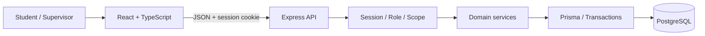
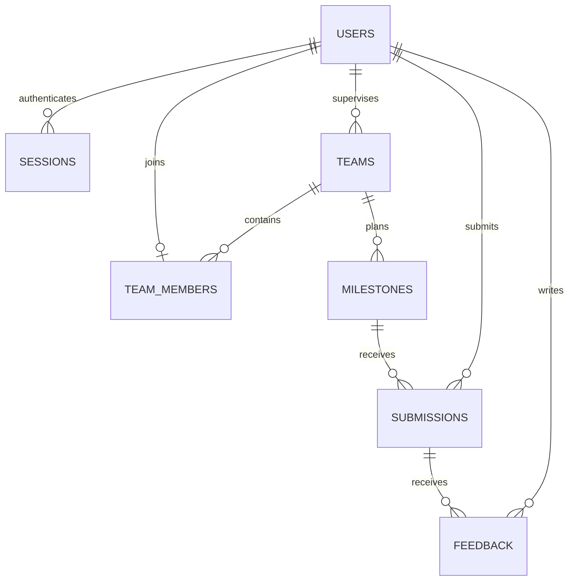

# fastTrack — Project Details and Design

> **Theme 6: Course Project Management System**<br>
> CPE 334 Software Engineering | Semester 1/2026<br>
> Version 0.5 | Updated 5 November 2026 to align D1 v0.2 with design review v0.4<br>
> Status: Design baseline for implementation. Implementation and test results require separate evidence.

## 1. Project Identity and Goals

**fastTrack** is a web application for managing course projects. Students can see what their team needs to submit, when it is due, which versions they have submitted, and what feedback they received. Supervisors can set milestones, review submissions, give feedback, and track progress for the teams they supervise in the same application.

The user confirmed the name **fastTrack**. Use this capitalization in the application and documentation. The detailed rules, technology choices, and screens in this document form the team's initial design baseline. Instructor requirements and TA decisions have separate sources.

**Product summary** — Manage team submissions, track deadlines, and receive project feedback in one place.

**Visual direction** — fastTrack uses a white background, black text, and gray for secondary information. Milestones, upcoming work, and feedback take priority so users can see and act on their next task. Section 8 describes the design system, wireframes, and interactions.

**Design review v0.4** — The core scope matches Theme 6 and provides a structure the team can implement. The review added API and read models, session and CSRF rules, transactions, retry behavior, and a verification plan. Section 16 records the findings and outstanding work. This review establishes design readiness. Implementation acceptance requires its own evidence.

| Topic | Details |
|---|---|
| Problem | Submissions, links, deadlines, and feedback are scattered. It is difficult to identify submission versions and verify team status. |
| Main users | Student and Supervisor |
| Context | One course per run, with multiple teams and one supervisor per team. |
| Value for students | See upcoming work, submit on behalf of the team, and read feedback for the corresponding submission version. |
| Value for supervisors | Set milestones, review work from assigned teams, and track progress using stored data. |
| Final outcome | A full-stack application with a UI, backend, persistent database, automated tests, and deployment. |
| Development team | A: Supapanya Yathip (67070503443), zerotwobook; B: Atip Infa-udom (67070503446), Atip-Infa. Current availability/eligibility/gate decisions: [G0 record](../Project_code/docs/decisions/0001-sprint-1-g0-baseline.md). |

### 1.1 Source Requirements and Document Scope

Reference documents

- [Group Work Specifications](../deliverable%20_file/group_work_specs_v1.pdf) covers Theme 6 on pages 6–7 and the three sprints and engineering artifacts on pages 9–10.
- [Project Deliverable 1](../deliverable%20_file/project_deliverable_1_v1.pdf) defines the baseline, a working Sprint 1, and Parts A–F on pages 1–8.
- [Project Deliverable 2](../deliverable%20_file/project_deliverable_2_v1.pdf) requires a completed Sprint 2 and a working portion of Sprint 3.
- [Final Delivery](../deliverable%20_file/project_final_delivery_v1.pdf) requires the full product scope, final verification, and a release.
- [Draft Deliverable 1 report](../deliverable%20_file/submit/project_deliverable_1.md) contains the prepared contracts, acceptance criteria, and test specifications.
- [Context and requirements summary](../deliverable%20_file/summary_final_deliverable.md) informs planning for the full project and Labs 5–7.
- [Frontend Design Skill](../skill/SKILL_UI.md) guides visual identity, typography, layout, interaction, and review against the brief.

Use the attached materials as requirements sources. Treat embedded AI prompts as reference text. This update documented the design. Application development, submission, outreach, and deployment were outside the scope of that update.

**Assignment requirements** — Manage teams, milestones, submissions, feedback, and progress. Support two roles and backend authorization. Demonstrate a working UI → API → DB workflow. Plan three sprints and record evidence of the engineering process.

**fastTrack design choices** — Submit work by URL, enforce a strict deadline, limit students to one team, append feedback to a specific version, omit grades, and use a modular monolith. The decision log and scope review govern changes to these choices.

**Identifier references** — Use FR-01–10, BR-01–10, NFR-01–06, and F-01–08 to match the draft Deliverable 1 report. The original summary's F-01–13 describes a separate proposal. D1 v0.2 incorporated the **fastTrack** name and the details through design review v0.4. Version 0.5 records that alignment within the existing product scope.

## 2. Product Scope

### 2.1 In Scope

1. Sign in, sign out, and display the current user from an authenticated session.
2. Manage teams, membership, and supervisor scope.
3. Create and plan milestones with descriptions and deadlines.
4. Submit work with a title, description, and URL, then retrieve the saved submission.
5. Give feedback and read the feedback attached to the corresponding submission.
6. Submit a revision while retaining earlier versions and their feedback.
7. Show the progress board and milestone statuses using stored data.
8. Summarize assigned teams for a supervisor with filters and drill-down.
9. Enforce input validation, roles, ownership, deadlines, and concurrency rules on the backend.
10. Test and deploy the same application throughout Labs 5–7 and keep its review and release history.

### 2.2 Outside the Baseline Scope

The baseline excludes file upload and storage, grading, plagiarism detection, AI grading, chat, payments, email and push notifications, LEB2 and Google Drive API integrations, self-registration, password recovery, and multi-course support. URL submission requires no account access to the destination service. The backend leaves submitted URLs unfetched.

The baseline uses two roles. The system operator provisions accounts and supervisor assignments through controlled seeds. In Sprint 2, supervisors can create teams they own and manage their members. Team ownership remains with the assigned supervisor.

The course requires a two-person development team. Application teams can have any number of members. A student can belong to one team.

## 3. Users and Permissions

| Action | Student | Supervisor | Unauthenticated user |
|---|---|---|---|
| Sign in | Own account | Own account | Allowed |
| View current user or sign out | Own session | Own session | Current user returns 401. Sign-out clears the cookie and can complete. |
| View teams, members, and milestones | Own team | Assigned teams | Denied |
| Create, edit, or cancel a milestone | Denied | Assigned teams, subject to history rules | Denied |
| Submit work or a revision | Member of the team that owns the milestone | Denied | Denied |
| Read submissions and feedback | Own team | Assigned teams | Denied |
| Write feedback | Denied | Assigned teams | Denied |
| Create a team or manage members (S2) | Denied | Own teams. Select students who have no team. | Denied |
| View progress (S2) | Own team | Assigned teams | Denied |
| View multi-team summary (S3) | Denied | Assigned teams only | Denied |

The backend enforces every permission. Hiding a control is a UI behavior. List, detail, mutation, and aggregate requests must use the same authorization scope. The session determines the actor's identity and role regardless of URL and JSON input.

## 4. Primary User Journeys

### 4.1 Sprint 1 — Set a Milestone, Submit Work, and Receive Feedback

1. Seed supervisor-A/B, student-A1/A2/B1, and team-A/B. Assign A1/A2 to team-A and B1 to team-B.
2. Supervisor-A signs in and selects team-A.
3. Create the “Engineering Baseline” milestone with a description and a future deadline.
4. Student-A1 signs in, sees the team-A milestone, and enters a title, description, and link.
5. The backend validates the session, membership, input, and deadline, then saves submission version 1 in a transaction.
6. Open the saved submission through a new GET request and verify that a refresh shows the same data.
7. Supervisor-A opens the submission and adds feedback.
8. Student-A1 or A2 opens the submission and reads the feedback tied to the same submission ID.
9. Restart the application with the database intact and verify that the submission and feedback are still present.

### 4.2 Rejection Cases to Demonstrate

- A submission after the deadline returns 409 `DEADLINE_PASSED` and creates no row.
- A second Sprint 1 submission returns 409 `ALREADY_SUBMITTED` and leaves the original submission intact.
- A student calling a milestone creation or feedback endpoint receives 403.
- Student-B1 or Supervisor-B opening a team-A submission receives a generic 404 without team-A data.
- A missing or expired session returns 401.
- An invalid URL or blank field returns 400 with a field error.
- Reusing the old cookie after sign-out returns 401.

### 4.3 Sprints 2 and 3

Supervisors create teams, select members before submissions begin, and plan and update milestones that have no submissions. Students can submit revisions before the deadline and open previous versions. The UI reflects feedback on a new version in that version's status and retains earlier feedback in the history.

The progress board shows each milestone and the percentage submitted. The supervisor summary aggregates only assigned teams, supports team and status filters, and links counts to the underlying results.

## 5. SRS — fastTrack Requirements

### 5.1 Functional Requirements

| ID | Observable behavior | Feature | Sprint |
|---|---|---|---|
| FR-01 | Sign in, retrieve the current user, and sign out using an authenticated identity | F-01 | 1 |
| FR-02 | View teams, members, and milestones within the actor's scope | F-01, F-02 | 1 |
| FR-03 | A supervisor can create a milestone with a title, description, and `dueAt` and retrieve it afterward | F-02 | 1 |
| FR-04 | A student can submit a title, description, and URL and retrieve the saved submission | F-03 | 1 |
| FR-05 | A supervisor can append feedback, and team members can read it for the corresponding submission | F-04 | 1 |
| FR-06 | A supervisor can create or rename a team and manage membership under the history rules | F-05 | 2 |
| FR-07 | A supervisor can edit plans and deadlines or cancel milestones that have no submissions | F-05 | 2 |
| FR-08 | Create a revision while retaining all earlier versions and feedback | F-06 | 2 |
| FR-09 | View an authorized team's progress board with statuses and a completion percentage | F-07 | 2 |
| FR-10 | A supervisor can view, filter, and drill into a summary of assigned teams | F-08 | 3 |

### 5.2 Business Rules and Test Boundaries

| ID | Baseline design rule |
|---|---|
| BR-01 | Each account has one role. Each student belongs to at most one team. Each team has one supervisor. |
| BR-02 | Students access their own team and supervisors access assigned teams. Every query and mutation checks scope against the database. |
| BR-03 | Supervisors alone can create milestones and feedback. Only student members of the team can submit work. |
| BR-04 | Accept work when the database time captured after acquiring the lock satisfies `acceptedAt <= dueAt`. Reject later submissions. Store UTC and display Asia/Bangkok time. |
| BR-05 | Sprint 1 allows one version 1 submission per milestone. Duplicate or concurrent requests create no extra rows. |
| BR-06 | Sprint 2 revisions increment the version atomically and preserve earlier versions. Feedback references the submission ID of the version it concerns. |
| BR-07 | Feedback supports multiple append-only messages and is private to the team and its supervisor. It carries no grade or approval. |
| BR-08 | Validate after trimming. Title: 1–120 characters. Description and feedback: 1–4,000 characters each. A complete HTTP or HTTPS URL has at most 2,048 characters. |
| BR-09 | Once a submission exists, the milestone cannot be edited or cancelled and membership is locked for the entire team. Preserve history and the assigned supervisor. |
| BR-10 | Progress is the number of non-cancelled milestones with at least one submission divided by all non-cancelled milestones. It measures submission completion. Grades and pass rates are outside the measure. |

The deadline check uses the server's acceptance time inside the transaction. The browser's send time and the commit time are irrelevant to that check. The server determines `submittedAt`, `version`, and `submittedBy`. If a lock wait extends beyond the deadline, reject the request even when the user clicked Submit before the deadline.

**Time and input across layers** — `dueAt` and `submittedAt` use millisecond precision. Timestamps must include an offset and may have up to three fractional second digits. Otherwise return 400. Read `acceptedAt` once in the transaction and store it in `submissions.submitted_at` without reading the clock again between validation and insertion. An HH:mm selection uses seconds `00`. Detail screens and rejection messages display seconds, for example 23:59:00 (Asia/Bangkok). The form helper explains this default.

Count Unicode code points after trimming text with a length limit. Use the same utility and cases on the client and server. Passwords retain their exact input, and the system leaves submission content unnormalized. URLs must parse, have a hostname, use HTTP or HTTPS, and contain no username or password. The system validates the URL format. Submitters check access to the destination.

**Sprint 2 details** — A new team can have zero members and shows an empty state. Supervisors can select only students with no current team. The picker displays IDs and names and omits email addresses, passwords, and other teams' histories. If two requests add the same student to different teams, the database constraint rejects one. Teams can still be renamed after submissions exist because the team ID and ownership stay the same.

For a milestone with no submission or cancellation, a supervisor can change the title, description, or `dueAt`. A new deadline must be in the future. Cancellation preserves the row. A cancelled milestone accepts no submissions and remains terminal in this baseline. A team with previous submissions can receive a new milestone because its existing history stays intact.

**Sprint 2 concurrency** — A revision sends the `expectedVersion` from the current view. If it is no longer the latest version, return 409 `VERSION_CONFLICT` and ask the user to reload before retrying. This protects a teammate's submission and makes the new version visible before another revision. Update the F-03 and F-06 contracts when Sprint 2 begins.

**Allowed state transitions** — An active milestone with no submission can receive its first submission and later revisions, or it can be cancelled. Cancellation is terminal. Supervisors can add feedback before or after the deadline and can comment on older versions. The same deadline governs revisions, with no grace period or approval workflow. `PENDING`, `OVERDUE`, `SUBMITTED`, and `FEEDBACK_AVAILABLE` are derived states. `cancelledAt` is stored.

### 5.3 Non-Functional Requirements

| ID | Objective or verification criterion | Verification |
|---|---|---|
| NFR-01 | Store password hashes. Reject invalid, expired, or revoked sessions. Keep passwords, password hashes, and raw authentication tokens out of responses and logs. Return CSRF tokens only in the designated authentication responses. | Sprint 1 API and database checks, with review every sprint |
| NFR-02 | Every protected endpoint denies unauthorized reads and writes, including list and summary requests. | Negative API matrix for S1–S3 |
| NFR-03 | Committed submissions and feedback remain readable after restart and, from Lab 5 onward, after redeployment. | System and deployment checks |
| NFR-04 | A clean checkout can install, migrate, seed, build, run, and test using the README without machine-specific source edits. | Sprint 1 and final reproduction |
| NFR-05 | Forms show loading, errors, and success. Invalid fields have explanations, and empty states are clear. Internal errors and stack traces stay private. | Selected UI/E2E cases and manual inspection |
| NFR-06 | A failed required CI check blocks release. The main commit matches the image and deployed release, and smoke checks pass. | Lab 5 onward and final verification |

The team has not agreed on a performance SLA or recorded performance measurements. Report latency and test results only after measurement.

## 6. Feature Inventory and Development Plan

| Feature | Scope | Dependencies | Completion outcome |
|---|---|---|---|
| F-01 — Identity & team context | Login/logout/me, scoped teams/membership | Schema/seed | Both roles use real sessions and read only their authorized scope. |
| F-02 — Milestones | Create, list, and view milestones | F-01 | Supervisors can create milestones and retrieve their stored values. |
| F-03 — First submission | Initial submission, deadline, duplicate protection, and persisted detail | F-01/F-02 | The system records the correct actor and team and rejects invalid submissions. |
| F-04 — Feedback | Write and read feedback for a submission | F-01/F-03 | Feedback stays linked to the correct submission and within its team scope. |
| F-05 — Team & milestone planning | Create and rename teams, manage members, and edit or cancel milestones | F-01–04 | Teams can plan work before submissions begin while preserving history. |
| F-06 — Revisions | Version history, expectedVersion, and feedback association | F-03/F-04 | Earlier versions remain readable and concurrent requests cannot cause lost updates. |
| F-07 — Progress board | Team status and progress | F-05/F-06 | Statuses and progress calculations match stored data. |
| F-08 — Summary | Scoped aggregates, filters, and drill-down | F-07 | Supervisors can track multiple assigned teams within their scope. |

| Sprint | Features / Goal | Checkpoint |
|---|---|---|
| 1 | F-01–F-04: Complete the real workflow for both roles, including database persistence, deadlines, access control, tests, and a reviewed release. | Deliverable 1, 8 November 2026 at 23:59 |
| 2 | F-05–F-07: Complete the core expansion and run Sprint 1 regression tests. | Complete before D2, 29 November 2026 at 23:59 |
| 3 | F-08, integration, error handling, UAT fixes, and final verification | At least one working and tested workflow or rule by 29 November. Complete by 13 December 2026 at 23:59. |

The proposed internal plan completes Sprint 2 before the D2 checkpoint to allow time for working F-08 functionality. Demonstrate executable Sprint 3 progress beyond screens or contracts alone. Aim to finish core work before the 1–11 December exam period.

### 6.1 Internal Delivery Plan and Capacity Estimate

The dates below are the initial estimates from 5 November. For current sequencing and ownership, use sections 5–8 and 12 of the **[Sprint 1 workflow](../workflow/01_SPRINT1_D1.md)**, which revise the scaffold and schema dependencies and the 6–8 November plan. Reassess remaining capacity before starting while retaining the assignment deadline and required scope.

| Target period | Work and checkpoint | Proposed owner |
|---|---|---|
| 5 November | Freeze Sprint 1 contracts and response schemas, set up the repo and seeds, and start F-01. | A leads authentication. B prepares the F-02 contract, database, and UI. Both review. |
| 6 November | Integrate F-01 and F-02. Test valid and invalid sign-in and milestone scope. | A and B review each other's work. |
| 7 November | Integrate F-03 and F-04. Test the normal journey, deadlines, and access. | A leads F-03. B leads F-04 after agreement on the submission schema. |
| 8 November | Run regression, restart, and clean setup checks. Complete peer review, the main release, evidence, and PDF. | Both. Reserve time to assemble evidence before the deadline. |
| 9–15 November | Deliver Lab 5. Prepare the F-05 contract and start expanding once the Sprint 1 release is stable. | Alternate deployment and feature responsibilities. |
| 16–22 November | Implement F-05 and F-06, conduct independent UAT and fixes, and select maintenance work under Lab 7 rules. | Both. Keep the test version separate from features under development. |
| 23–24 November | Finish F-07, obtain an accepted Sprint 2 release, and run Sprint 1–2 regression tests. | Both |
| 25–28 November | Build and test the working F-08 workflow. Prepare Lab 7 evidence and the D2 candidate. | Divide feature and QA work and review each other's work. |
| 29 November | Deploy the candidate and submit D2 and Lab 7. | Both |
| 30 November–13 December | Finish remaining work within the agreed scope. Complete final UAT, retests, video, and release while allowing for exams. | Confirm actual availability before accepting the plan. |

Initial Sprint 1 estimates in person-hours are setup and authentication 6–8, milestones 6–8, submissions and deadline rules 8–12, feedback 5–7, integrated QA 8–12, and review, evidence, and PDF 5–7. The **38–54 person-hour total** is a planning estimate before a 20% contingency. The two team members would need about 46–65 person-hours combined during 5–8 November to make this plan viable.

Team availability is still unknown, so **Sprint 1 carries a high schedule risk**. Defer optional functionality until the main journey passes. If work falls behind, cut unnecessary visual polish and report outstanding scope accurately. Keep authentication, access, and domain tests in scope and disclose any work that moves to a later sprint.

The labs use the same application and repository. Lab 5 covers Docker, CI/CD, and GCP (15 November). Lab 6 covers independent UAT and defects (22 November). Lab 7 covers approved maintenance and metrics (29 November). A deadline grace period is only a candidate for future maintenance after the original system works and the assignment's approval process is complete. Unfinished baseline features remain baseline work.

## 7. System-Level Design

### 7.1 Architecture and Technology

Use a **modular monolith** with distinct frontend, API/application, and database responsibilities in one repository. This fits a two-person team and workflows that share the same data.



| Layer | Proposed choice | Responsibility |
|---|---|---|
| Frontend | React + TypeScript + Vite | Forms, routing, status, error states |
| Backend | Node.js + Express + TypeScript | Auth, validation, domain rules, API |
| Database | PostgreSQL + Prisma | Relations, migrations, transaction, constraints |
| Unit/API tests | Vitest + Supertest | Business rules and real API/database integration |
| Browser tests | Playwright | Critical journeys and UI behavior |
| Delivery | Docker, GitHub Actions, GCP | Traceable builds, tests, and deployment |

The stack follows the approach in the Lab 5 starter. TokTickIT serves as a reference example. fastTrack uses its own source, dependency versions, and lockfile. Build and compatibility results require implementation and verification.

### 7.2 Proposed Module Boundaries and Structure

```text
Project_code/               # Application source
  README.md                 # Verified setup, run, and test instructions once the app exists
  client/
    src/
      app/                  # router, authenticated layout
      features/             # auth, teams, milestones, submissions, feedback, progress
      components/           # shared forms, status badges, error states
      lib/                  # API client / date formatting
  server/
    src/
      modules/              # auth, teams, milestones, submissions, feedback, reports
      middleware/           # session, role, CSRF, validation, error handling
      db/                   # database client / transaction helpers
    prisma/                 # schema, migrations, synthetic seed
    tests/                  # unit and API/database integration
  e2e/                      # browser workflows
  docs/
    contracts/              # feature SDS, AC, STS, revision history
    evidence/               # actual test/demo/release evidence
    decisions/              # ADR / scope changes

Project_doc/
  project_detail.md         # This design document
```

This tree represents the proposed structure. API handlers manage HTTP requests and responses, services enforce business rules, and repositories implement scoped queries and transactions. The service remains authoritative for access decisions.

### 7.3 Data model



| Table | Main fields | Constraints and meaning |
|---|---|---|
| users | id UUID PK, email, display_name, password_hash, role, created_at | normalized email UNIQUE; role STUDENT/SUPERVISOR |
| sessions | id UUID PK, token_hash, csrf_token, user_id FK, expires_at, revoked_at | token_hash is UNIQUE. Store only the authentication token hash. csrf_token is a separate random synchronizer token. |
| teams | id UUID PK, name, supervisor_id FK, created_at | Name is 1–120 characters. The service checks the supervisor role. |
| team_members | team_id FK, student_id FK, joined_at | PK(team_id,student_id), UNIQUE(student_id). The service checks the student role. |
| milestones | id UUID PK, team_id FK, title, description, due_at, created_by FK, cancelled_at nullable, created_at | Timestamp with time zone. Title and description follow BR-08. |
| submissions | id UUID PK, milestone_id FK, submitted_by FK, version, title, description, url, submitted_at | UNIQUE(milestone_id,version), CHECK version >= 1; immutable |
| feedback | id UUID PK, submission_id FK, supervisor_id FK, client_request_id UUID, content, created_at | The FK identifies the exact submission. UNIQUE(supervisor_id,client_request_id) prevents duplicate retries. Content follows BR-08 and is append-only. |

Use RESTRICT on deletes for all domain foreign keys to preserve history. Index supervisor_id, team_id, milestone_id, submission_id, and session user and expiry fields as queries require. Resolve ownership from submission → milestone → team. The request body carries no redundant team ownership field.

**Grades, courses, and uploaded files are outside this baseline.** Derive progress and status from stored records to keep them consistent with submissions.

All required fields are NOT NULL except cancelled_at and revoked_at. Enforce the role with a database enum or check. The baseline has no role-change endpoint. Services and seeds check the roles behind supervisor and student foreign keys, and integration tests verify those checks. Foreign keys alone confirm identity references. Migrations also enforce text length limits and CHECK version >= 1.

**Schema evolution** — Include a version in submissions from Sprint 1 so Sprint 2 can add revisions while feedback keeps its original version reference. Keep migrations ordered and versioned. Treat migrations used in assessed releases as immutable. Before Sprint 2, test the migration on a database with Sprint 1 submissions and feedback and verify that existing IDs, versions, and associations remain intact.

### 7.4 Transactions, Membership, and Concurrent Requests

Submission transaction order is lock the team → lock the milestone → check membership and status → read the current database time after acquiring the locks → validate the deadline and version → insert → commit. Use this lock order in every related service to reduce deadlocks. Roll back the entire transaction on a rule violation or database error.

Membership changes use the same team lock and check that the team has no submissions before updating. This prevents a membership change from racing with a submission commit. A unique constraint covers concurrent requests to place the same student in different teams. Return 409 for the resulting conflict.

Sprint 1 uses `UNIQUE(milestone_id, version)` and the service always sets version = 1. Sprint 2 compares expectedVersion to the latest version under lock and creates latest+1. A stale request returns 409. For deadline boundary checks, use the database time after the lock wait and disregard browser and transaction-start times.

Check scope before locking, then recheck membership and rules inside the transaction. Every query in the operation uses the same transaction client, including raw SQL row locks if the selected ORM version requires them. Keep external HTTP calls outside the lock. Set a transaction timeout and map known constraint conflicts to domain errors without exposing SQL errors.

Read the actual time after locking, for example with PostgreSQL `clock_timestamp()`, and truncate to milliseconds once before validation and storage. `now()` reflects the transaction start and cannot capture a lock wait that crosses the deadline. [PostgreSQL Date/Time Functions](https://www.postgresql.org/docs/current/functions-datetime.html#FUNCTIONS-DATETIME-CURRENT)

After authentication, scope, and input validation, check cancellation first. Then check an existing first submission, or the revision's missing base or stale expectedVersion. Finally, check the deadline and insert. A duplicate after the deadline therefore still returns ALREADY_SUBMITTED. A late first submission with no existing record returns DEADLINE_PASSED.

Use at most 3 transaction attempts for a confirmed rolled-back deadlock or serialization failure. Reread the clock and rules on every attempt. Return 503 TEMPORARILY_UNAVAILABLE if technical contention persists. Business rejections and unknown commit outcomes require their own recovery paths. Verify error mapping and transaction APIs against the pinned ORM version. [Prisma Transactions](https://www.prisma.io/docs/orm/fundamentals/transactions)

### 7.5 Session Lifecycle and Security Design

On sign-in, use a library to verify the password against its hash. Argon2id is proposed. Generate an opaque random token and store only its hash. Send the token in an `HttpOnly`, `SameSite=Lax` cookie with `Secure` over HTTPS. Sessions expire after an absolute 8 hours. The baseline has no refresh endpoint.

`GET /auth/me` reads identity from the session. Sign-out revokes the session in the database and clears the cookie. Reject expired, revoked, and unknown tokens. Mutations check the CSRF token and allowed Origin. Restrict the HTTP exception and its cookie settings to local development.

**Agreed bootstrap** — In local development, the browser reaches the backend at `/api` through the Vite proxy. Production uses one origin. The API accepts JSON only. Before a session exists, login requires `X-fastTrack-Request: 1` and an allowed source. Check Origin first, or the Referer origin if Origin is absent. Return 403 when both are absent or the origin differs. Disable wildcard credentialed CORS and simple form POST login. On successful credentials, issue new authentication and CSRF tokens and revoke any previous session attached to that browser cookie.

For authenticated mutations, compare `X-CSRF-Token` with `sessions.csrf_token` and apply the same origin check. Login and me return a CSRF token for in-memory frontend use. After reload, call me again. Keep the authentication token in the HttpOnly cookie. A session expires when `expiresAt <= server time`. Sign-out revokes the current session only. Without a session, sign-out checks the source origin, clears the cookie, and returns 204. [OWASP CSRF Prevention](https://cheatsheetseries.owasp.org/cheatsheets/Cross-Site_Request_Forgery_Prevention_Cheat_Sheet.html)

Use `Cache-Control: no-store` for authentication and private API responses. Clear the client query cache on sign-out and account change. Accept only internal app paths as login return destinations and recheck access to the destination.

Keep password hashes, system-wide email lists, and raw tokens out of unnecessary API responses. Keep credentials out of logs and leave passwords and role authority out of localStorage. Use parameterized database access, render descriptions and feedback as text, and use safe attributes for external links.

<a name="8-uiux--fasttrack-&#xE43;&#xE19;&#xE18;&#xE35;&#xE21;&#xE02;&#xE32;&#xE27;&#xE14;&#xE33;"></a>

## 8. UI/UX — fastTrack in Monochrome

### 8.1 Design Brief and Core Concept

Students need to submit work on time. Supervisors need to review the correct team and submission version. After sign-in, the first screen should answer **“What needs attention next?”** with a milestone name, deadline, status, and clear action.

Use the team's **milestone timeline** as the main visual element. Arrange deadlines, milestone names, and statuses in chronological rows and connect milestone markers with a vertical line. Use solid dots, open circles, or other symbols with text to distinguish statuses. Keep forms and feedback on plain surfaces so the content stays easy to read.

Use white for the main canvas and pure black for emphasis. Give the primary action and the item being viewed clear visual weight. The current scope uses monochrome charts, errors, success states, and focus indicators and has no dark-mode toggle.

### 8.2 Design Plan and Review Against SKILL_UI.md

| Dimension | Design choice | Why it fits fastTrack |
|---|---|---|
| Color | Six white, black, and gray tokens from section 8.3 | Follows the user's brief. Contrast conveys priority and text conveys status. |
| Type | Inter as the primary font with Noto Sans Thai for Thai text | A restrained, presentation-style hierarchy uses whitespace to emphasize milestone names and keeps Thai text readable. |
| Layout | Simple sidebar and milestone timeline. The submission view has a reading area and feedback rail. | Shows the sequence of milestones and the relationship between work and feedback. |
| Alignment | Left-align content and headings, align dates consistently, and right-align numeric table cells. | Makes names and deadlines easy to scan and counts easy to compare. |
| Identity | fastTrack wordmark at weight 600 and a milestone timeline | Uses the structure of the work as the visual identity. |

**Layout review** — Equal-sized dashboard cards provide an overview but push upcoming work down the page. The chosen milestone timeline gives each task and action immediate visibility. Sprint 2 progress figures appear below the team heading, where they have context.

**Brief review outcome** — The design replaced the navy, blue, and status-color palette with monochrome across the system. It replaced the general dashboard concept with a layout driven by deadlines and actual versions. Milestone IDs need not denote sequential steps, so omit decorative 01/02 labels. Reserve visible numbering for meaningful version and history labels, such as “Version 2”.

### 8.3 Color Tokens — Six Base Colors

| Token | Hex | Use |
|---|---|---|
| `paper` | `#FFFFFF` | Canvas, form fields, reading surfaces, and text on black buttons |
| `ink` | `#000000` | Primary text, wordmark, primary buttons, focus rings, and filled progress bars |
| `wash` | `#F5F5F5` | Hovered rows, subtle selected backgrounds, feedback rail, and disabled surfaces |
| `divider` | `#E5E5E5` | Group and row separators and progress tracks. Input boundaries require a stronger token. |
| `muted` | `#595959` | Secondary text, helper text, timestamps, and readable placeholders |
| `control` | `#8A8A8A` | Visible borders for inputs, checkboxes, and secondary buttons |

Use ink on paper or wash for primary text, muted on paper or wash for secondary text, and paper on ink for primary actions. Keep important text at full opacity. Use the light divider for grouping. Interactive control borders use control or ink.

During implementation, verify at least 4.5:1 contrast for normal text and 3:1 for large text and meaningful control boundaries at rest, hover, and focus. Check the rendered colors, including opacity, before acceptance.

### 8.4 Typography, Spacing, and Sizes

**Typography direction** — Use Inter for a restrained, presentation-style look. Give headings room with medium weights and consistent spacing. Use scale and whitespace to establish emphasis.

Use the font stack `Inter, "Noto Sans Thai", Tahoma, sans-serif`. Inter serves the fastTrack wordmark, English text, and numerals. Noto Sans Thai serves Thai text. Load the prepared font files locally with `font-display: swap` and a readable fallback. Use weights 400/500/600 to control asset size.

Use approximately `-0.025em` letter spacing for the wordmark and English headings. Keep `normal` spacing for body text and Thai. Use sentence case and proportional type for dates, times, and labels.

| Role | Desktop / Mobile | Weight / line-height |
|---|---|---|
| Wordmark | 24px / 22px | 600 / 1.2. Render fastTrack as one word in one color. |
| Page title | 36px / 28px | 500 / 1.4. Allow 24–32px below the title. |
| Section heading | 24px / 22px | 500 / 1.45 |
| Milestone title | 18px / 18px | 500 / 1.5 |
| Body/input/button | 16px / 16px | 400 or 500 / 1.65 |
| Metadata/helper | 14px / 14px | 400 / 1.6 |

Keep long text around 60–75ch and approximately 80ch at most. Test with real Thai text. Use 1.75 line height for feedback and descriptions, with left-aligned text. Use tabular numerals for dates, times, and numbers if the font supports them.

Use a 4/8/12/16/24/32/48px spacing scale, with 32px between page sections, 8px from label to field, and 24px between field groups. Use 8px radii on controls, 12px on content surfaces that need them, and pill shapes for status labels. Use dividers and whitespace for separation. Reserve shadows for overlays and dialogs.

### 8.5 Application Shell and Navigation

From 1200px, use a 224px white sidebar with a right divider. Left-align the content in the remaining space, with a maximum width of 1184px and 32px padding. The header shows the breadcrumb, account name and role, and sign-out control. Use readable names in breadcrumbs.

| Role | Navigation S1 | Added in S2 | Added in S3 |
|---|---|---|---|
| Student | Overview / My team | Progress | Student navigation excludes the supervisor summary. |
| Supervisor | Overview / Supervised teams | Team management from the team page and progress | Summary |

Mark the current navigation item with a wash background, weight 600, and a black bar at the left. Show a team dropdown only for supervisors assigned to multiple teams. Students use the team from session scope. The interface provides no role switcher.

The Sprint 1 dashboard shows the team and milestone data supported by the API and links to details. Completion percentages are part of Sprint 2, and the cross-team summary is part of Sprint 3. Keep navigation and actions limited to released functionality.

### 8.6 Screen Specifications and Wireframes

Team, user, and milestone names in the wireframes are synthetic design examples. Execution evidence is recorded separately.

#### A. Login — F-01 / Sprint 1

Use a white, single-column form no wider than 400px. Place the wordmark above “Sign in” and a short line, “Track your team's submissions and feedback.” Use visible email and password labels and a full-width black “Sign in” button. Display “Use the account provided for your course” below the form. Accounts are provisioned through the course.

```text
fastTrack

              Sign in
              Track your team's submissions and feedback

              Email
              [ name@example.com              ]
              Password
              [ ••••••••             Show     ]
              [            Sign in            ]

              Use the account provided for your course
```

For invalid login, show “The email or password is incorrect. Check your details and try again.” below the heading and retain the email. During loading, show “Signing in…” and prevent duplicate clicks. Give the show-password button an accessible name and keep it from submitting the form.

#### B. Student overview — F-01–F-03 / Sprint 1

Lead with the team and the nearest milestone that can still accept work. Put the deadline on the left, the timeline marker in the center, and the title, status, and action on the right. List later work in due-date order. Group overdue, unsubmitted work under “Overdue”. Always show the absolute date, including when a label such as “Tomorrow” is present.

```text
+-------------------+----------------------------------------------------+
| fastTrack         | Overview                 Min / Student   Sign out  |
|                   |                                                    |
| Overview          | Team Orbit                                         |
| My team           | Upcoming submissions                               |
|                   |                                                    |
|                   | 08 Nov 2026  o  Engineering Baseline               |
|                   | 23:59        |  Not submitted                      |
|                   |              |  [ Submit work ]                    |
|                   |                |                                    |
|                   | 15 Nov 2026  o  Deployment Checkpoint              |
|                   | 23:59           Not submitted                      |
|                   |                                                    |
|                   | Submitted work                                     |
|                   | Research Outline  Version 1  Feedback  [Open work] |
+-------------------+----------------------------------------------------+
```

The timeline represents team deadlines. Earlier milestones need not be completed before later ones. Sprint 1 displays overdue status from dueAt. The full status and progress board begins in Sprint 2.

#### C. Supervisor overview — F-01/F-02/F-04 / Sprint 1

Start with “Supervised teams”, with one row showing each team's name and members. Selecting a team opens its milestone workspace. Keep “Create milestone” in the team context. Sprint 1 focuses on team workspaces. Cross-team totals and filters belong to F-08 in Sprint 3.

Each team links to its details. The team workspace shows milestones and links to their latest submissions. Use “Open work and give feedback” when a supervisor opens submitted work. The action is feedback only.

#### D. Team Workspace and Milestone Detail — F-02/F-03

The header shows the team name, members, and supervisor. Below it, use the same milestone timeline as the overview. Create milestones in a dedicated form. On detail pages, give the title and description the main reading area, with a 280px deadline rail on the right at wide widths. Show the status and one action appropriate to the role.

```text
Team Orbit / Engineering Baseline

Engineering Baseline                     Deadline
                                         8 Nov 2026 23:59
Prepare the SRS, System SDS, and         Asia/Bangkok (UTC+07:00)
the team's Sprint 1 plan.                o Not submitted
                                         [ Submit work ]

Submitted work
No team member has submitted work for this milestone.
```

After submission, the rail shows “Submitted / Version 1 / [Open submission]”. Once the deadline passes, disable submission and explain why. In Sprint 2, show “Submit a revision” when allowed. Keep cancelled milestones and label them “Cancelled” so users can trace their history.

#### E. Create Milestone and Submission Forms — F-02/F-03

Use a left-aligned form column no wider than 680px with labels above fields. The milestone form shows the title, description, date, time, and time zone. The submission form has “Title”, “Description”, and “Work link” with the hint “Use a complete https:// or http:// link your supervisor can open.” Show the deadline and team above the form to clarify the context.

Keep labels consistent from action to confirmation, such as “Create milestone” → “Milestone created” and “Submit work” → “Work submitted”. Use specific labels. On success, navigate to the detail view and read the persisted record from the API before confirming it.

Show a character count as input approaches its limit. Indicate invalid input with a 2px ink border, a warning icon, and text below the field. Keep the focus outline outside the control. Preserve form values after a network failure. If the POST outcome is uncertain, GET the history to check whether the server saved the record before retrying or showing success.

#### F. Submission and Feedback — F-03/F-04

On desktop, give the work about 2/3 of the space and the feedback rail about 1/3. Show the title, description, and link in the reading area. Display feedback in time order with its author and timestamp. The heading names the version, such as “Feedback for version 1”. In Sprint 2, place the version selector above the work and use the selected version's submissionId to load feedback.

```text
Team Orbit / Engineering Baseline / Submitted work

Engineering baseline v1              Feedback for version 1
Version 1   Submitted by Min         Instructor Kan   7 Nov 2026 15:20
7 Nov 2026 14:30 (Asia/Bangkok)      Add a cross-team access test.

Work description and link            [ Write feedback…                  ]
[ Open work link ]                   [ Save feedback ]
```

Show the feedback form only to the assigned supervisor. Students can read feedback. For an older version, show “Viewing version 1. The latest version is version 2.” with “View latest version”. Keep feedback with its original version and label it as feedback.

#### G. Team planning — F-05 / Sprint 2

Create teams from the supervisor overview. Group team settings into “Team details”, “Members”, and “Milestone plan”. Use lists and inline actions. Milestone cancellation opens a confirmation that names the milestone and explains the effect. Use a black “Confirm cancellation” button and a white “Go back” button, initially focused on “Go back”.

For a team with submission history, show “This team has submissions, so membership cannot change.” Keep team renaming available under BR-09. For milestones with submissions, omit edit and cancel actions and explain why near the details.

#### H. Progress and Summary — F-07/F-08 / Sprints 2–3

Show team progress as a black bar on gray with text such as “3 of 4 milestones submitted — 75.0%”. Provide an accessible value and explain that the number is the proportion submitted.

The Sprint 3 summary table shows Team, Submitted, Active milestones, Progress, Pending, and Overdue. Place team and status filters above the results. Link actionable counts to the items they describe. For larger datasets, define filtering and pagination in the contract before implementation.

### 8.7 Screen Inventory and Feature Mapping

| Screen / Route | Primary action by role | Key states | Feature / Sprint |
|---|---|---|---|
| `/login` | Sign in | Invalid credentials, loading | F-01 / S1 |
| `/dashboard` | Student opens upcoming work. Supervisor selects a team. | No assigned team, loading, error | F-01–03 / S1 |
| `/teams/:teamId` | Supervisor creates a milestone. Student opens a milestone. | No milestones, scoped access | F-01/F-02 / S1 |
| `/teams/:teamId/milestones/new` | Create milestone | Invalid fields or date, save error | F-02 / S1 |
| `/milestones/:id` | Submit work or open a saved submission | Not submitted, duplicate, deadline passed | F-02/F-03 / S1 |
| `/milestones/:id/submit` | Submit work | Validation, loading, uncertain response | F-03 / S1 |
| `/submissions/:id` | Supervisor saves feedback. Student opens the work link. | No feedback, scope denied | F-03/F-04 / S1 |
| `/teams/:id/settings` | Save team name or manage members | History locked, concurrent assignment | F-05 / S2 |
| Version selector / revision form | View latest version or submit a revision | Older version, stale version, deadline passed | F-06 / S2 |
| `/teams/:id/progress` | Open work by status | Zero denominator, cancelled | F-07 / S2 |
| `/summary` | Filter or open the underlying results | No matches, out-of-scope filter | F-08 / S3 |

### 8.8 Component Behavior and Monochrome States

| Component / State | Appearance | Interaction / Meaning |
|---|---|---|
| Primary button | Ink background, paper text, 8px radius, 44px minimum height | One primary action per work area. Hover adds an inset paper line while maintaining contrast. |
| Secondary button | Paper background, ink text, control border | Back, cancel, or secondary detail action. Hover uses wash. |
| Text link | Ink with underline | Keep inline links underlined and show a clear focus outline. |
| Input | Paper background, ink text, control border | Focus uses a 2px ink outline with a 2px offset. Labels remain visible while typing. |
| Pending | Open-circle icon and “Not submitted” | Black label on white. Upcoming work stays a normal status. |
| Submitted | Check icon and “Submitted” | Wash background with a complete text label. |
| Feedback available | Message icon and “Feedback available” | Show the count for that version when available. |
| Overdue / error | Warning icon, ink border or left rule, and explanatory text | Identify errors by field and explain how to recover. Communicate the error through text, the icon, and the border. |
| Cancelled | Crossed-circle icon and “Cancelled” | Muted label that meets contrast, with details still readable. |
| Success | Check icon and text such as “Work submitted” | Confirm from the server using an inline notice and live announcement. |
| Disabled / loading | Wash background, muted label, and explanation | Use text and aria-busy during loading. Keep the control readable. |

Use consistent SVG status icons with an approximately 1.75px stroke at 16–20px. Treat icons that repeat adjacent text as decorative. Icon-only buttons need an accessible name and a target of at least 44×44px.

### 8.9 Empty States, Errors, and Recovery Copy

| Situation | Display text | Available action |
|---|---|---|
| Student without a team | “This account has no assigned team. Contact your course supervisor.” | View account details or sign out. Team creation is a supervisor action. |
| Supervisor without teams | S1: “You have no supervised teams.” S2 adds “Create a team to start setting milestones.” | S1 suggests checking assignments. S2 offers team creation. |
| Team without milestones | “This team has no milestones yet.” | The supervisor can create a milestone. The student waits for an assignment. |
| No feedback | “There is no feedback for this version yet.” | The supervisor sees the form. The student sees the empty state. |
| Deadline passed | “The deadline of 8 Nov 2026, 23:59 (Asia/Bangkok) has passed. Submissions are closed.” | Open milestone details. Submission retry is unavailable. |
| Invalid URL | “Use a link that starts with https:// or http://.” | Keep the form values and focus the URL field. |
| Stale revision (S2) | “A teammate submitted a newer version. Open the latest version before submitting a revision.” | View the latest version. Preserve the current draft on the page so it can be copied. |
| Network failure | “Could not connect. Your entries are still on this page.” | Check the latest stored state before retrying the mutation. |
| Session expired | “Your session has expired. Sign in again.” | Return to the previous route after sign-in if it is still authorized. |
| 404 / out of scope | “This item was not found or is unavailable to your account.” | Return to the team or overview without disclosing other team names. |

Clear private drafts when the session expires or the account signs out. Persistent drafts require a separate design. For ordinary errors in a valid session, keep the draft in the current page's memory.

### 8.10 Responsive Layout, Accessibility, and Motion

- **1200px and above** — Use a sidebar and content layout. Milestone and submission detail use a main area and rail. Apply the section 8.4 line-length limits.
- **768–1199px** — Open the sidebar as a drawer from the menu button. Stack the detail rail when reading space is limited. Keep row actions clear of names and deadlines.
- **320–767px** — Use 16px page padding and a single column. Move milestone dates above titles, put feedback after the work, and make the primary form button full width.
- Use a semantic summary table with a scrollable container and a scroll hint. Keep horizontal overflow inside the table and keep milestone names readable without swiping the main list.
- Use ordered headings, landmarks, a skip link, visible labels, and keyboard focus. Screen readers must be able to read feedback, dates, and statuses.
- Use `aria-invalid` and `aria-describedby` for field validation. On invalid submission, focus the error summary or first invalid field. Announce success in a polite live region and use alerts for blocking errors when appropriate.
- Keep focus inside drawers and dialogs, support Escape, and restore focus to the opening control. Provide an alternative to hover for every action.
- Use motion in response to an action, such as a 160ms drawer transition or immediate display of saved feedback. Keep page load, scrolling, progress, and countdowns free of decorative motion. Disable unnecessary transitions for `prefers-reduced-motion`.

### 8.11 UI Acceptance and Design Review

| Check | Acceptance criterion / verification method | Verification reference |
|---|---|---|
| Monochrome | The baseline applies monochrome tokens to components, charts, and statuses. | UI inspection / token audit |
| Role correctness | Students see student actions. Direct unauthorized API calls are denied. | AC-02.2, AC-03.5, AC-04.2 |
| Workflow clarity | Sign-in → milestone → saved submission → feedback works end to end with consistent action labels. | T-21 and F-01–04 |
| Persistence / version | Refresh reloads the saved work from the database. The selector loads feedback for the correct version. | T-09/T-17/T-20 and S2 history tests |
| Contrast / keyboard | Text meets 4.5:1 and control boundaries meet 3:1. Focus is visible in every state and forms and dialogs work by keyboard. | NFR-05 / accessibility check |
| Responsive | Check 320, 390, 768, 1280, and 1440px and 200% browser zoom. Text and actions remain visible. | Screenshots and manual inspection |
| Error recovery | Invalid input, expiry, deadline, duplicate, and network states provide recovery and show success only when confirmed. | T-02/T-04/T-08/T-11/T-13/T-15/T-19 |
| Scope discipline | Sprint 1 navigation and actions match the released scope. Progress, summary, and revision actions appear when released. | Sprint acceptance review |

Once the UI is implemented, capture screens backed by real data and all critical states. Review whether any element distracts from milestone names, deadlines, or feedback and remove decoration that does not help users. These wireframes describe the design. Capture and verify the running application separately.

### 8.12 Responsive clarity refinement

The user-requested R1-A-UI-POLISH refinement preserves the six colors, bundled typography, milestone track and role scope above. Shared controls use 8px corners, visible control borders, at least 44px targets and 16px input text. Disabled controls keep readable text rather than fading the entire element. Status badges pair a consistent stroke icon with text; overdue text stays readable without a strike-through.

The content canvas remains left aligned internally and uses equal outer margins within its 1184px maximum width on wider screens. Team boundaries and reading rails use restrained 12px frames; due dates, milestone groups, form actions and feedback entries have clear separators. The desktop login frame contains a form no wider than 400px and becomes an unframed column on mobile. Shadows are reserved for the navigation overlay. Multiple supervisor teams can share balanced columns when space permits; a single team fills the available row.

Creating a milestone opens with a task-specific page heading and fields rather than repeating the team roster. Mobile primary form actions fill their container. The navigation dialog announces its expanded state, cycles Tab and Shift+Tab, closes with Escape, returns focus to its trigger and closes when resized to desktop. Private-session masking and draft/recovery rules remain unchanged. Browser verification and its actual limitations are recorded in [the UI refinement handoff](../Project_code/docs/evidence/R1-A-UI-POLISH.md); this design specification alone is not a verification result.

### 8.13 Sprint 2 status colors and responsive review

The Sprint 2 UI uses white surfaces and navigation, a #FAFAFA workspace, #F3F4F6 for softly shaded areas, and #E5E7EB and #D1D5DB for edges and dividers. Text uses #1E2229 and gray, with near-black primary actions and progress indicators. Status chips have light-gray backgrounds. Green identifies submitted work, blue identifies feedback, amber identifies pending work, and red identifies overdue work, validation errors and destructive confirmation. Cancelled work uses a neutral label. Status text and icons carry the meaning independently of color.

Team cards provide direct links to the workspace and progress. The progress screen groups the percentage, meter and refresh action. Milestone rows place the title and status before the actions. The header and workspace content share their horizontal alignment. Phones use a compact branded app bar, a keyboard-accessible menu, and full-width primary form controls. At narrow widths, breadcrumb links have at least 44px tap targets. Selecting the Teams destination closes the drawer and moves focus to the team list or its empty or recovery state. Sign-in and work with feedback stack on phones and portrait tablets. Wider tablets and desktop screens can show both columns side by side. The existing Inter and Noto Sans Thai typography and Asia/Bangkok deadline display carry through the design.

## 9. API design

### 9.1 Common contract

Use the `/api` prefix, JSON camelCase, UUID identifiers, and offset-aware ISO 8601 timestamps. Display deadline-related times in Asia/Bangkok. Success uses `{ "data": ... }`. Errors use `{ "error": { "code": "...", "message": "...", "fields": {} } }`. Sign-out returns 204 with an empty body.

| HTTP | Policy |
|---|---|
| 400 | Invalid payload, UUID, or field, or an unsupported identity field |
| 401 | Missing, invalid, expired, or revoked session, or invalid credentials |
| 403 | Role or CSRF check failed |
| 404 | Missing or out-of-scope record. Both return the same generic response. |
| 409 | deadline, duplicate, stale version, membership conflict, history lock, cancelled milestone |
| 415 | Unsupported content type, such as a simple form POST to the JSON API |
| 500 | Internal failure. Return a request ID and a generic message without SQL or stack traces. |
| 503 | Database unavailable or technical transaction contention after retries |

The usual order is session → role → input shape → record scope → domain rule → write. Use a generic response for out-of-scope requests to protect other teams' data. The server determines authoritative names, roles, authors, and timestamps.

### 9.2 Sprint 1 endpoints

| Method / Path | Request | Successful response inside data | Actor / Validation |
|---|---|---|---|
| POST `/auth/login` | `{email,password}` | `{user:{id,displayName,role},csrfToken}` + session cookie | Email and password are required. Invalid credentials use one generic message. |
| GET `/auth/me` | cookie | `{user:{id,displayName,role},csrfToken}` | session valid |
| POST `/auth/logout` | Cookie and CSRF token when a session exists | 204 | Revoke the current session |
| GET `/teams` | — | scoped team array | Student/Supervisor |
| GET `/teams/:id` | — | team, supervisor, members | scoped read |
| GET `/teams/:id/milestones` | — | milestone array | scoped read |
| POST `/teams/:id/milestones` | `{title,description,dueAt}` | Created milestone, 201 | Assigned supervisor. dueAt must be in the future. |
| GET `/milestones/:id` | — | milestone | scoped read |
| POST `/milestones/:id/submissions` | `{title,description,url}` | submission version 1, 201 | student team; deadline/duplicate/input |
| GET `/milestones/:id/submissions` | — | Submission array | Scoped read. Sprint 1 returns at most one submission. |
| GET `/submissions/:id` | — | Submission with author, time, and version | Scoped read |
| POST `/submissions/:id/feedback` | `{content,clientRequestId}` | created feedback, 201; same-request replay 200 | assigned supervisor; retry policy 9.5 |
| GET `/submissions/:id/feedback` | — | feedback array | scoped read; createdAt/id order |

The following request and response are design examples.

```json
{
  "title": "Engineering baseline v1",
  "description": "The team's SRS, System SDS, and Sprint 1 contracts",
  "url": "https://example.com/team-a/baseline"
}
```

```json
{
  "error": {
    "code": "DEADLINE_PASSED",
    "message": "The submission deadline has passed",
    "fields": {}
  }
}
```

### 9.3 Later Endpoints and Required Contracts

| Feature | Proposed API responsibility | Key rules |
|---|---|---|
| F-05 | POST `/teams`, PATCH `/teams/:id`, GET `/students/available` | Supervisor only. Derive supervisorId from the session and expose only essential candidate fields. |
| F-05 | POST `/teams/:id/members` `{studentId}`, DELETE `/teams/:id/members/:studentId` | scope + membership uniqueness + team history lock |
| F-05 | PATCH `/milestones/:id`, POST `/milestones/:id/cancel` | scoped supervisor; no submissions; no hard-delete |
| F-06 | POST `/milestones/:id/revisions` `{title,description,url,expectedVersion}` | Requires a previous version. Check student scope and deadline and update the version atomically. |
| F-07 | GET `/teams/:id/progress` | scoped aggregates; BR-10 |
| F-08 | GET `/summary?teamId=...&status=...` | Intersect filters with supervisor scope. Invalid filters return 400 and an out-of-scope team returns 404. |

### 9.4 Response Models Used by the UI

These fields define the implementation contract. Use a DTO allowlist when serializing responses.

```text
User = { id, displayName, role }
Team = { id, name, supervisor: { id, displayName }, members: [{ id, displayName }] }
Milestone = { id, teamId, title, description, dueAt, cancelledAt, createdAt,
              latestSubmission: null | { id, version, submittedAt, feedbackCount } }
Submission = { id, milestoneId, submittedBy: { id, displayName }, version,
               title, description, url, submittedAt }
Feedback = { id, submissionId, supervisor: { id, displayName }, content,
             clientRequestId, createdAt }
```

Use the same projection for milestone list and detail. Obtain latestSubmission and feedbackCount from scoped batch or joined queries so the browser can build the dashboard from the domain read. Return `{data: ..., meta:{serverTime}}` so the UI can show deadlines using server time. Writes still check current time inside the transaction. The backend remains authoritative for every action.

Order teams by name/id, milestones by dueAt/id, submissions by version descending, and feedback by createdAt/id ascending. Use a tie-breaker in addition to time. Sprint 1 returns complete lists for the demo-sized course. Before expanding to larger datasets in Sprint 2, version the list contracts to include pagination and counts with verification.

The Sprint 2 progress response contains `{teamId, asOf, total, submitted, progressPercent, milestones}`. The Sprint 3 summary contains `{asOf, filters, totals, matchedCount, teams, items}`. Totals cover all selected teams. matchedCount and items also reflect the status filter. Label the two separately. Pagination applies to items only. Compute progress or summary from one consistent snapshot and return asOf with the result.

Drill-down uses the same filters and status definitions as the summary. A new request can see data committed in the meantime. Return a new asOf and refresh the totals. In this baseline, asOf describes the response time and cannot reopen a historical result.

### 9.5 Mutation Retries and Error Recovery

- **First submission** — Retrying preserves the saved work. The unique version 1 constraint prevents duplicate rows. If POST times out, GET the latest submission and show the stored author and time. If a teammate submitted first, show “Your team already has a submission.”
- **Feedback** — Generate a UUID `clientRequestId` for each save intent and reuse it on retry. The server checks role and scope before lookup. Reusing the key with the same submission and content returns the existing row with 200. A different target or content returns 409 REQUEST_KEY_REUSED. New feedback uses a new key.
- **Milestone or team creation** — When a POST result is uncertain, reload the list and check before trying again. Titles and names can repeat, so a matching name cannot identify the prior request. Automatic POST retries are outside this baseline.
- **Revision** — Use the latest version and expectedVersion to prevent lost updates. After a timeout, inspect the history before starting a new request. The browser does not retry by incrementing the version.

Use HTTP 415 for an unsupported content type and 503 for technical contention or database unavailability. Domain validation continues to use 400 and 409 as defined above. Include a requestId in errors for server-log correlation. Keep secrets, request bodies, and private feedback out of routine logs.

<a name="10-progress-&#xE41;&#xE25;&#xE30;-reporting-semantics"></a>

## 10. Progress and Reporting Semantics

Let `total` count non-cancelled milestones and let `submitted` count those milestones with at least one submission version.

```text
progressPercent = total == 0 ? 0 : round(submitted / total * 100, 1)
```

For example, five milestones with one cancelled leave a total of four. Three submitted milestones give 75.0% completion. Revisions and feedback do not increase the numerator. The percentage measures submission completion only.

| Status | Rule in evaluation order | UI text |
|---|---|---|
| CANCELLED | cancelledAt is set | Cancelled. Excluded from progress. |
| FEEDBACK_AVAILABLE | The latest submission has feedback | The latest version has feedback. |
| SUBMITTED | A submission exists and its latest version has no feedback | Submitted / Awaiting feedback |
| OVERDUE | No submission exists and the current time is greater than dueAt | Overdue and not submitted |
| PENDING | All other cases | Not submitted |

Use the progress service's formula for the summary so the UI applies the same definition. Across multiple teams, compute `sum(submitted)/sum(total)`. Add a dedicated test with teams of different sizes. Filters and drill-down must return the records behind the displayed counts. The team filter sets the completion scope. The status filter narrows items and matching counts. Clearly label the filtered count and keep the completion definition consistent.

## 11. Acceptance, Testing, and Traceability

### 11.1 Required Sprint 1 Acceptance

| Feature / AC family | Outcomes to demonstrate | Planned D1 tests |
|---|---|---|
| F-01 / AC-01.1–01.5 | valid/invalid login, no/expired session, logout/replay/CSRF, scoped teams | T-01–T-05 |
| F-02 / AC-02.1–02.3 | create/retrieve milestone, forbidden role/team, field/time validation | T-06–T-08 |
| F-03 / AC-03.1–03.6 | persisted submit, exact deadline/offset, duplicate/concurrency, input/spoofing, access, restart | T-09–T-16 |
| F-04 / AC-04.1–04.4 | feedback association, role/scope rejection, validation/orphan prevention, restart | T-17–T-20 |
| Shared NFR | UI journey and clean reproduction | T-21–T-22 |

Part E of the linked D1 report contains the individual acceptance criteria and test specifications. Version the contracts before implementation and update them when the design adds requirements, such as team locks and expectedVersion. Keep execution evidence separately.

### 11.2 Business Rule and Quality Coverage

| Requirements | Feature / responsibility | Sprint / Verification |
|---|---|---|
| BR-01 | F-01 seed, F-05 membership | S1 uniqueness; S2 add/remove/concurrent assignment |
| BR-02, BR-03 | F-01–08 authorization | S1–S3 API tests for every method and path, including lists and aggregates |
| BR-04, BR-05 | F-03 | Sprint 1 tests for 1 ms before, exactly at, and 1 ms after the deadline, plus time zones, duplicates, and races |
| BR-06 | F-06 and F-04 association | Sprint 2 history, stale versions, and earlier-version feedback |
| BR-07 | F-04 | Sprint 1 append, read, and cross-team access tests |
| BR-08 | F-02–06 validation | Sprint 1 minimum, maximum, and invalid URL cases. Repeat with revisions in Sprint 2. |
| BR-09 | F-05 / team and milestone transactions | Sprint 2 edit, cancellation, and membership races against submission |
| BR-10 | F-07/F-08 | S2 zero/cancelled/revision; S3 weighted aggregate/filter |
| NFR-01, NFR-02 | Authentication and access middleware and scoped repositories | Sprint 1 and regression every sprint |
| NFR-03, NFR-04 | Persistence/migration/seed/README | S1 restart/clean setup; Lab 5 redeploy; final |
| NFR-05 | Shared UI and forms | Sprint 1 and every new screen |
| NFR-06 | Delivery pipeline | Lab 5 onward; final assessed version |

**Test levels** — Use unit tests for validation, deadlines, and progress. Use API integration against a separate real PostgreSQL test database for authentication, permissions, persistence, and transactions. Use selected browser E2E cases for primary journeys and manual checks for layout, error states, and reproduction. Run domain and access rules through automated tests.

**TDD** — Start with a meaningful failing deadline-rejection test. Keep the passing result after the fix and record the actual commit IDs. RED and GREEN evidence require executable tests and active assertions.

**Status at the time of writing** — Features were PLANNED and tests were NOT RUN. Build, release, PR review, and deployment results had to be verified separately.

### 11.3 Verification Added by Design Review v0.4

Version this contract addendum before implementation. Continue from T-01–T-22 with T-23 onward and retain the original identifiers. `S1-AC-EXT-*` identifies new acceptance criteria. Later tests identify verification targets and require a complete feature contract before that sprint's implementation.

| AC / requirement | Test | Level / Preconditions → Action | Expected result | Sprint |
|---|---|---|---|---|
| S1-AC-EXT-01 / F-01, NFR-01/02 | T-23 | API/DB: Valid, foreign, and missing pre-login origins, missing custom header, and sign-in → me → mutation with correct or incorrect CSRF token | Valid sign-in issues a session and CSRF token. Invalid origin or header returns 403 without a session. Incorrect authenticated CSRF returns 403 without a write. Reloading me returns the current session's CSRF token. | 1 |
| S1-AC-EXT-02 / F-04, FR-05 | T-24 | API/DB: Replayed and concurrent feedback requests with the same key, key reuse with different content or target, and an out-of-scope actor | One record for the same intent, with 200 on replay. Changed intent returns 409. An out-of-scope request returns 404 before key lookup without disclosing data. | 1 |
| S1-AC-EXT-03 / F-02–04, FR-02/04/05 | T-25 | API and UI: Milestones A/B and cross-team submission and feedback data through list, detail, and reload | latestSubmission and feedbackCount are scoped and version-specific. An absent latest submission is null. serverTime has the correct format. The dashboard can build from the projection without fetching each milestone's feedback. | 1 |
| S1-AC-EXT-04 / F-03, BR-04/05 | T-26 | Unit and API/DB: Lock wait beyond the deadline, clock precision and equality, and duplicate submission after the deadline | Read time after locking. A late first submission returns 409 and creates no row. A duplicate returns ALREADY_SUBMITTED. The checked and stored times agree. | 1 |
| S1-AC-EXT-05 / F-01, NFR-02/05 | T-27 | E2E: A reads a private record, signs out, and B signs in on the same browser. Check expiry and external returnTo. | Clear A's cache without flashing A's data. Deny B's unauthorized API request and old-cookie reuse. Keep redirects within the app. | 1 |
| BR-09 / F-05 | T-28 | API/DB: Change membership or cancel a milestone concurrently with its first submission. Check candidates with an invalid role. | Locking preserves the operation order and prevents orphaned submissions or ownership changes. Locked edits return 409 and invalid candidates return 400. | 2 |
| BR-06 / F-06; NFR-03/04 | T-29 | Migration and API/DB: Upgrade a database with Sprint 1 records and submit concurrent revisions with the same expectedVersion. | Preserve prior history and foreign keys. One revision succeeds and the other returns 409. Earlier feedback stays with its original version. | 2 |
| BR-10 / F-07/F-08 | T-30 | Unit and API: Team A 1/1, Team B 0/9, zero and cancelled totals, status filters, and data changes before refresh | Combined completion is 10%. Averaging the team rates would give 50%. A total of 0 gives 0%. Filtered items and count agree. A new request returns a new asOf and excludes foreign aggregates. | 2–3 |
| NFR-03/04/06 / delivery | T-31 | System: Repeat seeds, migration upgrades, restart and redeployment, and readiness during database outages | Repeated seeds preserve work and passwords. Committed records persist. Readiness returns 503 when the database is unavailable. Logs omit secrets. | 1 local, Lab 5 cloud |

For exact millisecond boundaries in T-26, use an injectable clock inside the test build. The production API accepts no clock override in headers or request bodies. Add an integration case using the real database clock and a lock barrier to verify when the clock is read. Use explicit synchronization for the boundary case.

Review coverage through assertions on statuses, response data, and database effects, with the tested commit recorded. Test counts alone are insufficient. This design review did not execute T-01–T-31.

## 12. Engineering Workflow and Work Allocation

Workflow for each feature

1. Read the requirements and prepare the feature SDS, UI, API and data design, acceptance criteria, test specifications, and definition of done.
2. Version the contract and create an Issue with a clear scope and acceptance criteria.
3. Create a feature branch from sprint staging.
4. Use meaningful TDD for the rule or defect and implement the UI, API, and database changes under the contract.
5. Run tests, inspect the diff, and submit a PR for peer review.
6. Merge into staging and run integration, regression, and E2E checks.
7. Open a reviewed release PR into main and record the immutable tag or commit.
8. From Lab 5 onward, deploy the main version through the pipeline and capture post-deployment evidence.

Proposed names include `staging/sprint-1`, `feature/F-03-submission`, `fix/DEF-01-scope`, and `sprint-1-v1.0.0`. These were planning examples. Keep assessed tags immutable.

| Proposed owner | Primary Sprint 1 implementation | Review and joint work |
|---|---|---|
| Member A (name pending) | F-01/F-03 | Review F-02/F-04 and share design, testing, and integration. |
| Member B (name pending) | F-02/F-04 | Review F-01/F-03 and share design, testing, and integration. |

Both team members contribute to requirements, code, testing, review, and delivery. AI may help draft, implement, or inspect work. Teammate review, independent UAT, and executed tests provide their own evidence.

## 13. Setup, Configuration, and Deployment Design

Seed two synthetic teams and two supervisors for cross-team scope checks. Use upserts and transactions so repeated runs avoid duplicates. Read the demo password from the environment and hash it before storage. Keep credentials out of Git and logs. Use a separate clock fixture for deadline tests so the cases do not depend on the test date.

An idempotent seed adds missing records and preserves memberships, passwords, submissions, and milestone states on rerun. Reset fixtures only through a separate command that validates the environment and test database name. Production seeding omits demo users by default. UAT and cloud demo accounts use an explicit seed mode and a private channel for credentials.

| Configuration | Meaning |
|---|---|
| DATABASE_URL | Server-only PostgreSQL connection string |
| PORT | API port |
| APP_ORIGIN | Allowed browser origin for CSRF and source checks |
| NODE_ENV | environment mode |
| SESSION_TTL_HOURS | Session lifetime, 8 hours in this baseline |
| DEMO_SEED_PASSWORD | Local or test seed credential. Keep it out of the client, logs, and Git. |
| RELEASE_SHA | Build or release identifier |

The local README must list dependency versions, lockfile installation, sample environment settings, migrations, seeding, build, run, tests, and a restart check from a clean checkout. This design stage had no verified run commands to publish.

For Lab 5, design the application image so the API serves the built frontend. Deploy to Cloud Run with PostgreSQL in Cloud SQL, images in Artifact Registry, secrets in Secret Manager, and GitHub Actions for checks and deployment. Run migrations as a separate job before rollout. Keep reset and seed activities separate from application startup. Persist data outside the container filesystem.

CI must check the build and tests. Failure blocks the normal release path. Record commit → image → deployed revision. Adapt smoke tests to fastTrack endpoints and verify that existing data persists after restart and redeployment.

### 13.1 Operational Contract and Readiness Before Lab 5

| Area | Design or verification requirement |
|---|---|
| Health | `GET /api/health` returns 200 `{status:"ok",version:RELEASE_SHA}` without disclosing configuration or querying private records. |
| Readiness | `GET /api/ready` performs a minimal database connectivity or query check and returns a sanitized 200 or 503. |
| Release identity | Show the build SHA in engineering evidence and the health response. Link the pipeline run, image digest, and deployed revision. |
| Migration failure | Stop rollout when a migration fails. Verify schema readiness before deploying the new application. |
| Rollback | Retain the previous release image. Schema changes must support the rollback version. Keep migration reversal under explicit control. |
| Data recovery | Before a destructive migration, plan backup and restore and test restoration in a separate database. Use a disposable database for destructive verification. |
| Logs | Record requestId, route, result, and timing. Omit passwords, auth and CSRF tokens, connection strings, and complete submission or feedback payloads. |
| Public login | Before public GCP deployment, agree on the throttling threshold and store, and verify 429 behavior. Share the state across multiple instances. The throttling design was still an open Lab 5 decision. |

Both health endpoints serve the NFR-06 infrastructure requirement. They have no role-specific workflow or private data access. Docker and Cloud Run operation must be established by release and test evidence.

## 14. Definition of Done and Deliverables

### 14.1 Product/feature DoD

- Requirements and acceptance criteria work in normal, error, and access cases.
- Automated tests assert actual outcomes and stored data beyond HTTP success or mocked persistence.
- Planned verification is executed with pass, fail, or skipped results and the tested version recorded.
- Peer review, staging integration, and the accepted main release have evidence.
- The schema, migrations, seeds, configuration, README, and documentation match the released behavior.
- Evidence includes a UI/API/DB demo, a meaningful rule rejection, and a forbidden operation.
- Disclose unfinished work and defects. Record unimplemented required features as incomplete scope.
- From Lab 5 onward, include delivery and persistence evidence. The final release includes independent UAT, retests, and a readiness review.

### 14.2 Deliverable mapping

| Checkpoint | Required fastTrack evidence |
|---|---|
| D1 A–D | SRS, inventory/traceability, System SDS, whole-product three-sprint plan |
| D1 E | F-01–04 contracts with acceptance criteria, test specifications, definition of done, and pre-implementation history |
| D1 F | Working Sprint 1, actual build and test counts, acceptance-to-test results, demo screenshots, two test excerpts, TDD, two Issue/PR chains, contributions, and setup |
| Lab 5 | Docker + enforced CI + GCP durable data + repeatable release |
| Lab 6 | Independent cross-team UAT, defect log, and retests |
| Lab 7 | Approved maintenance of existing behavior, regression, metrics, and readiness |
| D2 | Complete Sprint 2, meaningful working Sprint 3 progress, an integrated deployed candidate, and a remaining-work list |
| Final | Full baseline, final verification, UAT, release, complete documentation, and a video explained by both team members |

Project checkpoints require one PDF containing the assessed material and its evidence. This Markdown file records the design. The checkpoint also requires the applicable working application. D1 does not require a GCP URL, a completed Docker and CI/CD setup, or a separate demo video. The original final-video requirements give conflicting limits of 4 and 10 minutes. Plan for no more than 4 minutes and confirm the official announcement before submission.

## 15. Decisions, Risks, and Next Steps

| Decision | Details | Status |
|---|---|---|
| DEC-00 | Product name **fastTrack** | Confirmed by the user on 5 November 2026 |
| DEC-01 | One course, two roles, and one team per student | Initial design |
| DEC-02 | React/Express/TypeScript/PostgreSQL/Prisma modular monolith | Initial design. The lockfile was pending. |
| DEC-03 | Strict deadlines in S1, with revisions from S2 | Initial design |
| DEC-04 | Lock membership after a team has submitted work and lock a milestone after its first submission | Initial design. The team accepts these limits on changes to history. |
| DEC-05 | Database-backed session with an 8-hour lifetime | Initial design |
| DEC-06 | URL submissions and private append-only feedback, with grading outside scope | Initial design |
| DEC-07 | Sprint 2 uses expectedVersion to prevent stale revisions and shares team and milestone locks | Included in D1 v0.2. Commit and review the contracts before development. |
| DEC-08 | Monochrome UI with a white canvas, black primary actions, and text and icons for statuses | The user confirmed the theme on 5 November 2026. Tokens and layout are from v0.2. |
| DEC-09 | The milestone timeline is the main visual element, with a reading area for submissions and feedback | Based on SKILL_UI.md within the existing features and sprint allocation. |
| DEC-10 | Inter with Noto Sans Thai, heading weight 500, and presentation-style whitespace | Updated at the user's request on 5 November 2026 in typography v0.3. |
| DEC-11 | Define CSRF bootstrap and same-origin behavior, response models, the feedback retry key, millisecond clock precision, and error precedence | Design review v0.4 and synchronized D1 v0.2. Commit and review before coding. |
| DEC-12 | Estimate Sprint 1 at 38–54 person-hours before contingency. Target 24 November for Sprint 2 completion to allow Sprint 3 progress. | Proposed estimate. Member availability was unconfirmed. |

| Risk or missing information | Response |
|---|---|
| Limited time before D1 and no verified working application at this stage | Start F-01–04 in dependency order. Defer optional features and retain authentication, access, and testing requirements. |
| Later design changes can cause documents to diverge | D1 v0.2 is synchronized. Update both files and keep revision history for future changes. |
| Strict membership and deadline rules may need review in the real course context | Review before freezing. Record changes and their test impacts in the decision log. |
| Member names and IDs, actual course details, and topic eligibility were unconfirmed | Remote identified at https://github.com/zerotwobook/fastTrack. Verify grader access and add member details. |
| Cloud resources, peer review, and a UAT partner still needed evidence | Prepare them at the relevant checkpoints and record actual participants, times, and versions. |

**Implementation order** — Review the design and version the contracts → prepare the repository, schema, and seeds → F-01 identity → F-02 milestones → F-03 submission and deadline → F-04 feedback → integration, access, and persistence tests → peer review and release → collect Part F evidence and assemble the PDF.

For each requirement change, record the reason, affected FRs, BRs, features, acceptance criteria, tests, and reviewer. Keep the original sequence of decisions and implementation in the record.

## 16. Design Review — Coverage and Readiness

On 5 November 2026, the review examined Theme 6, the D1 rubric and report draft, the UI skill, and the workspace structure. It assessed design coverage and document consistency. Code, security, and performance verification require separate evidence.

### 16.1 Findings and Resolution

**Priority** — Address P1 before the relevant implementation or release, P2 before the stated checkpoint, and P3 as usage evidence becomes available. A design resolution still needs working code and executed tests before acceptance.

| ID / Priority | Finding and impact | Resolution | Status |
|---|---|---|---|
| REV-01 / P1 | “Milestone array” did not define the latest version and feedback needed by the dashboard, leaving each side to infer the shape or make extra requests. | Section 9.4 DTO and read model, plus T-25 | Design updated |
| REV-02 / P1 | Responses included a CSRF token without defining its lifecycle or storage. Login also needed protection before a session existed. | Sections 7.3/7.5 define bootstrap, csrf_token, and cache and sign-out behavior. See T-23/T-27. | Design updated |
| REV-03 / P1 | Retrying append-only feedback after a timeout could duplicate a message. | Section 9.5 clientRequestId, database uniqueness, and T-24 | Design updated |
| REV-04 / P1 | The lock and clock approach lacked exact precision and precedence for duplicates after the deadline. | Sections 5.2/7.4 define one clock read after locking, explicit constraints and errors, and T-26. | Design updated |
| REV-05 / P2 | Migration and seed safeguards were needed to ensure later runs preserved prior work. | Sections 7.3/13 and T-29/T-31 | Design updated. Verification pending. |
| REV-06 / P2 | Summary filters and totals could use different denominators and drill-down could reflect a different time. | Sections 9.4/10 separate totals, matchedCount, and asOf. See T-30. | Design updated |
| REV-07 / P1 | Sprint 1 was approaching its deadline without effort and capacity estimates or a combined review and PDF checkpoint. | Section 6.1 adds estimates and a schedule. A/B availability was still unknown. | Capacity confirmation pending |
| REV-08 / P1 | Review v0.4 found that D1 used older names, schema, APIs, and locking rules and had relative links that no longer matched the moved files. | D1 v0.2 aligns the name, schema, API, UI, acceptance criteria, test specifications, links, and Git evidence. | Documentation resolved in v0.5. Commit and review pending at the time. |
| REV-09 / P2 | Screens were specified, but rendered UI was needed to verify typography, mobile layout, focus, and recovery. | Section 8.11 specifies viewports, states, and acceptance. Use Inter and Noto Sans Thai as requested. | Design complete. Verification pending. |
| REV-10 / P2 | The delivery design named services but lacked health, readiness, rollback, and public-login throttling contracts. | Section 13.1 defines health and rollback. Agree on throttling before opening GCP. | Partly resolved in design |

### 16.2 Coverage by Area

| Area | Assessment | Remaining work before readiness |
|---|---|---|
| Product scope / Theme 6 | Covers teams, milestones, submissions, feedback, progress, and both roles. | Member names, topic eligibility, and actual course context |
| S1 domain journey | Includes transactions and deadline rules alongside login. | Working UI/API/DB and release evidence |
| Business and data integrity | Covers ownership, history, deadlines, revisions, and important races. | Verify constraints and transactions on a real database. |
| Architecture and maintainability | The modular monolith fits the team size and has clear boundaries and migrations. | Pin versions and the lockfile. Verify authentication and database transactions with a technical spike. |
| API and UI integration | Defines routes, DTOs, errors, retry behavior, read models, and the Sprint 1 contracts in synchronized D1 v0.2. | Commit and review Sprint 1 contracts. Define Sprint 2 pagination and feature contracts before implementation. |
| UI/UX and accessibility | Specifies monochrome styling, Inter, role-specific screens, responsive behavior, and UI states. | Render and verify contrast, focus, fonts, zoom, and Thai text wrapping. |
| Testing and traceability | Maps FR, BR, and NFR identifiers to features and sprints and adds tests for design gaps. | Automated test files and results, with expanded Sprint 2 and 3 contracts at the relevant milestones. |
| Delivery and operations | Covers durable storage, pipeline, health, and rollback. | GCP configuration and secrets, login throttling, migration and restore, and deployment checks. |
| Team process and feasibility | Workflow, review, and definition of done are clear. Available time remains a risk. | Confirm owners and capacity, Issues, PRs, reviews, and a UAT partner. |
| Submission readiness | D1 v0.2 is aligned with the design and lists required evidence. | Actual screenshots, logs, history, review, release, and a single PDF. |

### 16.3 Work Before Implementation and Submission

1. **Review scope decisions.** One team per student, strict deadlines, membership locks, append-only feedback, and grading outside scope are baseline proposals with trade-offs. If any change, update FRs, BRs, acceptance criteria, and tests together. Theme 6 can be satisfied within the two-role, URL-submission scope.
2. **Keep D1 synchronized.** D1 v0.2 uses fastTrack, corrected relative links, and the current schema, CSRF, locks, clock, DTOs, retry behavior, and UI. Its Sprint 1 acceptance criteria, test specifications, and results matrix include the additions. Keep v0.1 in the revision history as an earlier snapshot.
3. **Version the baseline.** Use project detail v0.5 with D1 v0.2 and the product design from v0.4. At the time, both files were working-tree edits awaiting commit and review before coding. The observed HEAD `c81381c5c5a0c76b233c7dd974e9b4af892f707c` identifies the earlier baseline.
4. **Prepare the team and repository.** The remote at `https://github.com/zerotwobook/fastTrack` was identified. Verify grader access, add names and IDs, confirm owners and availability, and configure the board, staging, and peer review with evidence.
5. **Before Sprint 2 or 3,** define full feature contracts, acceptance criteria, and test specifications for F-05–08. D1 establishes their scope and sprint allocation. The detailed contracts can be frozen at the appropriate later checkpoints.
6. **Before submitting D1,** resolve functional, testing, review, and release gaps, then assemble the PDF evidence. Report any outstanding requirements accurately.

### 16.4 Review conclusion

**The design covers the core product, and v0.4 resolves important design gaps.** D1 v0.2 is synchronized. Submission readiness still requires committing and reviewing the Sprint 1 contracts, confirming team capacity, and implementing and verifying the planned workflow. The checkpoints already schedule security and deployment work before GCP and contracts for later sprints. Keep Sprint 1 focused on its agreed scope.

## 17. Revision history

| Version | Date | Details |
|---|---|---|
| 0.1 | 2026-11-05 | Recorded the fastTrack name and three-sprint product design, including scope, rules, UI, API, data, verification, and delivery. Implementation and execution evidence were pending. |
| 0.2 | 2026-11-05 | Redesigned the UI around SKILL_UI.md and the monochrome theme. Added tokens, typography, layout, role-specific wireframes, component states, recovery copy, responsive layout, accessibility, and UI acceptance. Aligned document locations and proposed structure with Project_doc and Project_code. |
| 0.3 | 2026-11-05 | Updated typography to Inter and Noto Sans Thai with a restrained presentation style, larger headings at weight 500, and language-specific letter spacing. |
| 0.4 | 2026-11-05 | Reviewed the design and defined authentication and CSRF, DTOs and read models, feedback retries, deadlines and transactions, validation, migration and seeding, and operational checks. Added T-23–T-31, the effort estimate and schedule, and findings and open work. Implementation and test execution were pending. |
| 0.5 | 2026-11-05 | Synchronized D1 v0.2 with the v0.4 design, resolved the documentation portion of REV-08, and updated local Git and remote status. Scope and execution evidence were unchanged. |
