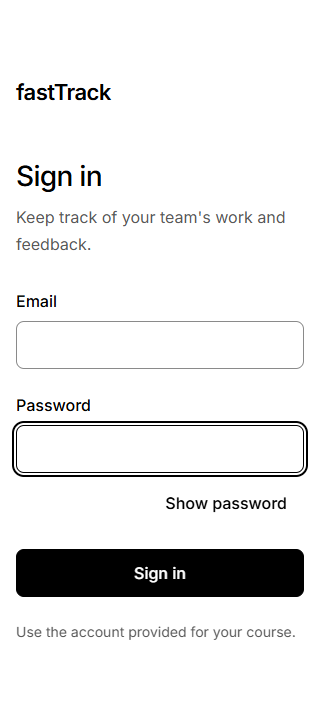
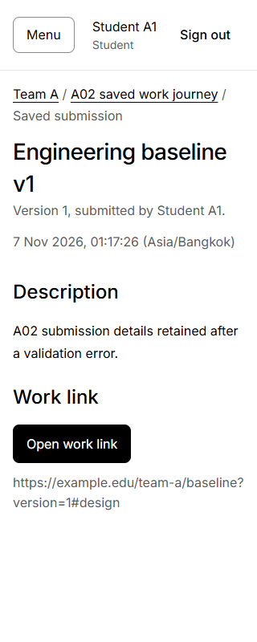
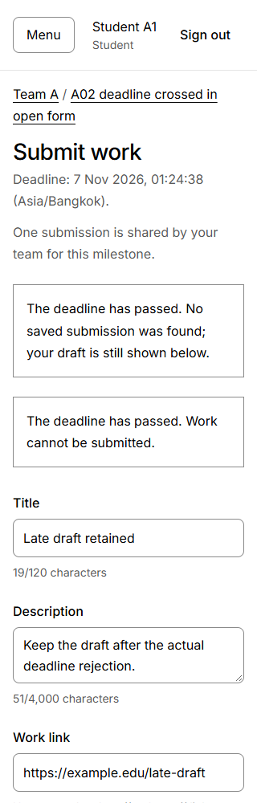
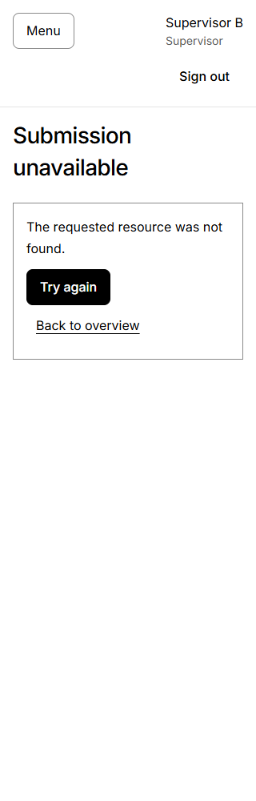

# Part F ? Owner A verification and process evidence

This is A's selected contribution to Part F, prepared 7 November 2026. Accepted staging baseline: **3365a36e4cd1fcdd7410cca2086447ec4ae5dc33**. The submitted main release/tag and final complete S1 verification are **PENDING**. B adds its F-02/F-04/access evidence and the final assembled PDF; this section does not certify feedback or G3.

## F.A1 Implemented scope and execution results

F-01/F-02/F-03 are accepted increments. F-03 was tested at **1bf8d632a4520cb8b2dd495c51b43d73a5e8a561**, documented at f6c4988 and approved/merged by B in PR #57 as 3365a36. The approved and merged trees are identical. These accepted-source results are reused for this documentation task; they are not newly executed document-task tests.

The final clean clone installed 316 packages without copied environment/generated client. Windows x64, Node 26.13.0/npm 11.20.0, pinned Prisma 7.10.1 and PostgreSQL 16.8. Commands from Project_code were `npm ci` and `npm run test:a02:isolated`; the browser review used `npm run review:a02` with a synthetic password and `npm run review:auth:stop`. The wrapper performs generation, migrations, checks/build and reserved-DB suites.

| Suite/check | Passing | Failing | Skipped / qualification |
| --- | ---: | ---: | --- |
| Ordinary/client/shared input | 111 / 6 files | 0 | 0 indicated in the successful complete console run |
| F-03 API/DB/service | 48 | 0 | 0 in the exported case records; includes internal clock/service and controlled retry errors |
| B01 DB | 33 | 0 | 0; 7 retained actor-stub service cases + 26 real-session regressions |
| Auth API/DB | 28 | 0 | 0 in exported records |
| G1 foundation | 38 | 0 | 0 in exported records |
| Historical-schema upgrade/rejection scenarios | 7 | 0 | All seven exercised; data/history preserved as required |
| Generation, fresh/repeated migration, typecheck, production-mode build | PASS | 0 stages failed | Compiled Prisma/shared-module packaging verified |
| Actual compiled process stop/start and retained saved record/session | PASS | 0 | Inside F-03 suite; this is more than a fresh in-memory app object |
| Cleanup and clean-clone Git status | PASS | 0 | Runner exit 0; owned containers/temporary credentials removed; clone clean |

Readable command output retained from the actual runs:

```text
RED executable 165f891:
ordinary: 106 passed
B01: 33 passed; auth: 28 passed; G1: 38 passed; upgrades: 7/7
F-03: 5 passed, 2 failed
- exact acceptedAt offset 1 ms: saved instead of rejecting
- first submission after actual database deadline: 201 instead of 409

GREEN executable 1bf8d63, final clean clone:
ordinary: 111 passed / 6 files
F-03: 48 passed, 0 failed, 0 failed suites
B01: 33 passed; auth: 28 passed; G1: 38 passed
upgrades: 7/7
build/typecheck/generation/migrations: passed
runner exit: 0; owned cleanup: passed
```

This block condenses the actual recorded output rather than pretending to be an untouched terminal screenshot. Exact UTC times and individual test names remain in the tracked structured results. The final clean run started 2026-11-06T18:22:50.932Z and finished 18:23:55.436Z (7 November, Asia/Bangkok). The review runner finished 18:25:14.448Z after actual browser checks and graceful cleanup.

## F.A2 AC-to-actual-test map

Files are `Project_code/server/src/testing/sessions.auth.ts` and `Project_code/server/src/testing/submissions.a02.ts`. Table names below are exact reported leaf test names; their enclosing describe groups and complete names are preserved in verification_map.json. All rows reference tested executable 1bf8d63 and its real report. The exact-clock cases use an internal test clock, while the lock cases use actual DB time and observed row-lock barriers.

| AC | Planned test IDs | Actual file and reported test name | Recorded result |
| --- | --- | --- | --- |
| AC-01.1 | T-01 | `sessions.auth.ts`: `T-01 authenticates stu-a1@test.local with real seed-compatible hash and allowlisted DTO`; `T-01 authenticates sup-a@test.local with real seed-compatible hash and allowlisted DTO` | PASS |
| AC-01.2 | T-02 | `sessions.auth.ts`: `T-02 conceals unknown email versus bad password and creates no session` | PASS |
| AC-01.3 | T-03 | `sessions.auth.ts`: `T-03 expires at equality, rejects revocation and rejects ambiguous duplicate cookies` | PASS |
| AC-01.4 | T-04 | `sessions.auth.ts`: `T-04 rejects wrong/missing CSRF without revocation then logout prevents replay and preserves another device` | PASS |
| AC-01.5 | T-05 | `sessions.auth.ts`: `T-05 scopes list/detail for stu-a1@test.local and conceals missing versus foreign team`; `T-05 handles no-team students and multiple assigned teams in stable order` | PASS |
| AC-03.1 | T-09 | `submissions.a02.ts`: `T-09/T-16 creates version 1 and reads the exact saved DTO after app recreation`; `T-14/T-25 permits teammate/supervisor reads and conceals foreign/missing list and detail identically` | PASS |
| AC-03.2 | T-10/T-11/T-12/T-26 | `submissions.a02.ts`: `T-10/T-12/T-26 uses exact acceptedAt offset -1 ms and persists that same instant`; `T-10/T-12/T-26 uses exact acceptedAt offset 0 ms and persists that same instant`; `T-10/T-12/T-26 uses exact acceptedAt offset 1 ms and persists that same instant`; `T-11 rejects a first submission after the actual database deadline without writing`; `T-12 uses equivalent offset instants and stores the once-read millisecond boundary` | PASS |
| AC-03.3 | T-13 | `submissions.a02.ts`: `T-13 serializes two different students to one immutable version 1`; `T-13/T-26 preserves the first submission and duplicate precedence after the deadline` | PASS |
| AC-03.4 | T-15 | `submissions.a02.ts`: `T-15 accepts exact Unicode/title/description/URL maxima and trims persisted values`; `T-15 rejects invalid/forged payload case 10 without partial writes` | PASS |
| AC-03.5 | T-14 | `submissions.a02.ts`: `T-14 checks session, role and source/CSRF before parsing JSON; rejects unsupported content types`; `T-14 denies foreign/absent milestone writes equally and checks input before scope`; `T-14/T-25 permits teammate/supervisor reads and conceals foreign/missing list and detail identically` | PASS |
| AC-03.6 | T-16/T-31 local | `submissions.a02.ts`: `T-16/T-31 creates through compiled HTTP and retains the exact submission/session after an actual process restart` | PARTIAL: API/DB restart PASS; combined browser check NOT RUN |
| S1-AC-EXT-01 | T-23 | `sessions.auth.ts`: `T-23 shared protection is fail-closed before JSON parsing and supplies immutable DB-derived identity`; `T-23 rejects a foreign source even with a valid session and CSRF without writing` | PASS |
| S1-AC-EXT-04 | T-26 | `submissions.a02.ts`: `T-26 rejects a real DB-clock deadline crossed while waiting for the team lock`; `T-26 rejects a real DB-clock deadline crossed while waiting for the milestone lock`; `T-13/T-26 preserves the first submission and duplicate precedence after the deadline` | PASS |

The invalid/forged F-03 family also executes cases 0-21 (missing/type/length/URL/identity/time fields), not only the selected unsafe-URL row shown here. T-27 memory/stale-account/return-to checks are in the ordinary session suite and actual browser observations. S1-AC-EXT-03/T-25 has verified milestone/latest-version read-model association at B01, but the complete feedback journey remains pending. S1-AC-EXT-02/T-24 is B's F-04 scope and is NOT RUN against this accepted baseline. T-21 and final-release T-22/T-31 are not claimed complete by partial feature tests.

## F.A3 Actual domain-rule test excerpt and TDD

Before each test, createBaseFixtures builds guarded real PostgreSQL data, and a valid student actor references that fixture. body() supplies a valid title, required description and HTTP(S) URL. This is the actual boundary test from submissions.a02.ts at 1bf8d63; it inspects the committed DB row and asserts no write after due.

```typescript
  it.each([-1, 0, 1])('T-10/T-12/T-26 uses exact acceptedAt offset %i ms and persists that same instant', async offset => {
    const milestone = fixtures.milestones.milestoneExact;
    const acceptedAt = new Date(milestone.dueAt.getTime() + offset);
    let calls = 0;
    const service = new SubmissionService(prisma, async () => { calls++; return acceptedAt; });
    const actor = { userId: fixtures.users.stuA1.id, role: 'student' as const };
    if (offset > 0) {
      await expect(service.submit(milestone.id, body(), actor)).rejects.toMatchObject({ status: 409, code: 'DEADLINE_PASSED' });
      expect(await prisma.submission.count()).toBe(0);
    } else {
      const saved = await service.submit(milestone.id, body(), actor);
      const row = await prisma.submission.findUniqueOrThrow({ where: { id: saved.id } });
      expect(saved.submittedAt).toBe(acceptedAt.toISOString());
      expect(row.submittedAt.getTime()).toBe(acceptedAt.getTime());
      expect(row.submittedById).toBe(actor.userId);
      expect(row.version).toBe(1);
    }
    expect(calls).toBe(1);
  });
```

The RED source is 165f891100978c990e54a1bd71bbaf6e97227e9e before the missing deadline rule. The same intended boundary behavior failed meaningfully: the +1ms promise resolved/saved, and the real past-deadline HTTP request returned 201. At 1bf8d63 the server compares the once-read time after team -> milestone locks, accepts equality and rejects > due. The GREEN results include before/equal/after tests, two real lock-wait crossings, equivalent offsets, duplicate-after-deadline precedence and concurrent students. No disabled assertions, syntax-error RED or intentionally failing protected merge is used.

Controlled P2034 injection verifies bounded confirmed-rollback retries in real transactions. It is not an induced actual deadlock. Independent lock-barrier tests observe DB waiting and actual clock crossing before releasing the blocker. Browser loss cases below intentionally intercept responses; those are not represented as real infrastructure outages.

## F.A4 Program demonstrations and captions

All data is synthetic. These are byte-identical original captures copied into tracked assets; asset_manifest.json records exact hashes/dimensions/source commits. No screenshot was synthesized or edited. Images were captured before the accepted merge at the identified tested sources, not from an uncreated main release.

**Figure A1 ? F-01 / AC-01.1-01.4, Student or Supervisor.** Starting condition: anonymous local browser. The actual blank sign-in screen shows labels, password visibility control and keyboard focus. Source 2899d1b; accepted through #54. This picture demonstrates the screen only. Real valid/invalid login, source/CSRF, expiry/logout/replay and session effects are established by the 28 auth cases and the recorded actual browser checks, not inferred from an empty form.



**Figure A2 ? F-03 / AC-03.1, Student A1.** Supervisor A created a future Team A milestone; A1 submitted valid work and opened its fresh GET-backed detail/reload. Expected: saved version 1, actual author/time/content. Actual: record 4877db44-a1de-4dd8-b4ef-c0d0fa4cc68a, author Student A1, submittedAt 2026-11-06T18:17:26.259Z, one record and persisted content. The safe external anchor uses _blank/noopener/noreferrer. Source 1bf8d63. This is the verified create/submit/retrieve portion of the journey; feedback is not included.



**Figure A3 ? F-03 / AC-03.2, Student A1.** A future deadline passed while the form stayed open; actual domain meta.serverTime polling confirmed the crossing. POST returned 409 DEADLINE_PASSED; saved count remained 0, the title remained Late draft retained and Submit work was disabled after recovery. The visible deadline includes seconds and Asia/Bangkok. Source 1bf8d63. The viewport capture intentionally shows the relevant rejection/draft rather than a fabricated full journey.



**Figure A4 ? F-03 / AC-03.5, Supervisor B.** After A logged out and B logged in at the former Team A saved URL, expected: generic denial and no Team A contents. Actual: Submission unavailable, 404 with the same body as a missing UUID, no Team A title/description. The assigned supervisor could read; supervisor POST returned 403 and saved count stayed 1. Source 1bf8d63. The API/no-write assertions supplement this UI picture.



Additional real browser observations: under America/New_York, saved 18:17:26Z displayed 01:17:26 Asia/Bangkok; at 320px there was no horizontal overflow. Invalid title/URL linked field errors to focused summary and retained other input. Response loss after real server 201 produced one POST/row and GET recovery; a separate A2 write was attributed to Student A2 while A1's draft remained. A failed recovery GET kept submission blocked until an explicit successful check, then one manual retry produced one record. These are actual local Chromium checks, not a claim of full cross-browser/load/screen-reader or public TLS verification.

## F.A5 Substantive Issue/PR and contract chronology

| Stage | Actual source/event | Evidence and result |
| --- | --- | --- |
| G0 engineering baseline | PR #44, reviewed d57b3ec, accepted 30fc5ef | Scope/rules/ownership/feature routes before application work. |
| F-01 contract then implementation | f09c2ea contract; 092796c implementation; verified correction 2899d1b; docs head 70dd0ce | Issue #5, A feature/s1-a-auth; B approved exact head, merged #54 as 0b99a28. |
| F-03 contract/test plan | 4aaeed1; Issue #7 and early Draft #57 during Started | Pre-implementation concrete plan plus existing D1 E.3/accepted baseline. |
| Meaningful F-03 RED | 165f891 | 5 pass/2 fail; existing regressions passed. |
| F-03 GREEN and final evidence | 1bf8d63 code, f6c4988 docs | 48 F-03 plus existing suites, actual browser and clean clone pass. |
| B peer acceptance | 2026-11-06T18:48:37Z, PR #57 at f6c4988 | B explicitly reports isolated and compiled-app review runs, accepts clock/locks/recovery and the feedback seam. |
| Accepted staging integration | B merged #57 at 18:50:50Z as 3365a36 | Approved/merge trees match; #7/#57 Done/PASSED/ACCEPTED, Issue closed after actual acceptance. |
| Full release into main | PENDING | Do not claim the staging chain already satisfies the required final main integration. |

Substantive domain chain: Issue #7 -> feature/s1-a-submissions -> PR #57 -> B review -> accepted staging. B adds the second selected access-restriction chain and its short actual test excerpt in its Part F contribution. Final PDF needs readable GitHub/history/board captures tied to the assessed main release; links alone are not sufficient.

## F.A6 Setup, participation and AI disclosure

The verified local runtime is a React/TypeScript client plus Express/TypeScript API and PostgreSQL/Prisma. Use the tracked lockfile and environment example. DATABASE_URL is private server configuration; APP_ORIGIN governs source/CSRF; sessions are absolute eight hours. Set DEMO_SEED_PASSWORD only for explicit local seed; keep all real passwords/tokens/DB URLs out of the PDF and Git. The seed adds synthetic users/teams without resetting their data/passwords/membership.

For the isolated reproduction, install from Project_code with npm ci, then run npm run test:a02:isolated with Docker Engine available. It provisions new loopback-only reserved databases, generates/migrates/builds/tests, checks historical upgrades and cleans only its own resources. For the compiled browser review set a synthetic AUTH_REVIEW_PASSWORD and run npm run review:a02, then stop with npm run review:auth:stop from that same clone. Seed emails identify synthetic Student A1/A2 and Supervisor A/B; no actual credential is printed here. The final PDF must summarize the assessed release's exact setup and output again if that source changes.

| Contributor | Actual recorded participation |
| --- | --- |
| A, Supapanya Yathip | Project/workflow baseline, scaffold/auth/submission implementation and meaningful tests; independent foundation/milestone review and authorized corrections; actual API/DB/browser checks; this owned documentation/evidence package. |
| B, Atip Infa-udom | Original schema/seed/shared UI/milestone contributions; source reviews/merges of A-authored increments #50/#54/#56/#57, including the specific reproduced checks recorded there; F-04/Part C/E/PDF work remains separately tracked and is not declared completed by this table. |
| AI assistance | Codex assisted A with planning, code, test design/execution, browser inspection and documentation/GitHub handoff under user direction. The user delegated remaining G2 UI acceptance to A/AI. This is disclosed rather than represented as independent B testing, cross-team UAT or instructor approval. |

## F.A7 Limitations and remaining release work

- F-04 is not integrated at accepted baseline 3365a36. Full T-21 journey, feedback persistence/retry and G3 remain pending.
- API process restart and independent browser reload are verified; the combined browser UI immediately after an actual restart is not separately recorded. Include it in G4 with accepted feedback.
- Final assessed-release clean setup/regression, main tag/commit, readable complete A-F PDF/navigation/page ranges, final contribution/access-chain evidence and LEB2 receipt remain pending.
- Local HTTP/Chromium results do not establish public TLS/cloud deployment, CI merge gates, load/full screen-reader or cross-browser certification. Lab 5/final delivery checks remain separate.
- Raw reports preserve their original pre-acceptance PENDING values; actual later acceptance is recorded separately. Do not convert planned or unexecuted checks to PASS or use these feature results as a final full-S1 release result.
