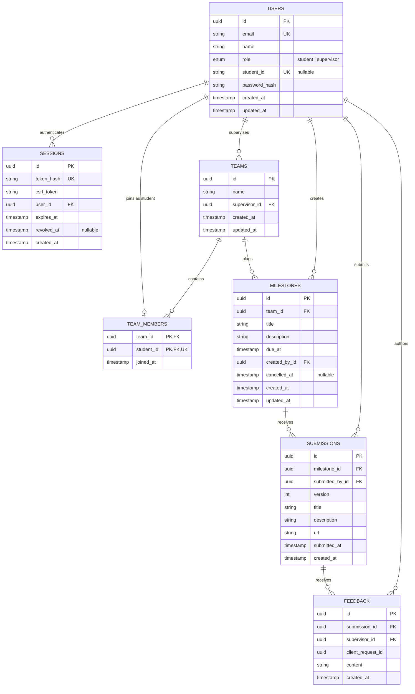

# Part C — System-Level Software Design Specification (SDS)

**Original package author:** Owner B (Atip Infa-udom / 67070503446)
**Authorized review corrections:** Owner A / Codex, Issue #64 / PR #65; B reviews these corrections
**Reviewer:** Owner A (Supapanya Yathip / 67070503443)
**System:** fastTrack — Course Project Management System
**Baseline & Target:** Sprint 1 Verified Increment (`staging/sprint-1` commit `fe65b19`, incorporating verified PRs #45, #50, #54, #56, #57, #61, and #62).

---

## C.1 System Architecture and Technology Stack

fastTrack is structured as a modular monolith delivering an end-to-end, single-course project management platform. The system enforces strict separation of concerns across presentation, routing/middleware security, domain business logic, and transactional database persistence.

```mermaid
flowchart LR
    Client["React 19.3.1 + Vite 8.3.6 SPA<br/>(Client UI)"]
    Proxy["Vite Dev Proxy /<br/>Same-Origin Host"]
    API["Express 5.3.0 Application<br/>(Fail-Closed Pipeline)"]
    Security["Auth & Security Guards<br/>(Session / Role / Source / CSRF)"]
    Modules["Domain Service Modules<br/>(Auth, Teams, Milestones,<br/>Submissions, Feedback)"]
    ORM["Prisma 7.10.1 ORM<br/>(@prisma/adapter-pg Driver)"]
    DB[("PostgreSQL 16.8<br/>(Durable Database)")]

    Client -->|JSON / HTTPS / Cookies| Proxy
    Proxy --> API
    API --> Security
    Security --> Modules
    Modules --> ORM
    ORM --> DB
```



### Pinned implementation stack

Versions come from the client/server workspace manifests and lockfile. `Project_code/package.json` requires Node >=26.13.0 <27 and npm >=11.20.0 <12. Only `client` and `server` are npm workspaces; `shared/` is tracked ESM source, not a separate package. The retained clean-clone result used Node 26.13.0/npm 11.20.0 and PostgreSQL 16.8; no Node 22/24 or PostgreSQL 14 compatibility run is claimed.

| Component | Technology | Version | Architectural Responsibility & Verified Seam |
|---|---|---|---|
| Frontend Client | React, TypeScript, Vite | React 19.3.1, Vite 8.3.6 | Single-page application rendering role-specific views, responsive forms, focus outlines, and Asia/Bangkok timestamps. Pure presentation; not an authorization authority. |
| Backend Server | Node.js, Express, TypeScript | Node.js 26.13.0, npm 11.20.0, Express 5.3.0 | Fail-closed HTTP pipeline, correlation ID generation, session protection, role enforcement, CSRF/source validation, and business rule orchestration. |
| Database & ORM | PostgreSQL, Prisma ORM | PostgreSQL 16.8, Prisma 7.10.1 | Relational persistence, transactional locking, row-level concurrency serialization, unique constraints, and schema migrations via `@prisma/adapter-pg`. |
| Shared Contracts | Pure ESM / TypeScript | Node.js ESM (`.mjs` / `.d.mts`) | Pure validation routines (`shared/milestones.mjs`, `shared/submissions.mjs`, `shared/feedback.mjs`), RFC 4122 UUID validation, Unicode code point limits, and strict unknown-key rejection. Shared across client and server. |
| Test Suites | Vitest, Supertest | Vitest 5.1.0, Supertest 7.3.1 | Fast unit test suites (pure validation), isolated database integration suites (transaction and concurrency checks), and compiled HTTP restart harnesses. |

---

## C.2 Relational Data Model and Physical Migrations

### C.2.1 Entity Relationship Diagram



Compound database invariants: submissions is unique on (milestone_id, version) with version >= 1; feedback is unique on (supervisor_id, client_request_id); team_members is unique on student_id. The ERD uses actual physical field names; role predicates are enforced in application scope checks.

### C.2.2 Migration Architecture: Logical Allocation vs. Physical Migration Sequence

In the preliminary design (v0.2 baseline), schema milestones were planned under four logical labels: M001 (core identity and teams), M002 (milestones), M003 (submissions), and M004 (feedback). During implementation and the joint G1 foundation audit, these logical entities were realized through an atomic initial baseline followed by progressive hardening migrations. The authoritative schema is managed through four ordered, timestamped physical Prisma migrations in `Project_code/server/prisma/migrations/`:

1. **`20261106094006_init_sprint1_schema`** (Initial Sprint 1 Relational Baseline):
   - Creates the `user_role` enum (`student`, `supervisor`).
   - Creates initial tables: `users`, `sessions`, `teams`, `team_members`, `milestones`, `submissions`, and `feedback`.
   - Establishes primary keys, basic foreign keys, and indexes for all Sprint 1 domain entities.

2. **`20261106094101_add_version_check_constraint`** (Database-Level Version Guard):
   - Adds the PostgreSQL check constraint: `ALTER TABLE "submissions" ADD CONSTRAINT "submissions_version_min" CHECK (version >= 1);`.
   - Guarantees database-level rejection of version 0 or negative integers, ensuring that submission versions begin at 1.

3. **`20261106195734_g1_schema_corrections`** (G1 Foundation Audit Alignment):
   - Executes inside an atomic `DO $g1_atomic_migration$` block with preflight UUID validation and length assertions before altering constraints.
   - Converts text UUID columns to native PostgreSQL `UUID` types with explicit `USING "col"::uuid` casts across all 7 tables.
   - Drops `teams_supervisor_id_key` unique index to allow one supervisor to oversee multiple teams (BR-01 / G1-01).
   - Adds nullable `revoked_at TIMESTAMPTZ` column to `sessions` for immediate session revocation (NFR-01 / G1-02).
   - Enforces `ON DELETE RESTRICT ON UPDATE CASCADE` across all foreign keys to prevent cascade deletion of academic history.
   - Adds Unicode whitespace-trimming check constraints (`btrim`) enforcing that names, titles, descriptions, and feedback cannot be blank.

4. **`20261106212301_g1_canonical_bounds_alignment`** (Canonical Length Bounds & Preflights):
   - Re-asserts bounds preflights across all tables.
   - Aligns column types with canonical specifications: `teams.name` (VARCHAR 120), `milestones.title` (VARCHAR 120), `milestones.description` (VARCHAR 4000), `submissions.title` (VARCHAR 120), `submissions.description` (VARCHAR 4000), `submissions.url` (VARCHAR 2048), and `feedback.content` (VARCHAR 4000).
   - Preserves identity fields as `TEXT` to prevent arbitrary truncation.
   - Validated against 7 migration scenarios (clean fresh deploy, repeat deploy, and upgrade paths) with zero data destruction.

### C.2.3 Idempotent Add-Only Seeding (`server/prisma/seed.ts`)

- Mandatory requirement: `DEMO_SEED_PASSWORD` must be supplied in the process environment; execution fails closed with an error if missing. No hardcoded or default credentials exist.
- IDs are generated by Prisma UUID defaults on first creation, not deterministic fixed seed IDs. Repeat execution preserves existing IDs and data.
- Non-destructive & Add-Only: Uses `findUnique` / `findFirst` checks before creation. Never overwrites existing user names, hashed passwords, student IDs, or team memberships.
- Creates two distinct supervisor accounts (`supervisor.a@fasttrack.local`, `supervisor.b@fasttrack.local`), three students (`student.a1@fasttrack.local`, `student.a2@fasttrack.local`, `student.b1@fasttrack.local`), and two teams (`Team A`, `Team B`) enabling immediate cross-tenant access testing.

---

## C.3 Authentication, Session Lifecycle, and Security Architecture

### C.3.1 Credential & Session Storage

1. **Password Hashing:**
   - Evaluated and implemented using Node.js `crypto.scrypt` with a cryptographically secure 16-byte salt (`randomBytes(16)`), 64-byte key length, and stored in format `${salt}:${hash}`.
   - Verification uses `crypto.timingSafeEqual` against a fixed dummy salt/hash when the user is not found, reducing the password-comparison timing difference for missing users; no blanket timing-side-channel elimination is claimed.

2. **Opaque Session Tokens:**
   - Authenticated sessions issue an unguessable 256-bit cryptographically secure random token (`randomBytes(32).toString('base64url')`, 43 characters).
   - The plain token is transmitted exclusively in an HTTP cookie: `fasttrack_session=<token>; HttpOnly; SameSite=Lax; Path=/; Expires=<absolute UTC expiry>;` (`Secure` is selected from the HTTPS APP_ORIGIN; production configuration requires HTTPS).
   - The database stores only the SHA-256 digest (`token_hash = sha256(token)`). Compromise of database storage does not yield valid session tokens.
   - Absolute lifetime: 8 hours (`expires_at = now() + 8h`). No silent sliding expiration.
   - Immediate revocation: `POST /api/auth/logout` sets `revokedAt` using the server/injected `now()` and clears the cookie.

3. **Cross-Site Request Forgery (CSRF) Protection:**
   - DB-session synchronizer token: each session generates a distinct 256-bit random token stored in `sessions.csrf_token` and returned in the login/session response body.
   - Authenticated domain writes and logout with a valid session require the header `X-CSRF-Token: <token>`.
   - Verified via `timingSafeEqual(Buffer.from(actual), Buffer.from(expected))`. No CSRF cookie is used; this is not a double-submit-cookie design.

4. **Origin & Source Verification:**
   - `requireSource` verifies `Origin` (or sanitized `Referer` if Origin is omitted) against `config.appOrigin`.
   - Pre-login endpoint (`POST /api/auth/login`) requires the custom header `X-fastTrack-Request: 1` in addition to origin verification, preventing browser cross-site form submissions.

### C.3.2 Pipeline Guard Order

Domain POST routes enforce the following order before JSON parsing. Login instead validates source and `X-fastTrack-Request: 1` before parsing; logout validates source, then requires CSRF only when a valid session exists. Read routes require a session and perform scope checks in the service:

$$\text{Request} \longrightarrow \text{requireSession} \longrightarrow \text{requireRole} \longrightarrow \text{requireMutation} \longrightarrow \text{requireJsonBody} \longrightarrow \text{parseJsonBody} \longrightarrow \text{Controller}$$

- **`requireSession`**: Extracts cookie, hashes token, verifies active expiry (`expires_at > now()`) and non-revocation (`revoked_at IS NULL`). Injects `AuthContext { userId, role, sessionId }`.
- **`requireRole('supervisor' | 'student')`**: Returns 403 `FORBIDDEN` if the caller's role does not match.
- **`requireMutation`**: Enforces `requireSource` (Origin check) and `requireCsrf` (`X-CSRF-Token` check).
- **`requireJsonBody` & `parseJsonBody`**: Verifies `Content-Type: application/json` and parses body only after authentication and CSRF are validated, preventing unauthenticated JSON parsing attacks.

### C.3.3 Role-Based Authorization & Cross-Tenant Negative Matrix

| Endpoint / Operation | HTTP Method | Student Role | Supervisor Role | Anonymous | Cross-Tenant / Negative Outcome |
|---|---|---|---|---|---|
| `POST /api/auth/login` | POST | 200 (creates session) | 200 (creates session) | 200 (creates session) | Bad credentials return generic 401 `INVALID_CREDENTIALS` |
| `POST /api/auth/logout` | POST | 204 (revokes session) | 204 (revokes session) | 204 (clears cookie) | Cannot revoke other devices' sessions |
| `GET /api/auth/me` | GET | 200 (`AuthUserDto`) | 200 (`AuthUserDto`) | 401 `UNAUTHENTICATED` | Cache-Control: `no-store` |
| `GET /api/teams` | GET | 200 (own team only) | 200 (supervised teams) | 401 `UNAUTHENTICATED` | Unassigned student receives `[]` |
| `POST /api/teams/:id/milestones` | POST | 403 `FORBIDDEN` | 201 (if supervised team) | 401 `UNAUTHENTICATED` | Foreign supervisor receives 404 `NOT_FOUND` |
| `GET /api/teams/:id/milestones` | GET | 200 (if team member) | 200 (if supervisor) | 401 `UNAUTHENTICATED` | Foreign team returns indistinguishable 404 `NOT_FOUND` |
| `GET /api/milestones/:id` | GET | 200 (if team member) | 200 (if supervisor) | 401 `UNAUTHENTICATED` | Foreign milestone returns indistinguishable 404 `NOT_FOUND` |
| `POST /api/milestones/:id/submissions` | POST | 201 (if team member) | 403 `FORBIDDEN` | 401 `UNAUTHENTICATED` | Duplicate returns 409 `ALREADY_SUBMITTED`; Past due returns 409 `DEADLINE_PASSED` |
| `GET /api/submissions/:id` | GET | 200 (if team member) | 200 (if supervisor) | 401 `UNAUTHENTICATED` | Foreign submission returns indistinguishable 404 `NOT_FOUND` |
| `POST /api/submissions/:id/feedback` | POST | 403 `FORBIDDEN` | 201 (if supervisor) | 401 `UNAUTHENTICATED` | Same `clientRequestId` returns 200 replay; Changed intent returns 409 `REQUEST_KEY_REUSED` |
| `GET /api/submissions/:id/feedback` | GET | 200 (if team member) | 200 (if supervisor) | 401 `UNAUTHENTICATED` | Foreign submission returns indistinguishable 404 `NOT_FOUND` |

---

## C.4 API Specifications, Error Envelopes, and Correlation

### C.4.1 Standardized Envelopes

JSON responses use allowlisted envelopes. Logout returns 204 with no body; liveness is separate from private domain DTOs:

- **Success Envelope:**
  ```json
  {
    "data": [],
    "meta": {
      "serverTime": "2026-11-07T03:55:00.000Z"
    }
  }
  ```
- **Error Envelope:**
  ```json
  {
    "error": {
      "code": "INVALID_INPUT",
      "message": "The submission payload contains invalid data.",
      "fields": {
        "url": "Provide a valid HTTP or HTTPS URL."
      }
    }
  }
  ```

### C.4.2 Standard Public Error Codes

| HTTP Status | Error Code | Meaning & Condition |
|---|---|---|
| 400 | `INVALID_INPUT` | Payload fails pure validation (length, format, disallowed characters, or unknown fields). |
| 401 | `UNAUTHENTICATED` | Missing, expired, revoked, or invalid session token. |
| 403 | `FORBIDDEN` | Caller role is not authorized, request source is rejected, or CSRF token is invalid. |
| 404 | `NOT_FOUND` | Resource does not exist or caller lacks tenant scope (indistinguishable to avoid enumeration). |
| 409 | `DEADLINE_PASSED` | Submission attempted after the official database deadline. |
| 409 | `MILESTONE_CANCELLED` | Submission target was cancelled; checked before duplicate/deadline rules. |
| 409 | `ALREADY_SUBMITTED` | Version 1 submission already exists for the milestone. |
| 409 | `REQUEST_KEY_REUSED` | A feedback mutation retry used an existing `clientRequestId` with altered payload content. |
| 503 | `TEMPORARILY_UNAVAILABLE` | Database transaction timeout or concurrent retry exhaustion. |

### C.4.3 Request Tracing & Correlation Header

Every HTTP interaction generates a unique UUID v4 tracking identifier returned in the `X-Request-Id` response header and recorded in the structured server log. Server errors are logged with method, route template, status code, duration, and correlation ID, while internal error stack traces and database credentials are completely redacted from public HTTP responses.

---

## C.5 Concurrency, Locking, and State Transition Invariants

### C.5.1 Submission Pipeline & Deadline Serialization

To eliminate race conditions between concurrent submissions and crossing deadline thresholds, `SubmissionService.submit` executes inside an atomic PostgreSQL transaction with two-phase row-level locks:

1. **Acquire Team Lock:**
   `SELECT id FROM teams WHERE id = $teamId FOR UPDATE`
   Serializes cooperating application operations taking the same team lock; direct database writers must follow this protocol. The team lock does not automatically lock every related row.
2. **Acquire Milestone Lock:**
   `SELECT id FROM milestones WHERE id = $milestoneId AND team_id = $teamId FOR UPDATE`
   Locks the milestone row to prevent deadline adjustments during submission evaluation.
3. **Scope Recheck and Rule Precedence:**
   Recheck membership and milestone scope within the same transaction after locking.
4. **Strict Precedence Invariant:**
   The submission is evaluated against three non-negotiable gates in strict order:
   - **Gate 1 (Cancellation):** If `cancelled_at IS NOT NULL`, reject immediately with 409 `MILESTONE_CANCELLED`.
   - **Gate 2 (Duplicate Submission):** Check if version 1 already exists. If present, reject immediately with 409 `ALREADY_SUBMITTED`.
   - **Gate 3 (Deadline Expiry):** After cancellation/duplicate checks, read `date_trunc('milliseconds', clock_timestamp())` once and compare it with the deadline. Persist that exact accepted value as submittedAt:
     $$\text{acceptedAt} > \text{dueAt} \implies \text{Reject with 409 DEADLINE\_PASSED}$$
     Boundary equality ($\text{acceptedAt} = \text{dueAt}$) is accepted. If crossed ($\text{acceptedAt} > \text{dueAt}$), no row is written, and draft content is preserved on the client.

### C.5.2 Feedback Mutation Idempotency & Retry Safety

Network failures between client and server risk duplicated supervisor feedback if the supervisor clicks "Submit" repeatedly. `FeedbackService.createFeedback` enforces idempotent retry safety:

1. **Tenant Scope Verification:**
   Before checking the idempotency table, the service verifies that the supervisor owns the team corresponding to the submission. This prevents cross-tenant probing of `clientRequestId` UUIDs.
2. **Deterministic Replay vs. Conflict Detection:**
   - If a feedback record with `(supervisor_id, client_request_id)` already exists:
     - If the existing record's `content` and `submission_id` match the incoming request, the server returns **HTTP 200 OK** with the existing `FeedbackDto` (deterministic replay).
     - If the `clientRequestId` matches but the `content` differs, the server rejects the request with **HTTP 409 Conflict** (`code: REQUEST_KEY_REUSED`), preventing accidental corruption.
3. **Classified Rollback Retry:**
   Writes use one transaction: scope lookup -> team row lock -> assignment/submission scope recheck -> supervisor/key lookup -> replay/conflict/insert. Only the actual feedback UUID unique constraint (including its pinned PostgreSQL adapter shape) or confirmed rolled-back contention may restart the whole scoped transaction, at most three attempts. Unknown outcomes/timeouts remain safe 503; arbitrary P2002 errors are not blindly retried. Reads scope and list in one repeatable-read transaction.
4. **Immutable Client Recovery:**
   The client freezes a UUID/body/exact-target intent after an unknown POST outcome and GETs saved feedback. A matching row confirms success. A successful GET without it permits a manual same-body/key retry; failed recovery keeps Save blocked. There is no automatic POST retry or Idempotency-Key header.

---

## C.6 UI Design System and Accessibility Compliance

### C.6.1 Monochrome Color Tokens

The visual theme strictly implements a minimalist monochrome palette using CSS custom properties:

```css
:root {
  --color-paper: #ffffff;    /* Canvas background, card surface */
  --color-ink: #000000;      /* Primary text, high-contrast borders */
  --color-wash: #f5f5f5;     /* Hover states, selected row backgrounds */
  --color-divider: #e5e5e5;  /* Subtle group dividers, horizontal rules */
  --color-muted: #595959;    /* Secondary text, metadata, helper labels */
  --color-control: #8a8a8a;  /* Form control borders (Input, Textarea) */
}
```

### C.6.2 Contrast Compliance Verification

- **Form Boundary Contrast (WCAG 2.1 AA Non-Text Contrast $\ge 3:1$):**
  Input and Textarea borders are declared with `border: 1px solid var(--color-control)`.
  Rendered resting border `#8a8a8a` on `#ffffff` white paper yields **3.45:1 contrast**, exceeding the required 3:1 ratio.
- **Text Contrast (WCAG 2.1 AA Text Contrast $\ge 4.5:1$):**
  Primary ink (`#000000`) on paper (`#ffffff`) yields **21:1 contrast**.
  Muted helper text (`#595959`) on paper (`#ffffff`) yields **7.0:1 contrast**, comfortably exceeding 4.5:1.

### C.6.3 Typography and Responsive Layout

- **Font Stack:** `Inter, "Noto Sans Thai", Tahoma, sans-serif`.
- **Target Viewports:** Verified across 320px (iPhone SE), 390px (iPhone 12/13), 768px (iPad Mini), 1280px (Desktop), and 1440px (HiDPI Display). Selected real API-backed screens were checked without horizontal overflow; this does not certify every possible content/state combination.
- **Focus Rings:** Visible 2px outline on focused interactive elements (`outline: 2px solid var(--color-ink); outline-offset: 2px`).
- **Control sizing:** Use the existing shared components; their CSS does not establish a universal 48px minimum. No full WCAG certification is claimed from these selected checks.
- **Native Zoom:** User A reported usable feedback, Your feedback, Save feedback and navigation at native Chrome 200% on 7 November 2026 at 03:13:16 UTC. Automation did not corroborate the zoom level and its reference image remained DPR 1. The manual report predates the later border-color-only correction; final contrast/layout measurements are separate. B explicitly accepted G4 in the actual PR #62 review. Preserve this attribution and limit, rather than presenting the normal-size images as 200% evidence. See [the native zoom record](../../../Project_code/docs/evidence/R1-J03-results.json).


## C.7 Configuration, packaging and implemented limits

| Setting / boundary | Actual behavior |
|---|---|
| DATABASE_URL | Required PostgreSQL URL. Runtime/seed load server/.env; Prisma CLI reads the process environment through prisma.config.ts. |
| APP_ORIGIN | Exact origin, default http://127.0.0.1:5173 locally. Production requires HTTPS. Source/CSRF checks are not disabled for local use. |
| PORT / SESSION_TTL_HOURS | API default 3000; valid integer port. Session TTL is fixed at 8 hours. |
| TEST_DATABASE_URL | Separate protected test target. Prefer the disposable isolated runner; never reset a personal/shared database. |
| DEMO_SEED_PASSWORD | Required private input for add-only demo seed; no default, no password in this package. |
| RELEASE_SHA | Development/test allow safe labels; production requires the actual 40-character lowercase Git SHA. |
| Local browser | Vite binds 127.0.0.1:5173 and proxies /api to 127.0.0.1:3000; keep APP_ORIGIN and browser hostname identical. |
| Compiled packaging | Keep shared/*.mjs alongside server/dist; the compiled server imports those tracked modules. The browser build bundles its own imports. |

S1 implements F-01 through F-04 only: authentication/scoped teams, milestone create/read, first submission and append-only exact-version feedback. Later team management, revisions, progress and summary work is planned for S2/S3. Self-hosted font assets, hosted CI/Docker/deployment and final PDF/release are not supplied by this source package. The current health endpoint is liveness, not a verified database-readiness check. See [technical setup](../../../Project_code/README.md) and Part F for the pinned disposable review route.
