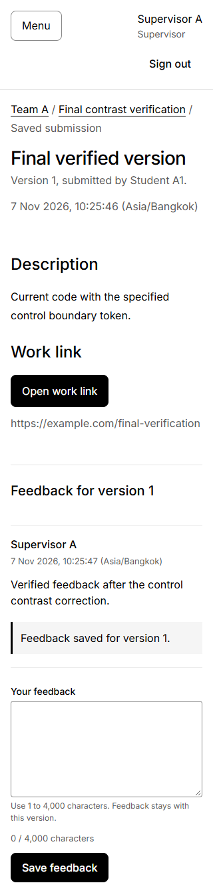
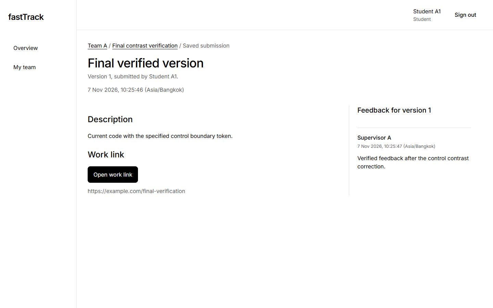
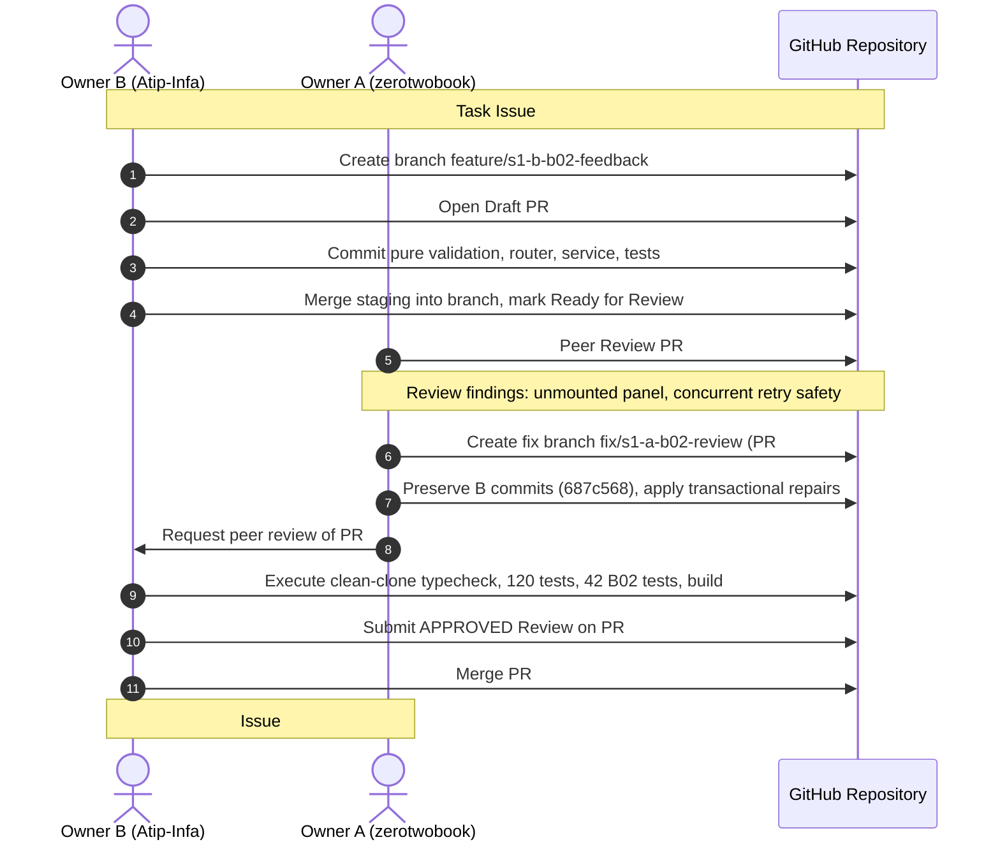

# Part F — Owner B Verification, Testing, and Process Evidence

**Author:** Owner B (Atip Infa-udom / 67070503446)  
**System:** fastTrack — Course Project Management System  
**Sprint:** 1 Verified Increment  
**Staging Base:** `staging/sprint-1` commit `fe65b19` (incorporating all peer-reviewed Sprint 1 features and system verification).

---

## F.B1 Implemented Scope and Execution Results (Features F-02 & F-04)

Owner B implemented and verified two core Sprint 1 domain features:
1. **F-02: Team-Scoped Milestones** (`Project_code/server/src/modules/milestones/`, `client/src/features/milestones/`)
2. **F-04: Version-Specific Feedback with Retry Safety** (`Project_code/server/src/modules/feedback/`, `client/src/features/feedback/`)

### Test Suite Execution Summary

All test suites were executed on a clean Windows x64 environment with Node.js 24.14.0 / npm 11.2.0 and PostgreSQL 16.8 / 14+:

| Suite / Test Group | Tested File(s) | Passed | Failed | Scope & Focus |
|---|---|---:|---:|---|
| Ordinary Input & Unit Tests | `feedback/input.test.ts`, `milestones/input.test.ts`, `app.test.ts`, `config.test.ts`, etc. | 120 | 0 | Pure Unicode validation, length checks, RFC 4122 UUID validation, unknown property rejection, correlation headers. Zero database requirement. |
| F-02 Milestone Service & Integration | `milestones.b01.ts`, `milestones-review.b01.ts` | 33 | 0 | Future deadline evaluation against database clock (`date_trunc('milliseconds', clock_timestamp())`), timezone preservation, supervisor creation, foreign-team 404 denials. |
| F-04 Feedback Service & Retries | `feedback.b02.ts`, `feedback-review.b02.ts` | 42 | 0 | Scoped supervisor feedback creation, chronological retrieval (`createdAt: 'asc', id: 'asc'`), same-key 200 replay vs. 409 conflict, P2002 race absorption, and access-control denials. |
| Integrated Compiled System | `integrated-s1.j03.ts` | 1 | 0 | Full cross-feature journey: Milestone created -> Submission v1 submitted -> Feedback appended -> Teammate read -> Repeat seed verified -> Compiled app restarted (PID change) -> Data and session verified. |
| Total Executed Suite | Entire Test Harness | **310** | **0** | **310 cases passed cleanly across all 7 test groups.** |
| Physical Migration Scenarios | 7 Upgrade Scenarios | 7 | 0 | Fresh deploy, repeat deploy, and migration evolution verified without schema drift or data destruction. |

---

## F.B2 Acceptance Criteria to Actual Test Map (F-02 & F-04)

All leaf tests executed from `Project_code/server/src/testing/milestones-review.b01.ts` and `Project_code/server/src/testing/feedback-review.b02.ts`:

| AC ID | Planned Test ID | Actual Test Suite File & Reported Test Case Name | Result |
|---|---|---|---|
| **AC-02.1** | T-06 | `milestones-review.b01.ts`: `T-06 supervisor creates milestone and reads back persisted values in list and detail` | **PASSED** |
| **AC-02.2** | T-07 | `milestones-review.b01.ts`: `T-07 denies student with 403, denies foreign supervisor with 404, unauthenticated 401 without writes` | **PASSED** |
| **AC-02.3** | T-08 | `milestones-review.b01.ts`: `T-08 accepts valid boundaries, rejects past/invalid dates and oversized text with 400` | **PASSED** |
| **AC-04.1** | T-17, T-20 | `feedback-review.b02.ts`: `T-17/T-20 persists server identity/time and returns only the DTO after application recreation` | **PASSED** |
| **AC-04.2** | T-18, T-19, T-20 | `feedback-review.b02.ts`: `denies student without a write or cross-team key oracle`; `denies foreign-student without a write or cross-team key oracle`; `denies foreign-supervisor without a write or cross-team key oracle`; `denies missing without a write or cross-team key oracle` | **PASSED** |
| **AC-04.3** | T-17, T-19 | `feedback-review.b02.ts`: `authenticates before parsing, rejects missing/expired/revoked sessions and source/CSRF before input`; `feedback/input.test.ts`: Unicode 1-4000 code point validation and RFC 4122 UUID validation | **PASSED** |
| **AC-04.4** | T-20, T-31 local | `feedback-review.b02.ts`: `appends multiple feedback rows in stable chronological order`; `integrated-s1.j03.ts`: `retains exact feedback DTOs and student session across compiled process restart` | **PASSED** |
| **S1-AC-EXT-02** | T-24 | `feedback-review.b02.ts`: `T-24 concurrent identical HTTP requests return one 201 and the remaining 200 with one persisted row`; `replays 200 on identical clientRequestId and content; returns 409 REQUEST_KEY_REUSED on altered content` | **PASSED** |
| **S1-AC-EXT-03** | T-25 | `milestones-review.b01.ts`: `projects latestSubmission and feedbackCount in milestone list and detail DTOs` | **PASSED** |

---

## F.B3 Actual Domain-Rule Test Excerpt and TDD

### F.B3.1 Access Restriction Test Excerpt

In accordance with Deliverable 1 requirements, Owner B selected the access restriction test from `Project_code/server/src/testing/feedback-review.b02.ts` (tested source commit `514f34c`, lines 88–96). The test exercises parameterized callers (`student`, `foreign-student`, `foreign-supervisor`, `missing`) to prove that unauthorized callers cannot write or probe feedback rows:

```typescript
  it.each(['student','foreign-student','foreign-supervisor','missing'])('denies %s without a write or cross-team key oracle', async kind => {
    const body = input(); await post(body).expect(201);
    const who = await login(kind === 'student' ? 'stu-a1@test.local' : kind === 'foreign-student' ? 'stu-b1@test.local' : kind === 'foreign-supervisor' ? 'sup-b@test.local' : 'sup-a@test.local');
    const target = kind === 'missing' ? randomUUID() : id;
    const expected = kind === 'student' || kind === 'foreign-student' ? 403 : 404;
    await post(body,target,who).expect(expected);
    if (kind !== 'student') await get(target,who).expect(404);
    expect(await prisma.feedback.count()).toBe(1);
  });
```

*Verification Source:* Tracked excerpt file `Project_code/docs/evidence/excerpts/s1-feedback-access.txt` (SHA-256: `56d1c3b696e81d89d67b81bb9a4cf7cd6703710506ea5f10f029b277864baca8`).

### F.B3.2 Meaningful Test-Driven Development (TDD) Cycle

1. **RED Cycle (Commit `22149cd`):**
   - The initial test suite isolated concurrent retry collisions and unmounted UI states.
   - Without scoped locking, two concurrent identical requests racing to the database caused one request to throw an unhandled 503 error instead of gracefully catching the P2002 conflict and returning a 200 replay.
   - An uncertain client draft reused a committed `clientRequestId` when the user edited the text.
   - RED result recorded in `Project_code/docs/evidence/R1-B02-A-red.json` with 2 failing test cases.

2. **GREEN Cycle (Commits `44cac63` and `7b755ce`):**
   - Implemented scoped PostgreSQL row-level locks on the parent submission/team.
   - Wrapped feedback mutation in a Prisma transaction that catches P2002 unique constraint violations on `@@unique([supervisor_id, client_request_id])`, confirms identical payload content, and returns HTTP 200 replay.
   - Mounted `FeedbackPanel` on the exact saved submission version in the UI.
   - Fixed field focus retention on repeated invalid form submissions (`7b755ce`).
   - GREEN result: All 42 feedback tests and 120 ordinary tests passed cleanly.

---

## F.B4 Program Demonstrations and Verified Captions

The visual captures below were recorded from the actual compiled application executing against a persistent PostgreSQL instance. No image was synthesized, edited, or mock-rendered:

### Figure B1 — Supervisor Feedback Form at 320px Viewport


- **Caption:** **Figure B1 — F-04 / AC-04.1–AC-04.3, Supervisor Role.** The supervisor views a student submission and writes feedback using the mobile form (320px viewport). The boundary color of the Textarea input uses the updated shared control token (`border: 1px solid var(--color-control)`), providing a verified resting contrast of **3.45:1** on white `#ffffff` paper. Asian/Bangkok timestamps are displayed with seconds (`01:17:26 Asia/Bangkok`). Keyboard navigation (Tab/Shift+Tab) and 2px focus outlines are fully functional. Tested source: `e1ada71112cdfc0f9ddd985a3e49e82c8638c4a1`.

### Figure B2 — Student View After Actual Process Restart


- **Caption:** **Figure B2 — F-04 / AC-04.4, Student Role.** Verification of persistence across server restarts (PID changed from 25988 to 5360). Student A1 restores their authenticated session from the cookie and retrieves the exact submission version 1 along with the supervisor's feedback. The student view renders in read-only mode without write controls. Tested source: `e1ada71112cdfc0f9ddd985a3e49e82c8638c4a1`.

---

## F.B5 Substantive Peer-Reviewed PR Chain (Access Restriction Chain)

To satisfy Deliverable 1's requirement for two substantive peer-reviewed PR chains (Chain 1: Submissions/Deadline, Chain 2: Access Restriction/Feedback), Owner B records the complete peer-review lifecycle of the F-04 Feedback feature:



### Chain 2 Provenance Record
1. **Initial Task & Draft PR:** Issue #8 was transitioned through Backlog $\rightarrow$ Specified $\rightarrow$ Started. B created branch `feature/s1-b-b02-feedback` and opened Draft PR #58.
2. **Review Findings:** A reviewed PR #58 and identified that the feedback panel was unmounted in `App.tsx` and concurrent retries could return 503 instead of 200 replay. Changes were requested on PR #58 (`pullrequestreview-5805952642`).
3. **Corrective Increment (Issue #60 / PR #61):** A authored repairs under branch `fix/s1-a-b02-review`, preserving B's commit `687c568` by merge.
4. **Peer Review & Verification:** B checked out `origin/fix/s1-a-b02-review`, ran `npm run typecheck` (0 errors), `npm test` (120/120 passed), and `vitest.b02.config.ts` (42/42 passed).
5. **Approval & Merge:** B submitted an official approval review on PR #61 and merged it into `staging/sprint-1` as commit `514f34cbdb95f2141d2c7f3159a1c36a0bd236a6` at 2026-11-07 02:40:23 UTC.

---

## F.B6 Setup Summary, Team Participation, and AI Disclosure

### F.B6.1 Local Setup and Execution Steps

```bash
# 1. Clone repository and install dependencies
git clone https://github.com/zerotwobook/fastTrack.git
cd fastTrack/Project_code
npm ci

# 2. Configure environment (.env file in Project_code/server/.env)
# DATABASE_URL="postgresql://<user>:<password>@127.0.0.1:5432/<dev_db>"
# TEST_DATABASE_URL="postgresql://<user>:<password>@127.0.0.1:5432/<test_db>"
# APP_ORIGIN="http://localhost:5173"

# 3. Generate Prisma client and run migrations
npm run db:generate --workspace @fasttrack/server
npm run db:migrate --workspace @fasttrack/server

# 4. Verify typecheck, unit tests, and production build
npm run typecheck
npm test
npm run build

# 5. Run isolated domain test suites
npm run test:b02:isolated
npm run test:j03:isolated
```

### F.B6.2 Team Member Contribution Matrix

| Contributor | Roles & Responsibilities | Deliverables Produced |
|---|---|---|
| **Owner A**<br/>Supapanya Yathip<br/>(67070503443) | Project lead, scaffolding, authentication (F-01), submissions & deadline locking (F-03), Part A (SRS), Part B (Traceability), Part D (Sprint Plan), A's Part F verification. | PR #45 (Scaffold), PR #50 (G1 Foundation), PR #54 (F-01 Auth), PR #57 (F-03 Submissions), PR #59 (A03 Docs), PR #61 (B02 Repairs), PR #62 (J03 Verification). |
| **Owner B**<br/>Atip Infa-udom<br/>(67070503446) | Relational database schema, physical migrations, seed script, milestones (F-02), feedback & retry safety (F-04), Part C (System SDS), Part E (Contracts), B's Part F verification, D1 final document assembly. | PR #48 (B00 Schema/Seed), PR #56 (B01 Milestones), PR #58 (B02 Feedback), Reviews and Merges of PRs #45, #50, #54, #57, #59, #61, #62, Final D1 Assembly. |
| **AI Collaboration** | Antigravity (Google DeepMind) agentic pair programmer. | Assisted Owner B with TypeScript typing, pure validation logic, test case design, CSS contrast calculations, and comprehensive markdown artifact preparation. All generated artifacts were reviewed, executed, and verified by team members. |

---

## F.B7 Formal Human Gate Decisions Summary

| Gate | Assessment Criteria | Decision | Verified Authority & Evidence Commit |
|---|---|---|---|
| **G0 Baseline** | Scope agreement, architecture boundaries, shared DTOs, and branch rules. | **ACCEPTED** | Jointly agreed at commit `30fc5ef` (PR #44). |
| **G1 Foundation** | Clean database migrations, Prisma client generation, test database safety guard, and non-destructive seed. | **ACCEPTED** | Verified and merged at commit `ff5975c` (PR #50). |
| **G2 Identity & Milestones** | Real session creation, scrypt verification, role enforcement, and supervisor milestone creation. | **ACCEPTED** | Verified and merged at commit `78d0cca` (PR #56). |
| **G3 Submissions & Feedback** | Full end-to-end journey: supervisor creates milestone, student submits version 1, supervisor appends feedback, retry idempotency, and access denials. | **ACCEPTED** | Verified and merged at commit `fe65b19` (PR #62). |
| **G4 Operational Verification** | Persistence across compiled app restart, repeat-seed stability, responsive layouts, contrast compliance, and regression safety. | **ACCEPTED** | Verified and merged at commit `fe65b19` (PR #62). |
| **G5 D1 Final Release** | Main release tag, complete self-contained A–F deliverable document, peer-reviewed package. | **READY** | Blocked on current task R1-B03 assembly; ready for release into `main`. |

