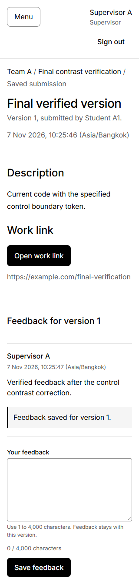
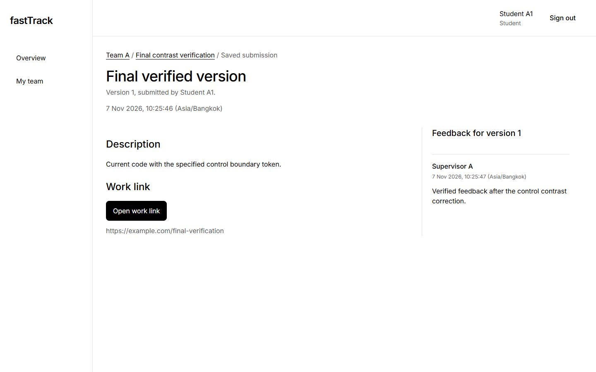
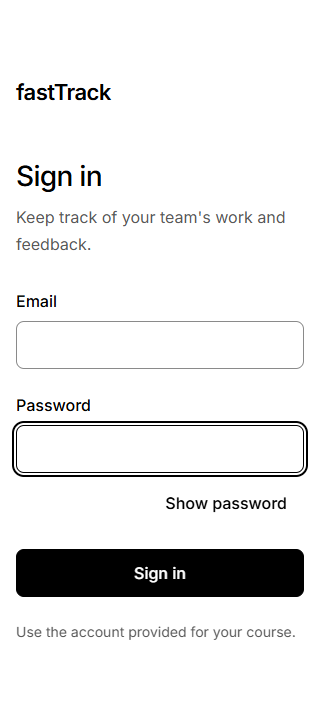
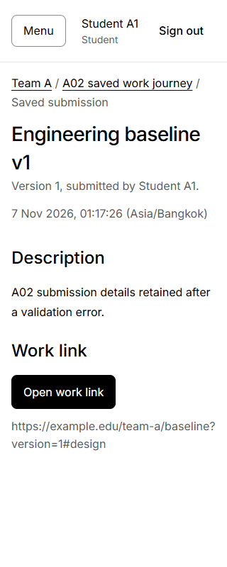
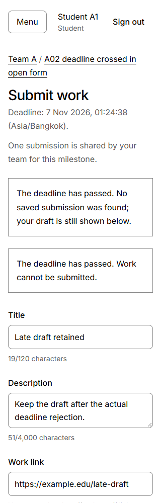
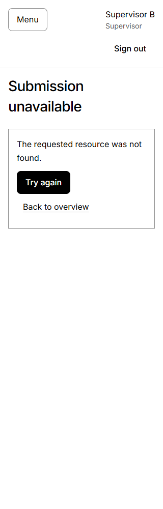

# fastTrack - Deliverable 1 review candidate

CPE 334 Software Engineering / Semester 1, 2026. Theme 6: Course Project Management System.

A: Supapanya Yathip / 67070503443 / zerotwobook. B: Atip Infa-udom / 67070503446 / Atip-Infa.

Repository: https://github.com/zerotwobook/fastTrack

Accepted staging application/source: 17f4398d52536fc8049022e56a7bacd0beeb822a. Refreshed 7 November 2026. Due 8 November 2026 at 23:59 Asia/Bangkok.

This is a combined review candidate, not an accepted main release or submitted PDF. G5/main/tag/submission is PENDING. B accepted the original 44-page preparation in PR #66; this refresh under R1-J04-A-REFRESH / #74 includes subsequently accepted corrections, release rules and UI from PRs #71, #69 and #73. The original A/B sources and historical evidence remain preserved. A/Codex prepares this refresh; its exact-version PDF/peer review and the user's explicit main-release authorization remain pending. The existing main-targeted PR #67 stays Draft.

[NAVIGATION]


# Part A - SRS and product scope

## A.1 Problem, context and actors

Student teams need to know what to deliver, when it is due, which work the team actually submitted and which supervisor feedback belongs to that work. Supervisors need to follow only their assigned teams. Informal links and messages make deadlines, version history and private feedback difficult to verify.

fastTrack provides one course-project context with explicit Student and Supervisor roles. A team follows a chronological milestone track; students submit work links and supervisors comment on the exact saved submission. The system records identity, version and acceptance time on the server. The course title shown in a future assessed deployment remains a presentation/configuration decision; a multi-course administration system is outside this baseline.

| Actor | Responsibilities and record scope |
| --- | --- |
| Student | Sign in/out; read their team, milestones, saved submissions and feedback; submit/revise work when permitted. At most one team. |
| Supervisor | Sign in/out; create milestones, read work and add feedback for assigned teams; later manage team membership/planning and scoped progress/summary. May supervise multiple teams. |
| Delivery maintainers, A and B | Maintain code, migrations, synthetic seed data, tests and reviewed releases. This is a team responsibility, not another application role or an authorization bypass. |

## A.2 Scope and exclusions

Sprint 1 covers real identity, scoped team context, milestone creation/read, one first submission per milestone and version-specific supervisor feedback. Sprint 2 adds team/planning management, revisions/history and team progress. Sprint 3 adds supervisor summary/filter/drill-down and completes hardening/verification. All continue the same application, repository and persistent history.

Work is submitted as a URL; the backend validates its syntax and never fetches it. The sender must check sharing permissions. There is no file upload, grading/approval workflow, chat, email notification, self-registration, password recovery, multi-course platform, public team directory, hard deletion of academic history or optional dark mode. Seeded accounts/team assignments are sufficient for S1; team-management behavior is still required in S2.

## A.3 Functional requirements

| ID | Observable required behavior | Feature / sprint |
| --- | --- | --- |
| FR-01 | Both roles can log in, retrieve current identity and log out; expired/revoked sessions cannot be replayed. | F-01 / 1 |
| FR-02 | Users can read only their assigned team context, milestones and related work. Foreign/missing private records are indistinguishable. | F-01/F-02, maintained by all features / 1-3 |
| FR-03 | Assigned supervisors create a milestone with required title/description and a future deadline, then retrieve the persisted values. | F-02 / 1 |
| FR-04 | A student team member submits title/description/work URL under the first-submission rules and retrieves saved author/version/time. | F-03 / 1 |
| FR-05 | An assigned supervisor appends feedback to an exact submission; that team's members read it without cross-team leakage. | F-04 / 1 |
| FR-06 | Supervisors create/rename teams and assign eligible students while preserving membership/history rules. | F-05 / 2 |
| FR-07 | Supervisors edit or cancel eligible unsubmitted milestones without destroying history or accepting an invalid deadline. | F-05 / 2 |
| FR-08 | Students create atomic revisions with expectedVersion; old submissions and their original feedback remain readable. | F-06 / 2 |
| FR-09 | Authorized users see team milestone status and progress derived from the same underlying records. | F-07 / 2 |
| FR-10 | Supervisors filter and drill into summary results from their assigned teams only. | F-08 / 3 |

## A.4 Business rules

| ID | Adopted, testable rule |
| --- | --- |
| BR-01 | Each account has one role; a student belongs to at most one team; each team has one supervisor. Supervisor-to-team assignment is one-to-many. |
| BR-02 | Server-side DB membership/assignment governs every protected read and write, including lists and aggregates. UI visibility is supplementary. |
| BR-03 | Only assigned supervisors create milestones/feedback. Only student members submit/revise work. |
| BR-04 | Read the database wall clock after required locks, truncate once to milliseconds and accept acceptedAt <= dueAt. Persist that same submittedAt. A request delayed past due is rejected even if the user clicked earlier. |
| BR-05 | S1 creates only version 1, with at most one submission per milestone. Sequential/concurrent duplicate requests cannot overwrite or add a second S1 record. |
| BR-06 | S2 increments the version atomically after checking expectedVersion; preserve all old versions and each version's feedback. |
| BR-07 | Feedback is private, append-only and associated with an exact submission ID. It is neither a grade nor an approval decision. |
| BR-08 | Trim text; count Unicode code points. Title 1-120, description/feedback 1-4,000; work URL <=2,048, complete HTTP(S), hostname present, no embedded credentials. Passwords are not trimmed. No automatic work-content normalization. |
| BR-09 | After any team submission, membership is history-locked. A submitted milestone cannot be edited/cancelled. No hard deletion or supervisor reassignment. A team rename and creation of additional milestones remain possible without changing ownership/history. |
| BR-10 | Team progress is submitted non-cancelled milestones divided by all non-cancelled milestones. Zero denominator gives 0%. Aggregate progress uses summed counts, not an average of team percentages. It is not a score. |

Timestamp inputs need an explicit zone and at most three fractional digits. HH:mm means seconds 00; deadline and rejection context display seconds in Asia/Bangkok, with UTC storage. First-submission errors after authentication/input/scope follow cancelled -> duplicate -> deadline precedence. A duplicate after due still returns ALREADY_SUBMITTED.

Mutation transactions share team -> milestone lock order, recheck scope with the same transaction client and perform no external HTTP calls while holding locks. Retry at most three times only for confirmed rolled-back technical contention, reading rules/time again. Unknown outcomes are checked through GET before an explicit retry. Feedback uses a clientRequestId per intent: replay with the same target/content returns the existing record; a changed intent with the same key returns 409 after scope checking. No automatic first-submission POST retry is permitted.

## A.5 Non-functional requirements

These are measurable behavior/verification targets, not invented latency or throughput promises.

| ID | Target and practical verification | Establish / repeat |
| --- | --- | --- |
| NFR-01 | Store password hashes and opaque session-token hashes; reject missing/expired/revoked sessions and invalid source/CSRF; responses/logs exclude secrets. Inspect real session/DB/negative API tests and safe logs. | S1; every sprint |
| NFR-02 | Every protected operation rejects unauthorized access without exposing/changing foreign data. Enumerate methods/paths and assert scoped DTOs, equal 404s and no-write effects. | S1-S3 as routes expand |
| NFR-03 | Committed work/feedback survives app restart, and after Lab 5 survives redeployment. Compare IDs/content/associations through fresh reads; retain DB while replacing processes. | S1 local; Lab 5 cloud; final |
| NFR-04 | A clean checkout installs, generates, migrates, seeds, builds, runs and tests using documented commands without source edits. Use new reserved databases and record source/output. | S1; final and packaging changes |
| NFR-05 | Forms expose loading/empty/error/recovery states, meaningful field labels and keyboard focus; mobile layout remains usable at 320px. Check real browser behavior, safe rendering, actual persisted reads and representative viewport/keyboard scenarios. | S1 and every new screen |
| NFR-06 | Failed required CI checks block release; release SHA, image and deployed revision agree; smoke and persistence checks pass. Verify a deliberately failed gate and deployed identifiers. | Lab 5 onward; final |

Local F-01-F-04 and full journey/persistence are accepted through G3/G4. The separate fresh setup passed 310 cases and seven migration scenarios; NFR-06/cloud verification remains allocated to Lab 5. There is no agreed performance SLA or measured load result.

## A.6 Decisions, assumptions and open matters

| Decision / question | Adopted resolution or remaining action |
| --- | --- |
| Theme and identity | Theme 6; B's ID ends in 6, matching the documented eligibility rule. Team names/IDs above are the actual provided identities. |
| Architecture | React/TypeScript/Vite and Express/TypeScript modular monolith with Prisma/PostgreSQL; shared pure validation, real backend scope, one continuous app. |
| Authentication implementation | Accepted seed-compatible scrypt hashes, DB-backed opaque eight-hour absolute sessions, memory-only CSRF/private client state and same-origin HTTP API. Do not silently replace the hash format with the older report's proposed Argon2id wording. |
| UI | English copy, existing white/black/gray milestone-track design and Inter with Noto Sans Thai fallback. |
| Scope versus later change | No grace period in the accepted deadline baseline. A future maintenance change needs its own approved revised contract and real RED/GREEN. |
| Release and assessment | F-01-F-04, G3/G4 and the corrected A/B source packages are accepted. G5, main/tag and actual course submission remain pending for this combined PDF review candidate. |
| Public operations | Hosting, durable cloud DB, enforced CI and public-login throttling belong to Lab 5 design/implementation; no public deployment is claimed here. |
| Source conflicts | The original final-video sources differ; retain the decision to target <=4 minutes pending actual instructor clarification. This does not add a video requirement to D1. |

Sources: instructor D1 pages 1-8 and Group specifications retained in the supplied [source handoff](../../summary_final_deliverable.md); adopted design [project detail](../../../Project_doc/project_detail.md); [current task/gate workflow](../../../workflow/01_SPRINT1_D1.md). The final assessed PDF must contain this substantive content, not substitute these links for it.


# Part B - Feature inventory and traceability

## B.1 Inventory, ownership and dependencies

| Feature | Purpose / dependencies | Sprint and primary allocation | Baseline result |
| --- | --- | --- | --- |
| F-01 Identity/team context | Real login/me/logout, immutable identity and scoped teams; schema/seed prerequisite. | 1 / A; B reviews | Accepted through PR #54 |
| F-02 Milestones | Supervisor create, both-role scoped track/list/detail; F-01. | 1 / B original; authorized A correction, B peer review | Accepted through PR #56 |
| F-03 First submission | Student version 1, locks/deadline/duplicates, saved read/recovery; F-01/F-02. | 1 / A; B reviews | Accepted through PR #57 |
| F-04 Feedback | Supervisor append/read, exact submission/version association and retry key; F-01/F-03. | 1 / B; A reviews | Accepted local S1 increment |
| F-05 Teams/planning | Eligible membership, rename and unsubmitted-milestone edit/cancel; F-01-F-04. | 2 / A teams, B milestone planning | Planned |
| F-06 Revisions | Atomic version/expectedVersion/history; F-03/F-04. | 2 / B; A reviews | Planned |
| F-07 Team progress | Canonical statuses, count-based percentage and scoped board; F-05/F-06. | 2 / A; B reviews | Planned |
| F-08 Summary | Assigned-team aggregate/filter/drill-down with consistent data/time; F-07. | 3 / A filters/totals, B details/navigation | Planned |

Each member owns their assigned feature's UI/API/tests/evidence. Shared composition/schema/lockfile changes are coordinated through the workflow. Foundation/migration, auth, delivery and accessibility are named system responsibilities rather than additional invented feature IDs.

## B.2 Functional coverage

| Requirement | Feature(s) | Establish / planned verification |
| --- | --- | --- |
| FR-01 | F-01 | S1 AC-01.1-01.4; T-01-T-04/T-23/T-27 |
| FR-02 | F-01/F-02 plus every protected domain read | S1 AC-01.5/02.1/03.5/04.2, T-05/T-07/T-14/T-18/T-25; expand S2-S3 |
| FR-03 | F-02 | S1 AC-02.1-02.3, T-06-T-08 |
| FR-04 | F-03 | S1 AC-03.1-03.6, T-09-T-16/T-26 |
| FR-05 | F-04 | S1 AC-04.1-04.4, T-17-T-20/T-24/T-25 |
| FR-06 | F-05 team service | S2 eligible/multiple assignment, history lock and scoped team CRUD; T-28 extension |
| FR-07 | F-05 milestone planning | S2 future deadline/edit/cancel/history-lock and concurrent first submission; T-28 |
| FR-08 | F-06 | S2 S1-data upgrade, stale expectedVersion, preserved IDs/history/feedback; T-29 |
| FR-09 | F-07 | S2 canonical status/zero/cancelled/revision and count-based progress; T-30 |
| FR-10 | F-08 | S3 aggregate/filter/drill-down/asOf, weighted totals and scope; T-30 |

## B.3 Rule coverage

| Requirement | Feature / system responsibility | Sprint / planned verification |
| --- | --- | --- |
| BR-01 | Foundation seed/constraints, F-01 and F-05 membership | S1 real unique/FK/seed tests; S2 assignment concurrency |
| BR-02 | Auth/team scope, F-01-F-08 | S1 method/path matrix and no-write/equal-404; extend every sprint |
| BR-03 | Required role guards and domain scope in F-02/F-03/F-04 | S1 T-07/T-14/T-18; direct API requests despite hidden controls |
| BR-04 | F-03 deadline; later F-06 | S1 T-10-T-12/T-26 exact 1ms, offset, DB clock after lock; repeat for revisions |
| BR-05 | F-03 and unique milestone/version constraint | S1 T-13/T-26 duplicate/concurrent write and immutable original data |
| BR-06 | F-06 and F-04 exact association | S2 T-29, stale revision/migration preservation/version-specific feedback |
| BR-07 | F-04 | S1 T-17-T-20/T-24 private append/read/replay; preserve in S2 history |
| BR-08 | Shared validation in F-02-F-06 | S1 T-08/T-15/T-19 Unicode/type/key/URL boundaries; extend S2 |
| BR-09 | Team/milestone transaction coordination in F-05 | S2 T-28 race/history protection; S1 submissions already use team -> milestone locks |
| BR-10 | F-07/F-08 read models | S2-S3 T-30 zero/cancelled/version statuses and weighted totals |

## B.4 Quality coverage

| Requirement | Named responsibility | Sprint and practical verification |
| --- | --- | --- |
| NFR-01 | Hash/session/source/CSRF lifecycle and safe errors/logs | S1 T-01-T-04/T-23; regress every sprint |
| NFR-02 | DB-scoped API/service reads and writes | S1 T-05/T-07/T-14/T-18/T-25/T-27; S2/S3 negative aggregates/planning |
| NFR-03 | Durable DB, immutable history, data-preserving migration/restart | S1 T-16/T-20/T-31 local; Lab 5 redeploy; final data integrity |
| NFR-04 | Lockfile/config, guarded fixtures, README and clean install | S1 T-22/T-31; clean-checkout checks again for final assessed release |
| NFR-05 | Shared UI plus feature forms/track/recovery/keyboard/mobile | S1 selected browser checks/T-21/T-27; inspect each added screen |
| NFR-06 | Required-check/release/deployment identity and smoke | Lab 5 CI/Docker/GCP; verify failures block normal merge/release, then final |


## B.5 Current evidence and gaps

All 18 S1 feature ACs, five extensions and shared checks have actual mapped evidence in Part F. The earlier A03 feedback/restart gaps were subsequently exercised in B02/J03 and accepted by B in #62. F-05-F-08 and cloud/CI/NFR-06 remain later-sprint allocations. G5/main/tag/submission remain pending. Historical source snapshots are preserved; this compilation states the actual later acceptance.


# Part C - System-level SDS

## C.1 System Architecture and Technology Stack

fastTrack is structured as a modular monolith delivering an end-to-end, single-course project management platform. The system enforces strict separation of concerns across presentation, routing/middleware security, domain business logic, and transactional database persistence.

[DIAGRAM:architecture]

### Pinned implementation stack

Versions come from the client/server workspace manifests and lockfile. `Project_code/package.json` requires Node >=26.13.0 <27 and npm >=11.20.0 <12. Only `client` and `server` are npm workspaces; `shared/` is tracked ESM source, not a separate package. The retained clean-clone result used Node 26.13.0/npm 11.20.0 and PostgreSQL 16.8; no Node 22/24 or PostgreSQL 14 compatibility run is claimed.

| Component | Technology | Version | Architectural Responsibility & Verified Seam |
|---|---|---|---|
| Frontend Client | React, TypeScript, Vite | React 19.3.1, Vite 8.3.6 | Single-page application rendering role-specific views, responsive forms, focus outlines, and Asia/Bangkok timestamps. Pure presentation; not an authorization authority. |
| Backend Server | Node.js, Express, TypeScript | Node.js 26.13.0, npm 11.20.0, Express 5.3.0 | Fail-closed HTTP pipeline, correlation ID generation, session protection, role enforcement, CSRF/source validation, and business rule orchestration. |
| Database & ORM | PostgreSQL, Prisma ORM | PostgreSQL 16.8, Prisma 7.10.1 | Relational persistence, transactional locking, row-level concurrency serialization, unique constraints, and schema migrations via `@prisma/adapter-pg`. |
| Shared Contracts | Pure ESM / TypeScript | Node.js ESM (`.mjs` / `.d.mts`) | Pure validation routines (`shared/milestones.mjs`, `shared/submissions.mjs`, `shared/feedback.mjs`), RFC 4122 UUID validation, Unicode code point limits, and strict unknown-key rejection. Shared across client and server. |
| Test Suites | Vitest, Supertest | Vitest 5.1.0, Supertest 7.3.1 | Fast unit test suites (pure validation), isolated database integration suites (transaction and concurrency checks), and compiled HTTP restart harnesses. |

---

## C.2 Relational Data Model and Physical Migrations

### C.2.1 Entity Relationship Diagram

[DIAGRAM:data-model]

| Physical entity | Major physical fields and constraints |
|---|---|
| users | id UUID PK; email UNIQUE; name; role enum; student_id nullable UNIQUE; password_hash; created_at; updated_at |
| sessions | id UUID PK; token_hash UNIQUE; csrf_token; user_id FK; expires_at; revoked_at nullable; created_at |
| teams | id UUID PK; name VARCHAR(120); supervisor_id FK; created_at; updated_at |
| team_members | team_id FK + student_id FK composite PK; student_id UNIQUE; joined_at |
| milestones | id UUID PK; team_id FK; title VARCHAR(120); description VARCHAR(4000); due_at; created_by_id FK; cancelled_at nullable; created_at; updated_at |
| submissions | id UUID PK; milestone_id FK; submitted_by_id FK; version; title VARCHAR(120); description VARCHAR(4000); url VARCHAR(2048); submitted_at; created_at; UNIQUE(milestone_id,version); CHECK version>=1 |
| feedback | id UUID PK; submission_id FK; supervisor_id FK; client_request_id UUID; content VARCHAR(4000); created_at; UNIQUE(supervisor_id,client_request_id) |


Compound database invariants: submissions is unique on (milestone_id, version) with version >= 1; feedback is unique on (supervisor_id, client_request_id); team_members is unique on student_id. The ERD uses actual physical field names; role predicates are enforced in application scope checks.

### C.2.2 Migration Architecture: Logical Allocation vs. Physical Migration Sequence

In the preliminary design (v0.2 baseline), schema milestones were planned under four logical labels: M001 (core identity and teams), M002 (milestones), M003 (submissions), and M004 (feedback). During implementation and the joint G1 foundation audit, these logical entities were realized through an atomic initial baseline followed by progressive hardening migrations. The authoritative schema is managed through four ordered, timestamped physical Prisma migrations in `Project_code/server/prisma/migrations/`:

1. **`20261106094006_init_sprint1_schema`** (Initial Sprint 1 Relational Baseline):
   - Creates the `user_role` enum (`student`, `supervisor`).
   - Creates initial tables: `users`, `sessions`, `teams`, `team_members`, `milestones`, `submissions`, and `feedback`.
   - Establishes primary keys, basic foreign keys, and indexes for all Sprint 1 domain entities.

2. **`20261106094101_add_version_check_constraint`** (Database-Level Version Guard):
   - Adds the PostgreSQL check constraint: `ALTER TABLE "submissions" ADD CONSTRAINT "submissions_version_min" CHECK (version >= 1);`.
   - Guarantees database-level rejection of version 0 or negative integers, ensuring that submission versions begin at 1.

3. **`20261106195734_g1_schema_corrections`** (G1 Foundation Audit Alignment):
   - Executes inside an atomic `DO g1_atomic_migration` block with preflight UUID validation and length assertions before altering constraints.
   - Converts text UUID columns to native PostgreSQL `UUID` types with explicit `USING "col"::uuid` casts across all 7 tables.
   - Drops `teams_supervisor_id_key` unique index to allow one supervisor to oversee multiple teams (BR-01 / G1-01).
   - Adds nullable `revoked_at TIMESTAMPTZ` column to `sessions` for immediate session revocation (NFR-01 / G1-02).
   - Enforces `ON DELETE RESTRICT ON UPDATE CASCADE` across all foreign keys to prevent cascade deletion of academic history.
   - Adds Unicode whitespace-trimming check constraints (`btrim`) enforcing that names, titles, descriptions, and feedback cannot be blank.

4. **`20261106212301_g1_canonical_bounds_alignment`** (Canonical Length Bounds & Preflights):
   - Re-asserts bounds preflights across all tables.
   - Aligns column types with canonical specifications: `teams.name` (VARCHAR 120), `milestones.title` (VARCHAR 120), `milestones.description` (VARCHAR 4000), `submissions.title` (VARCHAR 120), `submissions.description` (VARCHAR 4000), `submissions.url` (VARCHAR 2048), and `feedback.content` (VARCHAR 4000).
   - Preserves identity fields as `TEXT` to prevent arbitrary truncation.
   - Validated against 7 migration scenarios (clean fresh deploy, repeat deploy, and upgrade paths) with zero data destruction.

### C.2.3 Idempotent Add-Only Seeding (`server/prisma/seed.ts`)

- Mandatory requirement: `DEMO_SEED_PASSWORD` must be supplied in the process environment; execution fails closed with an error if missing. No hardcoded or default credentials exist.
- IDs are generated by Prisma UUID defaults on first creation, not deterministic fixed seed IDs. Repeat execution preserves existing IDs and data.
- Non-destructive & Add-Only: Uses `findUnique` / `findFirst` checks before creation. Never overwrites existing user names, hashed passwords, student IDs, or team memberships.
- Creates two distinct supervisor accounts (`supervisor.a@fasttrack.local`, `supervisor.b@fasttrack.local`), three students (`student.a1@fasttrack.local`, `student.a2@fasttrack.local`, `student.b1@fasttrack.local`), and two teams (`Team A`, `Team B`) enabling immediate cross-tenant access testing.

---

## C.3 Authentication, Session Lifecycle, and Security Architecture

### C.3.1 Credential & Session Storage

1. **Password Hashing:**
   - Evaluated and implemented using Node.js `crypto.scrypt` with a cryptographically secure 16-byte salt (`randomBytes(16)`), 64-byte key length, and stored in format `{salt}:{hash}`.
   - Verification uses `crypto.timingSafeEqual` against a fixed dummy salt/hash when the user is not found, reducing the password-comparison timing difference for missing users; no blanket timing-side-channel elimination is claimed.

2. **Opaque Session Tokens:**
   - Authenticated sessions issue an unguessable 256-bit cryptographically secure random token (`randomBytes(32).toString('base64url')`, 43 characters).
   - The plain token is transmitted exclusively in an HTTP cookie: `fasttrack_session=<token>; HttpOnly; SameSite=Lax; Path=/; Expires=<absolute UTC expiry>;` (`Secure` is selected from the HTTPS APP_ORIGIN; production configuration requires HTTPS).
   - The database stores only the SHA-256 digest (`token_hash = sha256(token)`). Compromise of database storage does not yield valid session tokens.
   - Absolute lifetime: 8 hours (`expires_at = now() + 8h`). No silent sliding expiration.
   - Immediate revocation: `POST /api/auth/logout` sets `revokedAt` using the server/injected `now()` and clears the cookie.

3. **Cross-Site Request Forgery (CSRF) Protection:**
   - DB-session synchronizer token: each session generates a distinct 256-bit random token stored in `sessions.csrf_token` and returned in the login/session response body.
   - Authenticated domain writes and logout with a valid session require the header `X-CSRF-Token: <token>`.
   - Verified via `timingSafeEqual(Buffer.from(actual), Buffer.from(expected))`. No CSRF cookie is used; this is not a double-submit-cookie design.

4. **Origin & Source Verification:**
   - `requireSource` verifies `Origin` (or sanitized `Referer` if Origin is omitted) against `config.appOrigin`.
   - Pre-login endpoint (`POST /api/auth/login`) requires the custom header `X-fastTrack-Request: 1` in addition to origin verification, preventing browser cross-site form submissions.

### C.3.2 Pipeline Guard Order

Domain POST routes enforce the following order before JSON parsing. Login instead validates source and `X-fastTrack-Request: 1` before parsing; logout validates source, then requires CSRF only when a valid session exists. Read routes require a session and perform scope checks in the service:

session -> role -> source/CSRF -> JSON -> input -> scope -> service

- **`requireSession`**: Extracts cookie, hashes token, verifies active expiry (`expires_at > now()`) and non-revocation (`revoked_at IS NULL`). Injects `AuthContext { userId, role, sessionId }`.
- **`requireRole('supervisor' | 'student')`**: Returns 403 `FORBIDDEN` if the caller's role does not match.
- **`requireMutation`**: Enforces `requireSource` (Origin check) and `requireCsrf` (`X-CSRF-Token` check).
- **`requireJsonBody` & `parseJsonBody`**: Verifies `Content-Type: application/json` and parses body only after authentication and CSRF are validated, preventing unauthenticated JSON parsing attacks.

### C.3.3 Role-Based Authorization & Cross-Tenant Negative Matrix

| Endpoint / Operation | Verb | Student Role | Supervisor Role | Anonymous | Cross-Tenant / Negative Outcome |
|---|---|---|---|---|---|
| `POST /api/auth/login` | POST | 200 (creates session) | 200 (creates session) | 200 (creates session) | Bad credentials return generic 401 `INVALID_CREDENTIALS` |
| `POST /api/auth/logout` | POST | 204 (revokes session) | 204 (revokes session) | 204 (clears cookie) | Cannot revoke other devices' sessions |
| `GET /api/auth/me` | GET | 200 (`AuthUserDto`) | 200 (`AuthUserDto`) | 401 `UNAUTHENTICATED` | Cache-Control: `no-store` |
| `GET /api/teams` | GET | 200 (own team only) | 200 (supervised teams) | 401 `UNAUTHENTICATED` | Unassigned student receives `[]` |
| `POST /api/teams/:id/milestones` | POST | 403 `FORBIDDEN` | 201 (if supervised team) | 401 `UNAUTHENTICATED` | Foreign supervisor receives 404 `NOT_FOUND` |
| `GET /api/teams/:id/milestones` | GET | 200 (if team member) | 200 (if supervisor) | 401 `UNAUTHENTICATED` | Foreign team returns indistinguishable 404 `NOT_FOUND` |
| `GET /api/milestones/:id` | GET | 200 (if team member) | 200 (if supervisor) | 401 `UNAUTHENTICATED` | Foreign milestone returns indistinguishable 404 `NOT_FOUND` |
| `POST /api/milestones/:id/submissions` | POST | 201 (if team member) | 403 `FORBIDDEN` | 401 `UNAUTHENTICATED` | Duplicate returns 409 `ALREADY_SUBMITTED`; Past due returns 409 `DEADLINE_PASSED` |
| `GET /api/submissions/:id` | GET | 200 (if team member) | 200 (if supervisor) | 401 `UNAUTHENTICATED` | Foreign submission returns indistinguishable 404 `NOT_FOUND` |
| `POST /api/submissions/:id/feedback` | POST | 403 `FORBIDDEN` | 201 (if supervisor) | 401 `UNAUTHENTICATED` | Same `clientRequestId` returns 200 replay; Changed intent returns 409 `REQUEST_KEY_REUSED` |
| `GET /api/submissions/:id/feedback` | GET | 200 (if team member) | 200 (if supervisor) | 401 `UNAUTHENTICATED` | Foreign submission returns indistinguishable 404 `NOT_FOUND` |

---

## C.4 API Specifications, Error Envelopes, and Correlation

### C.4.1 Standardized Envelopes

JSON responses use allowlisted envelopes. Logout returns 204 with no body; liveness is separate from private domain DTOs:

- **Success Envelope:**
  ```json
  {
    "data": [],
    "meta": {
      "serverTime": "2026-11-07T03:55:00.000Z"
    }
  }
  ```
- **Error Envelope:**
  ```json
  {
    "error": {
      "code": "INVALID_INPUT",
      "message": "The submission payload contains invalid data.",
      "fields": {
        "url": "Provide a valid HTTP or HTTPS URL."
      }
    }
  }
  ```

### C.4.2 Standard Public Error Codes

| HTTP Status | Error Code | Meaning & Condition |
|---|---|---|
| 400 | `INVALID_INPUT` | Payload fails pure validation (length, format, disallowed characters, or unknown fields). |
| 401 | `UNAUTHENTICATED` | Missing, expired, revoked, or invalid session token. |
| 403 | `FORBIDDEN` | Caller role is not authorized, request source is rejected, or CSRF token is invalid. |
| 404 | `NOT_FOUND` | Resource does not exist or caller lacks tenant scope (indistinguishable to avoid enumeration). |
| 409 | `DEADLINE_PASSED` | Submission attempted after the official database deadline. |
| 409 | `MILESTONE_CANCELLED` | Submission target was cancelled; checked before duplicate/deadline rules. |
| 409 | `ALREADY_SUBMITTED` | Version 1 submission already exists for the milestone. |
| 409 | `REQUEST_KEY_REUSED` | A feedback mutation retry used an existing `clientRequestId` with altered payload content. |
| 503 | `TEMPORARILY_UNAVAILABLE` | Database transaction timeout or concurrent retry exhaustion. |

### C.4.3 Request Tracing & Correlation Header

Every HTTP interaction generates a unique UUID v4 tracking identifier returned in the `X-Request-Id` response header and recorded in the structured server log. Server errors are logged with method, route template, status code, duration, and correlation ID, while internal error stack traces and database credentials are completely redacted from public HTTP responses.

---

## C.5 Concurrency, Locking, and State Transition Invariants

### C.5.1 Submission Pipeline & Deadline Serialization

To eliminate race conditions between concurrent submissions and crossing deadline thresholds, `SubmissionService.submit` executes inside an atomic PostgreSQL transaction with two-phase row-level locks:

1. **Acquire Team Lock:**
   `SELECT id FROM teams WHERE id = $teamId FOR UPDATE`
   Serializes cooperating application operations taking the same team lock; direct database writers must follow this protocol. The team lock does not automatically lock every related row.
2. **Acquire Milestone Lock:**
   `SELECT id FROM milestones WHERE id = milestoneId AND team_id = teamId FOR UPDATE`
   Locks the milestone row to prevent deadline adjustments during submission evaluation.
3. **Scope Recheck and Rule Precedence:**
   Recheck membership and milestone scope within the same transaction after locking.
4. **Strict Precedence Invariant:**
   The submission is evaluated against three non-negotiable gates in strict order:
   - **Gate 1 (Cancellation):** If `cancelled_at IS NOT NULL`, reject immediately with 409 `MILESTONE_CANCELLED`.
   - **Gate 2 (Duplicate Submission):** Check if version 1 already exists. If present, reject immediately with 409 `ALREADY_SUBMITTED`.
   - **Gate 3 (Deadline Expiry):** After cancellation/duplicate checks, read `date_trunc('milliseconds', clock_timestamp())` once and compare it with the deadline. Persist that exact accepted value as submittedAt:
     acceptedAt > dueAt -> reject DEADLINE_PASSED; equality is accepted.
     Boundary equality (acceptedAt = dueAt) is accepted. If crossed (acceptedAt > dueAt), no row is written, and draft content is preserved on the client.

### C.5.2 Feedback Mutation Idempotency & Retry Safety

Network failures between client and server risk duplicated supervisor feedback if the supervisor clicks "Submit" repeatedly. `FeedbackService.createFeedback` enforces idempotent retry safety:

1. **Tenant Scope Verification:**
   Before checking the idempotency table, the service verifies that the supervisor owns the team corresponding to the submission. This prevents cross-tenant probing of `clientRequestId` UUIDs.
2. **Deterministic Replay vs. Conflict Detection:**
   - If a feedback record with `(supervisor_id, client_request_id)` already exists:
     - If the existing record's `content` and `submission_id` match the incoming request, the server returns **HTTP 200 OK** with the existing `FeedbackDto` (deterministic replay).
     - If the `clientRequestId` matches but the `content` differs, the server rejects the request with **HTTP 409 Conflict** (`code: REQUEST_KEY_REUSED`), preventing accidental corruption.
3. **Classified Rollback Retry:**
   Writes use one transaction: scope lookup -> team row lock -> assignment/submission scope recheck -> supervisor/key lookup -> replay/conflict/insert. Only the actual feedback UUID unique constraint (including its pinned PostgreSQL adapter shape) or confirmed rolled-back contention may restart the whole scoped transaction, at most three attempts. Unknown outcomes/timeouts remain safe 503; arbitrary P2002 errors are not blindly retried. Reads scope and list in one repeatable-read transaction.
4. **Immutable Client Recovery:**
   The client freezes a UUID/body/exact-target intent after an unknown POST outcome and GETs saved feedback. A matching row confirms success. A successful GET without it permits a manual same-body/key retry; failed recovery keeps Save blocked. There is no automatic POST retry or Idempotency-Key header.

---

## C.6 UI Design System and Accessibility Compliance

### C.6.1 Monochrome Color Tokens

The visual theme strictly implements a minimalist monochrome palette using CSS custom properties:

```css
:root {
  --color-paper: #ffffff;    /* Canvas background, card surface */
  --color-ink: #000000;      /* Primary text, high-contrast borders */
  --color-wash: #f5f5f5;     /* Hover states, selected row backgrounds */
  --color-divider: #e5e5e5;  /* Subtle group dividers, horizontal rules */
  --color-muted: #595959;    /* Secondary text, metadata, helper labels */
  --color-control: #8a8a8a;  /* Form control borders (Input, Textarea) */
}
```

### C.6.2 Contrast Compliance Verification

- **Form Boundary Contrast (WCAG 2.1 AA Non-Text Contrast >= 3:1):**
  Input and Textarea borders are declared with `border: 1px solid var(--color-control)`.
  Rendered resting border `#8a8a8a` on `#ffffff` white paper yields **3.45:1 contrast**, exceeding the required 3:1 ratio.
- **Text Contrast (WCAG 2.1 AA Text Contrast >= 4.5:1):**
  Primary ink (`#000000`) on paper (`#ffffff`) yields **21:1 contrast**.
  Muted helper text (`#595959`) on paper (`#ffffff`) yields **7.0:1 contrast**, comfortably exceeding 4.5:1.

### C.6.3 Typography and Responsive Layout

- **Font Stack:** `Inter, "Noto Sans Thai", Tahoma, sans-serif`.
- **Target Viewports:** Verified across 320px (iPhone SE), 390px (iPhone 12/13), 768px (iPad Mini), 1280px (Desktop), and 1440px (HiDPI Display). Selected real API-backed screens were checked without horizontal overflow; this does not certify every possible content/state combination.
- **Focus Rings:** Visible 2px outline on focused interactive elements (`outline: 2px solid var(--color-ink); outline-offset: 2px`).
- **Control sizing:** Use the existing shared components; their CSS does not establish a universal 48px minimum. No full WCAG certification is claimed from these selected checks.
- **Native Zoom:** User A reported usable feedback, Your feedback, Save feedback and navigation at native Chrome 200% on 7 November 2026 at 03:13:16 UTC. Automation did not corroborate the zoom level and its reference image remained DPR 1. The manual report predates the later border-color-only correction; final contrast/layout measurements are separate. B explicitly accepted G4 in the actual PR #62 review. Preserve this attribution and limit, rather than presenting the normal-size images as 200% evidence. See [the native zoom record](../../../Project_code/docs/evidence/R1-J03-results.json).


## C.7 Configuration, packaging and implemented limits

| Setting / boundary | Actual behavior |
|---|---|
| DATABASE_URL | Required PostgreSQL URL. Runtime/seed load server/.env; Prisma CLI reads the process environment through prisma.config.ts. |
| APP_ORIGIN | Exact origin, default http://127.0.0.1:5173 locally. Production requires HTTPS. Source/CSRF checks are not disabled for local use. |
| PORT / SESSION_TTL_HOURS | API default 3000; valid integer port. Session TTL is fixed at 8 hours. |
| TEST_DATABASE_URL | Separate protected test target. Prefer the disposable isolated runner; never reset a personal/shared database. |
| DEMO_SEED_PASSWORD | Required private input for add-only demo seed; no default, no password in this package. |
| RELEASE_SHA | Development/test allow safe labels; production requires the actual 40-character lowercase Git SHA. |
| Local browser | Vite binds 127.0.0.1:5173 and proxies /api to 127.0.0.1:3000; keep APP_ORIGIN and browser hostname identical. |
| Compiled packaging | Keep shared/*.mjs alongside server/dist; the compiled server imports those tracked modules. The browser build bundles its own imports. |

S1 implements F-01 through F-04 only: authentication/scoped teams, milestone create/read, first submission and append-only exact-version feedback. Later team management, revisions, progress and summary work is planned for S2/S3. Self-hosted font assets, hosted CI/Docker/deployment and final PDF/release are not supplied by this source package. The current health endpoint is liveness, not a verified database-readiness check. See [technical setup](../../../Project_code/README.md) and Part F for the pinned disposable review route.

## C.8 Main screens and delivery plan

| Screen | Student / supervisor workflow | Shared behavior |
|---|---|---|
| Login and overview | Real login/me/logout; own team or assigned-team list | Visible labels, generic login failure, no-store, cache purge and loading/empty/error/retry. |
| Team and milestone | Student reads; assigned supervisor creates future milestone | Monochrome track, explicit Bangkok dueAt including seconds, shared fields, scoped server checks. |
| First-submission form/detail | Student creates version 1; both scoped roles read saved work | Strict fields, retained draft, deadline/duplicate/cancelled errors; GET reconciliation for unknown outcome. |
| Saved-version feedback | Student reads; assigned supervisor appends to exact ID/version | Loading/empty/error, frozen UUID/body on uncertain save, checked manual retry; no write control for students. |

Desktop navigation is 224px from 1200px, with a keyboard-accessible mobile menu below it and a skip link. Shared forms retain field errors/focus and draft intent; server authorization is authoritative. Descriptions/feedback render as text; work links use safe external attributes and are never fetched by the server.

The adopted Lab 5 design uses Cloud Run for the API plus built frontend image, Cloud SQL PostgreSQL for durable data, Artifact Registry for images, Secret Manager for credentials and GitHub Actions for checks/deployment. A separate migration job must pass before rollout. Do not reset/seed a shared DB on every startup or persist academic records on container disk. Record commit -> image digest -> deployed revision, preserve a compatible rollback image and test backup/restore before destructive migrations. DB readiness and tested public-login throttling remain Lab 5 work. None is represented as an S1 cloud deployment.


# Part D - Three-sprint plan

## D.1 Sprint goals and completion outcomes

| Sprint | Included features / goal | Dependencies | Completion outcome and checkpoint |
| --- | --- | --- | --- |
| 1 | F-01-F-04: real identity, milestone, immutable first submission and version-specific feedback through UI -> API -> PostgreSQL. | G0 agreed scope/interfaces; accepted scaffold/schema/seed; G1 foundation; G2 identity/milestone before submissions/feedback. | Complete two-role domain journey, rule/access/no-write/persistence checks, meaningful TDD, current setup and peer-reviewed main release. D1: 8 Nov 2026. |
| 2 | F-05-F-07: team/planning management, atomic revisions/history and team progress while retaining accepted S1 behavior. | Stable accepted S1; versioned S2 contracts; shared membership/lock/version/status rules; Lab 5 delivery. | Core expansion accepted with upgrade/regression/role tests and durable deployed data. Target finish 23-24 Nov to permit real S3 progress before D2 on 29 Nov. |
| 3 | F-08 summary/filter/drill-down; complete integration, error handling, UAT fixes and final verification. | Accepted S2 and canonical progress/status definitions; scoped aggregation contracts. | Meaningful implemented/tested S3 workflow by D2 on 29 Nov; whole baseline, final UAT/retests/readiness/release/report/video by 13 Dec. |

This is one evolving app, not three rewrites. Each sprint starts from the accepted predecessor. Keep immutable assessed releases and synchronize main ancestry back into active staging through reviewed sync PRs when needed.

## D.2 Allocation and interface ownership

| Round | A leads, B reviews | B leads, A reviews | Joint responsibility |
| --- | --- | --- | --- |
| S1 | Scaffold/config/test wiring; F-01; F-03; Parts A/B/D and domain/TDD evidence. | Schema/migrations/seed/shared UI; F-02; F-04; Parts C/E and access/feedback/UI evidence; PDF assembly. | Interface decisions, real integrated acceptance, regression, final Part F and reviewed release. Authorized corrections preserve the original owner's history and require the other member's review. |
| S2 | Docker/runtime, F-05 teams, F-07 progress and UAT/impact tests. | CI/release, F-05 milestone planning, F-06 revisions and approved maintenance implementation. | Cloud/durable data checks, independent UAT, defect retests, regression and release. |
| S3 | F-08 filters/totals, domain/data QA and traceability; D2 release coordination. | F-08 items/navigation, UI/access/operations QA and package assembly; Final release coordination. | Scope closure, final acceptance/UAT, both members' explanation/demo and submission checks. |

Feature owners implement UI/API/tests/evidence rather than splitting the team permanently into coder/document writer. Separate task branches and separate working directories are required. A coordinates app/API composition and manifests/lockfile; B coordinates schema/migrations/shared primitives. Concrete auth/submission/feedback/status seams are agreed before dependent integration.

## D.4 Internal schedule, effort and risk control

| Period | Planned work / constraint |
| --- | --- |
| 6-7 Nov | Actual team availability was provided as broadly all day; complete foundation, F-01-F-04 and cross-review while collecting evidence. This is availability, not a recorded timesheet. |
| 8 Nov | Reserve time for full regression/restart, peer fixes, release and readable PDF assembly before D1 23:59. |
| 9-15 Nov | Lab 5 Docker/CI/GCP/durable DB and release proof; begin versioned S2 contracts from stable S1. Lab 5 due 15 Nov. |
| 16-22 Nov | Core F-05/F-06 and independent cross-team UAT/defects/retests. Lab 6 due 22 Nov. Select maintenance only for already-working behavior and obtain required approval. |
| 23-24 Nov | Target F-07/accepted S2; regress S1/S2 and migration/history preservation. |
| 25-29 Nov | Real F-08 workflow/tests, approved maintenance/metrics/readiness, D2 candidate. D2 and Lab 7 due 29 Nov as separate submissions. |
| 30 Nov-13 Dec | Bounded completion, final UAT/retests/hardening/release/report/video. Exams run 1-11 Dec; avoid postponing main workflows until 12-13 Dec. |

Initial S1 estimate: setup/auth 6-8, milestones 6-8, submissions/deadline 8-12, feedback 5-7, integration QA 8-12 and review/evidence/PDF 5-7 person-hours: 38-54 before contingency, approximately 46-65 with 20%. These are estimates from planning, not time actually spent. Reassess remaining effort at each gate using actual defects/review turnaround and availability.

Keep at most one dependent implementation active per person. While waiting for a gate, prepare agreed contracts, test designs, fixtures or owned report sections. If time is tight, cut optional decoration and disclose incomplete required work; do not remove security/domain tests, weaken assertions or relabel unfinished baseline behavior as maintenance.

## D.5 Change and release control

Use Issue -> specified scope -> Started before edits -> early Draft PR -> verified review -> accepted staging integration -> reviewed release into main. Fixing is used for actual findings, Done for actual accepted integration. Preserve RED/GREEN, substantive peer review, tested source and immutable releases; no fabricated stage, test, UAT or submission history.

Any changed deadline/revision/progress rule needs an explicit revised contract and impact/regression tests. Lab 7 maintenance requires its prescribed approval and a working prior behavior. Public hosting adds delivery/security decisions such as login throttling and secrets management; those are not claimed complete by a local S1 build.

Part A defines the baseline; Part B maps every requirement into these sprints; Part F records actual verification and remaining gaps. The final PDF's A-F navigation must use real exported page numbers and its submitted release, rather than the preparation snapshot used here.


## D.6 Current sequence

G0 -> reviewed scaffold/schema/seed -> G1 -> F-01/F-02 -> delegated G2 -> F-03/F-04 -> G3 complete journey -> G4 clean setup/restart/access/UI -> accepted A/B source packages. B accepted G3/G4 in #62 and corrected source package #65. Current staging is 4de6a7a. This combined report is under joint #12 / PR #66. Final G5/main/tag/submission remains pending; inspect the exact future candidate again and notify the user before main merge.


# Part E - Sprint 1 engineering contracts

## E.0 Shared boundaries and DTOs

All routes below are under `/api`. Requests derive user/role from the DB-backed session, never a body/header identity. Domain writes run session -> required role -> source/CSRF -> JSON type/parser -> strict input -> scope/transaction/rule -> write. Login has its separate source/bootstrap guard; logout checks source and requires CSRF only for a valid session. Reads require a session and scope. Foreign/missing records share a generic 404; invalid identifiers may return 400 first. Student writes prohibited by role return 403 before resource scope is disclosed.

Successful JSON responses use `{data}`. Team, milestone, submission and feedback GETs add `meta: {serverTime}`; login/me return `{data:{user,csrfToken}}`. Logout is 204 with no body. Errors use `{error:{code,message,fields}}`; fields is a field-message object, possibly empty. `X-Request-Id` is a response header, not a request identity or body authority. Auth/private responses are `Cache-Control: no-store`.

Generated entity IDs are UUIDs. Generic team/resource checks and feedback UUID validation do not all enforce UUID v4; feedback payload validators accept RFC UUID versions 1-5 with valid variant bits and normalize to lowercase. The browser generates v4 request keys. Do not claim a stricter validator than the code implements. Response timestamps are UTC ISO strings with millisecond precision; UI displays Asia/Bangkok including seconds.

The exact allowlisted DTO shapes are:

```typescript
type Person = { id: string; displayName: string };
type AuthUser = Person & { role: 'student' | 'supervisor' };
type SessionData = { user: AuthUser; csrfToken: string };
type Team = { id: string; name: string; supervisor: Person; members: Person[] };
type LatestSubmission = { id: string; version: number; submittedAt: string; feedbackCount: number };
type Milestone = { id: string; teamId: string; title: string; description: string;
  dueAt: string; cancelledAt: string | null; createdAt: string;
  latestSubmission: LatestSubmission | null };
type Submission = { id: string; milestoneId: string; submittedBy: Person; version: number;
  title: string; description: string; url: string; submittedAt: string };
type Feedback = { id: string; submissionId: string; supervisor: Person;
  content: string; clientRequestId: string; createdAt: string };
```

Passwords/hashes, raw authentication tokens, email rosters, internal timestamps/relations and SQL diagnostics are not extra DTO properties. The CSRF token in SessionData is deliberate; the authentication token stays in its HttpOnly cookie.

## E.1 F-01 - Authentication and scoped team context

Owner A, reviewer B. FR-01/02, BR-01/02 and NFR-01/02/05. Source: [auth contract](../../../Project_code/docs/contracts/sprint-1-auth.md). The actual schema is the initial `20261106094006_init_sprint1_schema` plus applicable G1 corrections/canonical bounds from C.2; there is no separate feature-named auth migration.

| Method / route | Input and guard | Success | Relevant failures |
|---|---|---|---|
| POST /auth/login | Source plus X-fastTrack-Request: 1, JSON `{email,password}` only | 200 SessionData; host-only HttpOnly SameSite=Lax cookie, Secure for HTTPS, absolute Expires | 400 INVALID_INPUT; 401 INVALID_CREDENTIALS; 403 FORBIDDEN; 415 UNSUPPORTED_MEDIA_TYPE; safe 503 |
| GET /auth/me | Valid unrevoked/unexpired cookie session | 200 SessionData; no TTL sliding | 401 UNAUTHENTICATED; safe 503 |
| POST /auth/logout | Source; matching X-CSRF-Token if a valid session exists | 204; revoke only this session and clear cookie; no-session also 204 after source check | 403 FORBIDDEN; safe 503 |
| GET /teams | Session; query only own/supervised teams, stable name/id order | 200 Team[] and meta.serverTime; no-team student gets [] | 401; safe 503 |
| GET /teams/:id | Session, valid UUID, scope | 200 Team and meta.serverTime | 400 invalid ID; 401; equal missing/foreign 404; safe 503 |

Email is trimmed/lowercased for lookup. Empty/non-string/missing credentials or unknown keys return 400; unknown email and wrong password share a 401 and create no session. Re-login rotates session/CSRF and revokes the browser's previous cookie session. Keep the seed-compatible scrypt format and session source/CSRF/cache behavior in C.3.

| AC | Observable acceptance |
|---|---|
| AC-01.1 | Both roles authenticate to the correct allowlisted identity/session without password/hash/raw authentication token in JSON. |
| AC-01.2 | Unknown email/wrong password share 401 with no session; empty/invalid payload returns 400 and UI recovery. |
| AC-01.3 | Missing, forged, exactly expired or revoked sessions receive 401 with no private data. |
| AC-01.4 | Logout revokes/clears the current session; old-cookie replay fails; authenticated bad-CSRF mutation cannot write. |
| AC-01.5 | Team list/detail obey scope; no-team list is empty, cross-team detail is 404, seed/membership retain one-team-per-student. |

Feature DoD: T-01-T-05, T-23/T-27, real session/hash/scoped queries, UI login/logout/account-switch evidence and peer review of the actual implementation. Accepted feature merge is #54 / 0b99a28; later integration verification is separately recorded.

## E.2 F-02 - Team milestones

Original owner B; A repaired findings, B reviewed #56. FR-03, BR-02/03/08, NFR-02/05. Source: [milestone contract](../../../Project_code/docs/contracts/sprint-1-milestones.md). Schema: actual initial migration plus G1 corrections and canonical bounds; no `20261105010000_milestones` file is required or asserted.

| Method / route | Input and guard | Success | Relevant failures |
|---|---|---|---|
| POST /teams/:teamId/milestones | Assigned supervisor/session/source/CSRF; `{title,description,dueAt}` only | 201 Milestone | 400 INVALID_INPUT; 401; role/source/CSRF 403; foreign team 404; 415; safe 503 |
| GET /teams/:teamId/milestones | Scoped session | 200 Milestone[] plus meta.serverTime; dueAt/id ascending | 400 invalid ID; 401; foreign/missing 404; safe 503 |
| GET /milestones/:id | Scoped session | 200 Milestone plus meta.serverTime | Same protected-read failures |

Title 1-120 and description 1-4,000 trimmed Unicode code points are required. dueAt must be a real calendar instant with an explicit zone and supported millisecond precision. Creation locks/rechecks the assigned team and requires dueAt strictly after the DB wall clock read after waiting for that lock. Unknown/forged properties fail with field/form messages before writes. LatestSubmission is null or the actual highest-version record and its feedback count, scoped consistently in list/detail reads.

| AC | Observable acceptance |
|---|---|
| AC-02.1 | Assigned supervisor creates; subsequent scoped list/detail reads match persisted title/description/team/deadline. |
| AC-02.2 | Student create 403; foreign supervisor create/read 404; anonymous 401; no unauthorized write. |
| AC-02.3 | Empty/oversized text, invalid calendar/zone/precision or nonfuture dueAt return 400 with UI field recovery and no new row. |

Feature DoD: T-06-T-08/T-25, actual API/DB create/read/no-write negatives, Bangkok conversion and shared UI. Accepted corrected merge #56 / 78d0cca; delegated G2 evidence remains attributable to the user's explicit delegation.

## E.3 F-03 - First submission and deadline serialization

Owner A, reviewer B. FR-04, BR-02/03/04/05/08 and NFR-02/03/05. Source: [submission contract](../../../Project_code/docs/contracts/sprint-1-submissions.md). Schema: initial migration, `20261106094101_add_version_check_constraint`, G1 corrections and canonical bounds; the unique(milestoneId,version) and version>=1 constraints protect history.

| Method / route | Input and guard | Success | Relevant failures |
|---|---|---|---|
| POST /milestones/:id/submissions | Student/session/source/CSRF, scoped milestone; `{title,description,url}` only | 201 Submission, version 1, server-selected author/accepted timestamp | 400 INVALID_INPUT; 401; role/source/CSRF 403; foreign/missing 404; 409 MILESTONE_CANCELLED / ALREADY_SUBMITTED / DEADLINE_PASSED; 415; safe 503 |
| GET /milestones/:id/submissions | Scoped session | 200 Submission[] plus meta.serverTime; version descending | 400 invalid ID; 401; equal missing/foreign 404; safe 503 |
| GET /submissions/:id | Scoped session | 200 Submission plus meta.serverTime | Same protected-read failures |

Trimmed Unicode bounds: title 1-120, description 1-4,000, URL 1-2,048 code points. URL must be absolute HTTP(S), have a hostname and no embedded credentials. The server does not fetch it. Reject unknown/system identity/version/time properties. Scope -> team lock -> milestone lock -> scope recheck -> cancellation -> existing version -> single DB wall-clock read -> deadline -> insert occurs in one transaction. Accept acceptedAt<=dueAt and persist that same value; a late first attempt never writes. Only confirmed rolled-back contention can retry, at most three attempts. No HTTP clock override exists.

| AC | Observable acceptance |
|---|---|
| AC-03.1 | A student member submits valid work as version 1; new scoped API/UI reads match DB content/author/time. |
| AC-03.2 | Before/equal deadline accepted; +1ms rejected with 409 DEADLINE_PASSED/no write; equivalent timezone instants behave identically. |
| AC-03.3 | Duplicate or concurrent first submissions preserve exactly one version 1; other attempt returns 409 ALREADY_SUBMITTED without overwrite, including after dueAt. |
| AC-03.4 | Invalid/oversized/empty fields, unsafe URL or forged authority return 400 without partial writes. |
| AC-03.5 | Foreign student reads/writes are 404, supervisor submission is 403, anonymous is 401. Protected read scope applies to either role. |
| AC-03.6 | Actual process restart with the same DB preserves saved submission/session and subsequent API/UI reads. |

Feature DoD: T-09-T-16/T-25/T-26/T-31 local, meaningful deadline RED/GREEN, concurrency/lock/no-write/precision assertions and compiled restart/UI evidence. Accepted merge #57 / 3365a36; the older A03 partial UI-after-restart snapshot is supplemented by current J03 evidence, not silently rewritten.

## E.4 F-04 - Exact-version feedback and retry safety

Original owner B; A repaired #60/#61, B reviewed/merged. FR-05, BR-02/03/06/07/08 and NFR-02/03/05. Source: [feedback contract](../../../Project_code/docs/contracts/sprint-1-feedback.md). Actual initial migration plus G1 corrections/bounds includes the exact-submission FK and unique(supervisorId,clientRequestId); no separate fictional feedback migration.

| Method / route | Input and guard | Success | Relevant failures |
|---|---|---|---|
| POST /submissions/:id/feedback | Assigned supervisor/session/source/CSRF; `{content,clientRequestId}` only | 201 Feedback for new intent, 200 exact replay | 400 INVALID_INPUT; 401; role/source/CSRF 403; foreign/missing 404; 409 REQUEST_KEY_REUSED; 415; safe 503 |
| GET /submissions/:id/feedback | Scoped student/supervisor session | 200 Feedback[] plus meta.serverTime; createdAt/id ascending | 400 invalid ID; 401; equal missing/foreign 404; safe 503 |

Content is required trimmed Unicode text, 1-4,000 code points, rejecting NUL/unpaired surrogates. clientRequestId is a required valid normalized UUID; reject extra identity/target/time fields. Feedback remains append-only on one exact submission ID/version, even after its deadline. Same supervisor/key/target/trimmed body replays the original row; changed target or content conflicts. Scope is checked before the key lookup. C.5 describes the bounded, classified rollback retry and frozen client intent/reconciliation; there is no Idempotency-Key header or automatic POST retry.

| AC | Observable acceptance |
|---|---|
| AC-04.1 | Assigned supervisor appends; scoped readers see correct content/submissionId/version with no cross-target mixing. |
| AC-04.2 | Students cannot write (403); foreign readers/foreign supervisor writer get 404, anonymous gets 401; no unauthorized row or key oracle. |
| AC-04.3 | Empty/oversized/invalid-Unicode content, missing/invalid key or forged fields return 400; missing target 404; no new row. |
| AC-04.4 | Multiple entries retain association and stable order; actual process restart preserves their API/UI readback. |

Feature DoD: T-17-T-20/T-24/T-25/T-31 local; real source/CSRF/scope, no-write and concurrency/replay assertions; access excerpt; UI recovery; actual corrected-head peer review. Accepted #61 merge 514f34c and later J03/G3/G4 acceptance remain distinct facts.

## E.5 Sprint 1 acceptance extensions

| ID | Feature / planned check | Required behavior |
|---|---|---|
| S1-AC-EXT-01 | F-01 / T-23 | Login source/bootstrap guard, fresh rotated tokens, me restoration and no-write CSRF denial. |
| S1-AC-EXT-02 | F-04 / T-24 | Same-key/same-target/body replay 200 even concurrently; changed intent 409; scope before key lookup. |
| S1-AC-EXT-03 | F-02-F-04 / T-25 | Scoped list/detail latestSubmission and exact-version feedbackCount, null when empty, serverTime; real UI projection. |
| S1-AC-EXT-04 | F-03 / T-26 | Read DB clock after locks once; checked/stored instant identical; late first no-write, duplicate-after-due remains ALREADY_SUBMITTED. |
| S1-AC-EXT-05 | F-01 / T-27 | Purge private cache and stale requests on logout/account switch/401; no old-account flash; expired-cookie replay denied; external returnTo stays local. |

## E.6 Software test specification and actual execution

The planned stimuli/expected assertions are retained in baseline D1 E.5 (T-01-T-27 plus T-31 local) and each source contract above. The nine B-owned AC rows have [a resolvable exact test map](../d1_owner_b/verification_map.json); the full current map covers all 18 feature ACs, five extensions and shared targets. Do not substitute this run summary for the individual test specifications.

The following **reuses A/Codex's finalized J03 clean-clone run**, Node 26.13.0/npm 11.20.0, pinned PostgreSQL 16.8. This table retains that historical run identity rather than relabeling it as B-owned. The separate fresh 310-case setup reproduction performed by A/Codex during #64 is documented in Part F and setup_reproduction.json with its own times/source. Ordinary tests do not require PostgreSQL; the isolated groups do.

| Group / selector | Cases passed | Scope |
|---|---:|---|
| npm test / ordinary *.test.ts files | 120 | Pure validation, config, HTTP envelope/logging and client state; seven files, no external DB required. |
| test:g1 / foundation.g1.ts and foundation-safety.g1.ts | 38 | DB constraints, guarded targets, add-only seed and foundation safety. |
| test:auth / sessions.auth.ts | 28 | Real session/hash/source/CSRF/scoped team lifecycle; browser account-switch evidence is separately attributed. |
| test:b01 / milestones-review.b01.ts and milestones.b01.ts | 33 | 26 real-session regressions plus seven retained explicit-actor service cases. |
| test:a02 / submissions.a02.ts | 48 | Deadline boundaries, locks/no-write, scope, duplicates, compiled process restart. |
| test:b02 / feedback-review.b02.ts and feedback.b02.ts | 42 | 29 real-session/transaction cases plus 13 retained explicit-actor service cases. |
| test:j03 / integrated-s1.j03.ts | 1 | Actual compiled HTTP cross-feature journey, all-table seed fingerprint and restart/session persistence. |
| **Total cases** | **310** | **0 failed; cases are not a coverage percentage.** |
| Migration scenarios, separately counted | 7 | Upgrade success and expected invalid-legacy-data rejection with history/data preservation. |

See [actual finalized report](../../../Project_code/docs/evidence/R1-J03-results.json), [verification narrative](../../../Project_code/docs/evidence/R1-J03-system-verification.md), and [Part F](../d1_owner_b/F_B_VERIFICATION.md) for exact names, sources, chronology and manual/browser limits. B's recorded independent #61/#62 review checks are separate from this retained full run.

## E.7 Definition of Done and release boundary

The accepted engineering increment has actual feature peer reviews, DB constraints/migrations, source/CSRF/scope protection, automated regression and selected actual browser/restart evidence. Typing and build passed in the attributed J03 run; this correction does not claim new app tests merely because text changed.

The **D1 release DoD is still pending**: the combined PDF needs B review; the corrected source package is accepted; both owners' A-F content must be assembled into one self-contained English PDF with navigation/readable figures; exact candidate/tag and contributions/AI-use/limits must match; both real G5 decisions and the final pre-main review/user notification in #12 must occur. PDF assembly/review feeds G5; it is not deferred until after G5 acceptance. No main release or submission is accepted by this source-package PR.

## E.8 Per-feature UI and data boundaries

| Feature | UI behavior and failure handling | Data / integration boundary |
|---|---|---|
| F-01 | Login, role-aware shell/scoped teams; no stale private state on logout/401/account switch; internal returnTo only. | Existing identity/session/team schema and add-only seed; no client identity override. |
| F-02 | Supervisor milestone form; read-only student track; Bangkok deadline, retained invalid draft and field/loading/empty/retry states. | Shared milestones parser, required real guards, team lock/future DB time; no new feature migration. |
| F-03 | Student work form then GET-backed saved detail; deadline seconds; late/duplicate/unknown-result recovery without fake success. | Shared submissions parser, immutable S1 version, team->milestone locks and once-read DB time; exact feedback render slot. |
| F-04 | Persisted-version rail; supervisor write/student read; freeze key/body until GET confirms a save or permits explicit same-intent retry. | Existing exact-submission FK/unique UUID; bounded classified rollback retry; no grade/edit/delete endpoint. |

## E.9 Planned software test specification

These are stable planned scenario IDs, not the count of executable leaf cases. All synthetic DB fixtures use guarded targets. Each row embeds its level, preconditions/input, action and expected outcome; later test variations are mapped in Part F.

| Test / linked AC | Level | Preconditions / input | Action and expected result |
|---|---|---|---|
| T-01 / 01.1 | API/DB | Seed both roles with actual scrypt hashes. | Login each -> 200 correct allowlisted identity/session; no password/hash/raw auth token in JSON. |
| T-02 / 01.2 | API/UI | Unknown email, wrong password, empty payload. | First two -> same 401/no session; empty -> 400; readable recovery. |
| T-03 / 01.3 | API/DB | Missing/forged/revoked token and exact expiry. | All protected routes -> 401/no private data or write. |
| T-04 / 01.4 | API/DB/UI | Login, invalid CSRF, valid logout, old cookie. | Wrong CSRF 403/no revoke; logout 204; replay 401; other device preserved. |
| T-05 / 01.5 | API/DB | Assigned/foreign/no-team actors, repeat seed and duplicate membership. | Scoped list/detail; foreign 404; no-team []; seed IDs/data and unique membership preserved. |
| T-06 / 02.1 | API/DB | Assigned supervisor, valid future milestone. | Create 201; fresh student/supervisor list/detail equal persisted fields. |
| T-07 / 02.2 | API/DB | Student, foreign supervisor, anonymous. | Create/read -> role 403/scope 404/session 401; no unauthorized row. |
| T-08 / 02.3 | Unit/API/UI | Text min/max/over; invalid date/zone/precision/nonfuture due. | Valid boundaries accepted; invalid 400/no row; future time checked after actual team lock. |
| T-09 / 03.1 | API/DB/UI | Student member, active unsubmitted future milestone. | 201 version 1; fresh scoped reads preserve author/time/content. |
| T-10 / 03.2 | Service/DB | Internal acceptedAt dueAt-1ms and equal. | Both accepted; checked/stored timestamp identical. |
| T-11 / 03.2 | Service/API/DB | dueAt+1ms and actual expired first attempt. | 409 DEADLINE_PASSED; zero rows. |
| T-12 / 03.2 | Service/DB | Equivalent +07:00/Z instant. | Identical boundary decision; no zone/precision drift. |
| T-13 / 03.3 | API/DB race | Two teammates, sequential/concurrent first submit. | One 201/version 1; other ALREADY_SUBMITTED; original row unchanged. |
| T-14 / 03.5 | API/DB | Foreign readers/student writer, supervisor writer, missing session/bad source. | 404/403/401 by scope/role/session; guards before JSON; no leak/write. |
| T-15 / 03.4 | Unit/API/UI | Unicode/URL min/max/over, unsafe URL, forged identity/version/time. | Valid trimmed input accepted; invalid 400/no partial row; focus/draft retained. |
| T-16 / 03.6 | System | Saved work/session and retained DB. | Real compiled stop/start -> new PID; exact API/session/UI readback. |
| T-17 / 04.1 | API/DB/UI | Two submission targets and assigned supervisor. | Append to X -> 201; X returns it; Y never mixes it. |
| T-18 / 04.2 | API/DB | Students, foreign supervisor, anonymous. | 403/404/401 as applicable, no write or key oracle. |
| T-19 / 04.3 | Unit/API/UI | Content 0/1/4000/4001, NUL/surrogate, forged fields, bad key/absent target. | Valid boundaries accepted; invalid 400 or absent 404; no orphan row. |
| T-20 / 04.4 | System/API/DB | Two saved feedback rows. | Restart -> original association/order/DTOs readable by student. |
| T-21 / shared | System/UI | Real two-role sessions. | Create -> submit -> saved GET/reload -> feedback -> student read; UI/API/DB agree. |
| T-22 / NFR-04 | System | New pinned clone and disposable DBs. | Install/generate/migrate/seed/build/run/test without source edits; owned cleanup. |
| T-23 / EXT-01 | API/DB | Valid/foreign/missing source/header; session rotation. | Only valid bootstrap; me restores CSRF; bad authenticated token no-write. |
| T-24 / EXT-02 | API/DB race | Same UUID/target/body replay and changed intent. | One 201 plus 200 replays; changed target/body 409; scope precedes key lookup. |
| T-25 / EXT-03 | API/UI | Versions/targets/teams/feedback counts. | Correct latestSubmission/count or null; list/detail agree with serverTime. |
| T-26 / EXT-04 | API/DB locks | Real team/milestone wait until after due, duplicate after due. | Post-lock DB clock; late first no-write; duplicate ALREADY_SUBMITTED precedence. |
| T-27 / EXT-05 | UI/API | A private data -> logout -> B login; delayed response/history/expiry/returnTo. | No stale A flash under B; scoped API denial; external redirect stays local. |
| T-31 local / 03.6,04.4 | System/DB | Saved work/feedback; repeat add-only seed; compiled restart. | IDs/content/session/fingerprints preserved. Cloud redeploy/readiness remains Lab 5. |


# Part F - Working Sprint 1 and verification

## F.B1 Implemented scope and execution provenance

B originally implemented schema/seed/shared UI, F-02 milestones and F-04 feedback. A corrected reviewed integration/security/retry findings, preserving B commits; B reviewed the A-authored repairs. This source package records both contributions and reuses the accepted verification artifacts; it does not make every test or repair a B-authored result.

The retained full J03 clean-clone run was executed by A/Codex on Windows x64, Node 26.13.0/npm 11.20.0 and PostgreSQL 16.8 pinned by image digest. The report is [R1-J03-results.json](../../../Project_code/docs/evidence/R1-J03-results.json); the [narrative](../../../Project_code/docs/evidence/R1-J03-system-verification.md) records executable source, commands, browser phases and limitations. Its pending-gate text is a pre-review snapshot: actual subsequent G3/G4 acceptance is B's [PR #62 approval](https://github.com/zerotwobook/fastTrack/pull/62#pullrequestreview-5809937419), not an invented edit to that historical run.

| Group | Passed | Failed | Actual scope |
|---|---:|---:|---|
| Ordinary | 120 | 0 | Seven files, no external DB required. |
| G1 | 38 | 0 | Real DB/seed/constraint/safe-target checks. |
| F-01 | 28 | 0 | Real sessions/source/CSRF/scoped teams. |
| F-02 | 33 | 0 | 26 real-session regressions; seven retained explicit-actor service cases. |
| F-03 | 48 | 0 | Deadline, duplicate, scope, transaction/lock and compiled restart checks. |
| F-04 | 42 | 0 | 29 real-session/transaction cases; 13 retained explicit-actor service cases. |
| Compiled cross-feature journey | 1 | 0 | Real HTTP flow, seed fingerprint of seven tables, actual process restart/session and no-write denials. |
| **Total cases** | **310** | **0** | Cases, not a coverage percentage. |
| Migration scenarios, separate | 7 | 0 | Valid upgrade and safe expected rejection of invalid legacy data. |

B's independent reviews are distinct evidence. On #61 B recorded typecheck, 120 ordinary cases, 42 B02 cases and build. On #62 B recorded typecheck, ordinary/B02 and the compiled J03 journey/build, then explicitly accepted G3 and G4 at the reviewed head. Do not relabel these as a B rerun of every one of the 310 cases. Current documentation/setup reproduction is recorded at the end of this file only after actual completion.

## F.B3 Actual access excerpt and meaningful RED/GREEN

The complete source block below is byte-identical after LF normalization to lines 88-96 of `Project_code/server/src/testing/feedback-review.b02.ts` at immutable source `514f34cbdb95f2141d2c7f3159a1c36a0bd236a6`. It uses actual login/session callers, denies unauthorized writes and checks the row count; foreign/missing reads share 404. Students fail the role guard with 403 even if foreign.

```typescript
  it.each(['student','foreign-student','foreign-supervisor','missing'])('denies %s without a write or cross-team key oracle', async kind => {
    const body = input(); await post(body).expect(201);
    const who = await login(kind === 'student' ? 'stu-a1@test.local' : kind === 'foreign-student' ? 'stu-b1@test.local' : kind === 'foreign-supervisor' ? 'sup-b@test.local' : 'sup-a@test.local');
    const target = kind === 'missing' ? randomUUID() : id;
    const expected = kind === 'student' || kind === 'foreign-student' ? 403 : 404;
    await post(body,target,who).expect(expected);
    if (kind !== 'student') await get(target,who).expect(404);
    expect(await prisma.feedback.count()).toBe(1);
  });
```

Tracked [access excerpt](../../../Project_code/docs/evidence/excerpts/s1-feedback-access.txt), SHA-256 `56d1c3b696e81d89d67b81bb9a4cf7cd6703710506ea5f10f029b277864baca8`. The [source/excerpt manifest](../../../Project_code/docs/evidence/R1-J03-excerpts.json) pins source and excerpt hashes. Together with A's deadline excerpt this supplies two selected domain/access blocks for final assembly; links do not replace embedding them in the final PDF.

A/Codex authored the corrective RED/GREEN cycle for B's original feedback increment:

1. RED `22149cd`: [R1-B02-A-red.json](../../../Project_code/docs/evidence/R1-B02-A-red.json) records **117 ordinary passed / 3 failed** and **31 B02 passed / 5 failed, 36 B02 cases**. Failures expose actual unknown-draft/Unicode and concurrent-intent behavior. The original forced-overlap probe separately observed 201/503 for identical retries. The first harness TypeScript error is disclosed separately and is not product RED evidence.
2. GREEN implementation `44cac63bfb5b073c5cc2ebc02c6ad7a2b70f22b5` plus focus correction `7b755ce1e0f20271a66bdec0102827d0f4ca0d8f`: scoped transaction/actual-constraint classification and bounded rollback retry, strict Unicode, immutable recovery and mounted exact-version FeedbackPanel. Later strengthened transaction tests are not retroactively counted as the initial RED suite.
3. Accepted #61 head `f516b1704af67b367f1e6ec09657134645b8eeed`, B review/merge `514f34cbdb95f2141d2c7f3159a1c36a0bd236a6`: 120 ordinary and 42 B02 cases passed, with inherited regression. [Repair narrative](../../../Project_code/docs/evidence/R1-B02-A-review.md) and its results retain the complete chronology.

## F.B4 Figures and accessibility evidence

Both PNGs are unchanged copies of original real-app screenshots. Their [manifest](../d1_owner_b/asset_manifest.json) records actual dimensions, source paths/hashes and tested source. These are reference images plus separate measured/behavioral records, not synthesized screenshots or complete WCAG certification.

### Figure B1 - Supervisor, exact version, 320px viewport



F-04 / AC-04.1-04.3, Supervisor A. Source `e1ada71112cdfc0f9ddd985a3e49e82c8638c4a1`. Real API-created work; feedback was saved through the actual UI. PNG **320x1334**. Visible timestamps include 7 Nov 2026, 10:25:46 and 10:25:47 (Asia/Bangkok); they are not the previous package's 01:17:26 caption. The shared Textarea uses control border #8A8A8A on white, measured separately at about 3.45:1. Text ink/white is 21:1; selected keyboard/focus/layout checks are recorded in the J03 report. The cleared form in this capture demonstrates the post-save state, not an uncertain frozen draft.

### Figure B2 - Student after actual compiled process restart



F-04 / AC-04.4, Student A1. Same final source; PNG **1440x900**. The recorded process PID changed 25988 -> 5360 while the same DB was retained. API comparison verified original submission/feedback DTOs and session; the UI renders saved version 1 without supervisor write controls. The screenshot alone is not the restart proof: the associated record includes PID change and DTO readback.

Native Chrome 200% is **user A's manual PASS**, recorded 2026-11-07T03:13:16Z for feedback readability, field/save access and navigation. Automation did not confirm that zoom setting (its reference viewport was still DPR 1). This report predates the color-only correction; final current-source contrast/layout measurements are separate. Do not label either normal-size figure as native-200% evidence. B's actual #62 review accepted G4 with this stated provenance. Selected widths 320/390/768/1280/1440, focus/recovery and timezone checks do not establish universal 48px targets or exhaustive accessibility compliance.

## F.B5 Substantive peer-review chain and contribution record

The access/retry chain is [Issue #8](https://github.com/zerotwobook/fastTrack/issues/8) -> original B [PR #58](https://github.com/zerotwobook/fastTrack/pull/58) -> A changes-requested review -> authorized correction [Issue #60](https://github.com/zerotwobook/fastTrack/issues/60) / [PR #61](https://github.com/zerotwobook/fastTrack/pull/61) -> B approval/merge. B's original head `687c5687a683737d17b0bc0af51316f80bffe67a` remains in the correction ancestry; #58 was closed unmerged/superseded, not falsely accepted. Findings included an unmounted panel, actual retry collision, ordinary-suite DB coupling and uncertain-draft mutation.

B approved final #61 head on 2026-11-07T02:36:37Z and merged `514f34c` at 02:40:23Z. The accepted merge tree matches the approved head. This chain plus A's #7 -> #57 deadline chain supplies two substantive reviewed chains; preserve the original review findings, fixes and versions in the final report. No unsupported earlier board transition chronology is reconstructed here.

| Member / assistance | Actual contribution and attribution |
|---|---|
| A - Supapanya Yathip, 67070503443, zerotwobook | Scaffold, auth/teams, submissions/deadline, original A/B/D report sections, G1 verification/repairs; reviewed and repaired B01 (#55/#56) and B02 (#60/#61) preserving B history; J03 tests/contrast/verification (#62); current B-package repair (#64/#65). B reviews A-authored corrections. |
| B - Atip Infa-udom, 67070503446, Atip-Infa | Original schema/migrations/seed/shared UI, milestone #52 and feedback #58 increments, original C/E/F package #63; actual peer reviews/merges of A increments. #56 was A's repair of B's #52, not solely B-authored. The original plan allocated assembly to B; A/Codex prepares this joint candidate under #12, and B's combined-PDF review is pending. |
| A / Codex assistance | Actual A sessions used Codex to implement/review/test/repair code and prepare evidence/docs, including this correction. Reported automated checks are agent-run; do not turn them into invented human commands. Native-200% came from user A; B approvals/gate decisions are linked separately. |
| B / reported assistance | The original B package reports Antigravity assistance for typing, validation/tests and Markdown. This is B's self-report, not an independently verified tool log or a claim that B authored A's corrective tests/CSS. B confirms its own final disclosure during peer review. |

## F.B6 Reproducible pinned setup

Prerequisites: Git, Node 26.13.0/npm 11.20.0 and a running Docker engine that can fetch the runner's pinned PostgreSQL 16.8 image. The isolated route needs no existing personal DB or server/.env. It creates guarded disposable dev/test databases, supplies migration/seed configuration internally, builds and verifies the compiled app, and cleans only its own container on graceful stop. Use a private synthetic review password; do not commit/log it.

The default main is currently the planning baseline, so **select the runnable accepted S1 commit explicitly**. In a fresh PowerShell directory:

```powershell
git clone https://github.com/zerotwobook/fastTrack.git fastTrack-s1-review
Set-Location fastTrack-s1-review
git switch --detach fe65b1962e2c62bf5a11a96e3fb536da9e3e98bc
Set-Location Project_code
node --version
npm --version
docker info
npm ci
$env:AUTH_REVIEW_PASSWORD = Read-Host 'Choose a private synthetic review password'
npm run review:j03
```

Keep that terminal running. Open the **actual loopback URL printed by the runner**, not the fixed Vite development URL. Log in using the synthetic password and supervisor.a@fasttrack.local or student.a1@fasttrack.local. The compiled client/API share the assigned origin. `/api/auth/me` restores the session; it is not `/api/auth/session`. Repeat supervisor-create/student-submit/supervisor-feedback/student-read and the denied paths from the handoff as applicable. Existing screenshots describe their own earlier evidence phase, not this new session.

From a second terminal at the same clone's Project_code:

```powershell
npm run review:auth:stop
```

The full JSON report is finalized during teardown if G1_REPORT_PATH was supplied in the command environment. For a noninteractive check, `npm run test:j03:isolated` runs the same full isolated verification chain and exits after cleanup; it does not leave the browser review app running.

For a developer-owned persistent local setup, use [Project_code/README.md](../../../Project_code/README.md): provision separate dev/test databases, copy server/.env.example, privately replace placeholders, and use exactly http://127.0.0.1:5173 for both APP_ORIGIN and the browser. Runtime/seed load server/.env; Prisma CLI does not implicitly load that file, so export process DATABASE_URL before `npm run db:migrate --workspace @fasttrack/server`. Supply DEMO_SEED_PASSWORD before `npm run db:seed --workspace @fasttrack/server`, generate the Prisma client before standalone typecheck, then `npm run dev`. No credentials or reset command are provided for another person's database.

### Actual reproduction during #64 correction

A/Codex reproduced the pinned route during #64 from a new HTTPS clone at `fe65b19`, Node 26.13.0/npm 11.20.0, Docker engine 29.9.2 and pinned PostgreSQL 16.8. `npm ci` and `npm run review:j03` passed: 120 ordinary + 38 G1 + 28 auth + 33 B01 + 48 A02 + 42 B02 + one J03 = **310 passed / 0 failed**, plus seven migration scenarios. Generation/typecheck/build and fresh/repeat migrations completed in that pipeline. A separate Python cookie-jar HTTP probe confirmed compiled client GET 200, seeded supervisor login 200 and `/api/auth/me` 200 with the same user. `npm run review:auth:stop` exited successfully; the runner finalized its report and removed its own container. [Case-level setup results](../d1_owner_b/setup_reproduction.json) retain the actual run times, outcomes and cleanup. This new smoke probe is HTTP, not a new interactive browser/zoom check. Reused screenshots/native-200% evidence above remain separately attributed.

## F.B7 Human gates and remaining D1 work

| Gate | Actual state / authority |
|---|---|
| G0 | ACCEPTED through the joint baseline #44 / 30fc5ef. |
| G1 | ACCEPTED after B review of A's foundation verification/repair #50 / ff5975c. |
| G2 | ACCEPTED in the recorded user-delegated A/AI acceptance after B's #56 merge; [G2 record](../../../Project_code/docs/evidence/R1-G2-acceptance.md) preserves the delegation and actual checks. Do not invent a new B UI run. |
| G3 | ACCEPTED explicitly by B's actual #62 review of 6a11378; accepted staging merge fe65b19. |
| G4 | ACCEPTED explicitly by that same review, including the user-attributed native-200% limit. |
| G5 | **PENDING**: combined PDF peer review, final rendered-page review, exact release candidate/tag, both owners' real decisions and #12 pre-main review/user notification remain. |

The corrected source package was accepted through #65; no source-package merge alone completes the final report or submission. A/Codex assembles this joint R1-J04 / #12 candidate from both accepted packages; B reviews the exact combined PDF and confirms contributions. There is no R1-B04 task introduced by this document. Final PDF preparation/review occurs before final G5 acceptance; accepted main identity and the PDF must be reconciled to the actual release. Notify the user with the final candidate and actual checks before main merge. Do not upload to the course system or invent a receipt without an actual authorized submission.

## F.8 Complete current acceptance results

This current compilation supersedes earlier A03 partial/not-run status for full-S1 acceptance only. Historical sources remain unchanged. All 18 feature ACs/five extensions/shared targets have current evidence. The following exact representative names and source files are embedded; full report pointers/hashes remain in the manifest sources. Counts are cases, not a coverage percentage.

| AC / planned test IDs | Actual file and reported name or evidence type | Result |
|---|---|---|
| AC-01.1 / T-01 | server/src/testing/sessions.auth.ts<br/>F-01 real PostgreSQL session and team contracts T-01 authenticates stu-a1@test.local with real seed-compatible hash and allowlisted DTO | PASSED |
| AC-01.2 / T-02 | server/src/testing/sessions.auth.ts<br/>F-01 real PostgreSQL session and team contracts T-02 conceals unknown email versus bad password and creates no session | PASSED |
| AC-01.3 / T-03 | server/src/testing/sessions.auth.ts<br/>F-01 real PostgreSQL session and team contracts T-03 rejects missing/forged identity before reading /api/auth/me | PASSED |
| AC-01.4 / T-04 | server/src/testing/sessions.auth.ts<br/>F-01 real PostgreSQL session and team contracts T-04 rejects wrong/missing CSRF without revocation then logout prevents replay and preserves another device | PASSED |
| AC-01.5 / T-05 | server/src/testing/sessions.auth.ts<br/>F-01 real PostgreSQL session and team contracts T-05 scopes list/detail for stu-a1@test.local and conceals missing versus foreign team | PASSED |
| AC-02.1 / T-06 | server/src/testing/milestones-review.b01.ts<br/>B01 independent real-session regression T-06 creates then reads identical persisted list/detail projections | PASSED |
| AC-02.2 / T-07 | server/src/testing/milestones-review.b01.ts<br/>B01 independent real-session regression T-07 conceals foreign versus missing milestone identity with equal 404 bodies | PASSED |
| AC-02.3 / T-08 | server/src/testing/milestones-review.b01.ts<br/>B01 independent real-session regression T-08 rejects malformed/forged payload case 0 without writes | PASSED |
| AC-03.1 / T-09 | server/src/testing/submissions.a02.ts<br/>F-03 first-submission deadline TDD and persistence T-09/T-16 creates version 1 and reads the exact saved DTO after app recreation | PASSED |
| AC-03.2 / T-10/T-11/T-12 | server/src/testing/submissions.a02.ts<br/>F-03 first-submission deadline TDD and persistence T-10/T-12/T-26 uses exact acceptedAt offset 1 ms and persists that same instant | PASSED |
| AC-03.3 / T-13 | server/src/testing/submissions.a02.ts<br/>F-03 first-submission deadline TDD and persistence T-13/T-26 preserves the first submission and duplicate precedence after the deadline | PASSED |
| AC-03.4 / T-15 | server/src/testing/submissions.a02.ts<br/>F-03 authorization, validation and immutable submission contracts T-15 rejects invalid/forged payload case 0 without partial writes | PASSED |
| AC-03.5 / T-14 | server/src/testing/submissions.a02.ts<br/>F-03 authorization, validation and immutable submission contracts T-14 denies foreign/absent milestone writes equally and checks input before scope | PASSED |
| AC-03.6 / T-16/T-31 local | server/src/testing/submissions.a02.ts<br/>F-03 real lock barriers and bounded technical recovery T-16/T-31 creates through compiled HTTP and retains the exact submission/session after an actual process restart | PASSED |
| AC-04.1 / T-17/T-20 | server/src/testing/feedback-review.b02.ts<br/>F-04 real sessions, immutable versions and idempotent retries keeps feedback on its exact version, allows after the deadline, and rejects key reuse on another authorized version | PASSED |
| AC-04.2 / T-18/T-19/T-20 | server/src/testing/feedback-review.b02.ts<br/>F-04 real sessions, immutable versions and idempotent retries denies student without a write or cross-team key oracle | PASSED |
| AC-04.3 / T-17/T-19 | server/src/testing/feedback-review.b02.ts<br/>F-04 real sessions, immutable versions and idempotent retries rejects invalid content 0 with a field error and no write | PASSED |
| AC-04.4 / T-20/T-31 local | server/src/testing/integrated-s1.j03.ts<br/>Sprint 1 integrated compiled HTTP and durable data T-21/T-22/T-25/T-31 creates, submits, appends and scopes feedback; repeat seed and actual process restart preserve all records | PASSED |
| S1-AC-EXT-01 / T-23 | server/src/testing/sessions.auth.ts<br/>F-01 real PostgreSQL session and team contracts T-23 denies missing login protection before parsing or writes | PASSED |
| S1-AC-EXT-02 / T-24 | server/src/testing/feedback-review.b02.ts<br/>F-04 real sessions, immutable versions and idempotent retries T-24 replays a trimmed identical intent with one row and conflicts on changed content | PASSED |
| S1-AC-EXT-03 / T-25 | server/src/testing/milestones-review.b01.ts<br/>B01 independent real-session regression T-25 projects only latest-version feedback and preserves stable dueAt/id ordering | PASSED |
| S1-AC-EXT-04 / T-26 | server/src/testing/submissions.a02.ts<br/>F-03 real lock barriers and bounded technical recovery T-26 rejects a real DB-clock deadline crossed while waiting for the team lock | PASSED |
| S1-AC-EXT-05 / T-27 | Actual browser records /browser/10 and /browser/13: delayed old-account feedback response after A logout/B login never renders A data under B; foreign API read is denied; external returnTo stays local. | PASSED - recorded browser checks |
| Shared-T21 / T-21 | Actual compiled J03/browser evidence: current-j03-compiled-journey, supervisor-ui-created-milestone-readback, student-ui-submit-and-empty-feedback, supervisor-ui-feedback-and-persisted-readback, student-before-final-process-restart | PASSED |
| Shared-T22 / T-22 | Actual compiled J03/browser evidence: fresh-clean-clone-stage-output | PASSED |
| Shared-T31-local / T-31 local | server/src/testing/foundation.g1.ts<br/>G1 canonical foundation contracts on real PostgreSQL repeats the seed without duplicating records or replacing stored password hashes/membership | PASSED |
| Shared-UI-acceptance / Responsive/keyboard/states/contrast/native 200% | Actual compiled J03/browser evidence: load-recovery-layout-keyboard-and-timezone, supervisor-ui-feedback-and-persisted-readback, native-200-manual-user-result, post-contrast-real-controls | PASSED - mixed automated/manual evidence |

## F.9 Domain-rule excerpt and A deadline TDD

Source: server/src/testing/submissions.a02.ts at 514f34c, lines 55-61. AC-03.2/T-11: a valid student submits to an unsubmitted past-deadline fixture; expect 409 DEADLINE_PASSED and zero rows. Current case PASSED. Together with the complete access excerpt in F.B3 this supplies the two selected actual test blocks. Display wrapping does not change the tracked source text.

```typescript
  it('T-11 rejects a first submission after the actual database deadline without writing', async () => {
    const id = fixtures.milestones.milestoneFuture.id;
    await prisma.milestone.update({ where: { id }, data: { dueAt: new Date(Date.now() - 1000) } });
    const result = await post(body(), id).expect(409);
    expect(result.body.error.code).toBe('DEADLINE_PASSED');
    expect(await prisma.submission.count()).toBe(0);
  });
```

Actual A deadline RED: 165f891100978c990e54a1bd71bbaf6e97227e9e, five F-03 cases passed/two failed; the +1ms attempt saved instead of rejecting, and the real late first POST returned 201 instead of 409. Existing regression passed. GREEN 1bf8d632a4520cb8b2dd495c51b43d73a5e8a561 added the post-lock once-read DB-time rule; 48 F-03 cases passed. B approved f6c4988 at 2026-11-06T18:48:37Z and merged #57 as 3365a36 at 18:50:50Z. This is behavior RED, not a syntax error or a fabricated failing protected merge.

### Figure A1 - Login

F-01 / AC-01.1-01.4, anonymous Student/Supervisor. Start at login and use the locally supplied synthetic credential. The image shows actual blank labels/focus with no credential. Valid/invalid login, source/CSRF, expiry/logout/replay come from 28 actual API/DB cases and recorded browser checks; source exception 2899d1b.



### Figure A2 - Saved work

F-03 / AC-03.1, Student A1. A supervisor created a future milestone, A1 submitted valid work and opened fresh GET-backed detail/reload. Expected/actual persisted version 1, author/time/content. Source exception 1bf8d63; this earlier image does not demonstrate feedback.



### Figure A3 - Deadline rejection

F-03 / AC-03.2, Student A1. Deadline crossed in an open form. Expected/actual POST 409 DEADLINE_PASSED, row count zero and retained draft/disabled submit after recovery. Seconds/Asia-Bangkok are visible. Source exception 1bf8d63.



### Figure A4 - Foreign ownership denial

F-03 / AC-03.5, Supervisor B after A logout/B login at the former private saved URL. Expected/actual generic unavailable, API 404 equal to missing, no Team A content. Supervisor submit also returns 403/no write. Source exception 1bf8d63.



## F.11 Two reviewed chains, contract chronology and current board

Domain chain: #7 / feature/s1-a-submissions -> A PR #57 -> B approval of f6c4988 -> staging 3365a36. B accepted exact clock/locking/duplicate/recovery behavior after isolated and compiled review checks. Access/retry chain: original B #8 / PR #58 -> A changes-requested review -> authorized A correction #60 / PR #61 -> B approval/merge 514f34c. B's original 687c568 remains in ancestry; the superseded PR is closed unmerged, not accepted. Both chains have real substantive peer checks. Their final integration into main remains pending for this review candidate.

Actual GitHub API/Git snapshot captured 2026-11-07T07:57:19+00:00. Reformatted source data, not a fabricated GitHub screenshot.

```text
PR #57 MERGED | author zerotwobook | feature/s1-a-submissions -> staging/sprint-1
head f6c4988d48e6e92310332f1e110007b93945bf03
APPROVED by Atip-Infa at 2026-11-06T18:48:37Z | exact reviewed head f6c4988d48e6e92310332f1e110007b93945bf03
merged by Atip-Infa at 2026-11-06T18:50:50Z | merge 3365a36e4cd1fcdd7410cca2086447ec4ae5dc33
https://github.com/zerotwobook/fastTrack/pull/57

PR #61 MERGED | author zerotwobook | fix/s1-a-b02-review -> staging/sprint-1
head f516b1704af67b367f1e6ec09657134645b8eeed
APPROVED by Atip-Infa at 2026-11-07T02:36:37Z | exact reviewed head f516b1704af67b367f1e6ec09657134645b8eeed
merged by Atip-Infa at 2026-11-07T02:40:23Z | merge 514f34cbdb95f2141d2c7f3159a1c36a0bd236a6
https://github.com/zerotwobook/fastTrack/pull/61

PR #65 MERGED | author zerotwobook | fix/s1-a-b03-review -> staging/sprint-1
head f7742df9300525285e653399979b17867e7198dd
APPROVED by Atip-Infa at 2026-11-07T05:51:00Z | exact reviewed head f7742df9300525285e653399979b17867e7198dd
merged by Atip-Infa at 2026-11-07T05:54:07Z | merge 4de6a7a8d3f6c1028d8a40fbbae17875c272361b
https://github.com/zerotwobook/fastTrack/pull/65

```

| Actual contract / test / implementation event | Immutable commit and author date |
|---|---|
| Merge pull request #44 from zerotwobook/docs/s1-a-g0-baseline | 30fc5ef9fa6e0aa39332a0127541341f5b5e1fcf / 2026-11-06T14:40:31+07:00 |
| docs: accept delegated G2 and specify first submissions | 4aaeed1b653eec17d92b74c9655fb9cd6ed3aef3 / 2026-11-07T00:53:27+07:00 |
| test: establish first-submission deadline RED increment | 165f891100978c990e54a1bd71bbaf6e97227e9e / 2026-11-07T00:59:08+07:00 |
| feat: enforce first-submission deadlines and integrate saved work | 1bf8d632a4520cb8b2dd495c51b43d73a5e8a561 / 2026-11-07T01:09:57+07:00 |
| docs(b02): specify F-04 feedback contract and verification plan | b971b44d45491bc95de222beab22dca50bdaa577 / 2026-11-07T01:05:38+07:00 |
| test(b02): isolate database checks and reproduce retry and text failures | 22149cd69a728f17f64e365fc1c1e6bac10b9b76 / 2026-11-07T02:46:10+07:00 |
| fix(b02): compose version feedback and reconcile transactional retries | 44cac63bfb5b073c5cc2ebc02c6ad7a2b70f22b5 / 2026-11-07T02:50:56+07:00 |
| docs: correct D1 contracts setup and evidence attribution | f7742df9300525285e653399979b17867e7198dd / 2026-11-07T12:29:50+07:00 |

Actual pre-release board snapshot at 2026-11-07T07:57:19+00:00. Completed source work is separate from the pending final release.

| Issue / task | Live issue state | Status / verification / acceptance |
|---|---|---|
| #2 [R1-J00] | CLOSED | Done / PASSED / ACCEPTED |
| #3 [R1-A00] | CLOSED | Done / PASSED / ACCEPTED |
| #4 [R1-B00] | CLOSED | Done / PASSED / ACCEPTED |
| #5 [R1-A01] | CLOSED | Done / PASSED / ACCEPTED |
| #6 [R1-B01] | CLOSED | Done / PASSED / ACCEPTED |
| #7 [R1-A02] | CLOSED | Done / PASSED / ACCEPTED |
| #8 [R1-B02] | CLOSED | Done / PASSED / ACCEPTED |
| #9 [R1-J03] | CLOSED | Done / PASSED / ACCEPTED |
| #10 [R1-A03] | CLOSED | Done / PASSED / ACCEPTED |
| #11 [R1-B03] | CLOSED | Done / PASSED / ACCEPTED |
| #12 [R1-J04] | OPEN | Started / NOT RUN / PENDING |
| #64 [R1-B03-A-REVIEW] | CLOSED | Done / PASSED / ACCEPTED |


Current local increment and G0-G4/source packages are accepted. This combined report is A/Codex assembly under joint #12, reviewed separately by B. Main release/tag, both final G5 decisions and authorized course receipt are pending. Before main merge, inspect the exact latest release PR/base/head, verify applicable checks/peer approval, resolve blockers and notify the user with real findings/limits. If head/base changes, reassess affected checks. Do not infer final submission from source preparation.
