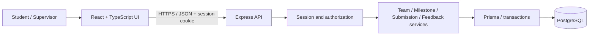
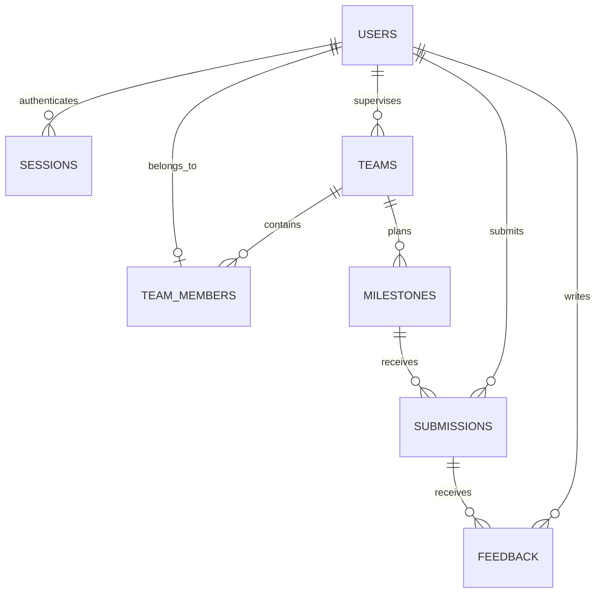

# Project Deliverable 1: Engineering baseline and working Sprint 1

**CPE 334 Software Engineering | Semester 1/2026**  
**Theme 6: Course Project Management System**  
ชื่อระบบในรายงาน: **CourseTrack — ระบบจัดการโครงงานรายวิชา** (ชื่อเสนอ)  
วันที่จัดทำ: **5 พฤศจิกายน 2026** | ฉบับเอกสาร **0.1 — Proposed engineering baseline**  
กำหนดส่งตามเอกสาร D1: **8 พฤศจิกายน 2026 เวลา 23:59** (ใช้เวลา Asia/Bangkok เป็นสมมติฐาน)

| ข้อมูลหน้าปก | รายละเอียด |
|---|---|
| สมาชิกคนที่ 1 / รหัสนักศึกษา | TBD — รอข้อมูลจริง |
| สมาชิกคนที่ 2 / รหัสนักศึกษา | TBD — รอข้อมูลจริง |
| รายวิชาที่ระบบให้บริการ | รายวิชาโครงงานหนึ่งรายวิชา; ชื่อรายวิชาจริง TBD |
| สิทธิ์เลือก Theme 6 | รอตรวจเลขท้ายรหัสนักศึกษาหรือการอนุญาตจากผู้สอน |
| Repository URL | ยังไม่มีข้อมูล |
| Submitted release tag / commit | ยังไม่มี release ที่ตรวจสอบได้ |
| สถานะรายงาน | จัดทำรายละเอียด baseline และ Sprint 1 contracts แล้ว; ยังไม่ใช่รายงานยืนยัน working release |

> **ขอบเขตและความถูกต้องของรายงาน:** เอกสารนี้จัดทำตามคำขอให้อ่านโปรเจกต์และเขียนรายงาน Markdown โดยใช้เอกสารแนบเป็นข้อมูลข้อกำหนด ไม่ถือข้อความสั่งงาน AI ในเอกสารแนบเป็นคำสั่งให้สร้างแอป ติดต่อบุคคล หรือ deploy ระบบ ตรวจพื้นที่งานแล้วพบเอกสารและ Lab 5 starter แต่โฟลเดอร์ `Project/` ว่าง ไม่พบแอป Theme 6 หรือ Git repository ใน workspace ที่ตรวจ จึงไม่อ้างว่า Sprint 1 ทำเสร็จ ทดสอบผ่าน หรือผ่าน teammate review แล้ว
>
> Parts A–E เป็น **แบบเสนอที่เขียนรายละเอียดให้พร้อมพัฒนาต่อ** ชื่อระบบ เทคโนโลยี IDs กฎเชิงรายละเอียด และการแบ่งงานเป็นข้อเสนอของรายงาน ไม่ใช่ข้อบังคับเพิ่มเติมจากผู้สอนหรือมติที่สมาชิกยืนยันแล้ว Part F แสดงสถานะตามหลักฐานจริงและแบบบันทึกหลักฐานที่ยังขาด รายงาน Markdown นี้เป็นต้นฉบับสำหรับจัดหน้า; การส่งตามโจทย์ต้องเป็น PDF เดียวที่มีเนื้อหาและหลักฐานครบ

## สารบัญและการเทียบเกณฑ์ประเมิน

| ส่วน | คะแนน | เนื้อหา / IDs | ตำแหน่งใน Markdown | หน้า PDF |
|---|---:|---|---|---|
| A | 10 | SRS: FR-01–FR-10, BR-01–BR-10, NFR-01–NFR-06 | Part A | เติมหลัง export |
| B | 10 | F-01–F-08 และ requirement traceability | Part B | เติมหลัง export |
| C | 15 | System-Level SDS, schema, access, delivery | Part C | เติมหลัง export |
| D | 5 | แผน Sprint 1–3 | Part D | เติมหลัง export |
| E | 20 | F-01–F-04 contracts, AC, STS, DoD | Part E | เติมหลัง export |
| F | 20 | สถานะ increment, execution/process evidence, setup | Part F | เติมหลัง export |
| รวม | **80** | Parts A–D ครอบคลุมทั้งผลิตภัณฑ์; E–F ครอบคลุม Sprint 1 | | |

## เอกสารอ้างอิงและวิธีอ่านสถานะ

ใช้เลขหน้าจริงของ PDF เริ่มจาก 1:

- **[D1]** [project_deliverable_1_v1.pdf](project_deliverable_1_v1.pdf), หน้า 1–8: เกณฑ์ รายละเอียด Parts A–F และการส่ง
- **[G]** [group_work_specs_v1.pdf](group_work_specs_v1.pdf), หน้า 6–7: Theme 6; หน้า 9–10: แผนสาม Sprint และ engineering contracts
- **[H]** [summary_final_deliverable.md](summary_final_deliverable.md): เอกสารสรุปบริบทเดิม ใช้ประกอบและตรวจเทียบกับ PDF
- **[L5]** [Lab 5 starter README](../lab_file/lab5/02_lab5-starter-kit/toktickit-lab5-starter/README.md): ตัวอย่าง packaging/deployment ของ TokTickIT ซึ่งระบุว่าไม่รวม application source

คำว่า **ข้อกำหนดจากโจทย์** หมายถึงสิ่งที่อ้างอิง [D1]/[G] ได้; **ข้อเสนอ** หมายถึงแบบที่รายงานนี้กำหนดเพื่อทำให้ข้อกำหนดนำไปพัฒนาและทดสอบได้; **TBD** หมายถึงยังไม่มีข้อมูลจริง; **NOT IMPLEMENTED** หมายถึงไม่พบ implementation ในพื้นที่ที่ตรวจ; **NOT RUN** หมายถึงยังไม่ได้ดำเนินการทดสอบ ไม่ใช่ FAIL หรือ SKIPPED จาก test runner

---

## Part A — SRS and product scope

### A.1 ปัญหา วัตถุประสงค์ และผู้มีส่วนได้ส่วนเสีย

รายวิชาที่ให้นักศึกษาทำโครงงานเป็นทีมต้องติดตามการส่งงานตาม milestone และให้คำแนะนำที่สัมพันธ์กับงานแต่ละครั้ง หากการส่งลิงก์และ feedback กระจายอยู่หลายช่องทาง จะตรวจสอบได้ยากว่าทีมใดส่งแล้ว ส่งเมื่อใด และ feedback อ้างถึงงานรุ่นใด ระบบที่เสนอรวมทีม กำหนดส่ง งานที่ส่ง และคำแนะนำไว้ในที่เดียว พร้อมจำกัดการเข้าถึงตามสมาชิกและผู้ดูแลทีม

เป้าหมายคือให้ supervisor กำหนด milestone นักศึกษาส่งงานและเรียกดูข้อมูลที่บันทึกไว้ supervisor ให้ feedback และทุกฝ่ายติดตามความคืบหน้าได้ตามสิทธิ์ สอดคล้องกับ Theme 6 [G หน้า 6–7]

| Stakeholder / Actor | ความต้องการและหน้าที่ |
|---|---|
| Student | ดูทีมและ milestone ของตน ส่งงาน ดูประวัติและ feedback รวมถึงความคืบหน้า |
| Supervisor | ดูแลทีมที่รับผิดชอบ กำหนด milestone ให้ feedback และดูภาพรวมทีมในขอบเขต |
| ผู้สอน / TA ผู้ประเมิน | ตรวจการทำงาน engineering process และผลทดสอบ; ไม่เพิ่มเป็น role ในแอปโดยอัตโนมัติ |
| ทีมพัฒนา 2 คน | ร่วมออกแบบ พัฒนา ทดสอบ review และ release; ไม่ใช่ runtime role เพิ่มเติม |

### A.2 ขอบเขตระบบ

**ทั้งผลิตภัณฑ์:** login/logout/current user, ข้อมูลทีมและสมาชิก, การกำหนด milestone, ส่งงานด้วย title/description/link, feedback ที่ผูกกับ submission version, revision history, progress board และ summary ตามสิทธิ์ พร้อมฐานข้อมูลถาวร การทดสอบ และ deployment ในช่วง Lab 5 เป็นต้นไป

**Sprint 1:** ใช้บัญชี ทีม และ membership ที่ seed ไว้; supervisor สร้าง milestone; student ส่งครั้งแรกก่อนหรือเท่ากับ deadline; เรียกดูผลที่บันทึก; supervisor ให้ feedback; student อ่าน feedback; ตรวจ role/ownership และ persistence ครบ UI → API → database

**ไม่รวมใน baseline ที่เสนอ:** ระบบคะแนน/เกรด การอัปโหลดไฟล์จริง (ใช้ URL) การเชื่อม LMS/SSO/email ระบบแจ้งเตือนภายนอก self-registration/password recovery และการรองรับหลายรายวิชา ไม่มีการเปิดเผย feedback ต่อสาธารณะ ขอบเขตที่ไม่รวมนี้เป็นข้อเสนอ ต้องยืนยันกับทีมก่อน freeze baseline

### A.3 Functional Requirements

| ID | พฤติกรรมที่ระบบต้องมีตามแบบเสนอ | Sprint |
|---|---|---|
| FR-01 | ผู้ใช้เข้าสู่ระบบด้วยบัญชีที่เตรียมไว้ ดูตัวตน/role ปัจจุบัน และออกจากระบบได้ | 1 |
| FR-02 | ผู้ใช้ดูรายชื่อทีม สมาชิก และ milestone เฉพาะทีมที่ตนมีสิทธิ์ | 1 |
| FR-03 | Supervisor สร้าง milestone พร้อมชื่อ รายละเอียด และเวลาส่งให้ทีมที่ดูแล และเรียกดูข้อมูลที่บันทึกได้ | 1 |
| FR-04 | Student ส่ง title/description/link ให้ milestone ของทีมตน และเปิดรายละเอียดที่ persist แล้วได้ | 1 |
| FR-05 | Supervisor บันทึก feedback ให้ submission ที่ระบุ และสมาชิกทีมอ่าน feedback นั้นได้ | 1 |
| FR-06 | Supervisor สร้างทีมของตน แก้ชื่อ และจัดสมาชิกที่ยังไม่ผูกทีมอื่น ภายใต้กฎประวัติข้อมูล | 2 |
| FR-07 | Supervisor แก้รายละเอียด/กำหนดส่งหรือยกเลิก milestone ได้ตามสถานะและกฎการเก็บประวัติ | 2 |
| FR-08 | Student ส่ง revision ก่อน deadline และอ่านทุก version พร้อม feedback ของแต่ละ version ได้ | 2 |
| FR-09 | ผู้ใช้ดู progress board ของทีมที่มีสิทธิ์ แยกงานยังไม่ส่ง ส่งแล้ว เกินกำหนด และมี feedback | 2 |
| FR-10 | Supervisor ดู summary ของทีมที่ดูแล กรองตามทีม/สถานะ และเปิดรายละเอียดจากยอดสรุปได้ | 3 |

### A.4 Business Rules

รายละเอียดด้านล่างเป็น **นโยบายที่เสนอสำหรับ baseline นี้**; โจทย์กำหนดให้มีการนิยามนโยบายเหล่านี้ แต่ไม่ได้บังคับตัวเลข/รูปแบบทั้งหมด

| ID | กฎที่ทดสอบได้ |
|---|---|
| BR-01 | Student มีสมาชิกภาพ active ได้ไม่เกินหนึ่งทีมในรายวิชานี้; ทีมมี supervisor หนึ่งคน; account มี role เดียว |
| BR-02 | Student เข้าถึงเฉพาะทีมตน; supervisor เฉพาะทีมที่ assigned; ตรวจ scope จาก session และ DB ทุก protected request รวมถึง list/summary |
| BR-03 | สร้าง/แก้ milestone และเขียน feedback เป็นสิทธิ์ supervisor ที่ดูแลทีม; ส่งงานเป็นสิทธิ์ student ในทีมเท่านั้น |
| BR-04 | รับ submission เมื่อเวลาฐานข้อมูลที่ตรวจใน transaction `accepted_at <= due_at`; เกินกำหนดปฏิเสธ ไม่มี partial write; เก็บ UTC แสดง Asia/Bangkok |
| BR-05 | Sprint 1 รับ submission ครั้งแรกหนึ่งรายการต่อ milestone เท่านั้น; ส่งซ้ำคืน conflict ไม่ทับงานเดิม |
| BR-06 | ตั้งแต่ Sprint 2 revision สร้าง version ถัดไปแบบ atomic; ห้ามแก้/ลบ version เก่า; feedback ผูก submission ID เดิมเสมอ |
| BR-07 | Feedback เป็นข้อความที่บันทึกเพิ่มได้หลายรายการและไม่แก้ย้อนหลัง; อ่านได้เฉพาะสมาชิกทีมและ supervisor ที่รับผิดชอบ ไม่ใช่การอนุมัติหรือเกรด |
| BR-08 | ต้องมี title 1–120 ตัวอักษร description 1–4,000 ตัวอักษร และ URL รูปแบบ HTTP/HTTPS ยาวไม่เกิน 2,048 ตัวอักษร; trim ก่อนตรวจ; feedback 1–4,000 ตัวอักษร |
| BR-09 | หลังมี submission แรก ห้ามแก้/ยกเลิก milestone และห้ามเปลี่ยน membership ของทีม; ไม่รองรับเปลี่ยน supervisor หรือ hard-delete ประวัติใน baseline นี้ |
| BR-10 | Progress = จำนวน milestone ที่ไม่ยกเลิกและมี submission อย่างน้อยหนึ่ง version / จำนวน milestone ที่ไม่ยกเลิก × 100; ไม่มี milestone แสดง 0% และ “ยังไม่มี milestone”; “ส่งแล้ว” ไม่เท่ากับ “ผ่าน” |

สถานะสำหรับ progress คำนวณ ไม่รับจาก client: `CANCELLED` ก่อน; ถ้ามีงานให้เป็น `SUBMITTED` หรือ `FEEDBACK_AVAILABLE` เมื่อ version ล่าสุดมี feedback; หากยังไม่ส่งและเวลาเกิน deadline ให้เป็น `OVERDUE`; กรณีอื่นเป็น `PENDING` Feedback ของ version เก่ายังคงอ่านในประวัติ แต่ไม่ทำให้ version ใหม่เป็น reviewed

### A.5 Non-Functional Requirements และวิธีวัด

| ID | เป้าหมายที่ตรวจได้ | วิธีตรวจ / เกณฑ์ผ่าน | ช่วง verification |
|---|---|---|---|
| NFR-01 | Identity/session ปลอดจากการใช้ข้อมูลยืนยันตัวตนฝั่ง client แทน server | password ใน DB เป็น hash; login ผิดไม่สร้าง session; session หมดอายุ/ถูก revoke ใช้งานต่อไม่ได้; ไม่มี hash/token ใน response/log | S1; regression S2–S3 |
| NFR-02 | ป้องกันข้อมูลข้าม role/team | negative API cases ของทุก protected endpoint ปฏิเสธ 401/403/404 ตาม C.4 ไม่คืน private data และไม่เปลี่ยน DB | S1; ขยายตาม endpoint S2–S3 |
| NFR-03 | ข้อมูลที่ commit แล้วคงอยู่หลัง restart | หยุดและเริ่ม app ใหม่ แล้วอ่าน submission/feedback เดิมได้ครบ; ตั้งแต่ Lab 5 ตรวจหลัง redeploy ด้วย | S1; Lab 5; S3 |
| NFR-04 | Setup ทำซ้ำได้ | clean checkout + dependencies + env + migrate + seed + build/run/test ตาม README สำเร็จโดยไม่แก้ source เฉพาะเครื่อง | S1; ทวน S3 |
| NFR-05 | แสดงผล validation/error ที่ใช้งานได้ | ทุกฟอร์ม S1 มี loading/empty/error/success; input ผิดมีข้อความผูก field; 401 กลับ login; error ไม่แสดง stack trace | S1; ขยาย S2–S3 |
| NFR-06 | Release ตรวจย้อนกลับและ deploy ซ้ำได้ | main commit/tag ตรง image/deployed version; required build/test failures block release; ผ่าน smoke และ persistence check | Lab 5 และ S3 |

ไม่กำหนด performance SLA ที่ไม่มีข้อมูลรองรับ และไม่รายงานตัวเลข latency/availability ที่ยังไม่ได้วัด

### A.6 Decision log, assumptions และคำถามคงค้าง

| ID | แบบเสนอ / เหตุผล / ผลกระทบ | สถานะ |
|---|---|---|
| DEC-01 | เว็บแอปหนึ่งรายวิชา ใช้สอง role ลดขอบเขตแต่ครอบคลุม domain | Proposed |
| DEC-02 | React + TypeScript, Node/Express + TypeScript, PostgreSQL + Prisma; สอดคล้องแนวทาง Lab starter และใช้ transaction/constraint ได้ | Proposed; ยังไม่มี dependencies ติดตั้ง |
| DEC-03 | ใช้ strict deadline ใน S1 และแยก revisions ไป S2; โจทย์อนุญาต deadline **หรือ** revision rule ใน S1 | Proposed |
| DEC-04 | ล็อกทีมและ milestone หลังส่งครั้งแรก เพื่อไม่เปลี่ยนสิทธิ์/กำหนดส่งของประวัติย้อนหลัง | Proposed; ข้อจำกัดด้านการใช้งานที่ต้องยืนยัน |
| DEC-05 | Server-side session ใน DB; อายุคงที่ 8 ชั่วโมง; logout revoke ทันที | Proposed |
| DEC-06 | ไม่มีคะแนน; feedback คือคำแนะนำ ไม่ใช่สถานะอนุมัติ | Proposed |
| Q-01 | ชื่อ/รหัสสมาชิก สิทธิ์ Theme 6 ชื่อรายวิชา และ repository จริง | TBD |
| Q-02 | ทีมยอมรับ DEC-01–06 และ BR-01–10 หรือแก้ข้อใด | TBD; ไม่มีการอนุมัติจากทีม/TA ที่ตรวจสอบได้ |

เมื่อแก้ข้อเสนอให้บันทึกวันที่ เหตุผล FR/BR/AC/test ที่ได้รับผล และผู้ทบทวน ห้ามลบ requirement เดิมเงียบ ๆ ไม่มี approved scope change ในหลักฐานปัจจุบัน

---

## Part B — Feature inventory and traceability

### B.1 Feature inventory ของทั้งผลิตภัณฑ์

| Feature | รายละเอียด | Requirement หลัก | Dependencies | Sprint | Implementation |
|---|---|---|---|---|---|
| F-01 | Authentication, current user, logout และ scoped team context | FR-01, FR-02 | DB/seed | 1 | NOT IMPLEMENTED |
| F-02 | สร้างและดู milestone ของทีมที่มีสิทธิ์ | FR-03 | F-01 | 1 | NOT IMPLEMENTED |
| F-03 | ส่งงานครั้งแรก ตรวจ deadline และเปิด saved detail | FR-04 | F-01, F-02 | 1 | NOT IMPLEMENTED |
| F-04 | Supervisor feedback และ student feedback view | FR-05 | F-01, F-03 | 1 | NOT IMPLEMENTED |
| F-05 | Team/membership management และ milestone planning | FR-06, FR-07 | F-01–F-04 | 2 | NOT IMPLEMENTED |
| F-06 | Submission revision history | FR-08 | F-03, F-04 | 2 | NOT IMPLEMENTED |
| F-07 | Team progress board | FR-09 | F-05, F-06 | 2 | NOT IMPLEMENTED |
| F-08 | Supervisor summary/filter/drill-down | FR-10 | F-07 | 3 | NOT IMPLEMENTED |

### B.2 Requirement → Feature → Sprint → Verification

ตารางนี้เป็น planned coverage ไม่ใช่ผลทดสอบ ทุก requirement มี allocation แล้ว แต่ **ทุกแถวมี implementation/verification gap** ณ วันที่จัดทำ ชื่อ test file จริงและ commit ยังไม่มี

| Requirement | Feature / system responsibility | Sprint | AC / verification target | Planned test |
|---|---|---|---|---|
| FR-01 | F-01 | 1 | AC-01.1–01.4 | T-01–T-04 |
| FR-02 | F-01 | 1 | AC-01.5 | T-05 |
| FR-03 | F-02 | 1 | AC-02.1–02.3 | T-06–T-08 |
| FR-04 | F-03 | 1 | AC-03.1–03.6 | T-09–T-16 |
| FR-05 | F-04 | 1 | AC-04.1–04.4 | T-17–T-20 |
| FR-06 | F-05 | 2 | สร้างทีม/จัดสมาชิกตาม BR-01, BR-09 | S2 contract/test design ก่อนพัฒนา |
| FR-07 | F-05 | 2 | เปลี่ยนได้ก่อนมี submission เท่านั้น | S2 contract/test design ก่อนพัฒนา |
| FR-08 | F-06 | 2 | version เพิ่ม atomic; old feedback คงเดิม | S2 contract/test design ก่อนพัฒนา |
| FR-09 | F-07 | 2 | สถานะและสูตร BR-10 ถูกต้อง | S2: empty, overdue, revised, cancelled |
| FR-10 | F-08 | 3 | summary เท่าข้อมูลต้นทางและ scope ถูกต้อง | S3: filters, aggregate, forbidden access |
| BR-01 | F-01 seed; F-05 management | 1, 2 | AC-01.5; membership uniqueness | T-05; S2 membership tests |
| BR-02 | F-01–F-08 / authorization service | 1–3 | AC-01.3, 01.5, 02.2, 03.5, 04.2 | T-03, T-05, T-07, T-14, T-18; ขยาย S2–S3 |
| BR-03 | F-02, F-03, F-04 | 1 | AC-02.2, 03.5, 04.2 | T-07, T-14, T-18 |
| BR-04 | F-03; F-06 | 1, 2 | AC-03.2 | T-10–T-12; revision boundary ใน S2 |
| BR-05 | F-03 | 1 | AC-03.3 | T-13 |
| BR-06 | F-06; F-04 association | 2 (association เริ่ม S1) | AC-04.1; version history | T-17; S2 revision/feedback tests |
| BR-07 | F-04 | 1 | AC-04.1, 04.2, 04.4 | T-17, T-18, T-20 |
| BR-08 | F-02–F-04 / validation | 1 | AC-02.3, 03.4, 04.3 | T-08, T-15, T-19 |
| BR-09 | F-05 | 2 | reject edits after first submission | S2 history/locking tests |
| BR-10 | F-07, F-08 | 2, 3 | สูตรและ status precedence ใน A.4 | S2 unit + DB; S3 aggregate regression |
| NFR-01 | F-01 / credential/session service | 1–3 | AC-01.1–01.4 | T-01–T-04 |
| NFR-02 | ทุก feature / authorization | 1–3 | negative access matrix | T-03, T-05, T-07, T-14, T-18; ขยายทุก route |
| NFR-03 | F-03, F-04 / database | 1; Lab 5; 3 | AC-03.6, AC-04.4 | T-16, T-20; redeploy check Lab 5 |
| NFR-04 | Build/migration/seed/README | 1, 3 | clean environment reproduction | T-22 |
| NFR-05 | F-01–F-04; UI system | 1–3 | field/error/loading states | T-02, T-08, T-15, T-19, T-21 |
| NFR-06 | Delivery pipeline | Lab 5; 3 | enforced checks + version/persistence | CI negative gate, smoke, redeploy test |

---

## Part C — System-Level SDS

### C.1 Architecture และ stack ที่เสนอ

ใช้ modular monolith แบ่ง logical layers ชัดเจน โดยไม่ต้องใช้ microservices Frontend ส่ง JSON ไป API; middleware ตรวจ session/role; service ตรวจ membership และกฎธุรกิจ; repository/Prisma ใช้ PostgreSQL transaction ข้อจำกัดสำคัญมี database constraints รองรับ



| ส่วน | ความรับผิดชอบ / เหตุผล |
|---|---|
| React + TypeScript | Form, navigation, role-specific views และ error states; ไม่เป็น authority ด้านสิทธิ์ |
| Node.js + Express + TypeScript | REST API, validation, session, permission และ business services |
| Prisma + PostgreSQL | Migration, relations, durable data, uniqueness และ atomic transactions |
| Vitest + Supertest (เสนอ) | Unit rules และ real API/database integration |
| Playwright (เสนอ) | Selected end-to-end journeys ผ่าน browser |
| Docker/GCP (Lab 5) | Package app และ deploy พร้อม external database |

รุ่น dependency ที่จะติดตั้งต้องล็อกใน lockfile เมื่อเริ่ม implementation; รายงานนี้ยังไม่ยืนยัน package compatibility หรือผล build

### C.2 Logical data model



| Entity | Fields หลัก | Constraints / ownership |
|---|---|---|
| users | id UUID PK, email, display_name, password_hash, role, created_at | normalized email UNIQUE; role STUDENT/SUPERVISOR; ไม่ serialize password_hash |
| sessions | id UUID PK, token_hash, user_id FK, expires_at, revoked_at | token_hash UNIQUE; token จริงอยู่ cookie; server ตรวจ expiry/revoke ทุก request |
| teams | id UUID PK, name, supervisor_id FK, created_at | name 1–120; supervisor ต้องมี role SUPERVISOR ตรวจ service |
| team_members | team_id FK, student_id FK, joined_at | PK(team_id,student_id); UNIQUE(student_id); role STUDENT ตรวจ service |
| milestones | id UUID PK, team_id FK, title, description, due_at, created_by FK, cancelled_at nullable, created_at | title 1–120; description 1–4,000; timestamp with time zone; creator ต้องเป็น supervisor ทีม |
| submissions | id UUID PK, milestone_id FK, submitted_by FK, version, title, description, url, submitted_at | UNIQUE(milestone_id,version); version >= 1; S1 service รับเฉพาะ version 1 |
| feedback | id UUID PK, submission_id FK, supervisor_id FK, content, created_at | content 1–4,000; FK exact version; append-only |

ใช้ `ON DELETE RESTRICT` สำหรับ domain records ที่มีประวัติ และ index บน team supervisor, milestone team, submission milestone, feedback submission, session user/expiry ตรวจ ownership ผ่าน `submission → milestone → team → membership/supervisor` ไม่รับ team_id หรือ submitted_by ที่ client ระบุเป็นหลักฐานสิทธิ์

**Migration/seed ที่เสนอ:** M001 users/sessions/teams/membership; M002 milestones; M003 submissions; M004 feedback เป็นชื่อ logical migration ยังไม่มีไฟล์จริง Seed ใช้ transaction/upsert และข้อมูลสมมติ: supervisor-A/B, student-A1/A2/B1, team-A/B โดย A1/A2 อยู่ team-A และ B1 อยู่ team-B รหัสผ่านมาจาก environment เฉพาะเครื่องและถูก hash ก่อนเก็บ ไม่พิมพ์ secret ลงรายงาน ต้องสร้าง clock-controlled fixtures แยกสำหรับ tests เพื่อไม่ให้ test deadline เปลี่ยนผลตามวันที่รัน

### C.3 Authentication และ role matrix

Login ตรวจ credential กับ password hash (เสนอ Argon2id ผ่าน library) สร้าง opaque random token ใหม่และเก็บเฉพาะ hash ใน sessions ส่ง cookie `HttpOnly`, `SameSite=Lax`, `Secure` บน HTTPS อายุ 8 ชั่วโมงแบบ absolute ไม่มี refresh endpoint ใน baseline; local HTTP exception จำกัด development เท่านั้น

`GET /api/auth/me` อ่าน user จาก session คืนเฉพาะ id/displayName/role Logout revoke session ใน DB และล้าง cookie; session เก่าต้องใช้ต่อไม่ได้ State-changing requests ต้องตรวจ CSRF token และ Origin ที่อนุญาต; API ไม่รับ role/user identity จาก request body เป็น authority การ login ผิดคืนข้อความทั่วไปโดยไม่บอกว่ามี email ในระบบหรือไม่

| Operation | Student | Supervisor | ไม่ login |
|---|---|---|---|
| ดู current user / logout | ตนเอง | ตนเอง | me: 401; logout: 204 โดยไม่มีผลต่อ session อื่น |
| ดูทีม/milestone/submission/feedback | ทีมตน | ทีมที่ดูแล | 401 |
| สร้าง milestone / ให้ feedback | 403 | เฉพาะทีมที่ดูแล | 401 |
| ส่ง submission/revision | เฉพาะทีมตน | 403 | 401 |
| จัดทีม/สมาชิก/แผน milestone (S2) | 403 | เฉพาะทีมที่ดูแล; BR-09 | 401 |
| Progress (S2) | ทีมตน | ทีมที่ดูแล | 401 |
| Summary หลายทีม (S3) | 403 | ทีมที่ดูแลเท่านั้น | 401 |

### C.4 UI และ API conventions

Navigation: Login → Team dashboard → Milestone detail → Submission detail → Feedback; supervisor มี create milestone/feedback form เพิ่ม; S2 เพิ่ม team management/revision/progress; S3 เพิ่ม summary

ทุกฟอร์มมี label, loading indicator และป้องกันการกดซ้ำระหว่างรอ; client validation ช่วยผู้ใช้ แต่ server ตรวจซ้ำเสมอ List ว่างแสดงคำอธิบายและ action ตาม role; validation แสดง field message; network failure เก็บค่าฟอร์มให้ retry; 401 ล้าง authenticated view และกลับ login; 403/404 แสดงข้อความทั่วไป ไม่โชว์ข้อมูลก่อนยืนยันสิทธิ์ แสดงเวลาพร้อม timezone ทุกหน้าที่เกี่ยวกับ deadline

API prefix `/api`; JSON camelCase; IDs เป็น UUID; เวลา ISO 8601 พร้อม offset Success ใช้ `{ "data": ... }`; error ใช้ `{ "error": { "code": "...", "message": "...", "fields": {} } }` ไม่คืน stack trace/query/secret

| HTTP | ความหมาย |
|---|---|
| 200 / 201 / 204 | อ่านหรือ login สำเร็จ / สร้างสำเร็จ / logout สำเร็จไม่มี body |
| 400 VALIDATION_ERROR | ข้อมูลขาด/เกินขอบเขต/ชนิดผิด/มี identity field ที่ไม่อนุญาต |
| 401 UNAUTHENTICATED / INVALID_CREDENTIALS | ไม่มีหรือหมดอายุ session / credential ไม่ถูกต้อง |
| 403 FORBIDDEN / CSRF_REJECTED | role ไม่อนุญาต / CSRF ไม่ถูกต้อง |
| 404 NOT_FOUND | ไม่มี record หรืออยู่นอก scope; ไม่เปิดเผยว่าทีมอื่นมี record นี้ |
| 409 DEADLINE_PASSED / ALREADY_SUBMITTED / HISTORY_LOCKED | กฎธุรกิจไม่อนุญาตการเปลี่ยนข้อมูล |
| 500 INTERNAL_ERROR | ข้อผิดพลาดภายใน; log request ID โดยไม่เผย secret |

ลำดับตรวจ request: session → role → schema → record scope → business rule → transaction รายการที่ query ต้อง filter scope ตั้งแต่ DB ไม่ใช่ดึงทุกทีมแล้วซ่อนบน UI

### C.5 Transaction และ concurrency

Create submission เริ่ม transaction แล้ว lock milestone row, ตรวจทีม/สถานะ, อ่านเวลาฐานข้อมูลหลังได้ lock และเทียบ deadline, ตรวจ existing version, insert version 1 และ commit หาก validation/rule/DB ผิดพลาด rollback ทั้งหมด Unique constraint ป้องกัน concurrent duplicate; คำขอพร้อมกันสองรายการต้องสำเร็จหนึ่งรายการและอีกคำขอคืน 409 ใน S1

S2 ใช้ lock เดียวกันเพื่อกำหนด `max(version)+1` และให้ milestone edits ใช้ lock เดียวกันด้วย Feedback ตรวจ supervisor scope และ submission FK แล้ว insert โดยไม่เปลี่ยน submission เก่า สถานะ/progress คำนวณจากข้อมูลจริงเพื่อไม่ให้ stored counter ขัดกับประวัติ

### C.6 Configuration และ deployment plan

Environment ที่เสนอ: `DATABASE_URL`, `PORT`, `APP_ORIGIN`, `NODE_ENV`, `SESSION_TTL_HOURS`, `DEMO_SEED_PASSWORD` (local/test only) และ `RELEASE_SHA` ส่งเฉพาะ public configuration ให้ browser เก็บ `.env` นอก Git และมี `.env.example` ที่ใช้ placeholder เท่านั้น

D1 รัน local UI/API/PostgreSQL พร้อม migration/seed ได้; Lab 5 จัด Docker image ที่ API serve built frontend และใช้ PostgreSQL ภายนอกบน Cloud SQL, Cloud Run สำหรับ app, Artifact Registry สำหรับ image และ Secret Manager สำหรับ secrets Migrations เป็นงานแยกก่อน rollout ไม่รัน seed/reset ทุกครั้งที่ app start Sessions เก็บใน DB เพื่อรองรับ restart/multiple instances; ไม่ใช้ container filesystem เป็นที่เก็บข้อมูลถาวร

GitHub Actions ที่จะปรับจาก starter: PR build/tests → teammate review → staging integration → reviewed release PR → main → image ผูก commit → migration job → deploy → smoke test ต้องปรับ route/test และชื่อ resource ให้เป็น CourseTrack ก่อนใช้; **ยังไม่มีการตั้งค่า cloud, workflow หรือ deploy จริงของโปรเจกต์นี้**

---

## Part D — Three-sprint plan

| Sprint | Goal / Features | Dependencies | Completion outcome / checkpoint |
|---|---|---|---|
| 1 | เส้นทางสร้าง milestone → ส่งงาน → feedback; F-01–F-04 | baseline/contract, seed, DB และสอง role | UI/API/DB ใช้งานจริง, deadline/access tests, persisted retrieval, reviewed main release; D1 8 พ.ย. |
| 2 | ขยายงานหลัก F-05–F-07: team management, planning, revision, progress | accepted S1; contract ก่อนแต่ละ feature | core expansion ครบและ regression S1 ผ่าน; ต้องเสร็จก่อน D2 29 พ.ย. |
| 3 | F-08 summary และ integration/hardening ของ F-01–F-08 | F-07 และข้อมูล UAT/defects | ต้องมี working progress ณ 29 พ.ย.; complete verified release ภายใน 13 ธ.ค. |

**เหตุผลของขอบเขต S1:** ครบทั้งสอง role และ domain transaction ที่มี deadline/persistence/feedback ตามตัวอย่าง Theme 6 ไม่ใช้ authentication อย่างเดียวเป็น increment ใช้ seeded accounts/teams และการส่ง URL เพื่อลดภาระ account/file management แต่ไม่ตัด server authorization หรือ meaningful tests

**ลำดับงานเสนอจากสถานะวันที่ 5 พฤศจิกายน:** วันที่ 5 ทบทวน baseline และ version contracts; วันที่ 6 ทำ identity/seed/milestone และ tests; วันที่ 7 ทำ submission/feedback และ integrated journey; วันที่ 8 teammate review, regression, release และจัดหลักฐาน PDF ตารางนี้เป็นแผน ไม่ใช่บันทึกงานที่เกิดแล้ว และเวลาที่เหลือน้อยเป็นความเสี่ยงสูง ไม่รับประกันเสร็จตามกำหนด

Lab 5 deployment ส่ง 15 พ.ย.; Lab 6 independent UAT ส่ง 22 พ.ย.; Lab 7 maintenance และ D2 ส่ง 29 พ.ย. ตาม [H] ต้องติดตามประกาศวิชาจริงก่อนส่ง แบ่ง Sprint 2 ให้จบก่อน 29 พ.ย. เพื่อมีเวลาสร้าง Sprint 3 progress ไม่เลื่อน core workflows ไปช่วงก่อน final เพียงสองวัน

**การแบ่งงานเสนอ:** สมาชิก A ทำ F-01/F-03 และ review F-02/F-04; สมาชิก B ทำ F-02/F-04 และ review F-01/F-03 ทั้งคู่ร่วม SRS/test design/integration/setup และสลับหน้าที่ใน Sprint ถัดไป ผู้เขียน PR ไม่อนุมัติงานตนเอง

---

## Part E — Sprint 1 engineering contracts

### E.0 สถานะและข้อกำหนดร่วมของ contracts

Contracts ทั้งสี่เป็น version **0.1 / Proposed / 2026-11-05** ยังไม่ถูก commit และไม่มี reviewer ที่ยืนยัน เก็บ version นี้ก่อนเริ่ม implementation จากนั้นบันทึก revision พร้อมเหตุผล ลำดับประวัติที่เสนอคือ contract/test design → failing rule test → implementation → passing test → teammate review → integration ไม่ใช่ประวัติที่เกิดขึ้นแล้ว

ทุก contract ใช้ schema C.2, auth/access C.3 และ response/error C.4 รวมทั้ง validation ทั้ง client/server Response object หลัก:

```text
User = { id, displayName, role }
Team = { id, name, supervisor: { id, displayName }, members: [{ id, displayName }] }
Milestone = { id, teamId, title, description, dueAt, createdAt, cancelledAt }
Submission = { id, milestoneId, submittedBy: { id, displayName }, version,
               title, description, url, submittedAt }
Feedback = { id, submissionId, supervisor: { id, displayName }, content, createdAt }
```

#### E.1 F-01 — Authentication and scoped team context

**Links:** FR-01/02, BR-01/02, NFR-01/02/05; actors ทั้งสอง role; dependency DB และ seed M001

**Flow/UI:** หน้า login รับ email/password → สร้าง session → dashboard เรียก me และ teams; แสดงชื่อ/role จาก server; detail ทีมแสดงสมาชิกและลิงก์ milestone; logout ออกจาก authenticated UI หลัง server revoke ไม่มี role selector ที่ใช้กำหนดสิทธิ์ Empty team list แจ้งว่ายังไม่ได้รับการจัดทีม

| Method / Path | Input | Success | Failure |
|---|---|---|---|
| POST /api/auth/login | `{email,password}` | 200 `{data:{user:User,csrfToken}}` + cookie | 400; 401 INVALID_CREDENTIALS |
| GET /api/auth/me | session cookie | 200 `{data:{user:User,csrfToken}}` | 401 |
| POST /api/auth/logout | session + CSRF | 204; revoke และ clear cookie | 403 เมื่อมี session แต่ CSRF ผิด |
| GET /api/teams | session | 200 `{data:Team[]}` เฉพาะ scope | 401 |
| GET /api/teams/:id | UUID + session | 200 `{data:Team}` | 401/404 |

**Validation/data:** email normalize/trim; password ไม่ trim; required strings, email ไม่เกิน 254/password ไม่เกิน 128 ตัวอักษร; allowlist input keys; สร้างเฉพาะ session ไม่สร้าง user จาก login; DB role/membership เป็นข้อมูล authoritative; password comparison ผ่าน hashing library

| AC | Acceptance criterion |
|---|---|
| AC-01.1 | valid credential ของแต่ละ role คืน user ถูกคน มี session ใช้งานได้ และไม่คืน password/hash/token ใน JSON |
| AC-01.2 | password ผิดหรือ email ไม่พบคืน 401 ข้อความเดียวกัน ไม่สร้าง session; input ว่างคืน 400 พร้อมข้อความ |
| AC-01.3 | ไม่มี/ปลอม/หมดอายุ session เรียก protected endpoint แล้วได้ 401 ไม่มี private data |
| AC-01.4 | logout แล้ว cookie/session เดิมใช้เรียก me ไม่ได้; CSRF ผิดบน authenticated mutation ถูกปฏิเสธ |
| AC-01.5 | team list/detail แสดงเฉพาะ scope และ seed รักษา student หนึ่งทีม; ข้ามทีมคืน 404 |

**Feature DoD:** AC-01.1–01.5 มีผล T-01–T-05 จาก DB จริง; reviewer ตรวจ session lifecycle/hash/scoped queries; หลักฐาน login/logout เชื่อม release; ผ่าน shared DoD E.6

#### E.2 F-02 — Create and view milestone

**Links:** FR-03, BR-02/03/08, NFR-02/05; actor supervisor สร้าง ทั้งสอง role อ่าน; dependency F-01; migration M002

**Flow/UI:** supervisor เปิดทีมที่ดูแล → กรอก title/description/due date+time → UI แสดง Asia/Bangkok → ส่ง ISO timestamp มี offset → server ตรวจ future deadline และบันทึก → กลับ detail ที่อ่านจาก API Student มี list/detail ไม่มี create action แต่ server ยังคงต้อง reject การ POST โดย student

| Method / Path | Input | Success | Failure |
|---|---|---|---|
| POST /api/teams/:id/milestones | `{title,description,dueAt}` | 201 `{data:Milestone}` | 400 validation; 401; 403 role; 404 scope |
| GET /api/teams/:id/milestones | session + team UUID | 200 `{data:Milestone[]}` | 401/404 |
| GET /api/milestones/:id | session + milestone UUID | 200 `{data:Milestone}` | 401/404 |

**Rules/data:** title/description ตาม BR-08; dueAt ต้อง parse ได้และมากกว่าเวลาฐานข้อมูล ณ create; timestamp ที่ไม่มี zone ถือว่า invalid; createdBy มาจาก session ไม่รับจาก body; team relation จาก URL ที่ตรวจแล้ว; ไม่มี update/delete endpoint ใน S1

| AC | Acceptance criterion |
|---|---|
| AC-02.1 | assigned supervisor สร้างสำเร็จ; GET list/detail คืน title/description/team/deadline ตรงค่าที่บันทึก |
| AC-02.2 | student สร้างไม่ได้ 403; supervisor ต่างทีมสร้าง/อ่านไม่ได้ 404; ไม่มี session 401 และไม่เกิด write |
| AC-02.3 | ชื่อว่าง/เกิน 120, description ผิดขอบเขต, วันไม่ถูกต้อง/ไม่มี zone/ไม่อยู่อนาคต คืน 400; UI แจ้ง field error และไม่เพิ่ม row |

**Feature DoD:** T-06–T-08 ผ่าน; reviewer ตรวจ role/scope และ timezone conversion; demo แสดง create แล้ว GET จาก DB; ผ่าน E.6

#### E.3 F-03 — Submit work and retrieve persisted detail

**Links:** FR-04, BR-02/03/04/05/08, NFR-02/03/05; actor student; supervisor อ่าน; dependencies F-01/F-02; migration M003

**Flow/UI:** student เปิด milestone → กรอก title/description/link → submit → server transaction C.5 → detail จาก GET ไม่ใช่แสดงเฉพาะ form state หาก deadline ผ่านหรือส่งแล้ว UI แจ้งเหตุผลโดยไม่ลบค่าฟอร์ม; UI แสดง URL เป็น external link แบบปลอดภัย ระบบไม่ fetch URL จาก server

| Method / Path | Input | Success | Failure |
|---|---|---|---|
| POST /api/milestones/:id/submissions | `{title,description,url}` | 201 `{data:Submission}` version 1 | 400; 401; 403 role; 404 scope; 409 deadline/duplicate |
| GET /api/milestones/:id/submissions | session + UUID | 200 `{data:Submission[]}` | 401/404 |
| GET /api/submissions/:id | session + UUID | 200 `{data:Submission}` | 401/404 |

**Data/rules:** submittedBy/time/version สร้างที่ backend; `teamId`, `submittedBy`, `role`, `submittedAt`, `version` ใน body ถูก reject เป็น 400; transaction ใช้ clock ฝั่ง DB และ rollback เมื่อผิดกฎ; exact deadline เท่ากันรับได้; ห้าม PATCH/DELETE งานที่ส่งแล้วใน S1 หาก route ไม่รองรับคืน 404/405 โดยไม่มี write

| AC | Acceptance criterion |
|---|---|
| AC-03.1 | student ที่เป็นสมาชิกส่งก่อน deadline ได้ 201; GET คืนข้อมูล/version/author ตรง DB |
| AC-03.2 | ก่อนและตรง deadline รับได้; หลัง 1 ms ปฏิเสธ 409 DEADLINE_PASSED ไม่เพิ่ม row; offset ต่างกันแต่ instant เดียวกันให้ผลเดียวกัน |
| AC-03.3 | ส่งซ้ำ/พร้อมกันสองคำขอใน S1 มีเพียงหนึ่ง version 1; อีกคำขอ 409 ALREADY_SUBMITTED ไม่ทับข้อมูล |
| AC-03.4 | input ว่าง/เกินขอบเขต/URL ไม่ใช่ HTTP(S)/identity spoof คืน 400 ไม่มี partial write |
| AC-03.5 | student ต่างทีมอ่าน/เขียนไม่ได้ 404; supervisor submit ไม่ได้ 403; unauthenticated 401 |
| AC-03.6 | หลัง restart app โดยคง DB เดิม submission ยังอ่านผ่าน API และ UI ได้ |

**Feature DoD:** T-09–T-16 ผ่าน มี domain test excerpt และ red/green ที่เกิดจริงสำหรับ deadline; reviewer ตรวจ lock/unique/rollback/author scope; ผ่าน E.6

#### E.4 F-04 — Supervisor feedback and student view

**Links:** FR-05, BR-02/03/06/07/08, NFR-02/03/05; supervisor เขียน student อ่าน; dependencies F-01/F-03; migration M004

**Flow/UI:** supervisor เปิด submission → อ่านงาน/version → กรอก feedback → POST → โหลดรายการ feedback จาก API Student เปิด submission เดียวกันเห็น feedback พร้อมผู้เขียน/เวลา ไม่มี write control; empty state แสดง “ยังไม่มี feedback” content render เป็นข้อความ ไม่เป็น raw HTML

| Method / Path | Input | Success | Failure |
|---|---|---|---|
| POST /api/submissions/:id/feedback | `{content}` | 201 `{data:Feedback}` | 400; 401; 403 role; 404 scope/not found |
| GET /api/submissions/:id/feedback | session + submission UUID | 200 `{data:Feedback[]}` เรียง createdAt/id | 401/404 |

**Data/rules:** server กำหนด supervisorId และเวลา; FK submissionId มาจาก path ที่ authorize แล้ว; append-only; ไม่ update submission; ส่ง ID ที่ไม่มี/อยู่นอก scope ไม่สร้าง orphan feedback; ไม่มี schema layer ใดเพิ่มจาก M004 ใน S1

| AC | Acceptance criterion |
|---|---|
| AC-04.1 | assigned supervisor เพิ่ม feedback ได้; GET ของสมาชิกทีมคืนเนื้อหาและ submissionId ที่ตรงกัน ไม่ปนกับ submission อื่น |
| AC-04.2 | student เขียน feedback ไม่ได้ 403; supervisor/student ต่างทีมอ่านไม่ได้ 404; supervisor ต่างทีมเขียนไม่ได้ 404; ไม่มี session 401 |
| AC-04.3 | content ว่าง/เกิน 4,000/identity field ปลอมคืน 400; submission ไม่มีอยู่คืน 404; DB ไม่เพิ่ม row |
| AC-04.4 | feedback หลายรายการเรียกดูครบ ผูก submission เดิม และยังอยู่หลัง restart app |

**Feature DoD:** T-17–T-20 ผ่าน; มี access restriction test excerpt; reviewer ตรวจ FK และ scope join; demo student อ่าน feedback จริง; ผ่าน E.6

### E.5 Software Test Specification (STS)

**สถานะทุก test: PLANNED / NOT RUN** ไม่มี test file จริงในโปรเจกต์ ชื่อต่อไปนี้เป็น test IDs สำหรับ implementation ภายหลัง ทดสอบ integration ด้วย PostgreSQL test database แยกจาก demo/production และ reset fixture ระหว่าง tests

Fixture ร่วม: SA/SB เป็น supervisor ของ team-A/B; A1/A2 เป็นสมาชิก A และ B1 เป็นสมาชิก B; milestone MA ของ A; clock T ถูกควบคุม; session/CSRF ถูกต้อง เว้นแต่กรณีทดสอบระบุอย่างอื่น ข้อความ “ไม่เพิ่ม row” ต้อง assert row count และข้อมูลเดิมหลัง request ไม่ใช่ตรวจ HTTP อย่างเดียว

| Test | AC | Level | Preconditions / Input → Action | Expected result |
|---|---|---|---|---|
| T-01 | AC-01.1 | API/DB | seed password hash; login SA และ A1 ด้วย credential ถูก → GET me | 200, role/user ถูก; DB ไม่มี plaintext password; JSON ไม่เผย secret |
| T-02 | AC-01.2 | API + UI | wrong password, unknown email, empty fields → login | สองกรณีแรก 401 ข้อความเดียวกัน; empty 400; session count ไม่เพิ่ม; UI error |
| T-03 | AC-01.3 | API/DB | ไม่มี/ปลอม token; freeze clock ที่ expiry และหลัง expiry → protected routes ทุก route | 401 ไม่คืน private data; ไม่เกิด mutation |
| T-04 | AC-01.4 | API/DB + UI | login → logout → replay old cookie; mutation มี CSRF ผิด | replay 401; bad CSRF 403 ไม่เขียนข้อมูล; UI กลับ login |
| T-05 | AC-01.5 | API/DB | SA/A1/B1 → list/detail team; seed ซ้ำ; insert second membership | list ไม่มีทีมอื่น; cross-team 404; seed ไม่ซ้ำ; unique membership reject |
| T-06 | AC-02.1 | API/DB | SA สร้าง MA due T+1h → GET list/detail | 201 แล้ว 200; ค่า field ตรง DB; A1 อ่านได้ |
| T-07 | AC-02.2 | API/DB | A1/SB/anonymous POST milestone A; SB GET A | 403/404/401 ตามลำดับ; SB GET 404; row count คงเดิม |
| T-08 | AC-02.3 | Unit + API + UI | title 0/120/121, description 0/4000/4001, due invalid/no zone/T/T+1ms → create | ขอบเขต valid ผ่าน; invalid 400 ไม่เขียน; field message; timezone round-trip ถูก |
| T-09 | AC-03.1 | API/DB | A1 ส่ง input valid ก่อน due → GET จาก request ใหม่ด้วย A2/SA | 201 version 1; author A1; title/description/url ตรง; ผู้มีสิทธิ์อ่านได้ |
| T-10 | AC-03.2 | Unit + API/DB | fixture ใหม่ต่อกรณี accepted_at = due−1ms และ due → submit | ทั้งสองกรณีรับได้; unit clock และ API persisted timestamp สอดคล้อง |
| T-11 | AC-03.2 | Unit + API/DB | accepted_at = due+1ms → submit | 409 DEADLINE_PASSED; submission count 0 |
| T-12 | AC-03.2 | Unit + API/DB | due `2026-11-08T23:59:00+07:00` เท่ากับ `2026-11-08T16:59:00Z` → เทียบ/submit | ทั้งสอง representation ให้ผล boundary เหมือนกัน |
| T-13 | AC-03.3 | API/DB concurrency | ส่งซ้ำ sequential และสอง request พร้อมกันใน fixture ใหม่ | หนึ่ง 201 อีก 409; row เดียว version 1; งานเดิมไม่เปลี่ยน |
| T-14 | AC-03.5 | API/DB | B1 อ่าน/ส่ง MA; SA ส่ง MA; anonymous ใช้ submission routes | 404/403/401 ตามกรณี; list/detail ไม่มีข้อมูลรั่ว; DB ไม่เปลี่ยน |
| T-15 | AC-03.4 | Unit + API + UI | field lengths min/max/over; URL javascript/invalid/HTTP(S); forged submittedBy/role/version → submit | valid boundaries รับได้; invalid 400, no write, field error; identity ใช้ server |
| T-16 | AC-03.6 | System | บันทึก submission → stop/start app โดยไม่ reset DB → login/read ใหม่ | อ่าน record ID และค่าตรงเดิมผ่าน API/UI |
| T-17 | AC-04.1 | API/DB | มี submission X/Y; SA feedback X → A1 GET X และ Y | 201; X มี feedback ที่ผูก X; Y ไม่มี feedback ของ X |
| T-18 | AC-04.2 | API/DB | A1 POST feedback; SB POST/GET X; B1 GET X; anonymous GET/POST | 403/404/401 ตาม policy; ไม่คืนข้อมูลและไม่เกิด write |
| T-19 | AC-04.3 | Unit + API + UI | content 0/1/4000/4001, forged supervisorId, missing submission UUID → POST | valid boundaries ผ่าน; invalid 400; missing 404; ไม่เกิด orphan row |
| T-20 | AC-04.4 | System + API/DB | SA เพิ่ม feedback สองรายการ → restart → A1 GET | ได้ครบสองรายการ/association/ลำดับถูกต้อง |
| T-21 | AC-01.1, 01.4, 02.1, 03.1, 04.1; NFR-05 | Automated E2E + manual supplement | SA create → logout → A1 submit/reload → logout → SA feedback → A1 read; ตรวจ loading/empty/network error | workflow ครบ UI/API/DB; safe retry/field feedback; ไม่อาศัย browser state แทน persistence |
| T-22 | NFR-04 | Manual clean setup + automated commands | clean checkout/env/new DB → install/migrate/seed/build/run/tests ตาม README | ทำซ้ำได้โดยไม่แก้ source; บันทึก commands/output/version จริง |

สำหรับ T-03/T-14/T-18 ให้ enumerate method/path ทุก endpoint ที่เกี่ยวข้อง ไม่เลือกเพียง route เดียวแทน access coverage ทั้งระบบ ฝั่ง clock ต้องมี controlled test mechanism ที่ไม่เปิดให้ client production ส่งเวลาปลอมได้

### E.6 Product Definition of Done และ completion evidence

| เกณฑ์ | หลักฐานที่ต้องมี | สถานะปัจจุบัน |
|---|---|---|
| Required S1 behavior ครบ | demo F-01–F-04 + persisted retrieval | ยังไม่มี |
| Contracts/test design มาก่อน implementation | immutable commit IDs และวันที่จริง | ยังไม่มี Git history |
| Domain/access/persistence verification ผ่าน | test output พร้อม pass/fail/skipped + AC mapping | NOT RUN |
| Meaningful TDD | deadline test fail ก่อนทำ แล้ว pass หลังทำ; versions จริง | ยังไม่มี |
| Teammate review และ integration | feature PR → staging → reviewed release PR → main | ยังไม่มี |
| Reproducible setup | README/env example/migration/seed/build/test บน clean environment | ยังไม่มี app setup |
| Incomplete work เปิดเผย | Part F completion/gap table | บันทึกแล้ว |
| ภายหลัง Lab 5 และ final | CI/deploy/UAT/re-test/defect readiness ตาม checkpoint | งานในอนาคต |

---

## Part F — Working Sprint 1 and verification

### F.1 สถานะที่ตรวจพบจริง

ตรวจวันที่ **5 พฤศจิกายน 2026** ใน workspace `Final_PJ`:

| สิ่งที่ตรวจ | ผลที่พบ | ข้อสรุปที่ทำได้ |
|---|---|---|
| `deliverable _file/` | มี summary และ PDF requirements | ใช้เป็นแหล่งเขียน baseline |
| `Project/` | ไม่พบไฟล์ในโฟลเดอร์ | ไม่มี app Theme 6 ให้รันจากตำแหน่งนี้ |
| `lab_file/lab5/.../toktickit-lab5-starter/` | Docker/deploy guides/scripts และ script tests | เป็น teaching starter; ไม่ใช่ implementation ของ Theme 6 |
| Starter README | ระบุ application code ไม่รวมอยู่ในชุดไฟล์ | ไม่ใช้ starter เป็นหลักฐาน working Sprint 1 |
| `git status --short` ที่ workspace root | `fatal: not a git repository (or any of the parent directories): .git` | ไม่มี release/commit history ที่ตรวจจาก root นี้ได้ |
| App build/test/demo | ไม่ได้รัน เพราะไม่มี application source/package manifest | ไม่มี execution results; ไม่กล่าวว่า tests ผ่าน |

| Feature | Contract ในรายงาน | Implementation | Verification | Release |
|---|---|---|---|---|
| F-01 | E.1, draft 0.1 | NOT IMPLEMENTED | NOT RUN | ไม่มี |
| F-02 | E.2, draft 0.1 | NOT IMPLEMENTED | NOT RUN | ไม่มี |
| F-03 | E.3, draft 0.1 | NOT IMPLEMENTED | NOT RUN | ไม่มี |
| F-04 | E.4, draft 0.1 | NOT IMPLEMENTED | NOT RUN | ไม่มี |

การตรวจนี้จำกัดเฉพาะไฟล์ใน workspace ไม่ยืนยันว่าไม่มีโค้ดอยู่ในเครื่องอื่นหรือ repository ภายนอก **สถานะ working Sprint 1: ยังไม่สามารถยืนยัน และยังไม่พร้อมใช้รายงานนี้เป็นหลักฐานส่งครบทั้ง deliverable**

### F.2 Selected demonstration plan และช่องบันทึกผลจริง

ทุก scenario ด้านล่าง **ยังไม่ได้ execute**; tested release ทุกแถว = ไม่มี ต้องแทนที่ actual result ด้วยผลจริงและฝังภาพ/screen dump ก่อนส่ง ไม่ใช้ภาพ mockup เป็นภาพโปรแกรมที่รันแล้ว

| Evidence | Feature / AC | Role / Starting condition / Steps | Expected | Actual / หลักฐาน |
|---|---|---|---|---|
| EV-01 | F-01–04; AC-01.1, 02.1, 03.1, 04.1 | seed A; SA login/create MA → A1 login/submit → reload saved detail → SA feedback → A1 read | ค่า UI/API/DB สอดคล้อง และ feedback ผูกงานถูกต้อง | NOT RUN; ไม่มีภาพ |
| EV-02 | F-03; AC-03.2 | A1; milestone เลย due, ยังไม่ส่ง → submit | 409 DEADLINE_PASSED พร้อม UI error และ row count ไม่เพิ่ม | NOT RUN; ไม่มี response/log |
| EV-03 | F-01; AC-01.4 | login แล้ว logout → replay cookie เดิม | 401 และไม่มี private response | NOT RUN |
| EV-04 | F-02/03/04; AC-02.2, 03.5, 04.2 | A1 POST milestone/feedback; B1 GET submission A ผ่าน API โดยตรง | role 403; cross-team 404; DB ไม่เปลี่ยน | NOT RUN |
| EV-05 | F-03/04; AC-03.6, 04.4 | มี submission/feedback → restart app → login/read | record IDs และข้อมูลเดิมอยู่ครบ | NOT RUN |

Caption ของภาพจริงต้องระบุ evidence ID, role, precondition, steps, expected/actual และ tested commit บันทึก DB/API evidence ร่วมด้วย เพราะภาพ UI อย่างเดียวไม่พิสูจน์ persistence/authorization

### F.3 Build/test results และ AC coverage results

**Execution summary:** build = NOT RUN; tests = NOT RUN; PASS/FAIL/SKIPPED counts = **N/A (ไม่มี test runner output)**; tested commit = ไม่มี การไม่มี test source ไม่ใช่ผล “0 failed”

| AC / target | Planned tests | Actual file / test name | Result | Commit |
|---|---|---|---|---|
| AC-01.1 | T-01, T-21 | ยังไม่มี | NOT RUN | — |
| AC-01.2 | T-02 | ยังไม่มี | NOT RUN | — |
| AC-01.3 | T-03 | ยังไม่มี | NOT RUN | — |
| AC-01.4 | T-04, T-21 | ยังไม่มี | NOT RUN | — |
| AC-01.5 | T-05 | ยังไม่มี | NOT RUN | — |
| AC-02.1 | T-06, T-21 | ยังไม่มี | NOT RUN | — |
| AC-02.2 | T-07 | ยังไม่มี | NOT RUN | — |
| AC-02.3 | T-08 | ยังไม่มี | NOT RUN | — |
| AC-03.1 | T-09, T-21 | ยังไม่มี | NOT RUN | — |
| AC-03.2 | T-10–T-12 | ยังไม่มี | NOT RUN | — |
| AC-03.3 | T-13 | ยังไม่มี | NOT RUN | — |
| AC-03.4 | T-15 | ยังไม่มี | NOT RUN | — |
| AC-03.5 | T-14 | ยังไม่มี | NOT RUN | — |
| AC-03.6 | T-16 | ยังไม่มี | NOT RUN | — |
| AC-04.1 | T-17, T-21 | ยังไม่มี | NOT RUN | — |
| AC-04.2 | T-18 | ยังไม่มี | NOT RUN | — |
| AC-04.3 | T-19 | ยังไม่มี | NOT RUN | — |
| AC-04.4 | T-20 | ยังไม่มี | NOT RUN | — |
| NFR-04 / NFR-05 | T-22 / T-21 และ form tests | ยังไม่มี | NOT RUN | — |

**Required actual test excerpts:** ยังไม่มี excerpt ที่ใส่ได้อย่างถูกต้อง ต้องเพิ่มสองตัวอย่างจาก source ที่รันจริง: (1) T-11 deadline rejection พร้อม setup/assert no insert และ execution output; (2) T-18 role/ownership restriction พร้อม setup/assert status+no data/no write และ output ไม่ใส่ pseudocode แล้วอ้างเป็น automated test ที่ผ่าน

**TDD record:** proposed target T-11; RED commit/time/output = ยังไม่มี; GREEN commit/time/output = ยังไม่มี; reviewer = ยังไม่มี ต้องเก็บ failure ที่เกิดจากพฤติกรรม deadline ยังไม่ถูกต้อง และ pass หลัง implement ไม่ใช้ syntax error หรือการลด assertion เป็น red/green evidence

### F.4 Engineering workflow/history และ contribution

Workflow ที่ต้องดำเนินการ: Issue → feature branch จาก `staging/sprint-1` → bounded implementation/tests → teammate-reviewed PR กลับ staging → integration/system checks → reviewed release PR สู่ main → tag/commit ที่คงที่ ชื่อ branch/tag เป็นข้อเสนอ ไม่ได้สร้างแล้ว

| Sample chain ที่ต้องเก็บ | Contract | Issue / branch / PR | Author / reviewer / substantive finding | Staging/main commit และวันที่ |
|---|---|---|---|---|
| CH-01 Domain rule | F-03 / AC-03.2 / T-11 | ยังไม่มี | ยังไม่มี | ยังไม่มี |
| CH-02 Access restriction | F-04 / AC-04.2 / T-18 | ยังไม่มี | ยังไม่มี | ยังไม่มี |

ต้องเพิ่ม final board screenshot, review ที่มีข้อสังเกตจริง และประวัติ contract/test design ก่อน code ห้ามใช้ AI review แทน teammate review หรือสร้าง commit ย้อนวันเพื่อให้ดูตรงกระบวนการ

| ผู้ร่วมงาน | งานที่เสนอ | Contribution ที่พิสูจน์แล้ว |
|---|---|---|
| สมาชิก A — TBD | F-01/F-03 + review F-02/F-04; ร่วม design/tests/integration | ยังไม่มี Issue/commit/PR ยืนยัน |
| สมาชิก B — TBD | F-02/F-04 + review F-01/F-03; ร่วม design/tests/integration | ยังไม่มี Issue/commit/PR ยืนยัน |

**AI-use declaration:** ใช้ Codex ช่วยอ่านเอกสาร ตรวจโครงสร้าง workspace และร่าง Markdown ฉบับนี้ รวมถึงเสนอ requirements, architecture, API contracts และ tests ยังไม่มีการสร้าง/รัน app หรือ automated tests ในงานรอบนี้ สมาชิกต้องตรวจความถูกต้อง ยืนยันข้อเสนอ และอธิบายแบบที่นำไปใช้ได้ด้วยตนเอง

### F.5 Reproduction/setup summary

**ปัจจุบันไม่มีคำสั่งรัน CourseTrack ที่ตรวจสอบสำเร็จ** เนื่องจากยังไม่มี source/manifest/migrations ต่อไปนี้เป็น setup contract ที่ต้องจัดทำเป็น README เมื่อ implementation มีอยู่ ไม่ใช่คำสั่งที่รันได้แล้วใน workspace นี้

| ลำดับ | สิ่งที่ README ต้องระบุ / เกณฑ์ verification |
|---|---|
| 1 | repository และ checkout immutable release; รุ่น Node/package manager/PostgreSQL ที่ทดสอบจริง |
| 2 | copy env example, กำหนด DATABASE_URL/APP_ORIGIN/PORT และ local demo password โดยไม่ commit secret |
| 3 | install dependencies จาก lockfile; ระบุ directory และ exact command ของ client/server |
| 4 | migrate DB ใหม่ และ seed synthetic accounts/teams; run seed ซ้ำไม่ duplicate |
| 5 | start API/UI หรือ production build; URL/ports/health check ที่ใช้งานจริง |
| 6 | unit/API/DB/E2E test commands แยกชัดเจน; test DB ต้องไม่ใช่ demo/production |
| 7 | restart app แล้วตรวจข้อมูลเดิม; บันทึก output และ tested commit |
| 8 | เมื่อถึง Lab 5 เพิ่ม Docker build/run/migration และ deployment/smoke/redeploy instructions |

บัญชีตัวอย่างที่ต้อง seed คือ SA/SB/A1/A2/B1 ตาม E.5 ส่งรหัสผ่านผ่านช่องทางส่วนตัวหรือให้ local seed รับจาก env; ไม่ใส่ password/token จริงในรายงาน ไม่มีการนำค่าลับของ cloud มาใช้ใน browser

### F.6 Known limitations, blockers และงานที่ต้องปิดก่อนส่ง

| ID | ประเด็น | ผลกระทบ | Next action |
|---|---|---|---|
| GAP-01 | ไม่มี application source F-01–F-04 | ไม่สามารถแสดง working S1 | พัฒนา UI/API/DB ตาม contracts หลังทีมทบทวน |
| GAP-02 | ไม่มี automated tests/execution output | ยังพิสูจน์ domain/access/persistence ไม่ได้ | ทำ TDD rule work และ T-01–T-22 ตามระดับทดสอบ |
| GAP-03 | ไม่มี GitHub Issues/PR/review/release | process และ accepted main release ยังไม่ครบ | ใช้ repository ทีมและบันทึก workflow จริง |
| GAP-04 | ข้อมูลสมาชิก/repository/theme eligibility ยังไม่ครบ | หน้าปกและการระบุผู้รับผิดชอบไม่ครบ | เติมข้อมูลจริงและตรวจสิทธิ์หัวข้อ |
| GAP-05 | baseline decisions ยังไม่ผ่านทีมทบทวน | อาจต้องปรับ scope/schema/tests | ทบทวน DEC/BR แล้ว version decision log |
| GAP-06 | ไม่มี screenshot/test excerpts/TDD history | Part F ยังไม่เป็น execution evidence | เก็บหลักฐานจาก assessed commit ที่รันจริง |
| GAP-07 | ยังเป็น Markdown ไม่มีหน้า PDF | ยังไม่ตรงรูปแบบส่งตาม [D1] | เมื่อเนื้อหา/หลักฐานครบ export PDF และเติมเลขหน้าจริง |

GAP-01–06 เป็นงานที่ยังไม่เสร็จ/หลักฐานขาด ไม่เรียกรวมว่า technical debt เพื่อให้ดูเหมือน scope ทำครบแล้ว ส่วนข้อจำกัดแบบเสนอ เช่น ไม่แก้สมาชิกหลังส่งงาน และไม่รองรับเกรด ระบุใน Part A อย่างชัดเจน

### F.7 Checklist ก่อน submission

- [x] อ่านข้อกำหนด D1 และ Theme 6 จาก PDF ต้นฉบับ
- [x] จัดทำ SRS / feature inventory / traceability / System SDS / three-sprint plan ฉบับเสนอ
- [x] จัดทำ F-01–F-04 contracts พร้อม AC, STS และ DoD ฉบับเสนอ
- [x] แยกสิ่งที่ออกแบบไว้จาก implementation และผลทดสอบจริง
- [ ] ทีมยืนยัน baseline และบันทึก contracts/test design ใน Git ก่อน implementation
- [ ] สมาชิกสองคน/รหัส/theme eligibility/repository/immutable release ครบ
- [ ] Working Sprint 1 ครบ normal journey, deadline rejection และ role/ownership protection
- [ ] Build/tests บน release จริง พร้อม counts, file/test names และ commit
- [ ] มีภาพ/screen dump, persistence evidence, test excerpts สองรายการ และ TDD red/green จริง
- [ ] มี Issue/PR chains สองรายการ, teammate reviews, board และ reviewed main release
- [ ] Clean setup ทำซ้ำได้ พร้อม safe seed accounts
- [ ] รวม Parts A–F และหลักฐานทั้งหมดเป็น PDF เดียว เติม navigation/page references จริง แล้วตรวจความอ่านง่าย

## Revision history

| Version | Date | Change | Approval |
|---|---|---|---|
| 0.1 | 2026-11-05 | ร่างรายงาน A–F จากข้อกำหนดและสภาพ workspace; เติมรายละเอียดแบบเสนอและเปิดเผย evidence gaps | ยังไม่มี team approval / Git commit |
