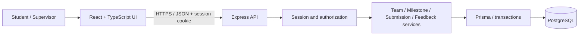
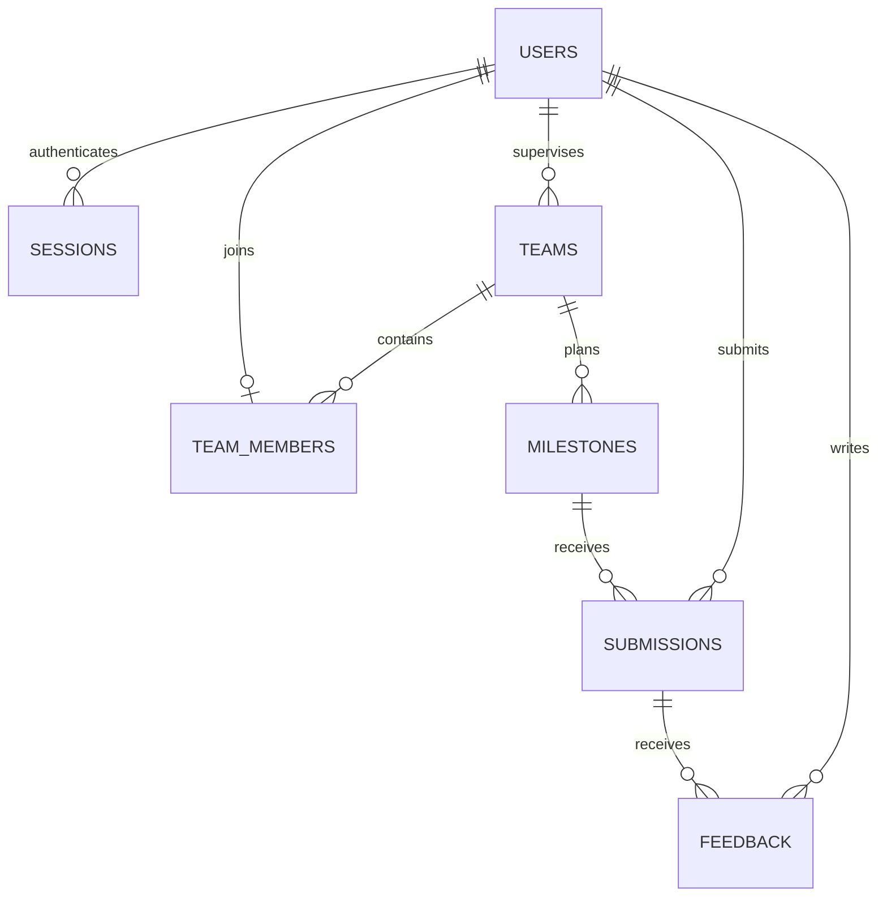

# Project Deliverable 1: Engineering baseline and working Sprint 1

**CPE 334 Software Engineering | Semester 1/2026**<br>
**Theme 6: Course Project Management System**<br>
ชื่อระบบในรายงาน: **fastTrack — ระบบจัดการโครงงานรายวิชา** (ชื่อยืนยันโดยผู้ใช้)<br>
วันที่จัดทำ: **5 พฤศจิกายน 2026** | ฉบับเอกสาร **0.2 — Synchronized engineering baseline**<br>
กำหนดส่งตามเอกสาร D1: **8 พฤศจิกายน 2026 เวลา 23:59** (ใช้เวลา Asia/Bangkok เป็นสมมติฐาน)

| ข้อมูลหน้าปก | รายละเอียด |
|---|---|
| สมาชิกคนที่ 1 / รหัสนักศึกษา | TBD — รอข้อมูลจริง |
| สมาชิกคนที่ 2 / รหัสนักศึกษา | TBD — รอข้อมูลจริง |
| รายวิชาที่ระบบให้บริการ | รายวิชาโครงงานหนึ่งรายวิชา; ชื่อรายวิชาจริง TBD |
| สิทธิ์เลือก Theme 6 | รอตรวจเลขท้ายรหัสนักศึกษาหรือการอนุญาตจากผู้สอน |
| Repository URL | https://github.com/zerotwobook/fastTrack — พบจาก local Git remote; ยังไม่ได้ตรวจสิทธิ์เข้าถึงภายนอก |
| Submitted release tag / commit | ยังไม่มี release ที่ตรวจสอบได้ |
| สถานะรายงาน | จัดทำรายละเอียด baseline และ Sprint 1 contracts แล้ว; ยังไม่ใช่รายงานยืนยัน working release |

> **สถานะและขอบเขต:** รายงานฉบับนี้ปรับให้ตรงกับ `Project_doc/project_detail.md` v0.5 (แบบผลิตภัณฑ์จาก v0.4; v0.5 บันทึกการ sync เอกสาร) ใช้ชื่อ fastTrack ธีมขาวดำ และ Inter + Noto Sans Thai ตามที่ผู้ใช้กำหนด เทคโนโลยีและกฎเชิงรายละเอียดเป็นแบบเสนอสำหรับพัฒนา ไม่ใช่ข้อบังคับเพิ่มเติมจากผู้สอน
>
> ตรวจ workspace ล่าสุดพบ Git repository บน main และ remote ของ fastTrack แต่ `Project_code/` ยังไม่มีไฟล์แอป ไม่มีผล build/test หรือ accepted Sprint 1 release ที่ยืนยัน รายงานนี้จึงเป็น baseline/contracts พร้อมสถานะหลักฐานตามจริง ยังไม่อ้างว่า Working Sprint 1 เสร็จแล้ว
>
> Parts A–D ออกแบบทั้งผลิตภัณฑ์; Part E ระบุ Sprint 1 contracts/AC/STS; Part F ระบุ implementation/verification ที่ยังขาด การส่งตามโจทย์ต้องเป็น PDF เดียวที่รวมเนื้อหาและหลักฐานทั้งหมด Markdown นี้เป็นต้นฉบับจัดหน้า

## สารบัญและการเทียบเกณฑ์ประเมิน

| ส่วน | คะแนน | เนื้อหา / IDs | ตำแหน่งใน Markdown | หน้า PDF |
|---|---:|---|---|---|
| A | 10 | SRS: FR-01–FR-10, BR-01–BR-10, NFR-01–NFR-06 | Part A | เติมหลัง export |
| B | 10 | F-01–F-08 และ requirement traceability | Part B | เติมหลัง export |
| C | 15 | System-Level SDS, schema, access, delivery | Part C | เติมหลัง export |
| D | 5 | แผน Sprint 1–3 | Part D | เติมหลัง export |
| E | 20 | F-01–F-04 contracts, AC เดิม + S1-AC-EXT-01–05, STS, DoD | Part E | เติมหลัง export |
| F | 20 | สถานะ increment, execution/process evidence, setup | Part F | เติมหลัง export |
| รวม | **80** | Parts A–D ครอบคลุมทั้งผลิตภัณฑ์; E–F ครอบคลุม Sprint 1 | | |

## เอกสารอ้างอิงและวิธีอ่านสถานะ

ใช้เลขหน้าจริงของ PDF เริ่มจาก 1:

- **[D1]** [project_deliverable_1_v1.pdf](../project_deliverable_1_v1.pdf), หน้า 1–8: เกณฑ์ รายละเอียด Parts A–F และการส่ง
- **[G]** [group_work_specs_v1.pdf](../group_work_specs_v1.pdf), หน้า 6–7: Theme 6; หน้า 9–10: แผนสาม Sprint และ engineering contracts
- **[H]** [summary_final_deliverable.md](../summary_final_deliverable.md): เอกสารสรุปบริบทเดิม ใช้ประกอบและตรวจเทียบกับ PDF
- **[L5]** [Lab 5 starter README](../../lab_file/lab5/02_lab5-starter-kit/toktickit-lab5-starter/README.md): ตัวอย่าง packaging/deployment ของ TokTickIT ซึ่งระบุว่าไม่รวม application source

- **[P]** [fastTrack project detail v0.5](../../Project_doc/project_detail.md): current design และ review register ที่ sync กับรายงานนี้ เนื้อหาที่ประเมินใน D1 ยังคงฝังใน Parts A–F ไม่ใช้ลิงก์แทนเอกสาร
- **[UI]** [SKILL_UI.md](../../skill/SKILL_UI.md): แนวทางออกแบบ UI ที่นำมาปรับกับธีมขาวดำ

คำว่า **ข้อกำหนดจากโจทย์** หมายถึงสิ่งที่อ้างอิง [D1]/[G] ได้; **ข้อเสนอ** หมายถึงแบบที่รายงานนี้กำหนดเพื่อทำให้ข้อกำหนดนำไปพัฒนาและทดสอบได้; **TBD** หมายถึงยังไม่มีข้อมูลจริง; **NOT IMPLEMENTED** หมายถึงไม่พบ implementation ในพื้นที่ที่ตรวจ; **NOT RUN** หมายถึงยังไม่ได้ดำเนินการทดสอบ ไม่ใช่ FAIL หรือ SKIPPED จาก test runner

---

## Part A — SRS and product scope

### A.1 ปัญหา วัตถุประสงค์ และผู้มีส่วนได้ส่วนเสีย

รายวิชาที่ให้นักศึกษาทำโครงงานเป็นทีมต้องติดตามการส่งงานตาม milestone และให้คำแนะนำที่สัมพันธ์กับงานแต่ละครั้ง หากการส่งลิงก์และ feedback กระจายอยู่หลายช่องทาง จะตรวจสอบได้ยากว่าทีมใดส่งแล้ว ส่งเมื่อใด และ feedback อ้างถึงงานรุ่นใด ระบบที่เสนอรวมทีม กำหนดส่ง งานที่ส่ง และคำแนะนำไว้ในที่เดียว พร้อมจำกัดการเข้าถึงตามสมาชิกและผู้ดูแลทีม

เป้าหมายคือให้ supervisor กำหนด milestone นักศึกษาส่งงานและเรียกดูข้อมูลที่บันทึกไว้ supervisor ให้ feedback และทุกฝ่ายติดตามความคืบหน้าได้ตามสิทธิ์ สอดคล้องกับ Theme 6 [G หน้า 6–7]

| Stakeholder / Actor | ความต้องการและหน้าที่ |
|---|---|
| Student | ดูทีมและ milestone ของตน ส่งงาน ดูประวัติและ feedback รวมถึงความคืบหน้า |
| Supervisor | ดูแลทีมที่รับผิดชอบ กำหนด milestone ให้ feedback และดูภาพรวมทีมในขอบเขต |
| ผู้สอน / TA ผู้ประเมิน | ตรวจการทำงาน engineering process และผลทดสอบ; ไม่เพิ่มเป็น role ในแอปโดยอัตโนมัติ |
| ทีมพัฒนา 2 คน | ร่วมออกแบบ พัฒนา ทดสอบ review และ release; ไม่ใช่ runtime role เพิ่มเติม |

### A.2 ขอบเขตระบบ

**ทั้งผลิตภัณฑ์:** login/logout/current user, ข้อมูลทีมและสมาชิก, การกำหนด milestone, ส่งงานด้วย title/description/link, feedback ที่ผูกกับ submission version, revision history, progress board และ summary ตามสิทธิ์ พร้อมฐานข้อมูลถาวร การทดสอบ และ deployment ในช่วง Lab 5 เป็นต้นไป

**Sprint 1:** ใช้บัญชี ทีม และ membership ที่ seed ไว้; supervisor สร้าง milestone; student ส่งครั้งแรกก่อนหรือเท่ากับ deadline; เรียกดูผลที่บันทึก; supervisor ให้ feedback; student อ่าน feedback; ตรวจ role/ownership และ persistence ครบ UI → API → database

**ไม่รวมใน baseline ที่เสนอ:** ระบบคะแนน/เกรด การอัปโหลดไฟล์จริง (ใช้ URL) การเชื่อม LMS/SSO/email ระบบแจ้งเตือนภายนอก self-registration/password recovery และการรองรับหลายรายวิชา ไม่มีการเปิดเผย feedback ต่อสาธารณะ ขอบเขตที่ไม่รวมนี้เป็นข้อเสนอ ต้องยืนยันกับทีมก่อน freeze baseline

ไม่มี Admin role, chat, plagiarism detection, AI grading หรือ payment ใน baseline บัญชี/การ assign supervisor เตรียมผ่าน seed; supervisor สร้างทีมของตนและเลือก student ที่ยังไม่มีทีมได้ตั้งแต่ S2 จำนวนสมาชิกทีมผู้พัฒนา 2 คนเป็นข้อกำหนดรายวิชา ไม่ใช่ข้อจำกัดจำนวนสมาชิกของแต่ละทีมที่ใช้แอป

### A.3 Functional Requirements

| ID | พฤติกรรมที่ระบบต้องมีตามแบบเสนอ | Sprint |
|---|---|---|
| FR-01 | ผู้ใช้เข้าสู่ระบบด้วยบัญชีที่เตรียมไว้ ดูตัวตน/role ปัจจุบัน และออกจากระบบได้ | 1 |
| FR-02 | ผู้ใช้ดูรายชื่อทีม สมาชิก และ milestone เฉพาะทีมที่ตนมีสิทธิ์ | 1 |
| FR-03 | Supervisor สร้าง milestone พร้อมชื่อ รายละเอียด และเวลาส่งให้ทีมที่ดูแล และเรียกดูข้อมูลที่บันทึกได้ | 1 |
| FR-04 | Student ส่ง title/description/link ให้ milestone ของทีมตน และเปิดรายละเอียดที่ persist แล้วได้ | 1 |
| FR-05 | Supervisor บันทึก feedback ให้ submission ที่ระบุ และสมาชิกทีมอ่าน feedback นั้นได้ | 1 |
| FR-06 | Supervisor สร้างทีมของตน แก้ชื่อ และจัดสมาชิกที่ยังไม่ผูกทีมอื่น ภายใต้กฎประวัติข้อมูล | 2 |
| FR-07 | Supervisor แก้รายละเอียด/กำหนดส่งหรือยกเลิก milestone ได้ตามสถานะและกฎการเก็บประวัติ | 2 |
| FR-08 | Student ส่ง revision ก่อน deadline และอ่านทุก version พร้อม feedback ของแต่ละ version ได้ | 2 |
| FR-09 | ผู้ใช้ดู progress board ของทีมที่มีสิทธิ์ แยกงานยังไม่ส่ง ส่งแล้ว เกินกำหนด และมี feedback | 2 |
| FR-10 | Supervisor ดู summary ของทีมที่ดูแล กรองตามทีม/สถานะ และเปิดรายละเอียดจากยอดสรุปได้ | 3 |

### A.4 Business Rules

นโยบายต่อไปนี้เป็นแบบที่เลือกเสนอสำหรับ fastTrack; โจทย์กำหนดให้ชี้แจงกฎ แต่ไม่ได้บังคับค่ารายละเอียดทุกค่า

| ID | กฎ baseline ที่ออกแบบ |
|---|---|
| BR-01 | Account มี role เดียว; student อยู่ได้ไม่เกินหนึ่งทีม; ทีมมี supervisor หนึ่งคน |
| BR-02 | Student เข้าถึงทีมตน; supervisor เข้าถึงทีมที่ assigned; ทุก query และ mutation ตรวจจาก DB |
| BR-03 | Supervisor เท่านั้นสร้าง milestone/feedback; student สมาชิกทีมเท่านั้นส่งงาน |
| BR-04 | รับงานเมื่อเวลาฐานข้อมูลที่ตรวจหลังได้ lock `acceptedAt <= dueAt`; หลังจากนั้นปฏิเสธ; ใช้ UTC จัดเก็บและ Asia/Bangkok แสดงผล |
| BR-05 | S1 มี submission version 1 ได้หนึ่งรายการต่อ milestone; duplicate/concurrent request ไม่สร้างข้อมูลซ้ำ |
| BR-06 | S2 revision เพิ่ม version อย่าง atomic ไม่ overwrite/delete รุ่นก่อน; feedback ชี้ submission ID ของรุ่นนั้น |
| BR-07 | Feedback เพิ่มได้หลายข้อความ เป็น append-only และ private ต่อทีม/ผู้ดูแล; ไม่ใช่เกรดหรือการอนุมัติ |
| BR-08 | Trim ข้อความก่อนตรวจ; title 1–120, description 1–4,000, feedback 1–4,000 ตัวอักษร; URL HTTP/HTTPS สมบูรณ์ไม่เกิน 2,048 ตัวอักษร |
| BR-09 | มี submission แล้วห้ามแก้/ยกเลิก milestone นั้น และห้ามเปลี่ยน membership ของทั้งทีม; ไม่ hard-delete ประวัติหรือเปลี่ยน supervisor |
| BR-10 | Progress นับ milestone ที่ไม่ยกเลิกและมี submission อย่างน้อยหนึ่งรายการ หารด้วย milestone ที่ไม่ยกเลิกทั้งหมด; ไม่เท่ากับคะแนนหรืออัตราผ่าน |

นโยบายเวลาใช้ “เวลาที่ server ตรวจรับใน transaction” ไม่ใช่เวลาที่ browser เริ่มส่งหรือเวลา commit สำเร็จ ห้ามรับ submittedAt/version/submittedBy จาก client หากรอ lock จนเลย deadline ต้อง reject แม้ผู้ใช้กดส่งก่อนเวลา

**รายละเอียดเวลาและ input ที่ต้องตรงกันทุกชั้น:** precision ของ dueAt/submittedAt เป็น millisecond; timestamp ต้องมี offset และรับทศนิยมวินาทีไม่เกิน 3 ตำแหน่ง มิฉะนั้นคืน 400; `acceptedAt` เป็นชื่อค่าที่อ่านใน transaction และบันทึกลง `submissions.submitted_at` โดยไม่อ่าน clock ซ้ำระหว่างตรวจและ insert การเลือกเวลาแบบ HH:mm ใช้วินาที `00` ไม่ตีความเองเป็นสิ้นนาที หน้ารายละเอียด/ข้อความปฏิเสธแสดงเวลาถึงวินาที เช่น 23:59:00 (Asia/Bangkok) และ helper ใน form อธิบายค่าเริ่มต้นนี้

ข้อความที่จำกัดความยาวนับ Unicode code points หลัง trim โดยใช้ utility และ validation cases เดียวกันทั้ง client/server; password ไม่ trim และไม่มีการ normalize เนื้อหางานอัตโนมัติ URL ต้อง parse ได้ มี hostname ใช้ protocol http/https และไม่มี username/password ฝังใน URL ระบบตรวจรูปแบบแต่ไม่รับประกันสิทธิ์เข้าถึงเว็บไซต์ปลายทาง จึงให้ผู้ส่งตรวจสิทธิ์ลิงก์ด้วยตนเอง

**รายละเอียด S2:** ทีมใหม่มีสมาชิก 0 คนได้และแสดง empty state; supervisor เลือกได้เฉพาะ student ที่ยังไม่อยู่ทีมใด โดยแสดงเฉพาะ ID/name ไม่เปิด email/password ข้อมูลประวัติของทีมอื่นไม่ปรากฏ หาก student ถูกเพิ่มเข้าทีมอื่นพร้อมกัน ให้ constraint ปฏิเสธคำขอหนึ่งรายการ การเปลี่ยนชื่อทีมยังทำได้แม้มีงานส่ง เพราะ team ID ไม่เปลี่ยนและไม่ได้ย้าย ownership

Milestone ที่ยังไม่ยกเลิกและยังไม่มี submission แก้ title/description/dueAt ได้ โดย dueAt ใหม่ต้องอยู่อนาคต; ยกเลิกได้แต่ไม่ลบ row รายการยกเลิกไม่รับงานและไม่กลับมา active ใน baseline นี้ การสร้าง milestone ใหม่เพิ่มในทีมที่มีงานแล้วทำได้ เพราะไม่ได้แก้ประวัติ milestone เดิม

**Concurrency S2:** revision ใช้ `expectedVersion` จากหน้าที่ผู้ใช้เปิดอยู่ หาก latest version เปลี่ยนไปแล้วให้ 409 `VERSION_CONFLICT` และให้ reload ก่อนส่งใหม่ ไม่ทับงานเพื่อนและไม่สร้าง revision โดยไม่รู้ว่ามีงานใหม่ การเปลี่ยนนี้ต้องมี revision ของ F-03/F-06 contract เมื่อเริ่ม S2

**State transitions ที่อนุญาต:** active/no submission → first submission → additional revisions; active/no submission → cancelled; cancelled เป็น terminal state Feedback เพิ่มได้ทั้งก่อนและหลัง deadline และให้กับ version เก่าได้ตาม submission ที่เปิดอยู่ Revision ไม่เปิดใหม่หลัง deadline และไม่มี grace period/approval workflow ใน baseline นี้ `PENDING/OVERDUE/SUBMITTED/FEEDBACK_AVAILABLE` เป็น derived states ของข้อมูล ส่วน `cancelledAt` เป็นข้อมูลสถานะที่บันทึกจริง

#### A.4.1 Progress และ summary

ให้ `total` = milestone ที่ไม่ยกเลิก และ `submitted` = รายการใน total ที่มี submission อย่างน้อยหนึ่ง version:

```text
progressPercent = total == 0 ? 0 : round(submitted / total * 100, 1)
```

ตัวอย่าง: มี 5 milestone ยกเลิก 1 เหลือ total 4; ส่งแล้ว 3 → 75.0% การส่ง revision ไม่เพิ่ม numerator และการมี feedback ไม่เพิ่ม progress เปอร์เซ็นต์การส่งไม่ใช่คุณภาพงานหรือเปอร์เซ็นต์คะแนน

| Status | กติกาตามลำดับตรวจ | ข้อความ UI |
|---|---|---|
| CANCELLED | cancelledAt มีค่า | ยกเลิกแล้ว; ไม่นับ progress |
| FEEDBACK_AVAILABLE | latest submission มี feedback | รุ่นล่าสุดได้รับ feedback |
| SUBMITTED | มี submission แต่ latest ยังไม่มี feedback | ส่งแล้ว / รอ feedback |
| OVERDUE | ไม่มี submission และเวลาปัจจุบัน > dueAt | เลยกำหนดและยังไม่ส่ง |
| PENDING | กรณีอื่น | ยังไม่ส่ง |

Summary ใช้สูตรเดียวกับ progress service ไม่คำนวณอีกสูตรหนึ่งใน frontend ยอดรวมของหลายทีมคำนวณ `sum(submitted)/sum(total)` ไม่ใช่ค่าเฉลี่ยเปอร์เซ็นต์ทีมที่มีจำนวน milestone ต่างกัน ต้องมี test ตัวอย่างนี้โดยเฉพาะ Filter และ drill-down ต้องคืนรายการที่อธิบายยอดได้; team-filter กำหนด scope ของเปอร์เซ็นต์ ส่วน status-filter กรองรายการ/จำนวนในมุมมองโดยไม่เปลี่ยนนิยาม completion ratio อย่างเงียบ ๆ แสดงชื่อยอดที่ถูกกรองให้ชัด

### A.5 Non-Functional Requirements และวิธีวัด

| ID | เป้าหมายที่ตรวจได้ | วิธีตรวจ / เกณฑ์ผ่าน | ช่วง verification |
|---|---|---|---|
| NFR-01 | Identity/session ปลอดจากการใช้ข้อมูลยืนยันตัวตนฝั่ง client แทน server | password ใน DB เป็น hash; login ผิดไม่สร้าง session; session หมดอายุ/ถูก revoke ใช้งานต่อไม่ได้; ไม่มี password hash/raw authentication token ใน JSON/log; CSRF token ส่งเฉพาะ auth response ที่กำหนด | S1; regression S2–S3 |
| NFR-02 | ป้องกันข้อมูลข้าม role/team | negative API cases ของทุก protected endpoint ปฏิเสธ 401/403/404 ตาม C.4 ไม่คืน private data และไม่เปลี่ยน DB | S1; ขยายตาม endpoint S2–S3 |
| NFR-03 | ข้อมูลที่ commit แล้วคงอยู่หลัง restart | หยุดและเริ่ม app ใหม่ แล้วอ่าน submission/feedback เดิมได้ครบ; ตั้งแต่ Lab 5 ตรวจหลัง redeploy ด้วย | S1; Lab 5; S3 |
| NFR-04 | Setup ทำซ้ำได้ | clean checkout + dependencies + env + migrate + seed + build/run/test ตาม README สำเร็จโดยไม่แก้ source เฉพาะเครื่อง | S1; ทวน S3 |
| NFR-05 | แสดงผล validation/error ที่ใช้งานได้ | ทุกฟอร์ม S1 มี loading/empty/error/success; input ผิดมีข้อความผูก field; 401 กลับ login; error ไม่แสดง stack trace | S1; ขยาย S2–S3 |
| NFR-06 | Release ตรวจย้อนกลับและ deploy ซ้ำได้ | main commit/tag ตรง image/deployed version; required build/test failures block release; ผ่าน smoke และ persistence check | Lab 5 และ S3 |

ไม่กำหนด performance SLA ที่ไม่มีข้อมูลรองรับ และไม่รายงานตัวเลข latency/availability ที่ยังไม่ได้วัด

### A.6 Decision log, assumptions และคำถามคงค้าง

| Decision | รายละเอียด | สถานะ |
|---|---|---|
| DEC-00 | ชื่อผลิตภัณฑ์ **fastTrack** | ยืนยันโดยผู้ใช้ 5 พ.ย. 2026 |
| DEC-01 | หนึ่งรายวิชา สอง role หนึ่งทีมต่อ student | แบบออกแบบตั้งต้น |
| DEC-02 | React/Express/TypeScript/PostgreSQL/Prisma modular monolith | แบบออกแบบตั้งต้น; ยังไม่มี lockfile |
| DEC-03 | Strict deadline S1; revision เริ่ม S2 | แบบออกแบบตั้งต้น |
| DEC-04 | Lock membership หลังทีมมีงาน; lock milestone หลังมี submission | แบบออกแบบตั้งต้น; ยอมรับข้อจำกัดการแก้ประวัติ |
| DEC-05 | DB-backed session อายุ 8 ชั่วโมง | แบบออกแบบตั้งต้น |
| DEC-06 | ไม่มีเกรด; private append-only feedback; URL submission | แบบออกแบบตั้งต้น |
| DEC-07 | S2 expectedVersion ป้องกัน stale revision; shared team/milestone locks | รายละเอียดเพิ่มจาก D1 draft; รวมใน D1 v0.2 แล้ว; ต้องลง version ก่อนพัฒนา |
| DEC-08 | UI เน้นขาวดำเทา ใช้ white canvas/black primary action และ text+icon statuses | ธีมยืนยันโดยผู้ใช้ 5 พ.ย. 2026; tokens/layout เป็นแบบออกแบบ v0.2 |
| DEC-09 | Milestone track เป็นองค์ประกอบหลัก; submission/feedback เป็นพื้นที่อ่านงาน | ตาม SKILL_UI.md; ไม่เพิ่มฟีเจอร์หรือเปลี่ยน Sprint allocation |
| DEC-10 | Inter เป็นฟอนต์หลัก จับคู่ Noto Sans Thai; หัวข้อ weight 500 และมี whitespace แบบสไลด์เรียบหรู | ปรับตามความต้องการผู้ใช้ 5 พ.ย. 2026; typography v0.3 |
| DEC-11 | ชี้แจง CSRF bootstrap/same-origin, response models, feedback retry key, millisecond clock และ error precedence | Design review v0.4; sync D1 v0.2 แล้ว; ต้อง commit/review ก่อน code |
| DEC-12 | ประเมิน S1 38–54 person-hours ก่อน contingency; ตั้งเป้าจบ S2 24 พ.ย. เพื่อมี S3 progress | ประมาณการเสนอ; เวลาว่างสมาชิกยังไม่ยืนยัน |

| Open question | สถานะ |
|---|---|
| Q-01 ชื่อ/รหัสสมาชิก รายวิชาจริง และสิทธิ์ Theme 6 | TBD; remote ของ repository พบแล้ว แต่ยังไม่ได้ยืนยัน grader access |
| Q-02 Team adoption ของ BR-01–10 และ technical decisions | ยังไม่มี team/TA approval evidence; ชื่อ/ธีม/ฟอนต์ยืนยันจากคำขอผู้ใช้ |
| Q-03 Capacity และ public-login throttling | เวลาว่างจริงยังไม่ทราบ; threshold/shared store ของ throttling ต้องกำหนดก่อน Lab 5 public deployment |

การ sync นี้บันทึกการพัฒนาแบบเสนอ ไม่ใช่ approved scope change จาก TA ให้เก็บวันที่/เหตุผล/affected FR/BR/AC/tests ทุกครั้งที่เปลี่ยน baseline

---

## Part B — Feature inventory and traceability

### B.1 Feature inventory ของทั้งผลิตภัณฑ์

| Feature | รายละเอียด | Requirement หลัก | Dependencies | Sprint | Implementation |
|---|---|---|---|---|---|
| F-01 | Authentication, current user, logout และ scoped team context | FR-01, FR-02 | DB/seed | 1 | NOT IMPLEMENTED |
| F-02 | สร้างและดู milestone ของทีมที่มีสิทธิ์ | FR-03 | F-01 | 1 | NOT IMPLEMENTED |
| F-03 | ส่งงานครั้งแรก ตรวจ deadline และเปิด saved detail | FR-04 | F-01, F-02 | 1 | NOT IMPLEMENTED |
| F-04 | Supervisor feedback และ student feedback view | FR-05 | F-01, F-03 | 1 | NOT IMPLEMENTED |
| F-05 | Team/membership management และ milestone planning | FR-06, FR-07 | F-01–F-04 | 2 | NOT IMPLEMENTED |
| F-06 | Submission revision history | FR-08 | F-03, F-04 | 2 | NOT IMPLEMENTED |
| F-07 | Team progress board | FR-09 | F-05, F-06 | 2 | NOT IMPLEMENTED |
| F-08 | Supervisor summary/filter/drill-down | FR-10 | F-07 | 3 | NOT IMPLEMENTED |

### B.2 Requirement → Feature → Sprint → Verification

ตารางนี้เป็น planned coverage ไม่ใช่ผลทดสอบ ทุก requirement มี allocation แล้ว แต่ **ทุกแถวมี implementation/verification gap** ณ วันที่จัดทำ ชื่อ test file จริงและ commit ยังไม่มี

| Requirement | Feature / system responsibility | Sprint | AC / verification target | Planned test |
|---|---|---|---|---|
| FR-01 | F-01 | 1 | AC-01.1–01.4; S1-AC-EXT-01/05 | T-01–T-04, T-23, T-27 |
| FR-02 | F-01, F-02 / milestone read model | 1 | AC-01.5; S1-AC-EXT-03 | T-05, T-25 |
| FR-03 | F-02 | 1 | AC-02.1–02.3; S1-AC-EXT-03 | T-06–T-08, T-25 |
| FR-04 | F-03 | 1 | AC-03.1–03.6; S1-AC-EXT-03/04 | T-09–T-16, T-25, T-26 |
| FR-05 | F-04 | 1 | AC-04.1–04.4; S1-AC-EXT-02/03 | T-17–T-20, T-24, T-25 |
| FR-06 | F-05 | 2 | สร้างทีม/จัดสมาชิกตาม BR-01, BR-09 | S2 contract/test design ก่อนพัฒนา |
| FR-07 | F-05 | 2 | เปลี่ยนได้ก่อนมี submission เท่านั้น | S2 contract/test design ก่อนพัฒนา |
| FR-08 | F-06 | 2 | version เพิ่ม atomic; old feedback คงเดิม | S2 contract/test design ก่อนพัฒนา |
| FR-09 | F-07 | 2 | สถานะและสูตร BR-10 ถูกต้อง | S2: empty, overdue, revised, cancelled |
| FR-10 | F-08 | 3 | summary เท่าข้อมูลต้นทางและ scope ถูกต้อง | S3: filters, aggregate, forbidden access |
| BR-01 | F-01 seed; F-05 management | 1, 2 | AC-01.5; membership uniqueness | T-05; S2 membership tests |
| BR-02 | F-01–F-08 / authorization service | 1–3 | AC-01.3, 01.5, 02.2, 03.5, 04.2 | T-03, T-05, T-07, T-14, T-18; ขยาย S2–S3 |
| BR-03 | F-02, F-03, F-04 | 1 | AC-02.2, 03.5, 04.2 | T-07, T-14, T-18 |
| BR-04 | F-03; F-06 | 1, 2 | AC-03.2; S1-AC-EXT-04 | T-10–T-12, T-26; revision boundary S2 |
| BR-05 | F-03 | 1 | AC-03.3; S1-AC-EXT-04 | T-13, T-26 |
| BR-06 | F-06; F-04 association | 2 (association เริ่ม S1) | AC-04.1; version history | T-17; T-29 (S2) |
| BR-07 | F-04 | 1 | AC-04.1/04.2/04.4; S1-AC-EXT-02 | T-17, T-18, T-20, T-24 |
| BR-08 | F-02–F-04 / validation | 1 | AC-02.3, 03.4, 04.3 | T-08, T-15, T-19 |
| BR-09 | F-05 | 2 | reject edits/membership changes after first submission | T-28 (S2) |
| BR-10 | F-07, F-08 | 2, 3 | สูตร, filtered counts, weighted total, asOf | T-30 (S2–S3) |
| NFR-01 | F-01 / credential/session service | 1–3 | AC-01.1–01.4; S1-AC-EXT-01/05 | T-01–T-04, T-23, T-27 |
| NFR-02 | ทุก feature / authorization | 1–3 | negative access matrix และ account-switch isolation | T-03, T-05, T-07, T-14, T-18, T-23–T-25, T-27 |
| NFR-03 | F-03, F-04 / database | 1; Lab 5; 3 | AC-03.6/04.4; durable restart/redeploy | T-16, T-20, T-31 ตาม checkpoint |
| NFR-04 | Build/migration/seed/README | 1, 3 | clean setup และ non-destructive seed/upgrade | T-22; T-31 local; T-29 upgrade S2 |
| NFR-05 | F-01–F-04; UI system | 1–3 | field/error/loading states | T-02, T-08, T-15, T-19, T-21 |
| NFR-06 | Delivery pipeline | Lab 5; 3 | enforced CI + version + readiness/redeploy | T-31 cloud/operational; CI negative-gate และ smoke tests Lab 5 |

---


## Part C — System-Level SDS

### C.1 Architecture และ stack ที่เสนอ

ใช้ modular monolith แบ่ง logical layers ชัดเจน โดยไม่ต้องใช้ microservices Frontend ส่ง JSON ไป API; middleware ตรวจ session/role; service ตรวจ membership และกฎธุรกิจ; repository/Prisma ใช้ PostgreSQL transaction ข้อจำกัดสำคัญมี database constraints รองรับ



| ส่วน | ความรับผิดชอบ / เหตุผล |
|---|---|
| React + TypeScript + Vite | Form, navigation, role-specific views และ error states; ไม่เป็น authority ด้านสิทธิ์ |
| Node.js + Express + TypeScript | REST API, validation, session, permission และ business services |
| Prisma + PostgreSQL | Migration, relations, durable data, uniqueness และ atomic transactions |
| Vitest + Supertest (เสนอ) | Unit rules และ real API/database integration |
| Playwright (เสนอ) | Selected end-to-end journeys ผ่าน browser |
| Docker/GCP (Lab 5) | Package app และ deploy พร้อม external database |

รุ่น dependency ที่จะติดตั้งต้องล็อกใน lockfile เมื่อเริ่ม implementation; รายงานนี้ยังไม่ยืนยัน package compatibility หรือผล build

### C.2 Logical data model



| Table | Fields หลัก | Constraints / meaning |
|---|---|---|
| users | id UUID PK, email, display_name, password_hash, role, created_at | normalized email UNIQUE; role STUDENT/SUPERVISOR |
| sessions | id UUID PK, token_hash, csrf_token, user_id FK, expires_at, revoked_at | token_hash UNIQUE; ไม่เก็บ raw authentication token; csrf_token เป็น random synchronizer token คนละค่ากับ auth token |
| teams | id UUID PK, name, supervisor_id FK, created_at | name 1–120; supervisor role ตรวจ service |
| team_members | team_id FK, student_id FK, joined_at | PK(team_id,student_id), UNIQUE(student_id); student role ตรวจ service |
| milestones | id UUID PK, team_id FK, title, description, due_at, created_by FK, cancelled_at nullable, created_at | timestamp with time zone; title/description ตาม BR-08 |
| submissions | id UUID PK, milestone_id FK, submitted_by FK, version, title, description, url, submitted_at | UNIQUE(milestone_id,version), CHECK version >= 1; immutable |
| feedback | id UUID PK, submission_id FK, supervisor_id FK, client_request_id UUID, content, created_at | FK exact submission; UNIQUE(supervisor_id,client_request_id) กัน retry ซ้ำ; content ตาม BR-08; append-only |

ทุก domain FK ใช้ RESTRICT เมื่อลบเพื่อไม่ล้างประวัติ มี index บน supervisor_id, team_id, milestone_id, submission_id และ session user/expiry ตาม query นำทางจาก submission → milestone → team เพื่อตรวจ ownership ไม่ซ้ำ team ownership ใน request body

**ไม่มีตาราง grades, courses หรือ uploaded_files ใน baseline นี้** Progress/status คำนวณจาก record จริง ไม่เก็บ counter ที่แก้แยกจาก submission แล้วอาจไม่ตรงกัน

Required fields ทุกตัวเป็น NOT NULL ยกเว้น cancelled_at/revoked_at; role มี DB enum/check และไม่มี endpoint เปลี่ยน role ใน baseline การตรวจ role ของ supervisor/student ที่ FK อ้างถึงทำใน service/seed พร้อม integration tests เพราะ FK เพียงอย่างเดียวไม่ยืนยัน role ขอบเขตความยาวข้อความและ CHECK version >= 1 ต้องอยู่ใน migration ด้วย

**Schema evolution:** เตรียม version ใน submissions ตั้งแต่ S1 เพื่อขยาย S2 โดยไม่ย้าย feedback ไปชี้ “latest” สร้าง migrations แบบมีลำดับและ version control ห้ามแก้ migration ที่ใช้กับ assessed release แล้ว ก่อนเพิ่ม S2 ต้องทดสอบ migrate จาก DB ที่มี S1 submission/feedback และยืนยันว่า ID, version และ association เดิมยังอยู่

**Migration allocation:** M001 users/sessions/teams/team_members; M002 milestones; M003 submissions; M004 feedback (รวม client_request_id) เป็นชื่อ logical migrations ที่เสนอ ยังไม่มี migration files จริง

Seed ใช้ข้อมูลสมมติสองทีมและสอง supervisor เพื่อทดสอบ cross-team scope ได้จริง ใช้ upsert/transaction ไม่สร้างซ้ำเมื่อรันอีกครั้ง Demo password รับจาก environment และ hash ก่อนเก็บ ไม่ commit/log credentials Tests ใช้ fixture clock แยกเพื่อให้ deadline cases ไม่ขึ้นกับวันรัน

Idempotent seed หมายถึงเพิ่มข้อมูลที่ยังไม่มี โดยไม่ย้ายสมาชิก/เปลี่ยน password/ลบ submission/คืนสถานะ milestone เดิมเมื่อรันซ้ำ การ reset fixture ทำได้เฉพาะ test database ผ่านคำสั่งแยกที่ตรวจ environment และ DB name; production seed ไม่สร้าง demo users โดยอัตโนมัติ บัญชีสำหรับ UAT/cloud demo ใช้ explicit seed mode และ secrets ที่ส่งผ่านช่องทางส่วนตัว

### C.3 Authentication และ role matrix

Login เปรียบเทียบ password กับ hash ผ่าน library (แบบเสนอ Argon2id) สร้าง opaque random token และเก็บเฉพาะ hash ใน DB ส่ง token เป็น `HttpOnly`, `SameSite=Lax` cookie และ `Secure` เมื่อใช้ HTTPS อายุแบบ absolute 8 ชั่วโมง; ไม่มี refresh endpoint ใน baseline

`GET /api/auth/me` อ่าน identity จาก session; logout revoke ใน DB และล้าง cookie; expired/revoked/unknown token ใช้งานไม่ได้ Mutation ตรวจ CSRF token และ allowed Origin; local HTTP exception จำกัด development ไม่ใช้ cookie setting ของ local กับ production โดยอัตโนมัติ

**Bootstrap ที่ตกลงใช้:** local browser เรียก `/api` ผ่าน Vite proxy ไป backend และ production ใช้ origin เดียวกัน API เป็น JSON-only Login ก่อนมี session ต้องมี `X-fastTrack-Request: 1` พร้อม source origin ที่ตรวจผ่าน (ตรวจ Origin หรือ origin จาก Referer เมื่อไม่มี Origin; ไม่มีทั้งคู่หรือ origin ไม่ตรงให้ 403) ไม่เปิด wildcard credentialed CORS และไม่ยอมรับ simple form POST เป็น login หลังตรวจ credential สำเร็จสร้าง auth token/CSRF token ใหม่เสมอ พร้อม revoke session เดิมที่ผูกกับ cookie ของ browser นั้นถ้ามี

Authenticated mutations ส่ง `X-CSRF-Token` เทียบ `sessions.csrf_token` และตรวจ origin เช่นเดียวกัน; login/me คืน CSRF token ให้ frontend ใน memory, reload แล้วเรียก me ใหม่; auth token อยู่ HttpOnly cookie เท่านั้น `expiresAt <= server time` ถือว่าหมดอายุ; logout revoke session ปัจจุบัน ไม่ logout ทุกอุปกรณ์ เมื่อไม่มี session logout ตอบ 204 หลังตรวจ source origin และล้าง cookie การแยก pre-login protection จาก authenticated token checks อิง [OWASP CSRF Prevention](https://cheatsheetseries.owasp.org/cheatsheets/Cross-Site_Request_Forgery_Prevention_Cheat_Sheet.html)

Auth/private API responses ใช้ `Cache-Control: no-store` และล้าง client-side query cache เมื่อ logout/เปลี่ยน account; return-to หลัง login รับเฉพาะ path ภายในแอป พร้อมตรวจสิทธิ์อีกครั้ง ไม่มี open redirect ไป URL ที่ user ส่งมา

ไม่ส่ง password hash, email รายชื่อทั้งระบบ หรือ raw token ผ่าน API โดยไม่จำเป็น ไม่ log credential และไม่ใช้ localStorage เป็นตัวกำหนด role/password ใช้ parameterized database access; render description/feedback เป็น text; link เปิดด้วย safe external-link attributes

| Operation | Student | Supervisor | ไม่ login |
|---|---|---|---|
| ดู current user / logout | ตนเอง | ตนเอง | me: 401; logout: 204 โดยไม่มีผลต่อ session อื่น |
| ดูทีม/milestone/submission/feedback | ทีมตน | ทีมที่ดูแล | 401 |
| สร้าง milestone / ให้ feedback | 403 | เฉพาะทีมที่ดูแล | 401 |
| ส่ง submission/revision | เฉพาะทีมตน | 403 | 401 |
| จัดทีม/สมาชิก/แผน milestone (S2) | 403 | เฉพาะทีมที่ดูแล; BR-09 | 401 |
| Progress (S2) | ทีมตน | ทีมที่ดูแล | 401 |
| Summary หลายทีม (S3) | 403 | ทีมที่ดูแลเท่านั้น | 401 |

### C.4 UI และ API conventions

Navigation ของ S1 คือ Login → scoped team dashboard → milestone → saved submission → feedback; S2 เพิ่ม team planning/revisions/progress; S3 เพิ่ม supervisor summary ใช้ milestone track เป็นองค์ประกอบหลัก และชื่องาน/กำหนดส่ง/สิ่งที่ต้องทำต่อเป็นจุดเด่น

#### C.4.1 Color tokens

| Token | Hex | ใช้กับ |
|---|---|---|
| `paper` | `#FFFFFF` | canvas, form fields, พื้นผิวอ่านงาน และข้อความบนปุ่มดำ |
| `ink` | `#000000` | primary text, wordmark, primary button, focus ring, เส้น progress ที่เติมแล้ว |
| `wash` | `#F5F5F5` | hover row, selected background แบบอ่อน, feedback rail, disabled surface |
| `divider` | `#E5E5E5` | เส้นแบ่งกลุ่มข้อมูล/แถวและ progress track; ไม่ใช้เป็นขอบเดียวที่บอกว่ามี input |
| `muted` | `#595959` | secondary text, helper text, timestamp, placeholder ที่ยังอ่านได้ |
| `control` | `#8A8A8A` | input border, checkbox outline, ขอบปุ่มรองที่ต้องมองเห็น |

Primary text ใช้ ink บน paper/wash; secondary text ใช้ muted บน paper/wash; primary action ใช้ paper บน ink ห้ามลด opacity ของข้อความสำคัญเพื่อสร้าง hierarchy เส้น divider อ่อนใช้แบ่งกลุ่มเท่านั้น ขอบ interactive control ต้องใช้ control หรือ ink

เกณฑ์ตรวจตอน implementation: text ปกติ contrast อย่างน้อย 4.5:1; large text และ meaningful control boundaries อย่างน้อย 3:1 ทั้ง resting/hover/focus states ตรวจจากสีที่ render จริงรวม opacity ก่อนรับงาน

#### C.4.2 Typography และ spacing

**ทิศทางตัวอักษร: เรียบหรูแบบสไลด์ ใช้ Inter เป็นหลัก** หัวข้อมีพื้นที่หายใจ ใช้น้ำหนักปานกลางและระยะห่างที่เป็นระเบียบ ให้ความเด่นเกิดจากขนาด/พื้นที่ว่างมากกว่าตัวหนาหนักทุกตำแหน่ง

ใช้ font stack `Inter, "Noto Sans Thai", Tahoma, sans-serif`: Inter สำหรับชื่อ fastTrack, ข้อความอังกฤษ และตัวเลข; Noto Sans Thai สำหรับข้อความไทย ใช้ font files ภายในแอปเมื่อจัดเตรียม assets พร้อม `font-display: swap` และ fallback ที่อ่านได้ เลือกไฟล์/น้ำหนักที่ต้องใช้จริงคือ 400/500/600 เพื่อควบคุมขนาด assets

Wordmark และหัวข้อภาษาอังกฤษใช้ letter-spacing ประมาณ `-0.025em`; เนื้อหาและภาษาไทยใช้ `normal` ไม่บีบช่องไฟไทย ใช้ sentence case และไม่ใช้ monospace กับวันเวลา/labels

| บทบาท | Desktop / Mobile | Weight / line-height |
|---|---|---|
| Wordmark | 24px / 22px | 600 / 1.2; fastTrack เป็นข้อความเดียว ไม่เน้นบางคำคนละสี |
| Page title | 36px / 28px | 500 / 1.4; เว้นระยะด้านล่าง 24–32px ให้หัวข้อหายใจ |
| Section heading | 24px / 22px | 500 / 1.45 |
| Milestone title | 18px / 18px | 500 / 1.5 |
| Body/input/button | 16px / 16px | 400 หรือ 500 / 1.65 |
| Metadata/helper | 14px / 14px | 400 / 1.6 |

ข้อความยาวจำกัดประมาณ 60–75ch ไม่เกิน 80ch โดยประมาณและทดสอบกับภาษาไทยจริง Feedback และ description ใช้ line-height 1.75; ไม่ justify เนื้อหา วันเวลาและตัวเลขใช้ tabular numerals เมื่อฟอนต์รองรับ

Spacing scale: 4/8/12/16/24/32/48px; ระยะระหว่าง page sections 32px, label ถึง field 8px, field groups 24px Radius มีหน้าที่ต่างกัน: controls 8px, content surfaces ที่จำเป็น 12px, status capsule แบบ pill ไม่ใส่ shadow ให้ทุกกล่อง ใช้เส้นแบ่งและ whitespace เป็นหลัก; shadow จำกัด overlay/dialog

#### C.4.3 Shell และ navigation

Desktop ตั้งแต่ 1200px: sidebar กว้าง 224px พื้นขาว ขอบขวา divider; content กว้างไม่เกิน 1184px มี padding 32px และจัดซ้ายภายในพื้นที่ที่เหลือ Header แสดง breadcrumb, ชื่อผู้ใช้/role และ logout; breadcrumb ใช้ชื่อที่อ่านรู้เรื่อง ไม่แสดง UUID

| Role | Navigation S1 | เพิ่ม S2 | เพิ่ม S3 |
|---|---|---|---|
| Student | ภาพรวม / ทีมของฉัน | ความคืบหน้า | ไม่มีเมนู supervisor summary |
| Supervisor | ภาพรวม / ทีมที่ดูแล | การจัดทีมผ่านหน้าทีม และความคืบหน้า | สรุปงาน |

Current navigation ใช้พื้น wash, label weight 600 และแถบดำด้านซ้าย ไม่ใช้สี accent Dropdown ทีมมีเฉพาะ supervisor ที่ดูแลหลายทีม; Student ใช้ทีมจาก session scope ไม่มี dropdown เปลี่ยน role

S1 dashboard ใช้ข้อมูลทีม/milestone ที่ API รองรับและลิงก์เข้ารายละเอียด ยังไม่มี progress percentage หรือ summary ข้ามทีมของ S2/S3 ซ่อนเมนูฟีเจอร์ที่ยังไม่ release ไม่แสดงปุ่มที่กดแล้วเป็นหน้าว่าง

#### C.4.4 Screen inventory

| Screen / Route | Primary action ตาม role | States สำคัญ | Feature / Sprint |
|---|---|---|---|
| `/login` | เข้าสู่ระบบ | invalid credentials, loading | F-01 / S1 |
| `/dashboard` | Student: เปิดงานที่จะส่ง; supervisor: เลือกทีม | no assigned team, loading/error | F-01–03 / S1 |
| `/teams/:teamId` | supervisor: สร้างงานส่ง; student: เปิด milestone | no milestones, scoped access | F-01/F-02 / S1 |
| `/teams/:teamId/milestones/new` | สร้างงานส่ง | invalid fields/date, save error | F-02 / S1 |
| `/milestones/:id` | ส่งงาน / เปิดงานที่ส่ง | not submitted, duplicate, deadline passed | F-02/F-03 / S1 |
| `/milestones/:id/submit` | ส่งงาน | validation, loading, uncertain response | F-03 / S1 |
| `/submissions/:id` | supervisor: บันทึกคำแนะนำ; student: เปิดลิงก์งาน | no feedback, scope denied | F-03/F-04 / S1 |
| `/teams/:id/settings` | บันทึกชื่อทีม / จัดสมาชิก | history locked, concurrent assignment | F-05 / S2 |
| Version selector / revision form | ดูรุ่นล่าสุด / ส่งฉบับแก้ไข | old version, stale version, due passed | F-06 / S2 |
| `/teams/:id/progress` | เปิดงานตามสถานะ | zero denominator, cancelled | F-07 / S2 |
| `/summary` | กรอง / เปิดรายการต้นทาง | no match, out-of-scope filter | F-08 / S3 |

#### C.4.5 Components และ states

| Component / State | Appearance | Interaction / Meaning |
|---|---|---|
| Primary button | ink background/paper text, radius 8px, min-height 44px | หนึ่ง primary action ต่อส่วนงาน; hover ใช้ inset paper line โดยคง contrast |
| Secondary button | paper, ink text, control border | กลับ/ยกเลิก/เปิดรายละเอียดรอง; hover wash |
| Text link | ink พร้อม underline | ลิงก์ในเนื้อหาคง underline; focus outline ชัด |
| Input | paper, ink text, control border | focus ink 2px outline + offset 2px; labels ไม่หายเมื่อพิมพ์ |
| Pending | open-circle icon + “ยังไม่ส่ง” | label ดำบนขาว; ไม่เรียกงานที่ยังไม่ถึงกำหนดว่า error |
| Submitted | check icon + “ส่งแล้ว” | wash background; text บอกสถานะครบ |
| Feedback available | message icon + “มีคำแนะนำ” | แสดงจำนวนของ version นั้นเมื่อมีข้อมูล |
| Overdue / error | warning icon, ink border/left rule, ข้อความอธิบาย | ไม่พึ่งสีแดง; error ผูก field และมีวิธีแก้ |
| Cancelled | crossed-circle icon + “ยกเลิกแล้ว” | muted label ที่ยัง contrast ผ่าน; รายละเอียดอ่านได้ |
| Success | check icon + ข้อความ เช่น “ส่งงานแล้ว” | ยืนยันจาก server; inline notice และ live announcement |
| Disabled / loading | wash background, muted label และคำอธิบาย | loading มีข้อความและ aria-busy; ไม่ใช้ opacity ลดทั้ง control จนอ่านไม่ออก |

Status icon เป็น SVG แบบ stroke เดียวกันประมาณ 1.75px ขนาด 16–20px ไม่ใช้ emoji หลากสี Icons ที่มีข้อความซ้ำตั้ง decorative; icon-only buttons ต้องมี accessible name และ hit area อย่างน้อย 44×44px

#### C.4.6 Recovery copy

| Situation | ข้อความที่แสดง | สิ่งที่ทำต่อได้ |
|---|---|---|
| Student ยังไม่มีทีม | “บัญชีนี้ยังไม่ได้รับการจัดทีม ติดต่อผู้ดูแลรายวิชา” | ดูข้อมูลบัญชี / ออกจากระบบ; ไม่มี CTA สร้างทีม |
| Supervisor ไม่มีทีม | S1: “ยังไม่มีทีมที่คุณดูแล”; S2 เพิ่ม “สร้างทีมเพื่อเริ่มกำหนดงานส่ง” | S1 แนะนำตรวจ assignment; S2 สร้างทีม |
| ทีมไม่มี milestone | “ทีมนี้ยังไม่มีงานส่ง” | Supervisor: สร้างงานส่ง; student: รอผู้ดูแลกำหนด |
| ยังไม่มี feedback | “ยังไม่มีคำแนะนำสำหรับงานรุ่นนี้” | Supervisor เห็น form; student เห็นสถานะรอ |
| Deadline passed | “เลยกำหนดส่ง 8 พ.ย. 2026 23:59 (Asia/Bangkok) แล้ว จึงส่งงานไม่ได้” | เปิดรายละเอียดงาน; ไม่แสดง retry submit |
| Invalid URL | “ใช้ลิงก์ที่ขึ้นต้นด้วย https:// หรือ http://” | คงค่าฟอร์มและ focus field |
| Stale revision (S2) | “มีเพื่อนส่งรุ่นใหม่แล้ว เปิดรุ่นล่าสุดก่อนส่งฉบับแก้ไข” | ดูรุ่นล่าสุด; รักษาร่างปัจจุบันในหน้าเพื่อให้คัดลอกได้ |
| Network failure | “เชื่อมต่อไม่สำเร็จ ข้อมูลที่กรอกยังอยู่ในหน้านี้” | ตรวจสถานะล่าสุดก่อน retry mutation |
| Session expired | “เซสชันหมดอายุ เข้าสู่ระบบอีกครั้ง” | Login แล้วกลับ route เดิมเมื่อยังมีสิทธิ์ |
| 404 / out of scope | “ไม่พบรายการนี้ หรือบัญชีนี้ไม่มีสิทธิ์เข้าถึง” | กลับทีม/ภาพรวม; ไม่เผยชื่อทีมอื่น |

กรณีออกจากระบบ/หมดอายุ session ต้องไม่เก็บ private draft ข้าม account แบบอัตโนมัติ หากจะเก็บร่างถาวรต้องออกแบบแยกภายหลัง ส่วน error ทั่วไปขณะ session ยัง valid ให้รักษาร่างใน memory ของหน้าปัจจุบัน

#### C.4.7 Responsive และ accessibility

- **1200px ขึ้นไป:** sidebar + content; milestone/submission detail ใช้ main/rail; line length จำกัดตาม C.4.2
- **768–1199px:** sidebar เป็น drawer เปิดจากปุ่มเมนู; detail stack rail เมื่อพื้นที่อ่านไม่พอ; row actions ไม่บังชื่อ/วันส่ง
- **320–767px:** page padding 16px; layout หนึ่งคอลัมน์; วันที่ใน milestone row ย้ายเหนือ title; feedback อยู่หลังเนื้อหางาน; ปุ่มหลักเต็มความกว้างของ form
- ตาราง summary ใช้ semantic table ที่เลื่อนใน container ได้ พร้อมคำแนะนำการเลื่อน; ทั้งหน้าไม่เกิด horizontal overflow และรายการหลักไม่บังคับ swipe เพื่ออ่านชื่องาน
- ใช้ headings ตามลำดับ, landmark, skip link, visible labels และ keyboard focus; feedback/date/status ต้องอ่านผ่าน screen reader ได้
- Validation ใช้ `aria-invalid`/`aria-describedby`; focus ไป error summary/field แรกเมื่อ submit ผิด; success ใช้ polite live region, blocking errors ใช้ alert ตามความเหมาะสม
- Drawer/dialog trap focus, Escape ปิด, คืน focus ไปปุ่มที่เปิด; ไม่ใช้ hover เป็นทางเดียวในการเข้าถึง action
- Motion มีเฉพาะตอบการกระทำ เช่น drawer 160ms หรือ feedback ใหม่แสดงทันทีหลังบันทึก; ไม่มี page-load stagger, parallax หรือ progress/countdown ที่วิ่งเอง เมื่อ `prefers-reduced-motion` เปิด ให้ตัด transition ที่ไม่จำเป็น

#### C.4.8 API conventions

API prefix `/api`; JSON camelCase; IDs เป็น UUID; เวลา ISO 8601 พร้อม offset Success ใช้ `{ "data": ... }`; domain GET responses เพิ่ม `meta.serverTime` ตาม C.7; error ใช้ `{ "error": { "code": "...", "message": "...", "fields": {}, "requestId": "..." } }` ไม่คืน stack trace/query/secret

| HTTP | ความหมาย |
|---|---|
| 200 / 201 / 204 | อ่านหรือ login สำเร็จ / สร้างสำเร็จ / logout สำเร็จไม่มี body |
| 400 VALIDATION_ERROR | ข้อมูลขาด/เกินขอบเขต/ชนิดผิด/มี identity field ที่ไม่อนุญาต |
| 401 UNAUTHENTICATED / INVALID_CREDENTIALS | ไม่มีหรือหมดอายุ session / credential ไม่ถูกต้อง |
| 403 FORBIDDEN / CSRF_REJECTED | role ไม่อนุญาต / CSRF ไม่ถูกต้อง |
| 404 NOT_FOUND | ไม่มี record หรืออยู่นอก scope; ไม่เปิดเผยว่าทีมอื่นมี record นี้ |
| 409 DEADLINE_PASSED / ALREADY_SUBMITTED / HISTORY_LOCKED / REQUEST_KEY_REUSED / VERSION_CONFLICT | กฎธุรกิจไม่อนุญาตการเปลี่ยนข้อมูล |
| 415 UNSUPPORTED_MEDIA_TYPE | รับ JSON API เท่านั้น; simple form POST ไม่รองรับ |
| 503 TEMPORARILY_UNAVAILABLE | DB unavailable/technical contention หลัง retry ครบ |
| 500 INTERNAL_ERROR | ข้อผิดพลาดภายใน; log request ID โดยไม่เผย secret |

ลำดับตรวจ request: session → role → schema → record scope → business rule → transaction รายการที่ query ต้อง filter scope ตั้งแต่ DB ไม่ใช่ดึงทุกทีมแล้วซ่อนบน UI

Auth endpoints ใช้ bootstrap/CSRF exceptions ตาม C.3; ทุก authenticated mutation ตรวจ CSRF/Origin ก่อน write และทุก POST domain ใช้ retry policy C.5.1 ตาราง feature endpoints แสดง body หลัก ส่วน envelope/meta/common errors ใช้กติกากลางนี้

### C.5 Transaction และ concurrency

Submission transaction: lock team → lock milestone → ตรวจ membership/สถานะ → อ่านเวลาฐานข้อมูลปัจจุบันหลังได้ lock → ตรวจ deadline/version → insert → commit ใช้ลำดับ lock เดียวกันทุก service ที่เกี่ยวข้องเพื่อลด deadlock หากผิดกฎหรือ DB error ให้ rollback ทั้งหมด

การแก้ membership ใช้ team lock เดียวกันและตรวจว่าทีมยังไม่มี submission ก่อนแก้ จึงไม่เกิดกรณีตรวจว่าไม่มีงานแล้วเปลี่ยนสมาชิกพร้อมกับคำขอส่งงานที่กำลัง commit การจัด student เข้าทีมหลายคำขอพร้อมกันมี unique constraint รองรับ และแปลง conflict เป็น 409

S1 ใช้ constraint `UNIQUE(milestone_id, version)` และ service กำหนด version = 1 เท่านั้น; S2 ตรวจ expectedVersion เทียบ latest ภายใต้ lock แล้วสร้าง latest+1 คำขอ stale คืน 409 Backend ไม่เลือกเวลาจาก browser และไม่ใช้ transaction-start timestamp แทนเวลาหลังรอ lock เมื่อทดสอบ boundary

ตรวจ scope รอบแรกก่อน lock แล้วตรวจ membership/rules ซ้ำภายใน transaction; ทุก query ที่เป็นส่วนหนึ่งของ operation ต้องใช้ transaction client เดียวกัน รวมทั้ง raw SQL สำหรับ row lock หาก ORM version ที่เลือกต้องใช้วิธีนี้ ห้ามเรียก HTTP ภายนอกขณะถือ lock กำหนด transaction timeout และแปลง known constraint conflict เป็น domain error ไม่เปิด SQL error ให้ client

ใช้เวลาจริงหลัง lock เช่น PostgreSQL `clock_timestamp()` แล้ว truncate เป็น millisecond หนึ่งครั้งก่อนตรวจ/บันทึก; `now()` อ้าง transaction start จึงไม่เหมาะสำหรับกรณีรอ lock ข้าม deadline ตามกติกานี้ [PostgreSQL Date/Time Functions](https://www.postgresql.org/docs/current/functions-datetime.html#FUNCTIONS-DATETIME-CURRENT)

ลำดับ domain errors หลังผ่าน auth/scope/input: cancelled → already submitted (first submission) หรือ missing base/stale expectedVersion (revision) → deadline → insert การ submit ซ้ำหลัง deadline จึงยังคืน ALREADY_SUBMITTED อย่างแน่นอน; การส่งครั้งแรกที่ยังไม่มี record หลัง deadline คืน DEADLINE_PASSED

Deadlock/serialization failure ที่ยืนยันว่า rollback แล้วให้ retry transaction แบบ bounded ไม่เกิน 3 attempts และอ่าน clock/rules ใหม่ทุกครั้ง; หากยังไม่สำเร็จคืน 503 TEMPORARILY_UNAVAILABLE เฉพาะ technical contention ห้าม retry business rejection หรือกรณีไม่รู้ว่า commit แล้วหรือยังอย่างสุ่ม การเลือก error mapping/transaction API ต้องตรวจตาม ORM version ที่ pin จริง [Prisma Transactions](https://www.prisma.io/docs/orm/fundamentals/transactions)

#### C.5.1 Mutation retry

- First submission: retry ไม่ overwrite; unique version 1 ป้องกัน row ซ้ำ หาก POST timeout ให้ GET latest submission ตรวจผลและแสดง author/time จริง หากเพื่อนเป็นผู้ส่งต้องแจ้งว่า “ทีมมีงานที่ส่งแล้ว” ไม่แสดงว่าคำขอของตนสำเร็จ
- Feedback: UI สร้าง `clientRequestId` UUID ต่อเจตนาบันทึกหนึ่งครั้งและใช้ค่าเดิมเมื่อ retry Server ตรวจ role/scope ก่อน lookup; key เดิม+submission/content เดิมคืน existing record 200 โดยไม่สร้าง row; key เดิมแต่ target/content ต่างคืน 409 REQUEST_KEY_REUSED; feedback ข้อความใหม่ใช้ key ใหม่เสมอ
- Milestone/team create: ไม่มี automatic POST retry ใน baseline เมื่อผลไม่แน่ชัดให้ reload รายการและตรวจผลก่อนสร้างอีกครั้ง เพราะ title/name ไม่ได้ unique จึงห้ามเดาว่า record ชื่อเหมือนกันคือคำขอเดิม
- Revision: latest version และ expectedVersion กัน lost update; หลัง timeout เปิด history ตรวจผลก่อนสร้างคำขอใหม่ ไม่มี auto increment/version retry จาก browser

เพิ่ม HTTP 415 สำหรับ content type ที่ไม่รองรับ, 503 สำหรับ technical contention/DB unavailable; domain validation ยังคง 400/409 ตามตาราง ส่วน errors ทุกตัวมี requestId ที่ผูกกับ server log โดยไม่เผย secrets ไม่ส่ง payload/private feedback ลง log โดยอัตโนมัติ

### C.6 Configuration และ deployment plan

Environment ที่เสนอ: `DATABASE_URL`, `PORT`, `APP_ORIGIN`, `NODE_ENV`, `SESSION_TTL_HOURS`, `DEMO_SEED_PASSWORD` (local/test only) และ `RELEASE_SHA` ส่งเฉพาะ public configuration ให้ browser เก็บ `.env` นอก Git และมี `.env.example` ที่ใช้ placeholder เท่านั้น

เป้าหมาย D1 คือรัน local UI/API/PostgreSQL พร้อม migration/seed ได้ (ยังไม่ได้ implement); Lab 5 จัด Docker image ที่ API serve built frontend และใช้ PostgreSQL ภายนอกบน Cloud SQL, Cloud Run สำหรับ app, Artifact Registry สำหรับ image และ Secret Manager สำหรับ secrets Migrations เป็นงานแยกก่อน rollout ไม่รัน seed/reset ทุกครั้งที่ app start Sessions เก็บใน DB เพื่อรองรับ restart/multiple instances; ไม่ใช้ container filesystem เป็นที่เก็บข้อมูลถาวร

GitHub Actions ที่จะปรับจาก starter: PR build/tests → teammate review → staging integration → reviewed release PR → main → image ผูก commit → migration job → deploy → smoke test ต้องปรับ route/test และชื่อ resource ให้เป็น fastTrack ก่อนใช้; **ยังไม่มีการตั้งค่า cloud, workflow หรือ deploy จริงของโปรเจกต์นี้**

#### C.6.1 Operational readiness (Lab 5)

| เรื่อง | แบบที่ต้องทำ / Verification |
|---|---|
| Health | `GET /api/health` คืน 200 `{status:"ok",version:RELEASE_SHA}` โดยไม่เผย config; ไม่ query private records |
| Readiness | `GET /api/ready` ตรวจ DB connection/query ขั้นต่ำ คืน 200 หรือ 503 แบบ sanitized; ไม่ใช่ข้อมูลทั้งฐาน |
| Release identity | แสดง build SHA ใน technical evidence/health response; ผูก pipeline run, image digest และ deployed revision |
| Migration failure | หยุด rollout เมื่อ migration ล้มเหลว; ห้าม deploy app ใหม่โดยสมมติ schema พร้อม |
| Rollback | เก็บ image release เดิม; schema changes ต้อง compatible กับรุ่นที่จะ rollback; ไม่ reverse migration อัตโนมัติ |
| Data recovery | ก่อน destructive migration ต้องมี backup/restore plan และทดลอง restore บน DB แยก; ไม่ทดลองทำลาย assessed DB |
| Logs | requestId, route, result, timing; ไม่บันทึก password/auth/CSRF token, connection string หรือ full submission/feedback payload |
| Public login | ก่อนเปิด GCP ต้องมี login throttling พร้อม threshold/store ที่ตกลงและ tested 429 behavior; ใช้ shared state เมื่อหลาย instances; รายละเอียดนี้ยังเป็น open Lab 5 decision |

สอง health endpoints เป็น infrastructure responsibility ของ NFR-06 ไม่เพิ่ม Student/Supervisor workflow และไม่มี private data access การยืนยันว่า Docker/Cloud Run ใช้งานจริงต้องอาศัย release/test evidence ภายหลัง

### C.7 Response models และ future API responsibilities

ชื่อ fields ต่อไปนี้เป็น contract สำหรับ implementation ไม่ใช่ข้อมูลที่ API คืนได้แล้ว ใช้ DTO allowlist และไม่ serialize database model ทั้งตัว:

```text
User = { id, displayName, role }
Team = { id, name, supervisor: { id, displayName }, members: [{ id, displayName }] }
Milestone = { id, teamId, title, description, dueAt, cancelledAt, createdAt,
              latestSubmission: null | { id, version, submittedAt, feedbackCount } }
Submission = { id, milestoneId, submittedBy: { id, displayName }, version,
               title, description, url, submittedAt }
Feedback = { id, submissionId, supervisor: { id, displayName }, content,
             clientRequestId, createdAt }
```

List/detail milestone ใช้ projection เดียวกัน; latestSubmission และ feedbackCount มาจาก scoped DB query แบบ batch/join ไม่ให้ browser ต้อง GET feedback ทีละ milestone เพื่อสร้าง dashboard คืน response `{data: ..., meta:{serverTime}}` สำหรับ domain reads ให้ UI อ้างเวลาจาก server ในการแสดง deadline แต่ write ต้องตรวจเวลาปัจจุบันใหม่ใน transaction เสมอ ปุ่ม/สถานะที่แสดงไม่ให้สิทธิ์ข้าม backend check

Ordering: teams ตาม name/id; milestones ตาม dueAt/id; submissions ตาม version มากไปน้อย; feedback ตาม createdAt/id น้อยไปมาก ห้ามใช้ timestamp อย่างเดียวเป็น tie-breaker S1 ใช้ list ของรายวิชาขนาด demo ทั้งชุดโดยไม่ตัดรายการเงียบ ๆ; S2 ก่อนขยายข้อมูลจริงให้ version list contracts เพิ่ม pagination และ counts พร้อม tests ไม่รายงานว่า S1 รองรับข้อมูลไม่จำกัด

S2 progress response ต้องมี `{teamId, asOf, total, submitted, progressPercent, milestones}`; S3 summary ต้องมี `{asOf, filters, totals, matchedCount, teams, items}` โดย totals ใช้ team scope ทั้งหมดที่เลือก ส่วน matchedCount/items ใช้ status filter ด้วย UI ติดป้ายสองส่วนนี้ต่างกัน Pagination ภายหลังตัดเฉพาะ items ไม่ตัด totals Query summary/progress อ่านข้อมูลที่ใช้คำนวณจาก consistent snapshot เดียว และคืน asOf เพื่อไม่ผสมยอดจากคนละขณะ

Drill-down ใช้ filters และนิยามสถานะเดียวกับ summary แต่ query ใหม่อาจเห็นข้อมูลใหม่จากการส่งงานระหว่างนั้น ให้คืน asOf ใหม่และ refresh ยอดด้วย ไม่สัญญาว่า asOf เป็น historical snapshot token ที่เปิดผลเก่าได้ เพราะ baseline ไม่มี time-travel reporting

#### C.7.1 Later endpoints

| Feature | API responsibility ที่เสนอ | กฎสำคัญ |
|---|---|---|
| F-05 | POST `/teams`, PATCH `/teams/:id`, GET `/students/available` | Supervisor; สร้างทีมโดย supervisorId มาจาก session; candidate list ให้เฉพาะข้อมูลขั้นต่ำ |
| F-05 | POST `/teams/:id/members` `{studentId}`, DELETE `/teams/:id/members/:studentId` | scope + membership uniqueness + team history lock |
| F-05 | PATCH `/milestones/:id`, POST `/milestones/:id/cancel` | scoped supervisor; no submissions; no hard-delete |
| F-06 | POST `/milestones/:id/revisions` `{title,description,url,expectedVersion}` | ต้องมี version เดิม; student scope; deadline; atomic version |
| F-07 | GET `/teams/:id/progress` | scoped aggregates; BR-10 |
| F-08 | GET `/summary?teamId=...&status=...` | supervisor scope intersect filters; invalid filters 400; team นอก scope 404 |

---

## Part D — Three-sprint plan

| Sprint | Goal / Features | Dependencies | Completion outcome / checkpoint |
|---|---|---|---|
| 1 | เส้นทางสร้าง milestone → ส่งงาน → feedback; F-01–F-04 | baseline/contract, seed, DB และสอง role | UI/API/DB ใช้งานจริง, deadline/access tests, persisted retrieval, reviewed main release; D1 8 พ.ย. |
| 2 | ขยายงานหลัก F-05–F-07: team management, planning, revision, progress | accepted S1; contract ก่อนแต่ละ feature | core expansion ครบและ regression S1 ผ่าน; ต้องเสร็จก่อน D2 29 พ.ย. |
| 3 | F-08 summary และ integration/hardening ของ F-01–F-08 | F-07 และข้อมูล UAT/defects | ต้องมี working progress ณ 29 พ.ย.; complete verified release ภายใน 13 ธ.ค. |

**เหตุผลของขอบเขต S1:** ครบทั้งสอง role และ domain transaction ที่มี deadline/persistence/feedback ตามตัวอย่าง Theme 6 ไม่ใช้ authentication อย่างเดียวเป็น increment ใช้ seeded accounts/teams และการส่ง URL เพื่อลดภาระ account/file management แต่ไม่ตัด server authorization หรือ meaningful tests

ตารางวันที่ด้านล่างเป็นประมาณการตั้งต้นวันที่ 5 พ.ย. ไม่ใช่งานที่ทำเสร็จแล้ว **ลำดับปฏิบัติและเจ้าของงานล่าสุดให้ใช้ [workflow รอบ 1](../../workflow/01_SPRINT1_D1.md) ข้อ 5–8 และ 12** ซึ่งปรับ dependency ของ scaffold/schema และแผน 6–8 พ.ย. แล้ว ก่อนเริ่มจริงให้ทีมประเมินเวลาคงเหลือใหม่โดยคง deadline และ required scope ตามโจทย์

| ช่วงเวลาเป้าหมาย | งานและจุดตรวจ | ผู้รับผิดชอบเสนอ |
|---|---|---|
| 5 พ.ย. | freeze S1 contracts/response schema, repo/setup/seed, เริ่ม F-01 | A นำ auth; B เตรียม F-02 contract/DB/UI; ทั้งคู่ทบทวน |
| 6 พ.ย. | F-01/F-02 integrated; valid/invalid login และ scoped milestone tests | A/B review สลับกัน |
| 7 พ.ย. | F-03/F-04 integrated; normal journey + deadline/access tests | A นำ F-03; B นำ F-04 หลังตกลง submission schema |
| 8 พ.ย. | regression/restart/clean setup, teammate review, main release, evidence/PDF | ทั้งคู่; กันเวลารวมหลักฐานก่อน deadline |
| 9–15 พ.ย. | Lab 5 delivery; เตรียม F-05 contract และเริ่มขยายเมื่อ S1 release คงที่ | สลับคนดูแล deployment และ feature work |
| 16–22 พ.ย. | F-05/F-06 + independent UAT/fixes; เลือก maintenance ตามกติกา Lab 7 | ทั้งคู่; เก็บเวอร์ชันทดสอบแยกจาก feature ที่กำลังพัฒนา |
| 23–24 พ.ย. | จบ F-07 และ accepted S2 release; regression S1–S2 | ทั้งคู่ |
| 25–28 พ.ย. | F-08 workflow จริงและ tests, Lab 7 evidence, D2 candidate | แบ่ง feature/QA แล้ว review สลับกัน |
| 29 พ.ย. | deployed candidate + D2/Lab 7 submissions | ทั้งคู่ |
| 30 พ.ย.–13 ธ.ค. | ปิดงานที่เหลือแบบจำกัดขอบเขต, final UAT/re-tests/video/release; เผื่อช่วงสอบ | ระบุเวลาว่างจริงก่อนรับแผน |

ประมาณ effort ตั้งต้นของ S1: setup/auth 6–8, milestones 6–8, submission/deadline 8–12, feedback 5–7, integrated QA 8–12, review/evidence/PDF 5–7 **รวม 38–54 person-hours** ตัวเลขนี้เป็นประมาณการวางแผน ไม่ใช่เวลาที่ทำจริง และยังไม่รวม contingency 20% จึงต้องมีเวลารวมราว 46–65 person-hours จากสองคนภายในช่วง 5–8 พ.ย. จึงจะรับแผนนี้ได้อย่างมีเหตุผล

ยังไม่มีข้อมูลเวลาว่างของสมาชิก จึงประเมินว่า **S1 เสี่ยงสูงด้านเวลา** ไม่ควรเพิ่ม optional functionality จนกว่าจะผ่าน journey หลัก หากช้ากว่าแผนให้ลดงานตกแต่งที่ไม่จำเป็นและรายงาน incomplete scope ตามจริง; ห้ามลด auth/access/domain tests หรือย้ายงานไป Sprint ถัดไปแล้วอ้างว่าทำครบ

Labs ใช้แอปและ repository เดียวกัน: Lab 5 Docker/CI/CD/GCP (15 พ.ย.), Lab 6 independent UAT/defects (22 พ.ย.), Lab 7 approved maintenance/metrics (29 พ.ย.) การเปลี่ยน deadline เป็น grace period เป็นเพียงตัวเลือก maintenance ในอนาคต ต้องมีระบบเดิมทำงานแล้วและผ่านการอนุมัติตามโจทย์ก่อน ไม่จัดฟีเจอร์ baseline ที่ยังไม่เสร็จเป็น maintenance

**การแบ่งงานเสนอ:** สมาชิก A ทำ F-01/F-03 และ review F-02/F-04; สมาชิก B ทำ F-02/F-04 และ review F-01/F-03 ทั้งคู่ร่วม SRS/test design/integration/setup และสลับหน้าที่ใน Sprint ถัดไป ผู้เขียน PR ไม่อนุมัติงานตนเอง

---

## Part E — Sprint 1 engineering contracts

### E.0 สถานะและข้อกำหนดร่วมของ contracts

Contracts ทั้งสี่เป็น version **0.2 / Proposed / 2026-11-05** ปรับจาก v0.1 ให้ตรง project detail v0.5 ฉบับนี้ยังอยู่ใน working tree และไม่มี teammate review ยืนยัน ต้อง commit contracts/test design ฉบับนี้ก่อนเริ่ม implementation จากนั้นบันทึก revision พร้อมเหตุผล ลำดับประวัติที่เสนอคือ contract/test design → failing rule test → implementation → passing test → teammate review → integration ไม่ใช่ประวัติที่เกิดขึ้นแล้ว ทุกข้อความ “ผ่าน” ใน Feature DoD เป็นเงื่อนไขที่ต้องทำให้ได้ ไม่ใช่ผล execute ปัจจุบัน

ทุก contract ใช้ schema C.2, auth/access C.3, UI/API conventions C.4, transaction/retry C.5 และ DTOs C.7 ที่ฝังในรายงานนี้ เพิ่ม S1-AC-EXT-01–05 ใน E.4.1 โดยระบุ feature ที่เกี่ยวข้องชัดเจน ทุก feature ต้องผ่านทั้ง AC เดิมและ extension ของตน

#### E.1 F-01 — Authentication and scoped team context

**Links:** FR-01/02, BR-01/02, NFR-01/02/05; actors ทั้งสอง role; dependency DB และ seed M001

**Flow/UI:** หน้า login รับ email/password → สร้าง session → dashboard เรียก me และ teams; แสดงชื่อ/role จาก server; detail ทีมแสดงสมาชิกและลิงก์ milestone; logout ออกจาก authenticated UI หลัง server revoke ไม่มี role selector ที่ใช้กำหนดสิทธิ์ Empty team list แจ้งว่ายังไม่ได้รับการจัดทีม

| Method / Path | Input | Success | Failure |
|---|---|---|---|
| POST /api/auth/login | `{email,password}` + X-fastTrack-Request และ valid source origin | 200 `{data:{user:User,csrfToken}}` + cookie | 400; 401 INVALID_CREDENTIALS; 403 source/header; 415 |
| GET /api/auth/me | session cookie | 200 `{data:{user:User,csrfToken}}` | 401 |
| POST /api/auth/logout | valid source origin; session + CSRF เมื่อมี session | 204; revoke current session และ clear cookie | 403 origin หรือ authenticated CSRF ผิด |
| GET /api/teams | session | 200 `{data:Team[]}` เฉพาะ scope | 401 |
| GET /api/teams/:id | UUID + session | 200 `{data:Team}` | 401/404 |

**Validation/data:** email normalize/trim; password ไม่ trim; required strings, email ไม่เกิน 254/password ไม่เกิน 128 ตัวอักษร; allowlist input keys; สร้างเฉพาะ session ไม่สร้าง user จาก login; DB role/membership เป็นข้อมูล authoritative; password comparison ผ่าน hashing library

| AC | Acceptance criterion |
|---|---|
| AC-01.1 | valid credential ของแต่ละ role คืน user ถูกคน มี session ใช้งานได้ และไม่คืน password/password hash/raw authentication token ใน JSON (CSRF token ส่งตาม contract) |
| AC-01.2 | password ผิดหรือ email ไม่พบคืน 401 ข้อความเดียวกัน ไม่สร้าง session; input ว่างคืน 400 พร้อมข้อความ |
| AC-01.3 | ไม่มี/ปลอม/หมดอายุ session เรียก protected endpoint แล้วได้ 401 ไม่มี private data |
| AC-01.4 | logout แล้ว cookie/session เดิมใช้เรียก me ไม่ได้; CSRF ผิดบน authenticated mutation ถูกปฏิเสธ |
| AC-01.5 | team list/detail แสดงเฉพาะ scope และ seed รักษา student หนึ่งทีม; ข้ามทีมคืน 404 |

**Feature DoD:** AC-01.1–01.5 และ S1-AC-EXT-01/05 มีผล T-01–T-05, T-23/T-27 จาก DB จริง; reviewer ตรวจ session lifecycle/hash/scoped queries; หลักฐาน login/logout เชื่อม release; ผ่าน shared DoD E.6

#### E.2 F-02 — Create and view milestone

**Links:** FR-03, BR-02/03/08, NFR-02/05; actor supervisor สร้าง ทั้งสอง role อ่าน; dependency F-01; migration M002

**Flow/UI:** supervisor เปิดทีมที่ดูแล → กรอก title/description/due date+time → UI แสดง Asia/Bangkok → ส่ง ISO timestamp มี offset → server ตรวจ future deadline และบันทึก → กลับ detail ที่อ่านจาก API Student มี list/detail ไม่มี create action แต่ server ยังคงต้อง reject การ POST โดย student

| Method / Path | Input | Success | Failure |
|---|---|---|---|
| POST /api/teams/:id/milestones | `{title,description,dueAt}` | 201 `{data:Milestone}` | 400 validation; 401; 403 role; 404 scope |
| GET /api/teams/:id/milestones | session + team UUID | 200 `{data:Milestone[]}` | 401/404 |
| GET /api/milestones/:id | session + milestone UUID | 200 `{data:Milestone}` | 401/404 |

**Rules/data:** title/description ตาม BR-08; dueAt ต้อง parse ได้และมากกว่าเวลาฐานข้อมูล ณ create; timestamp ที่ไม่มี zone/มีทศนิยมเกิน 3 ตำแหน่งถือว่า invalid; เวลา HH:mm ใช้วินาที 00 และแสดง helper; createdBy มาจาก session ไม่รับจาก body; team relation จาก URL ที่ตรวจแล้ว; ไม่มี update/delete endpoint ใน S1

| AC | Acceptance criterion |
|---|---|
| AC-02.1 | assigned supervisor สร้างสำเร็จ; GET list/detail คืน title/description/team/deadline ตรงค่าที่บันทึก |
| AC-02.2 | student สร้างไม่ได้ 403; supervisor ต่างทีมสร้าง/อ่านไม่ได้ 404; ไม่มี session 401 และไม่เกิด write |
| AC-02.3 | ชื่อว่าง/เกิน 120, description ผิดขอบเขต, วันไม่ถูกต้อง/ไม่มี zone/ไม่อยู่อนาคต คืน 400; UI แจ้ง field error และไม่เพิ่ม row |

**Feature DoD:** T-06–T-08 และ T-25 (S1-AC-EXT-03) ผ่าน; reviewer ตรวจ role/scope และ timezone conversion; demo แสดง create แล้ว GET จาก DB; ผ่าน E.6

#### E.3 F-03 — Submit work and retrieve persisted detail

**Links:** FR-04, BR-02/03/04/05/08, NFR-02/03/05; actor student; supervisor อ่าน; dependencies F-01/F-02; migration M003

**Flow/UI:** student เปิด milestone → กรอก title/description/link → submit → server transaction C.5 → detail จาก GET ไม่ใช่แสดงเฉพาะ form state หาก deadline ผ่านหรือส่งแล้ว UI แจ้งเหตุผลโดยไม่ลบค่าฟอร์ม; UI แสดง URL เป็น external link แบบปลอดภัย ระบบไม่ fetch URL จาก server

| Method / Path | Input | Success | Failure |
|---|---|---|---|
| POST /api/milestones/:id/submissions | `{title,description,url}` | 201 `{data:Submission}` version 1 | 400; 401; 403 role; 404 scope; 409 deadline/duplicate |
| GET /api/milestones/:id/submissions | session + UUID | 200 `{data:Submission[]}` | 401/404 |
| GET /api/submissions/:id | session + UUID | 200 `{data:Submission}` | 401/404 |

**Data/rules:** submittedBy/time/version สร้างที่ backend; `teamId`, `submittedBy`, `role`, `submittedAt`, `version` ใน body ถูก reject เป็น 400; transaction ใช้ clock ฝั่ง DB และ rollback เมื่อผิดกฎ; exact deadline เท่ากันรับได้; ห้าม PATCH/DELETE งานที่ส่งแล้วใน S1 หาก route ไม่รองรับคืน 404/405 โดยไม่มี write

| AC | Acceptance criterion |
|---|---|
| AC-03.1 | student ที่เป็นสมาชิกส่งก่อน deadline ได้ 201; GET คืนข้อมูล/version/author ตรง DB |
| AC-03.2 | ก่อนและตรง deadline รับได้; หลัง 1 ms ปฏิเสธ 409 DEADLINE_PASSED ไม่เพิ่ม row; offset ต่างกันแต่ instant เดียวกันให้ผลเดียวกัน |
| AC-03.3 | ส่งซ้ำ/พร้อมกันสองคำขอใน S1 มีเพียงหนึ่ง version 1; อีกคำขอ 409 ALREADY_SUBMITTED ไม่ทับข้อมูล |
| AC-03.4 | input ว่าง/เกินขอบเขต/URL ไม่ใช่ HTTP(S)/identity spoof คืน 400 ไม่มี partial write |
| AC-03.5 | student ต่างทีมอ่าน/เขียนไม่ได้ 404; supervisor submit ไม่ได้ 403; unauthenticated 401 |
| AC-03.6 | หลัง restart app โดยคง DB เดิม submission ยังอ่านผ่าน API และ UI ได้ |

**Feature DoD:** T-09–T-16, T-25/T-26 (S1-AC-EXT-03/04) และ T-31 local ผ่าน มี domain test excerpt และ red/green ที่เกิดจริงสำหรับ deadline; reviewer ตรวจ lock/unique/rollback/author scope; ผ่าน E.6

#### E.4 F-04 — Supervisor feedback and student view

**Links:** FR-05, BR-02/03/06/07/08, NFR-02/03/05; supervisor เขียน student อ่าน; dependencies F-01/F-03; migration M004

**Flow/UI:** supervisor เปิด submission → อ่านงาน/version → กรอก feedback → POST → โหลดรายการ feedback จาก API Student เปิด submission เดียวกันเห็น feedback พร้อมผู้เขียน/เวลา ไม่มี write control; empty state แสดง “ยังไม่มี feedback” content render เป็นข้อความ ไม่เป็น raw HTML

| Method / Path | Input | Success | Failure |
|---|---|---|---|
| POST /api/submissions/:id/feedback | `{content,clientRequestId}` | 201 `{data:Feedback}`; replay same intent 200 | 400; 401; 403 role; 404 scope/not found; 409 REQUEST_KEY_REUSED |
| GET /api/submissions/:id/feedback | session + submission UUID | 200 `{data:Feedback[]}` เรียง createdAt/id | 401/404 |

**Data/rules:** server กำหนด supervisorId และเวลา; FK submissionId มาจาก path ที่ authorize แล้ว; append-only; ไม่ update submission; ส่ง ID ที่ไม่มี/อยู่นอก scope ไม่สร้าง orphan feedback; M004 มี client_request_id และ UNIQUE(supervisor_id,client_request_id); key ต้องเป็น UUID และคงค่าเดิมเมื่อ retry intent เดิม; ตรวจ scope ก่อน replay lookup ตาม C.5.1

| AC | Acceptance criterion |
|---|---|
| AC-04.1 | assigned supervisor เพิ่ม feedback ได้; GET ของสมาชิกทีมคืนเนื้อหาและ submissionId ที่ตรงกัน ไม่ปนกับ submission อื่น |
| AC-04.2 | student เขียน feedback ไม่ได้ 403; supervisor/student ต่างทีมอ่านไม่ได้ 404; supervisor ต่างทีมเขียนไม่ได้ 404; ไม่มี session 401 |
| AC-04.3 | content ว่าง/เกิน 4,000/identity field ปลอม/clientRequestId ขาดหรือไม่เป็น UUID คืน 400; submission ไม่มีอยู่คืน 404; DB ไม่เพิ่ม row |
| AC-04.4 | feedback หลายรายการเรียกดูครบ ผูก submission เดิม และยังอยู่หลัง restart app |

**Feature DoD:** T-17–T-20, T-24/T-25 (S1-AC-EXT-02/03) และ T-31 local ผ่าน; มี access restriction test excerpt; reviewer ตรวจ FK และ scope join; demo student อ่าน feedback จริง; ผ่าน E.6

#### E.4.1 Sprint 1 acceptance extensions จาก design review

| AC | Feature / Requirement | Observable acceptance |
|---|---|---|
| S1-AC-EXT-01 | F-01 / NFR-01/02 | Login bootstrap ปฏิเสธ foreign/missing origin หรือ custom header; valid login สร้าง session/CSRF ใหม่; me หลัง reload คืน token ของ session; authenticated mutation ที่ CSRF ผิดไม่ write |
| S1-AC-EXT-02 | F-04 / FR-05 | Feedback key เดิม+target/content เดิมคืน record เดิม 200 แม้ concurrent retry; key เดิมแต่ intent ต่างคืน 409; ตรวจ scope ก่อนอ่าน key |
| S1-AC-EXT-03 | F-02–04 / FR-02/04/05 | Milestone list/detail คืน latestSubmission/feedbackCount ถูก version และทีม; ไม่มีงานเป็น null; มี serverTime; UI สร้าง dashboard จาก scoped projection |
| S1-AC-EXT-04 | F-03 / BR-04/05 | อ่าน clock หลัง lock หนึ่งครั้งแล้วใช้ค่าตรวจ/บันทึกเดียวกัน; late first submission ไม่ write; duplicate แม้เลย due คืน ALREADY_SUBMITTED |
| S1-AC-EXT-05 | F-01 / NFR-02/05 | Logout/account switch ล้าง private cache; B ไม่เห็นข้อมูล A แม้ browser เดิม; expired session ไม่ใช้ cookie เดิมต่อ; returnTo ภายนอกไม่ redirect |

### E.5 Software Test Specification (STS)

**สถานะทุก test: PLANNED / NOT RUN** ไม่มี test file จริงในโปรเจกต์ ชื่อต่อไปนี้เป็น test IDs สำหรับ implementation ภายหลัง ทดสอบ integration ด้วย PostgreSQL test database แยกจาก demo/production และ reset fixture ระหว่าง tests

Fixture ร่วม: ทุก feedback request มี clientRequestId UUID ที่ถูกต้องและใหม่ต่อ intent เว้นแต่ทดสอบ retry/invalid key; domain mutation มี JSON/content-type/origin/CSRF ตาม C.3 เว้นแต่กรณีทดสอบระบุข้อยกเว้น SA/SB เป็น supervisor ของ team-A/B; A1/A2 เป็นสมาชิก A และ B1 เป็นสมาชิก B; milestone MA ของ A; clock T ถูกควบคุม; session/CSRF ถูกต้อง เว้นแต่กรณีทดสอบระบุอย่างอื่น ข้อความ “ไม่เพิ่ม row” ต้อง assert row count และข้อมูลเดิมหลัง request ไม่ใช่ตรวจ HTTP อย่างเดียว

| Test | AC | Level | Preconditions / Input → Action | Expected result |
|---|---|---|---|---|
| T-01 | AC-01.1 | API/DB | seed password hash; login SA และ A1 ด้วย credential ถูก → GET me | 200, role/user ถูก; DB ไม่มี plaintext password; JSON ไม่เผย secret |
| T-02 | AC-01.2 | API + UI | wrong password, unknown email, empty fields → login | สองกรณีแรก 401 ข้อความเดียวกัน; empty 400; session count ไม่เพิ่ม; UI error |
| T-03 | AC-01.3 | API/DB | ไม่มี/ปลอม token; freeze clock ที่ expiry และหลัง expiry → protected routes ทุก route | 401 ไม่คืน private data; ไม่เกิด mutation |
| T-04 | AC-01.4 | API/DB + UI | login → logout → replay old cookie; mutation มี CSRF ผิด | replay 401; bad CSRF 403 ไม่เขียนข้อมูล; UI กลับ login |
| T-05 | AC-01.5 | API/DB | SA/A1/B1 → list/detail team; seed ซ้ำ; insert second membership | list ไม่มีทีมอื่น; cross-team 404; seed ไม่ซ้ำ; unique membership reject |
| T-06 | AC-02.1 | API/DB | SA สร้าง MA due T+1h → GET list/detail | 201 แล้ว 200; ค่า field ตรง DB; A1 อ่านได้ |
| T-07 | AC-02.2 | API/DB | A1/SB/anonymous POST milestone A; SB GET A | 403/404/401 ตามลำดับ; SB GET 404; row count คงเดิม |
| T-08 | AC-02.3 | Unit + API + UI | title 0/120/121, description 0/4000/4001, due invalid/no zone/T/T+1ms → create | ขอบเขต valid ผ่าน; invalid 400 ไม่เขียน; field message; timezone round-trip ถูก |
| T-09 | AC-03.1 | API/DB | A1 ส่ง input valid ก่อน due → GET จาก request ใหม่ด้วย A2/SA | 201 version 1; author A1; title/description/url ตรง; ผู้มีสิทธิ์อ่านได้ |
| T-10 | AC-03.2 | Unit + API/DB | fixture ใหม่ต่อกรณี accepted_at = due−1ms และ due → submit | ทั้งสองกรณีรับได้; unit clock และ API persisted timestamp สอดคล้อง |
| T-11 | AC-03.2 | Unit + API/DB | accepted_at = due+1ms → submit | 409 DEADLINE_PASSED; submission count 0 |
| T-12 | AC-03.2 | Unit + API/DB | due `2026-11-08T23:59:00+07:00` เท่ากับ `2026-11-08T16:59:00Z` → เทียบ/submit | ทั้งสอง representation ให้ผล boundary เหมือนกัน |
| T-13 | AC-03.3 | API/DB concurrency | ส่งซ้ำ sequential และสอง request พร้อมกันใน fixture ใหม่ | หนึ่ง 201 อีก 409; row เดียว version 1; งานเดิมไม่เปลี่ยน |
| T-14 | AC-03.5 | API/DB | B1 อ่าน/ส่ง MA; SA ส่ง MA; anonymous ใช้ submission routes | 404/403/401 ตามกรณี; list/detail ไม่มีข้อมูลรั่ว; DB ไม่เปลี่ยน |
| T-15 | AC-03.4 | Unit + API + UI | field lengths min/max/over; URL javascript/invalid/HTTP(S)/embedded credentials; Unicode code-point boundaries; forged submittedBy/role/version → submit | valid boundaries รับได้; invalid 400, no write, field error; identity ใช้ server |
| T-16 | AC-03.6 | System | บันทึก submission → stop/start app โดยไม่ reset DB → login/read ใหม่ | อ่าน record ID และค่าตรงเดิมผ่าน API/UI |
| T-17 | AC-04.1 | API/DB | มี submission X/Y; SA feedback X → A1 GET X และ Y | 201; X มี feedback ที่ผูก X; Y ไม่มี feedback ของ X |
| T-18 | AC-04.2 | API/DB | A1 POST feedback; SB POST/GET X; B1 GET X; anonymous GET/POST | 403/404/401 ตาม policy; ไม่คืนข้อมูลและไม่เกิด write |
| T-19 | AC-04.3 | Unit + API + UI | content 0/1/4000/4001, forged supervisorId, invalid/missing clientRequestId, missing submission UUID → POST | valid boundaries ผ่าน; invalid 400; missing 404; ไม่เกิด orphan row |
| T-20 | AC-04.4 | System + API/DB | SA เพิ่ม feedback สองรายการ → restart → A1 GET | ได้ครบสองรายการ/association/ลำดับถูกต้อง |
| T-21 | AC-01.1, 01.4, 02.1, 03.1, 04.1; NFR-05 | Automated E2E + manual supplement | SA create → logout → A1 submit/reload → logout → SA feedback → A1 read; ตรวจ loading/empty/network error | workflow ครบ UI/API/DB; safe retry/field feedback; ไม่อาศัย browser state แทน persistence |
| T-22 | NFR-04 | Manual clean setup + automated commands | clean checkout/env/new DB → install/migrate/seed/build/run/tests ตาม README | ทำซ้ำได้โดยไม่แก้ source; บันทึก commands/output/version จริง |

สำหรับ T-03/T-14/T-18 ให้ enumerate method/path ทุก endpoint ที่เกี่ยวข้อง ไม่เลือกเพียง route เดียวแทน access coverage ทั้งระบบ ฝั่ง clock ต้องมี controlled test mechanism ที่ไม่เปิดให้ client production ส่งเวลาปลอมได้

#### E.5.1 Sprint 1 STS additions

ทุกแถวเป็น PLANNED / NOT RUN ใช้ fixture ร่วมด้านบน; T-31 ใน D1 ประเมินเฉพาะ local seed/migration/restart ส่วน cloud redeploy/readiness เป็น Lab 5

| AC / requirement | Test | Level / Preconditions → Action | Expected result | Sprint |
|---|---|---|---|---|
| S1-AC-EXT-01 / F-01, NFR-01/02 | T-23 | API/DB: pre-login valid/foreign/missing origin, missing custom header; login → me → mutation correct/wrong CSRF | Valid login สร้าง session/CSRF ใหม่; cross-origin/header-invalid 403 ไม่สร้าง session; authenticated CSRF ผิด 403 ไม่ write; reload me ใช้ token เดิมของ session ได้ | 1 |
| S1-AC-EXT-02 / F-04, FR-05 | T-24 | API/DB: feedback request key เดิมส่งซ้ำ/พร้อมกัน, key เดิมต่าง content/target, actor นอก scope | Same intent ได้ record เดียวและ replay 200; changed intent 409; out-of-scope 404 ก่อน lookup key; ไม่มีข้อมูลรั่ว | 1 |
| S1-AC-EXT-03 / F-02–04, FR-02/04/05 | T-25 | API + UI: milestone A/B, submission/feedback ต่างทีม → list/detail/reload | DTO มี latestSubmission/feedbackCount ถูก version และ scoped; empty latest เป็น null; serverTime รูปแบบถูก; dashboard ไม่ต้องดึงทุก feedback ทีละงาน | 1 |
| S1-AC-EXT-04 / F-03, BR-04/05 | T-26 | Unit + API/DB: คำขอรอ lock จนเลย due; clock precision/equality; submit ซ้ำหลัง due | อ่าน clock หลัง lock, late first submission 409 ไม่มี row; duplicate คืน ALREADY_SUBMITTED; เวลา checked/stored เดียวกัน | 1 |
| S1-AC-EXT-05 / F-01, NFR-02/05 | T-27 | E2E: A อ่าน private record → logout → B login browser เดิม; expired session/returnTo ภายนอก | cache A ถูกล้าง ไม่มี flash ข้อมูล A; B API ถูกปฏิเสธ; external returnTo ไม่ redirect; cookie replay ไม่ผ่าน | 1 |
| NFR-03/04/06 / delivery | T-31 | System: seed ซ้ำ, migrate upgrade, restart/redeploy, DB down readiness | seed ไม่ reset งาน/password เดิม; durable records อยู่; readiness 503 ขณะ DB ใช้งานไม่ได้; logs ไม่มี secrets | 1 local; Lab 5 cloud |

T-26 ใช้ injectable clock เฉพาะ test build สำหรับ exact millisecond cases และเพิ่ม DB-clock integration กับ lock barrier; ห้ามรับ clock override จาก request ใน production ทุก failed request ต้อง assert ผลใน DB ไม่ใช่ status อย่างเดียว

**ขอบเขตต่อเนื่อง:** T-28 (membership/cancel race) และ T-29 (S1→S2 migration/revision) อยู่ S2; T-30 (progress/weighted summary/filter/asOf) อยู่ S2–S3 ตาม Part B ไม่รวมเป็น S1 execution requirement เลข T-01–T-31 เป็น test inventory IDs ไม่ใช่จำนวน test runner cases ที่ execute แล้ว

### E.6 Product Definition of Done และ completion evidence

| เกณฑ์ | หลักฐานที่ต้องมี | สถานะปัจจุบัน |
|---|---|---|
| Required S1 behavior ครบ | demo F-01–F-04 + persisted retrieval | ยังไม่มี |
| Contracts/test design มาก่อน implementation | immutable commit IDs และวันที่จริง | มี baseline Git commit เก่า แต่ยังไม่มี commit/review ของ contracts v0.2 |
| Domain/access/persistence verification ผ่าน | test output พร้อม pass/fail/skipped + AC mapping | NOT RUN |
| Meaningful TDD | deadline test fail ก่อนทำ แล้ว pass หลังทำ; versions จริง | ยังไม่มี |
| Teammate review และ integration | feature PR → staging → reviewed release PR → main | ยังไม่มี |
| Reproducible setup | README/env example/migration/seed/build/test บน clean environment | ยังไม่มี app setup |
| Incomplete work เปิดเผย | Part F completion/gap table | บันทึกแล้ว |
| ภายหลัง Lab 5 และ final | CI/deploy/UAT/re-test/defect readiness ตาม checkpoint | งานในอนาคต |

---

## Part F — Working Sprint 1 and verification

### F.1 สถานะที่ตรวจพบจริง

ตรวจซ้ำวันที่ **5 พฤศจิกายน 2026** ใน workspace `Final_PJ` หลัง sync เอกสาร:

| สิ่งที่ตรวจ | ผลที่พบ | ข้อสรุปที่ทำได้ |
|---|---|---|
| `Project_doc/project_detail.md` | มี baseline v0.5; design changes ถึง v0.4 และบันทึก D1 sync | ใช้เป็น design source ของ D1 v0.2 |
| `Project_code/` | ไม่มี application files | ไม่มีแอปให้ build/run/test จากตำแหน่งนี้ |
| `lab_file/lab5/.../toktickit-lab5-starter/` | Docker/deploy scripts/guides และ script tests | Teaching starter ไม่ใช่ implementation/evidence ของ fastTrack |
| Local Git | branch `main`; HEAD `c81381c5c5a0c76b233c7dd974e9b4af892f707c`; commit message `Add fastTrack project files`; วันที่ `2026-11-05T14:40:59+07:00` | มี repository/history จริง แต่ไม่ใช่ assessed working release |
| Remote | `origin = https://github.com/zerotwobook/fastTrack.git` | ยืนยัน local configuration เท่านั้น ยังไม่ได้ตรวจ remote access/PR history |
| Tags / current document state | `git tag --list` ไม่พบ tag; เอกสารที่ sync อยู่ใน working tree | ยังไม่มี submitted release tag หรือ commit ของรายงาน v0.2 |
| App build/test/demo | NOT RUN เพราะไม่มี source/manifest/migrations | ไม่มี PASS/FAIL/SKIPPED counts หรือ execution evidence |

รายงาน v0.1 บันทึก snapshot ก่อนมี Git และก่อนย้ายโฟลเดอร์ การตรวจครั้งนี้อัปเดต current state โดยเก็บเหตุผลใน revision history ไม่ใช้ HEAD ที่เห็นแทน test/release commit

| Feature | Contract ในรายงาน | Implementation | Verification | Release |
|---|---|---|---|---|
| F-01 | E.1, draft 0.2 | NOT IMPLEMENTED | NOT RUN | ไม่มี |
| F-02 | E.2, draft 0.2 | NOT IMPLEMENTED | NOT RUN | ไม่มี |
| F-03 | E.3, draft 0.2 | NOT IMPLEMENTED | NOT RUN | ไม่มี |
| F-04 | E.4, draft 0.2 | NOT IMPLEMENTED | NOT RUN | ไม่มี |

การตรวจนี้จำกัดเฉพาะไฟล์ใน workspace ไม่ยืนยันว่าไม่มีโค้ดอยู่ในเครื่องอื่นหรือ repository ภายนอก **สถานะ working Sprint 1: ยังไม่สามารถยืนยัน และยังไม่พร้อมใช้รายงานนี้เป็นหลักฐานส่งครบทั้ง deliverable**

### F.2 Selected demonstration plan และช่องบันทึกผลจริง

ทุก scenario ด้านล่าง **ยังไม่ได้ execute**; tested release ทุกแถว = ไม่มี ต้องแทนที่ actual result ด้วยผลจริงและฝังภาพ/screen dump ก่อนส่ง ไม่ใช้ภาพ mockup เป็นภาพโปรแกรมที่รันแล้ว

| Evidence | Feature / AC | Role / Starting condition / Steps | Expected | Actual / หลักฐาน |
|---|---|---|---|---|
| EV-01 | F-01–04; AC-01.1, 02.1, 03.1, 04.1 | seed A; SA login/create MA → A1 login/submit → reload saved detail → SA feedback → A1 read | ค่า UI/API/DB สอดคล้อง และ feedback ผูกงานถูกต้อง | NOT RUN; ไม่มีภาพ |
| EV-02 | F-03; AC-03.2 | A1; milestone เลย due, ยังไม่ส่ง → submit | 409 DEADLINE_PASSED พร้อม UI error และ row count ไม่เพิ่ม | NOT RUN; ไม่มี response/log |
| EV-03 | F-01; AC-01.4 | login แล้ว logout → replay cookie เดิม | 401 และไม่มี private response | NOT RUN |
| EV-04 | F-02/03/04; AC-02.2, 03.5, 04.2 | A1 POST milestone/feedback; B1 GET submission A ผ่าน API โดยตรง | role 403; cross-team 404; DB ไม่เปลี่ยน | NOT RUN |
| EV-05 | F-03/04; AC-03.6, 04.4 | มี submission/feedback → restart app → login/read | record IDs และข้อมูลเดิมอยู่ครบ | NOT RUN |

Caption ของภาพจริงต้องระบุ evidence ID, role, precondition, steps, expected/actual และ tested commit บันทึก DB/API evidence ร่วมด้วย เพราะภาพ UI อย่างเดียวไม่พิสูจน์ persistence/authorization

### F.3 Build/test results และ AC coverage results

**Execution summary:** build = NOT RUN; tests = NOT RUN; PASS/FAIL/SKIPPED counts = **N/A (ไม่มี test runner output)**; tested commit = ไม่มี การไม่มี test source ไม่ใช่ผล “0 failed”

| AC / target | Planned tests | Actual file / test name | Result | Commit |
|---|---|---|---|---|
| AC-01.1 | T-01, T-21 | ยังไม่มี | NOT RUN | — |
| AC-01.2 | T-02 | ยังไม่มี | NOT RUN | — |
| AC-01.3 | T-03 | ยังไม่มี | NOT RUN | — |
| AC-01.4 | T-04, T-21 | ยังไม่มี | NOT RUN | — |
| AC-01.5 | T-05 | ยังไม่มี | NOT RUN | — |
| AC-02.1 | T-06, T-21 | ยังไม่มี | NOT RUN | — |
| AC-02.2 | T-07 | ยังไม่มี | NOT RUN | — |
| AC-02.3 | T-08 | ยังไม่มี | NOT RUN | — |
| AC-03.1 | T-09, T-21 | ยังไม่มี | NOT RUN | — |
| AC-03.2 | T-10–T-12 | ยังไม่มี | NOT RUN | — |
| AC-03.3 | T-13 | ยังไม่มี | NOT RUN | — |
| AC-03.4 | T-15 | ยังไม่มี | NOT RUN | — |
| AC-03.5 | T-14 | ยังไม่มี | NOT RUN | — |
| AC-03.6 | T-16 | ยังไม่มี | NOT RUN | — |
| AC-04.1 | T-17, T-21 | ยังไม่มี | NOT RUN | — |
| AC-04.2 | T-18 | ยังไม่มี | NOT RUN | — |
| AC-04.3 | T-19 | ยังไม่มี | NOT RUN | — |
| AC-04.4 | T-20 | ยังไม่มี | NOT RUN | — |
| NFR-04 / NFR-05 | T-22 / T-21 และ form tests | ยังไม่มี | NOT RUN | — |
| S1-AC-EXT-01 | T-23 | ยังไม่มี | NOT RUN | — |
| S1-AC-EXT-02 | T-24 | ยังไม่มี | NOT RUN | — |
| S1-AC-EXT-03 | T-25 | ยังไม่มี | NOT RUN | — |
| S1-AC-EXT-04 | T-26 | ยังไม่มี | NOT RUN | — |
| S1-AC-EXT-05 | T-27 | ยังไม่มี | NOT RUN | — |
| NFR-03/04 local persistence/seed | T-31 เฉพาะ local | ยังไม่มี | NOT RUN | — |

T-28–T-30 เป็น planned verification สำหรับ S2–S3; T-31 cloud/operational จะรายงานใน Lab 5 ไม่ใส่เป็น S1 test ที่ผ่านหรือถูกข้าม

**Required actual test excerpts:** ยังไม่มี excerpt ที่ใส่ได้อย่างถูกต้อง ต้องเพิ่มสองตัวอย่างจาก source ที่รันจริง: (1) T-11 deadline rejection พร้อม setup/assert no insert และ execution output; (2) T-18 role/ownership restriction พร้อม setup/assert status+no data/no write และ output ไม่ใส่ pseudocode แล้วอ้างเป็น automated test ที่ผ่าน

**TDD record:** proposed target T-11; RED commit/time/output = ยังไม่มี; GREEN commit/time/output = ยังไม่มี; reviewer = ยังไม่มี ต้องเก็บ failure ที่เกิดจากพฤติกรรม deadline ยังไม่ถูกต้อง และ pass หลัง implement ไม่ใช้ syntax error หรือการลด assertion เป็น red/green evidence

### F.4 Engineering workflow/history และ contribution

พบ local main commit ตาม F.1 แต่ยังไม่มีหลักฐาน Issue/PR/teammate review/accepted release ที่ตรวจสอบในงานนี้ Workflow ที่ต้องดำเนินการ: Issue → feature branch จาก `staging/sprint-1` → bounded implementation/tests → teammate-reviewed PR กลับ staging → integration/system checks → reviewed release PR สู่ main → tag/commit ที่คงที่ ชื่อ branch/tag เป็นข้อเสนอ ไม่ได้สร้างแล้ว

| Sample chain ที่ต้องเก็บ | Contract | Issue / branch / PR | Author / reviewer / substantive finding | Staging/main commit และวันที่ |
|---|---|---|---|---|
| CH-01 Domain rule | F-03 / AC-03.2 / T-11 | ยังไม่มี | ยังไม่มี | ยังไม่มี |
| CH-02 Access restriction | F-04 / AC-04.2 / T-18 | ยังไม่มี | ยังไม่มี | ยังไม่มี |

ต้องเพิ่ม final board screenshot, review ที่มีข้อสังเกตจริง และประวัติ contract/test design ก่อน code ห้ามใช้ AI review แทน teammate review หรือสร้าง commit ย้อนวันเพื่อให้ดูตรงกระบวนการ

| ผู้ร่วมงาน | งานที่เสนอ | Contribution ที่พิสูจน์แล้ว |
|---|---|---|
| สมาชิก A — TBD | F-01/F-03 + review F-02/F-04; ร่วม design/tests/integration | ยังไม่มี Issue/commit/PR ยืนยัน |
| สมาชิก B — TBD | F-02/F-04 + review F-01/F-03; ร่วม design/tests/integration | ยังไม่มี Issue/commit/PR ยืนยัน |

**AI-use declaration:** ใช้ Codex ช่วยอ่านเอกสาร ตรวจโครงสร้าง workspace และร่าง Markdown ฉบับนี้ รวมถึงเสนอ requirements, architecture, API contracts และ tests ปรับ D1 v0.2 ให้ตรงแบบ fastTrack v0.5 และตรวจความสอดคล้องของเอกสาร; ยังไม่มีการสร้าง/รัน app หรือ automated tests ในงานรอบนี้ สมาชิกต้องตรวจความถูกต้อง ยืนยันข้อเสนอ และอธิบายแบบที่นำไปใช้ได้ด้วยตนเอง

### F.5 Reproduction/setup summary

**ปัจจุบันไม่มีคำสั่งรัน fastTrack ที่ตรวจสอบสำเร็จ** เนื่องจากยังไม่มี source/manifest/migrations ต่อไปนี้เป็น setup contract ที่ต้องจัดทำเป็น README เมื่อ implementation มีอยู่ ไม่ใช่คำสั่งที่รันได้แล้วใน workspace นี้

| ลำดับ | สิ่งที่ README ต้องระบุ / เกณฑ์ verification |
|---|---|
| 1 | repository และ checkout immutable release; รุ่น Node/package manager/PostgreSQL ที่ทดสอบจริง |
| 2 | copy env example, กำหนด DATABASE_URL/APP_ORIGIN/PORT และ local demo password โดยไม่ commit secret |
| 3 | install dependencies จาก lockfile; ระบุ directory และ exact command ของ client/server |
| 4 | migrate DB ใหม่ และ seed synthetic accounts/teams; run seed ซ้ำไม่ duplicate |
| 5 | start API/UI หรือ production build; URL/ports/health check ที่ใช้งานจริง |
| 6 | unit/API/DB/E2E test commands แยกชัดเจน; test DB ต้องไม่ใช่ demo/production |
| 7 | restart app แล้วตรวจข้อมูลเดิม; บันทึก output และ tested commit |
| 8 | เมื่อถึง Lab 5 เพิ่ม Docker build/run/migration และ deployment/smoke/redeploy instructions |

บัญชีตัวอย่างที่ต้อง seed คือ SA/SB/A1/A2/B1 ตาม E.5 ส่งรหัสผ่านผ่านช่องทางส่วนตัวหรือให้ local seed รับจาก env; ไม่ใส่ password/token จริงในรายงาน ไม่มีการนำค่าลับของ cloud มาใช้ใน browser

### F.6 Known limitations, blockers และงานที่ต้องปิดก่อนส่ง

| ID | ประเด็น | ผลกระทบ | Next action |
|---|---|---|---|
| GAP-01 | ไม่มี application source F-01–F-04 | ไม่สามารถแสดง working S1 | พัฒนา UI/API/DB ตาม contracts หลังทีมทบทวน |
| GAP-02 | ไม่มี automated tests/execution output | ยังพิสูจน์ domain/access/persistence ไม่ได้ | ทำ TDD และ T-01–T-27 พร้อม T-31 local; T-28–T-30 สำหรับ later Sprint |
| GAP-03 | มี local Git/remote แล้ว แต่ยังไม่มีหลักฐาน GitHub Issues/PR/review/accepted release | process และ accepted main release ยังไม่ครบ | ใช้ repository ทีมและบันทึก workflow จริง |
| GAP-04 | ชื่อ/รหัสสมาชิกและ theme eligibility ยังไม่ครบ; remote พบแล้วแต่ grader access ยังไม่ตรวจ | หน้าปกและการระบุผู้รับผิดชอบไม่ครบ | เติมข้อมูลจริงและตรวจสิทธิ์หัวข้อ |
| GAP-05 | baseline decisions ยังไม่ผ่านทีมทบทวน | อาจต้องปรับ scope/schema/tests | ทบทวน DEC/BR แล้ว version decision log |
| GAP-06 | ไม่มี screenshot/test excerpts/TDD history | Part F ยังไม่เป็น execution evidence | เก็บหลักฐานจาก assessed commit ที่รันจริง |
| GAP-07 | ยังเป็น Markdown ไม่มีหน้า PDF | ยังไม่ตรงรูปแบบส่งตาม [D1] | เมื่อเนื้อหา/หลักฐานครบ export PDF และเติมเลขหน้าจริง |

GAP-01–06 เป็นงานที่ยังไม่เสร็จ/หลักฐานขาด ไม่เรียกรวมว่า technical debt เพื่อให้ดูเหมือน scope ทำครบแล้ว ส่วนข้อจำกัดแบบเสนอ เช่น ไม่แก้สมาชิกหลังส่งงาน และไม่รองรับเกรด ระบุใน Part A อย่างชัดเจน

### F.7 Checklist ก่อน submission

- [x] อ่านข้อกำหนด D1 และ Theme 6 จาก PDF ต้นฉบับ
- [x] จัดทำ SRS / feature inventory / traceability / System SDS / three-sprint plan ฉบับเสนอ
- [x] จัดทำ F-01–F-04 contracts พร้อม AC, STS และ DoD ฉบับเสนอ
- [x] แยกสิ่งที่ออกแบบไว้จาก implementation และผลทดสอบจริง
- [x] Sync ชื่อ fastTrack, schema/API, UI, AC/STS และลิงก์ให้ตรง project detail v0.5
- [ ] ทีมยืนยัน baseline และบันทึก contracts/test design ใน Git ก่อน implementation
- [ ] สมาชิกสองคน/รหัส/theme eligibility/repository/immutable release ครบ
- [ ] Working Sprint 1 ครบ normal journey, deadline rejection และ role/ownership protection
- [ ] Build/tests บน release จริง พร้อม counts, file/test names และ commit
- [ ] มีภาพ/screen dump, persistence evidence, test excerpts สองรายการ และ TDD red/green จริง
- [ ] มี Issue/PR chains สองรายการ, teammate reviews, board และ reviewed main release
- [ ] Clean setup ทำซ้ำได้ พร้อม safe seed accounts
- [ ] รวม Parts A–F และหลักฐานทั้งหมดเป็น PDF เดียว เติม navigation/page references จริง แล้วตรวจความอ่านง่าย

## Revision history

| Version | Date | Change | Approval |
|---|---|---|---|
| 0.1 | 2026-11-05 | ร่างรายงาน A–F จากข้อกำหนดและสภาพ workspace; เติมรายละเอียดแบบเสนอและเปิดเผย evidence gaps | ยังไม่มี team approval / Git commit |
| 0.2 | 2026-11-05 | Sync กับ fastTrack project detail v0.5 (แบบจาก v0.4): กฎ/ข้อมูล/auth/DTO/retry/UI/แผน/AC/STS; แก้ลิงก์และอัปเดต local Git evidence | ยังไม่มี team review หรือ commit ของ revision นี้ |
