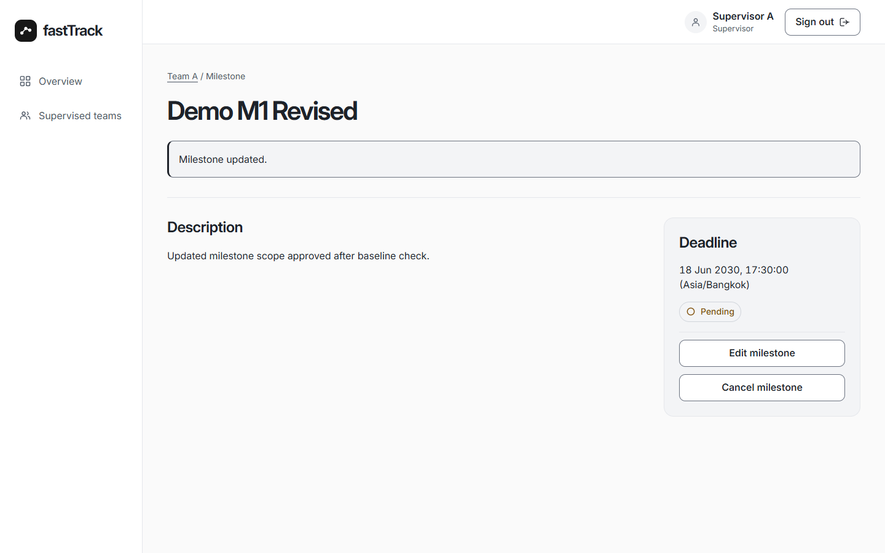
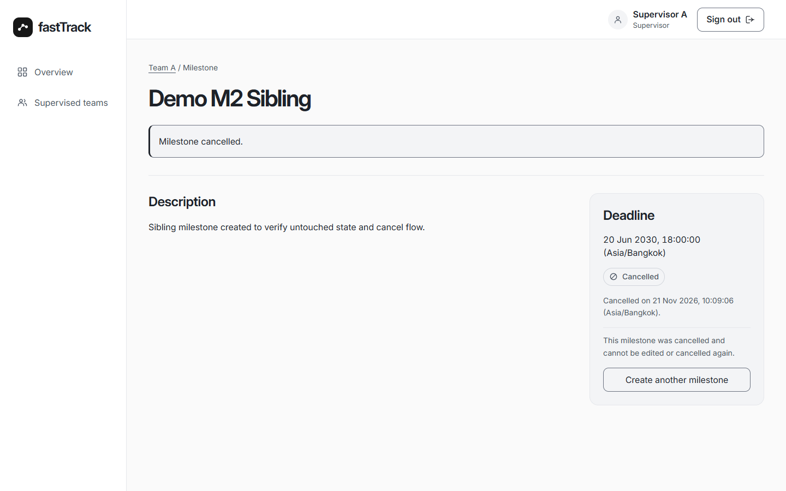

# Project Deliverable 2 — Draft Parts B & E (`R3-B02` / Issue `#32`)

**Assembly Note:** This file contains Member B's draft of **Part B** and **Part E** for [Issue #32 (`R3-B02`)](https://github.com/zerotwobook/fastTrack/issues/32), authored in parallel with Member A's [Draft PR #139 (`R3-B01` / `deliverable _file/submit/project_deliverable_2.md`)](https://github.com/zerotwobook/fastTrack/pull/139) so Parts A–E can be merged cleanly during final assembly without editing conflicts. Final PDF export remains gated on team review, authorized D2 `main` deployment, and post-deploy readback completion per [MAIN_RELEASE_GATE.md](../../workflow/MAIN_RELEASE_GATE.md).

---

## Part B — Sprint 2 Feature Increment: F-05 to F-07, Demos & Engineering Quality (25 points)

**Accepted Release Baseline:** [`v1.0.0-sprint-2`](https://github.com/zerotwobook/fastTrack/tree/v1.0.0-sprint-2) at commit `f3ff8d9704c6e2a3705805412f538b2b216569ad` (Release PR [`#129`](https://github.com/zerotwobook/fastTrack/pull/129), merged `2026-11-20T10:30:51Z`; Sprint 2 G6 closed in [Issue #26](https://github.com/zerotwobook/fastTrack/issues/26) on `2026-11-20T12:01:52Z`).

### B.1 Sprint 2 Contracts (`F-05` to `F-07`) and Verification Summary

All Sprint 2 behavioral boundaries were agreed before implementation in [sprint-2-feature-interfaces.md](../../Project_code/docs/contracts/sprint-2-feature-interfaces.md) (`S2-AC-01` through `S2-AC-08` and `STS-01` through `STS-32`).

| Feature | Owner | Core API / UI Interface | Key Contract Invariants & Acceptance (`S2-AC-01..08`) | Automated / Release Status (`v1.0.0-sprint-2`) |
| --- | --- | --- | --- | --- |
| **F-05A — Team Creation & Member Management** | A | Team planning API (`STS-01..09`, `STS-28`); UI routes `/teams/new`, `/teams/:id/settings` (`TeamCreate`, `TeamSettings`) | Supervisor-only scoped team creation, rename, student candidate paging, and membership updates; one active team per student (`TeamMember`); membership locks once submission history exists (including cancelled milestones); foreign and absent lookups collapse identically. | Verified in `v1.0.0-sprint-2` `test:auth` (`46` passed, covering `F-05A STS-01..STS-09` & `STS-28`) and `test:g1` (`38` passed) |
| **F-05B — Milestone Edit & Cancel** | B | `PATCH /api/milestones/:id`, `POST /api/milestones/:id/cancel`, `MilestoneEdit`, `MilestoneDetail` | Assigned supervisor only (`403` for students, uniform `404` for foreign/absent milestones); millisecond-exact DB-clock `dueAt > now` check re-verified under row lock (`STS-13`); editing/cancelling blocked (`409 MILESTONE_HISTORY_LOCKED`) once any submission exists (`STS-11`); cancellation preserves record (`cancelledAt`) and rejects future writes (`409 MILESTONE_CANCELLED`, `STS-12`, `STS-14`). | Verified in `v1.0.0-sprint-2` `ordinary` + `test:b01` (`48` passed, including `STS-10..STS-14`, `STS-28`, `STS-30`) |
| **F-06 — Submission Revision History & Version-Pinned Feedback** | B | `POST /api/milestones/:id/revisions`, `GET /api/submissions/:id`, `GET /api/submissions/:id/feedback`, `RevisionCreate`, `SubmissionDetail`, `VersionHistoryList` | Requires existing `v1` and future/equal deadline in DB transaction lock (`STS-18`); requires `expectedVersion` matching latest row (`409 VERSION_CONFLICT` on stale/concurrent base, `STS-17`); inserts append-only `version = N + 1` leaving prior submissions and their `feedback.submissionId` links immutable (`STS-15..21`, `STS-28..30`). | Verified in `v1.0.0-sprint-2` `test:b02` (`61` passed, including `STS-15..STS-21`, `STS-28..STS-30`, plus Lab 7 `L7-STS-01..04`) |
| **F-07 — Team Progress Overview & Calculation** | A | Team progress endpoint (`STS-23..28`, `STS-32`); UI route `/teams/:id/progress` (`TeamProgress`) and shared progress calculation | Active completion excludes `CANCELLED` milestones from denominator; counts any non-cancelled milestone with `>= 1` submission once regardless of revision/feedback count; status precedence checks cancelled -> feedback on latest version -> submitted -> overdue (`asOf > dueAt`) -> pending (`asOf === dueAt`). | Verified in `v1.0.0-sprint-2` `ordinary` (`198` passed) & `test:auth` (`46` passed, including `STS-23..STS-28` & `STS-32`) and reused as F-08's shared reporting contract |

#### Verified Automated Test & Build Results (`v1.0.0-sprint-2` @ `f3ff8d9704c6e2a3705805412f538b2b216569ad`)

| Verification Run | Command / Workflow | Scope | Result (`PASS / FAIL / SKIPPED`) |
| --- | --- | --- | --- |
| Main CI & Docker Build | [GitHub Actions run 44719877378](https://github.com/zerotwobook/fastTrack/actions/runs/44719877378) (`test-and-docker`) | Clean build, `postgres:16.8` migrations, ordinary + G1 + auth + B01 + A02 + B02 + J03 + runtime suites + legacy upgrade check | **458 passed, 0 failed, 0 skipped** (`198` ordinary, `38` G1, `46` auth, `48` B01, `54` A02, `61` B02, `1` J03, `12` runtime) + **7/7** legacy upgrades passed |
| Local Clean Checkout `B01` & `B02` Re-verification (B, `2026-11-21`) | `npx vitest run --config vitest.b01.config.ts server/src/testing/milestones-f05b.b01.ts --reporter=verbose`; `npm run test:b01`; `npm run test:b02` | Clean detached clone of `f3ff8d97` against disposable `postgres:16.8` container | Targeted `milestones-f05b.b01.ts`: **9 passed, 0 failed** (`5.53s`); `test:b01`: **48 passed, 0 failed**; `test:b02`: **61 passed, 0 failed** |
| Sprint 2 Cloud Run Deployment | [GitHub Actions run 44719877524](https://github.com/zerotwobook/fastTrack/actions/runs/44719877524) | Migration job `fasttrack-migrate-8lncs`; Cloud Run revision `fasttrack-app-00004-jr2` (100% traffic) | Passed (`sha256:26916972...` web, `sha256:a26fb84e...` jobs); Sprint 1 production records preserved ([post-release readback](../../Project_code/docs/evidence/R2-J01-B-post-release-readback.json)) |

---

### B.2 Live Sprint 2 Demos with Direct PostgreSQL Readback (`v1.0.0-sprint-2`)

Both demos below were executed live on `2026-11-21` using headless Chromium (`1440x900`) against the compiled `client/dist` + `server/dist` build of **`v1.0.0-sprint-2`** (`f3ff8d9704c6e2a3705805412f538b2b216569ad`) backed by disposable `postgres:16.8`. Every step was cross-checked directly against PostgreSQL rows via Prisma (see [R3-B02-s2-demos.md](../../Project_code/docs/evidence/R3-B02-s2-demos.md) and [R3-B02-s2-demo-results.json](../../Project_code/docs/evidence/R3-B02-s2-demo-results.json)).

#### Demo B-1 — `F-05B` Milestone Edit, Cancellation & Post-Submission Locking (`S2-AC-03`)

- **Feature / AC:** `F-05B` (`S2-AC-03`, `STS-10..STS-14`).
- **Actor / Role:** Supervisor A (`supervisor.a@fasttrack.local`, `userId: 0c4b06e5-a4d3-49e7-a263-4abe23b92ad4`) for Team A (`dc5ae7bd-26c3-4dd4-9737-175b54c0c608`, `2` team members).
- **Preconditions:** Two future unsubmitted milestones created on Team A (`M1` `Demo M1 Initial`, `62d2794f-4abc-4a41-9f8e-65ff0510f5db`, due `2030-06-15T11:00:00.000Z`; `M2` `Demo M2 Sibling`, `e75f8527-c4e5-4340-ae56-2623ac3c0ae2`, due `2030-06-20T11:00:00.000Z`).
- **Steps Executed:**
  1. Supervisor A opens `M1`, clicks **Edit milestone**, updates title to `"Demo M1 Revised"`, description to `"Updated milestone scope approved after baseline check."`, and deadline to `2030-06-18 17:30 Asia/Bangkok` (`2030-06-18T10:30:00.000Z`), then clicks **Save changes**.
  2. Supervisor A opens sibling `M2`, clicks **Cancel milestone**, and confirms **Confirm cancel milestone** in the accessible modal dialog.
  3. Subsequent authenticated API calls test post-cancel rejection on `M2` (`PATCH` and `POST /submissions`), and post-submission locking on `M1` once Demo B-2 creates `v1`.
- **Expected vs. Actual Result:** `M1` updates in place with `"Milestone updated."` while keeping `id`, `teamId`, `createdById`, `createdAt`, sibling `M2`, and team memberships invariant; `M2` marks `cancelledAt` while staying visible read-only with `"Milestone cancelled."` and rejects writes with `409 MILESTONE_CANCELLED`; after `v1` is submitted on `M1`, UI hides edit/cancel controls and API returns `409 MILESTONE_HISTORY_LOCKED`. **Actual matched expected.**

| Record / Probe (`postgres:16.8`) | Before Action | After Edit / Cancel / Lock | Verified Invariant |
| --- | --- | --- | --- |
| `M1` (`62d2794f-...`) | `Demo M1 Initial`, `dueAt: 2030-06-15T11:00:00.000Z`, `createdAt = updatedAt = 2026-11-21T03:09:03.764Z`, `cancelledAt: null` | `Demo M1 Revised`, `dueAt: 2030-06-18T10:30:00.000Z`, `updatedAt: 2026-11-21T03:09:05.321Z`, `cancelledAt: null` | `id`, `teamId`, `createdById`, `createdAt` unchanged; Team A member count stayed `2` |
| `M2` (`e75f8527-...`) | `Demo M2 Sibling`, `cancelledAt: null` | Unchanged on `M1` edit; after cancel: `cancelledAt: 2026-11-21T03:09:06.232Z` | Sibling row untouched by `M1` edit; cancel preserves row cleanly |
| `M2` post-cancel `PATCH` / `POST /submissions` | — | HTTP `409` (`code: MILESTONE_CANCELLED`) on both calls | Cancelled precedence blocks edits and student submissions |
| `M1` post-`v1` `PATCH` & UI controls | Edit & Cancel buttons rendered | Edit/Cancel buttons removed; rail shows lock explanation; `PATCH` returns HTTP `409` (`MILESTONE_HISTORY_LOCKED`) | Prior submission permanently locks milestone definition |

*Figure B-1 — `F-05B` (`S2-AC-03`, Supervisor A on `v1.0.0-sprint-2@f3ff8d9`): updated milestone `Demo M1 Revised` displaying `"Milestone updated."` banner and `18 Jun 2030, 17:30:00 (Asia/Bangkok)` deadline while retaining identity.*

*Figure B-2 — `F-05B` (`S2-AC-03`, Supervisor A on `v1.0.0-sprint-2@f3ff8d9`): cancelled sibling milestone `Demo M2 Sibling` displaying `"Milestone cancelled."`, `Cancelled` status badge, timestamp `21 Nov 2026, 10:09:06 (Asia/Bangkok)`, and disabled edit/cancel controls.*

---

#### Demo B-2 — `F-06` Revision History & Exact-Version Feedback Retention (`S2-AC-04`, `S2-AC-05`)

- **Feature / AC:** `F-06` (`S2-AC-04`, `S2-AC-05`, `STS-15..STS-22`).
- **Actors / Roles:** Student A1 (`student.a1@fasttrack.local`, `userId: 67e8b3e7-c18a-4046-9f97-c5ce1a3fd19f`) and Supervisor A (`supervisor.a@fasttrack.local`).
- **Preconditions:** Active future milestone `M1` (`62d2794f-4abc-4a41-9f8e-65ff0510f5db`) on Team A.
- **Steps Executed:**
  1. Student A1 submits `v1` (`Sprint 2 Architecture Draft`, `https://example.com/team-a/architecture-v1`).
  2. Supervisor A opens `v1` and saves feedback `"Feedback on version 1 baseline: clarify state diagram."` (`Save feedback` -> `"Feedback saved for version 1."`).
  3. Student A1 navigates to `/milestones/62d2794f-.../revisions/new` and submits `v2` (`Sprint 2 Architecture Revised`, `https://example.com/team-a/architecture-v2`).
  4. On `v2`, Student A1 confirms `No feedback for this version yet.`, then clicks **Open version 1** in the **Version history** list and inspects the retained `v1` submission and feedback.
- **Expected vs. Actual Result:** `v2` appears as `Latest` + `Current` with `0` feedback entries (`Feedback for version 2` panel empty); opening `v1` displays `"Viewing version 1; the latest version is version 2."`, a **View latest version** link, and `v1`'s exact original title/description/URL plus Supervisor A's feedback on `v1`. PostgreSQL confirms `v1` remained byte-for-byte immutable after `v2` creation. **Actual matched expected.**

| Table / Row (`postgres:16.8`) | Primary / Foreign IDs | Key Columns & Timestamp | Exactness Check |
| --- | --- | --- | --- |
| `submissions` (`v1`) | `id: 26aa7d8a-2712-473c-ae96-84b313b18063`, `milestoneId: 62d2794f-...`, `submittedById: 67e8b3e7-...` | `version: 1`, title `Sprint 2 Architecture Draft`, `submittedAt: 2026-11-21T03:09:07.409Z` | Deep-equal to pre-revision DB snapshot after `v2` saved |
| `feedback` (pinned to `v1`) | `id: 68158b43-5cbe-4128-aad4-86a0c9d916d7`, `submissionId: 26aa7d8a-...`, `clientRequestId: 97e2efe1-...` | `content: "Feedback on version 1 baseline: clarify state diagram."`, `createdAt: 2026-11-21T03:09:08.941Z` | Attached strictly to `v1.id`; zero migration onto `v2` |
| `submissions` (`v2`) | `id: 7dc92cdb-4c0d-451c-b1dc-f761d66bf901`, `milestoneId: 62d2794f-...`, `submittedById: 67e8b3e7-...` | `version: 2`, title `Sprint 2 Architecture Revised`, `submittedAt: 2026-11-21T03:09:09.734Z` | `feedback` count on `v2.id` = `0` |

*Figure B-3 — `F-06` (`S2-AC-04`, `S2-AC-05`, Student A1 on `v1.0.0-sprint-2@f3ff8d9`): newly submitted `Version 2` marked `Latest` + `Current` with an isolated empty `Feedback for version 2` panel and navigation to `Open version 1`.*

*Figure B-4 — `F-06` (`S2-AC-04`, `S2-AC-05`, Student A1 on `v1.0.0-sprint-2@f3ff8d9`): navigating back to `Version 1` renders `"Viewing version 1; the latest version is version 2."`, a `View latest version` link, unmodified `v1` payload, and retained feedback bound to version 1.*

---

### B.3 Role, Ownership & Boundary Test Excerpt (Owner: B)

- **Tested Target:** `v1.0.0-sprint-2` (`f3ff8d9704c6e2a3705805412f538b2b216569ad`)
- **Test File:** [`Project_code/server/src/testing/milestones-f05b.b01.ts#L263-L299`](../../Project_code/server/src/testing/milestones-f05b.b01.ts#L263-L299) (`STS-28`)
- **Setup & Fixtures:** Runs against an isolated disposable PostgreSQL 16.8 test database with seeded real HTTP sessions (`supA`, `stuA1`), an assigned Team A milestone (`ownId = milestoneFuture.id`), a foreign Team B milestone owned by Supervisor B (`foreignId = milestoneBTeam.id`), and a nonexistent UUID (`absentId = randomUUID()`). Helper calls send real cookies, `Origin`, and `X-CSRF-Token` headers matching production security middleware.
- **Assertions (`STS-28` verbatim code):**

~~~ts
  it('STS-28 enforces auth, role, CSRF/origin, media type, UUID validation, and equal 404 for foreign/absent milestones', async () => {
    const foreignId = fixtures.milestones.milestoneBTeam.id;
    const absentId = randomUUID();
    const ownId = fixtures.milestones.milestoneFuture.id;

    // 401 unauthenticated
    await request(app()).patch(`/api/milestones/${ownId}`).set('Content-Type', 'application/json').send(JSON.stringify(validEdit())).expect(401);
    await request(app()).post(`/api/milestones/${ownId}/cancel`).set('Content-Type', 'application/json').send('{}').expect(401);

    // 403 student role
    await patchMilestone(ownId, validEdit(), stuA1).expect(403);
    await cancelMilestone(ownId, {}, stuA1).expect(403);

    // 403 CSRF & foreign origin
    await request(app()).patch(`/api/milestones/${ownId}`).set('Cookie', supA.cookie).set('Origin', origin).set('Content-Type', 'application/json').send(JSON.stringify(validEdit())).expect(403);
    await request(app()).post(`/api/milestones/${ownId}/cancel`).set('Cookie', supA.cookie).set('Origin', 'https://foreign.example').set('X-CSRF-Token', supA.csrf).set('Content-Type', 'application/json').send('{}').expect(403);

    // 415 non-JSON
    await request(app()).patch(`/api/milestones/${ownId}`).set('Cookie', supA.cookie).set('Origin', origin).set('X-CSRF-Token', supA.csrf).set('Content-Type', 'text/plain').send('plain').expect(415);

    // 400 malformed UUID
    await patchMilestone('not-a-uuid', validEdit()).expect(400);
    await cancelMilestone('not-a-uuid', {}).expect(400);

    // Equal 404 for foreign vs absent milestone
    const foreignPatch = await patchMilestone(foreignId, validEdit(), supA);
    const absentPatch = await patchMilestone(absentId, validEdit(), supA);
    expect(foreignPatch.status).toBe(404);
    expect(absentPatch.status).toBe(404);
    expect(foreignPatch.body).toEqual(absentPatch.body);

    const foreignCancel = await cancelMilestone(foreignId, {}, supA);
    const absentCancel = await cancelMilestone(absentId, {}, supA);
    expect(foreignCancel.status).toBe(404);
    expect(absentCancel.status).toBe(404);
    expect(foreignCancel.body).toEqual(absentCancel.body);
  });
~~~

- **Executed Command & Actual Output (`2026-11-21` on clean `v1.0.0-sprint-2@f3ff8d9` + disposable PostgreSQL `16.8`):**

~~~text
$ npx vitest run --config vitest.b01.config.ts server/src/testing/milestones-f05b.b01.ts --reporter=verbose

 ✓ server/src/testing/milestones-f05b.b01.ts > F-05B Milestone edit and cancel (STS-10..STS-14, STS-28, STS-30) > STS-28 enforces auth, role, CSRF/origin, media type, UUID validation, and equal 404 for foreign/absent milestones 404ms

 Test Files  1 passed (1)
      Tests  9 passed (9)
   Duration  5.53s (tests 85%, import 13%, transform 2%)
~~~

---

### B.4 Member B Issue -> PR -> Substantive Review -> Fix -> Release Chain (Sprint 2)

| Stage | Artifact / Event | Recorded Timestamp & Commit / ID | Concrete Detail |
| --- | --- | --- | --- |
| 1. Issue & Branch | [Issue #18 (`R2-B02`)](https://github.com/zerotwobook/fastTrack/issues/18) -> `feat/s2-b-f05b-milestones` | Commits `efa9b0b` (`15:54:15Z`), `876e09a` (`16:02:49Z`), `ea480fb` (`16:08:11Z`) | Implemented `F-05B` backend edit/cancel endpoints, lock/clock guards, `MilestoneEdit` UI, cancel modal, and `STS-10..14 / STS-28 / STS-30` tests. |
| 2. Pull Request | [PR #118](https://github.com/zerotwobook/fastTrack/pull/118) targeting `staging/sprint-2` | Opened `2026-11-19T15:54:48Z` | Submitted `F-05B` implementation + tests for Member A peer review. |
| 3. Substantive Review Finding | Peer review (`COMMENTED`) by `zerotwobook` | `2026-11-19T16:23:07Z` on `ea480fb` | Identified **P2 millisecond truncation** in `MilestoneEdit` (`2030-05-10T11:30:59.501Z -> 18:30 -> 11:30:00.000Z`, risking unintended deadline shift when saving an unchanged timestamp) and flagged `session.ts` coordination with `a130a9f` on `staging/sprint-2`. |
| 4. Fix & Re-review | Fix commits `369b27b`, `fd045f5` -> `APPROVED` review | `369b27b` (`16:29:52Z`), `fd045f5` (`16:32:11Z`); approved `2026-11-19T16:51:42Z` | Preserved sub-second deadline precision (`step={0.001}` in edit form / input conversion) and cleanly resolved `session.ts` staging alignment before `zerotwobook` approved `fd045f5`. |
| 5. Merge, G3 & Release | `PR #118` merge -> `G3 #21` -> `PR #129` -> **`v1.0.0-sprint-2`** | `#118` merged `16:56:25Z` (`09cdf9f`); `G3 #21` (`63e81d1`, `2026-11-20T03:15:07Z`); `PR #129` merged `10:30:51Z` (`f3ff8d9`, `#26` closed `12:01:52Z`) | Shipped to production via CI `44719877378` (`458 passed`) and deploy `44719877524` (`fasttrack-app-00004-jr2`); full release handoff recorded in [R2-J03-B-release-handoff.md](../../Project_code/docs/evidence/R2-J03-B-release-handoff.md). |

---

## Part E — Release Verification, Deployment & Clean Setup (15 points)

**Current Gate Status:** **Pre-Deployment Checklist Prepared (`staging/sprint-3` Candidate Verified Locally & on Staging CI; Hosted D2 `main` Release Pending Authorization).** Per [MAIN_RELEASE_GATE.md](../../workflow/MAIN_RELEASE_GATE.md), no candidate enters `main` without explicit user review and authorization of the exact head/base release candidate.

### E.1 Pre-Release Staging Integration Baseline (`staging/sprint-3` @ `84c4a31`)

Before requesting `main` deployment authorization, both staging CI and B's independent clean-clone G2 verification (`#30`) exercised candidate commit `84c4a31220898957be96c9a54cff0d6e37832821`:

| Verification Source | Commit | Environment | Result Summary |
| --- | --- | --- | --- |
| Staging CI (`44777769845`) | `84c4a31220898957be96c9a54cff0d6e37832821` | GitHub Actions, `postgres:16.8` (`Debian 16.8-1.pgdg120+1`) | **483 passed, 0 failed, 0 skipped** (`214` ordinary, `38` G1, `46` auth, `57` B01, `54` A02, `61` B02, `1` J03, `12` runtime) + `7/7` upgrades passed (`ci-runtime-report`) |
| B Independent G2 Verification ([Issue #30](https://github.com/zerotwobook/fastTrack/issues/30)) | `84c4a31220898957be96c9a54cff0d6e37832821` | Separate clean clone (`npm ci`, `npm run test:runtime:isolated`, Docker `postgres:16.8`, compiled Chromium) | **G2 ACCEPTED** with `483/483` automated passes, `1/10 (10.0%)` -> `2/10 (20.0%)` live F-08 readback, filter/page preservation across milestone round-trip, supervisor scope isolation, student HTTP `403`, and reproduced minor `"Page 2 of 1"` label tracked as follow-up (`F08-AC-05/08`) |

### E.2 Clean Setup & Verification Reproduction Steps (`NFR-04`)

All application source lives under `Project_code/` with runtime versions pinned in [`Project_code/.node-version`](../../Project_code/.node-version) (`Node 26.13.0`, `npm 11.20.0`) and base images pinned by SHA-256 digest in [`Project_code/Dockerfile`](../../Project_code/Dockerfile) and [`Project_code/compose.yaml`](../../Project_code/compose.yaml).

> **Documentation Sync Note:** [`Project_code/README.md`](../../Project_code/README.md) currently stops at Sprint 1 / partial Sprint 2 layout details (`F-05B`, `F-06`, `F-08`, and `npm run test:runtime:isolated` are not yet documented there) and should be updated cleanly before G3 / D2 final assembly.

1. **Prerequisites & Environment Files (Non-Production Placeholders Only):**
   - Install Node `26.13.0` (`npm 11.20.0`) and Docker Engine / Docker Desktop.
   - For local manual runs without Compose, copy [`Project_code/server/.env.example`](../../Project_code/server/.env.example) to `Project_code/server/.env`, provision PostgreSQL on `127.0.0.1:5433`, and supply private synthetic hex values for `DATABASE_URL`, `TEST_DATABASE_URL`, and `DEMO_SEED_PASSWORD` (no default credential exists).
   - For Docker Compose runs, copy [`Project_code/compose.env.example`](../../Project_code/compose.env.example) to `Project_code/.env.compose` with synthetic `LOCAL_DB_PASSWORD`, optional `DEMO_SEED_PASSWORD`, and 40-char `RELEASE_SHA`.
2. **Reproducible Isolated Verification (Disposable PostgreSQL `16.8` Container):**

~~~bash
cd Project_code
npm ci
npm run db:generate --workspace @fasttrack/server
npm run typecheck
npm run test:runtime:isolated
~~~

3. **Optional Containerized Local App Startup (`compose.yaml`, loopback `127.0.0.1:8080`):**

~~~bash
cd Project_code
docker compose --env-file .env.compose up -d db
docker compose --env-file .env.compose --profile tools run --rm jobs npm run db:migrate --workspace @fasttrack/server
docker compose --env-file .env.compose --profile tools run --rm jobs npm run db:seed --workspace @fasttrack/server
docker compose --env-file .env.compose up --build app
~~~

Seeded synthetic accounts for local evaluation only: `supervisor.a@fasttrack.local`, `supervisor.b@fasttrack.local`, `student.a1@fasttrack.local`, `student.a2@fasttrack.local`, `student.b1@fasttrack.local` (all authenticated via the synthetic `DEMO_SEED_PASSWORD` provided at seed time).

---

### E.3 Post-Deploy D2 Release Evidence Checklist (Populate After Authorized `main` Deployment)

This checklist defines the exact evidence items to capture immediately after the team authorizes the D2 release PR to `main` and Cloud Run deployment completes:

#### 1. Release Commit, Tag, CI & Container Artifacts

| Evidence Item | Target / Format | Status | Recorded Value (`Populate Post-Deploy`) |
| --- | --- | --- | --- |
| Accepted `main` release PR & merge SHA | PR `#...`, 40-char commit SHA | Pending D2 release authorization | `_PENDING_` |
| Release Git tag | `v1.0.0-d2` (or agreed D2 tag) -> `<sha>` | Pending D2 release authorization | `_PENDING_` |
| `main` CI & Docker Build run | GitHub Actions run URL + `PASS / FAIL / SKIPPED` totals (`ci-runtime-report`) | Pending D2 release authorization | `_PENDING_` |
| Container image digests (`web` & `jobs`) | `sha256:...` pushed to Artifact Registry | Pending D2 release authorization | `_PENDING_` |
| Cloud Run migration job & active service revision | Job execution ID, Cloud Run revision name (`100%` traffic) | Pending D2 release authorization | `_PENDING_` |
| Public HTTPS URL & readiness endpoints | `https://...` + live HTTP `200` on `/api/health` and `/api/ready` (`RELEASE_SHA` matches tag) | Pending D2 release authorization | `_PENDING_` |

#### 2. Original Sprint 1 Production Persistence Readback (Preserved Across Upgrades)

Verify that the original Lab 5 baseline records documented in [`R2-J01-B-post-release-readback.json`](../../Project_code/docs/evidence/R2-J01-B-post-release-readback.json) (`canonicalRecordsSha256: c5396255105bfccd8f13ec0b8469aae6d1ab2a3a7923a13a55253e582bbe0f4e`) remain completely intact in the hosted D2 database without silent mutation or migration data loss:

- [ ] **Team A preserved:** `teamId = 7c600ee0-a595-4c52-a093-f0ed5e08fded` (`GET /api/teams/7c600ee0-a595-4c52-a093-f0ed5e08fded`) -> `_PENDING_`
- [ ] **Original Sprint 1 Milestone preserved:** `milestoneId = b19ae7d5-d2a1-4ace-9b11-d2a94cb8177d` (`GET /api/milestones/b19ae7d5-d2a1-4ace-9b11-d2a94cb8177d`) -> `_PENDING_`
- [ ] **Original Sprint 1 Submission preserved:** `submissionId = baa3eb8d-e37f-44c2-93fc-dc9f8e5463fd` (`GET /api/submissions/baa3eb8d-e37f-44c2-93fc-dc9f8e5463fd`) -> `_PENDING_`
- [ ] **Original Sprint 1 Feedback preserved:** `feedbackId = b9ebf7f7-a542-4b89-95a8-8f1de22a5357` (`GET /api/submissions/baa3eb8d-e37f-44c2-93fc-dc9f8e5463fd/feedback`) -> `_PENDING_`

#### 3. Post-Deploy Hosted `F-08` Scope & Functional Verification Re-run

- [ ] **Supervisor A `/summary` & `GET /api/summary`:** Weighted completion matches DB totals (active milestones only, excluding cancelled); team filter, status filter, and pagination match live rows; opening a milestone and navigating back preserves query parameters and page state -> `_PENDING_`
- [ ] **Student role enforcement:** Signed-in student navigation omits **Summary**, `/summary` shows restricted notice, and `GET /api/summary` returns HTTP `403` -> `_PENDING_`
- [ ] **Cross-supervisor ownership isolation:** Second supervisor sees only assigned teams on `/summary`, receives generic `404` on first supervisor's team/milestone, and never receives first supervisor team/milestone data -> `_PENDING_`
- [ ] **Page-label follow-up disposition (`F08-AC-05/08`):** Confirm whether `"Page 2 of 1"` on empty over-paged requests was fixed prior to D2 deploy or documented as a known minor non-blocking follow-up per Issue `#30` -> `_PENDING_`

#### 4. Final Timeline, AI & Human Accountability Statement

| Milestone | Target Date (`Asia/Bangkok`) | Owner / Gate |
| --- | --- | --- |
| Closeout of PR `#139` + B's D2 PR + `"Page 2 of 1"` / `README.md` decision + Lab 7 final sync (`#141`) | Before `2026-11-29` | A & B (`G3` staging integration) |
| User review & explicit authorization of D2 `main` release -> cloud deployment -> Part E live readback | Before `2026-11-29` | Human release gate (`MAIN_RELEASE_GATE.md`) + B/A readback |
| Final D2 PDF (`#33`) & Lab 7 submission | `2026-11-29 23:59` | B compiles & checks; team reviews & submits |
| Course final project maintenance / closeout window | `2026-12-01` – `2026-12-13 23:59` | A & B per [03_SPRINT3_D2_FINAL.md](../../workflow/03_SPRINT3_D2_FINAL.md) |

- **Human & AI Usage Disclosure:** Member A authored Sprint 1 core fixes (`#23`), F-05A, F-07, F-08A, and D2 Parts A/C/D; Member B authored Sprint 1 DB schema/seed, F-05B, F-06, F-08B, D2 Parts B/E, and release verification. AI coding assistants helped draft test harnesses, Playwright verification scripts, and English documentation under direct human/tool verification; every SHA, CI count, DB row UUID, timestamp, and screenshot cited above was inspected against executed tool output and live database/browser state rather than unverified memory.
- **Known Scope Limits Recorded Honestly:** As of this pre-release draft (`docs/s3-b-d2-release-evidence`), the hosted D2 cloud deployment has **not yet occurred**, so Section `E.3` cloud artifacts and post-deploy persistence readbacks remain explicitly marked `_PENDING_` until user authorization and deployment complete.
