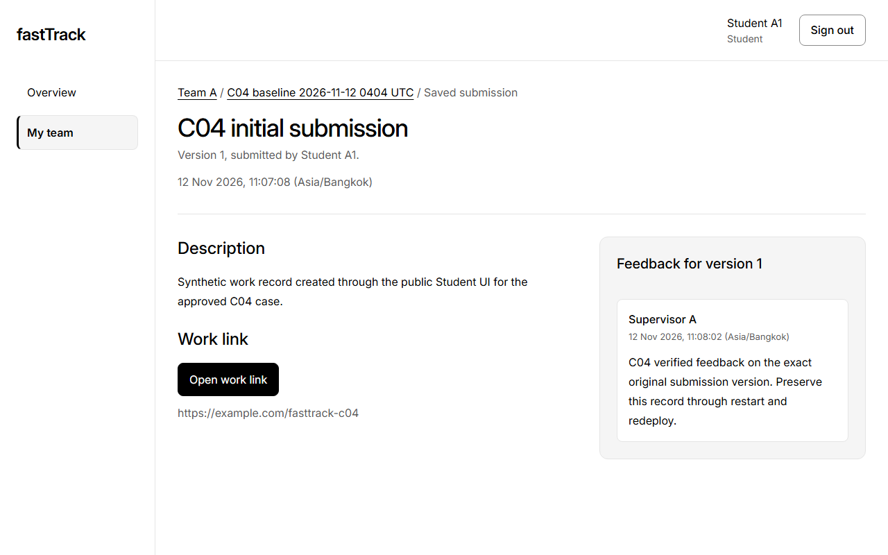
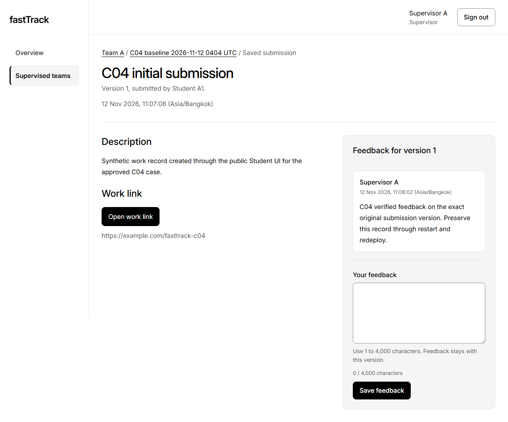
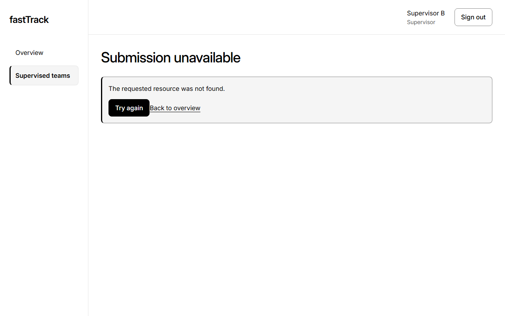

# B post-release live exact-record readback

Task R2-J01 / [Issue #16](https://github.com/zerotwobook/fastTrack/issues/16). Verifier: Role B (`Atip-Infa`); peer cross-check: Role A (`zerotwobook`). Executed on 12 November 2026 between `14:55:26Z` and `14:55:42Z` (`21:55:26`–`21:55:42` Asia/Bangkok) in isolated headless Chromium contexts via Playwright. No domain record, seed, migration, config or deployment was mutated.

**Outcome: B independent post-release domain readback and foreign-team 404 denial: PASS.** Both Student A1 and Supervisor A observed the frozen C-04 baseline records intact on serving main source `8e637e537cd037d630a5fffc1b5672d1b44371a8` (canonical SHA-256 `c5396255105bfccd8f13ec0b8469aae6d1ab2a3a7923a13a55253e582bbe0f4e`), and Supervisor B received HTTP `404` `NOT_FOUND` with zero Team A payload. Closed pre-release session survival remains NOT ESTABLISHED and the full eight-hour test remains NOT RUN.

## 1. Live service identity observed before role sign-ins

| Check | Endpoint | Observed result |
|---|---|---|
| Public health | `GET /api/health` | HTTP `200`, `{"status":"ok","version":"8e637e537cd037d630a5fffc1b5672d1b44371a8"}` |
| DB readiness | `GET /api/ready` | HTTP `200`, `{"status":"ready","database":"connected","version":"8e637e537cd037d630a5fffc1b5672d1b44371a8"}` |
| Anonymous sign-in copy | `GET /login` | Displays `"Track your team's milestones, submissions, and feedback."` |

Canonical URL: <https://fasttrack-app-kpx7au3w2a-as.a.run.app>

## 2. Independent role comparisons against the immutable C-04 baseline

Sanitized machine output: [R2-J01-B-post-release-readback.json](../../../../Project_code/docs/evidence/R2-J01-B-post-release-readback.json). Baseline compared: [R2-J01-C04-baseline.json](../../../../Project_code/docs/evidence/R2-J01-C04-baseline.json) (file SHA-256 `a54074ae9a07a0ce3138193245fd16c9ff2fc2800568f02f3f6e010cd86eb114`, canonical projection SHA-256 `c5396255105bfccd8f13ec0b8469aae6d1ab2a3a7923a13a55253e582bbe0f4e`).

| Role / account | UTC time | UI & API result on `/submissions/baa3eb8d-e37f-44c2-93fc-dc9f8e5463fd` | Canonical SHA-256 / cleanup |
|---|---|---|---|
| Student A1 (`student.a1@fasttrack.local`) | `14:55:35.933Z` | Milestone `C04 baseline 2026-11-12 0404 UTC` (`b19ae7d5-d2a1-4ace-9b11-d2a94cb8177d`), submission `C04 initial submission` version 1 (`https://example.com/fasttrack-c04`), feedback `b9ebf7f7-a542-4b89-95a8-8f1de22a5357` (`1` submission, `1` feedback) | `c5396255…0f4e` (`matchesBaseline: true`); logged out `14:55:36.583Z`, subsequent `GET /api/auth/me` -> `401` |
| Supervisor A (`supervisor.a@fasttrack.local`) | `14:55:39.226Z` | Exact same Team A (`7c600ee0-a595-4c52-a093-f0ed5e08fded`), milestone, submission version 1 and feedback; no new feedback submitted | `c5396255…0f4e` (`matchesBaseline: true`); logged out `14:55:39.874Z`, subsequent `GET /api/auth/me` -> `401` |
| Supervisor B (`supervisor.b@fasttrack.local`, Team B `cd27932d-72db-41b2-99c7-3dcee3929aae`) | `14:55:42.466Z` | Overview shows `1` team (`Team B` only). `GET /api/submissions/baa3eb8d-e37f-44c2-93fc-dc9f8e5463fd` returned HTTP `404` `{"error":{"code":"NOT_FOUND","message":"The requested resource was not found.","fields":{}}}`. UI rendered `Submission unavailable` with no Team A data | Foreign denial PASS; logged out `14:55:42.677Z`, subsequent `GET /api/auth/me` -> `401` |

## 3. Captured UI screenshots

Desktop (`1280x800`) full-page viewport captures taken during the isolated sessions without browser address-bar chrome. No password, session cookie or CSRF token is visible or stored in Git.

1. 

   *Figure B-1. C-05 (R-04): Independent Role B readback as Student A1 at `2026-11-12T14:55:35.933Z` on <https://fasttrack-app-kpx7au3w2a-as.a.run.app/submissions/baa3eb8d-e37f-44c2-93fc-dc9f8e5463fd> (serving main `8e637e5`), confirming milestone `C04 baseline 2026-11-12 0404 UTC`, `C04 initial submission` Version 1, and original Supervisor A feedback. SHA-256: `c23241f67865a36a88377dd226ef246002f7a1ee973ef3174d92806f856ad76f`.*

2. 

   *Figure B-2. C-05 (R-04): Independent Role B readback as assigned Supervisor A at `2026-11-12T14:55:39.226Z` on the same submission URL and source `8e637e5`, confirming identical original records and zero new mutations. SHA-256: `7bd2f54df9054126863892b93c577d92a41f6e7e10aa223dbd16fefb9b8f6123`.*

3. 

   *Figure B-3. C-04 / C-05 (R-03, R-04): Independent Role B readback as foreign-team Supervisor B at `2026-11-12T14:55:42.466Z` on `/submissions/baa3eb8d-e37f-44c2-93fc-dc9f8e5463fd`, confirming generic `Submission unavailable` (`404 NOT_FOUND`) without Team A data. SHA-256: `aae7048942609fc30cfa2ac8baef6a510cf308426c0897dbac6ccedc04beb455`.*

## 4. Scope and preserved limits

- This verification establishes domain-record persistence across baseline, distinct restart and later WIF redeploy from both A and B observations, plus foreign-team isolation on the live revision `fasttrack-app-00003-rc7`.
- Fresh logins here do not establish survival of closed pre-release browser sessions (`NOT ESTABLISHED`) or the full eight-hour session-expiry test (`NOT RUN`).
- Viewport screenshots omit browser URL chrome; exact canonical origin, route, HTTP status and source SHA accompany each observation in the JSON ledger above.
