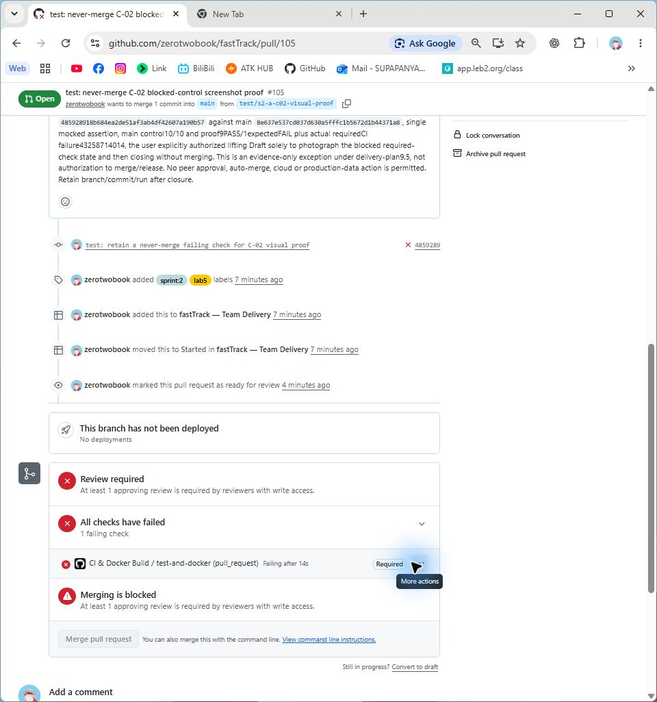

# C-02 native blocked required-check capture

Task R2-J01 / [Issue #16](https://github.com/zerotwobook/fastTrack/issues/16). A (`zerotwobook`) performed this AI-assisted follow-up to collect the missing visual evidence. The original B proof [PR #95](https://github.com/zerotwobook/fastTrack/pull/95) and its history remain unchanged. This is a new controlled experiment, not a reconstruction of that earlier blocked state.

**Outcome:** a genuine native Chrome image shows the normal non-Draft PR, failed required `test-and-docker` check, `Merging is blocked` and disabled merge button. [PR #105](https://github.com/zerotwobook/fastTrack/pull/105) was then closed without merging. The intentionally failing implementation is not accepted or released.

## Exact candidate and authorization

| Item | Actual value |
|---|---|
| Head | `485928918b684ea2de51af3ab4df42607a190b57`, `test/s2-a-c02-visual-proof` |
| Base | Current accepted main `8e637e537cd037d630a5fffc1b5672d1b44371a8` |
| Diff | One line in `deploy/tests/test_smoke.py`: mocked request count expected 4 -> 5; no application/workflow/configuration changes |
| Control | Accepted main: 10 mocked unit tests PASS, exit 0 |
| Deliberate proof | 10 mocked tests, 9 PASS / 1 expected FAIL, exit 1; `SmokeTests.test_public_checks_pass_and_skip_optional_login`, `AssertionError: 4 != 5` |
| Real CI | [Run 43258714014](https://github.com/zerotwobook/fastTrack/actions/runs/43258714014), [job 131323861862](https://github.com/zerotwobook/fastTrack/actions/runs/43258714014/job/131323861862), required `test-and-docker` FAILURE from GitHub Actions app `15368` |
| Effective policy | Active ruleset `26666182`, strict up-to-date required `test-and-docker` from app `15368`, no bypass actors, one approving review also required |
| User decision | The user explicitly authorized this exact head/base to lift Draft solely for the blocked-state photograph and then close unmerged; persisted in PR #105 / Issue #16 before Draft lift |
| Pre-closure API | OPEN, `isDraft: false`, `MERGEABLE`, `mergeStateStatus: BLOCKED`, auto-merge null, no approving review |
| Closure | CLOSED at `2026-11-12T16:35:23Z`, `mergedAt: null`, `mergeCommit: null`; main still `8e637e537cd037d630a5fffc1b5672d1b44371a8` |

The absent peer approval is another visible blocker. The conclusion that the failed test independently blocks merge comes from the effective required context/producer, the actual named failure and non-Draft state together. `BLOCKED` alone or a Draft restriction would not establish R-06. No approval was fabricated to remove the other blocker, and no merge attempt or bypass was made.

## Genuine visual evidence

*Figure C02-1. C-02 (R-06): actual <https://github.com/zerotwobook/fastTrack/pull/105>, captured `2026-11-12T16:34:20.219Z`. The open normal PR shows the failed required `CI & Docker Build / test-and-docker (pull_request)`, `All checks have failed`, `Merging is blocked` and disabled `Merge pull request`. Head `485928918b684ea2de51af3ab4df42607a190b57`, base `8e637e537cd037d630a5fffc1b5672d1b44371a8`. Native image retained unedited at 960x1025; SHA-256 `46867c0f0879e5472b0b22771dc324ca03df64825bbe141d7097689c3d7b7006`.*

Actual local commands/results, capture provenance, live API/policy comparison and verified closure are retained in [R2-J01-C02-visual-proof.json](../../../../Project_code/docs/evidence/R2-J01-C02-visual-proof.json).

## Final disposition

- The proof branch, commit, failed run and PR remain available. Nothing was merged, deployed, seeded, migrated or deleted, and main did not change.
- The close event's Project state was inspected and the proof card explicitly reconciled to PR Review / FAILED / PENDING. This denotes closed-unmerged failing evidence awaiting the consolidated package review, not accepted code or a Done implementation.
- The original #95 visual gap remains a historical fact. This later authorized image supplies actual C-02 visual evidence with its own source/time; no earlier screenshot, human execution or TA decision was invented.
- Final peer review occurs once through report-source PR #104 after the package checks. No separate peer approval of the intentionally failing proof was requested.
