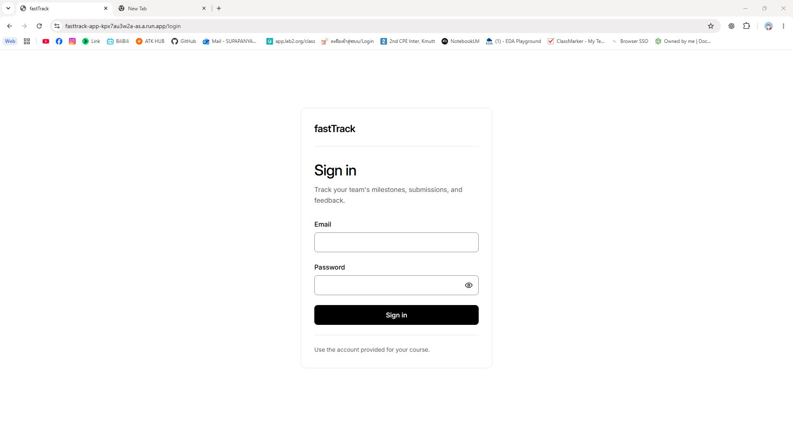
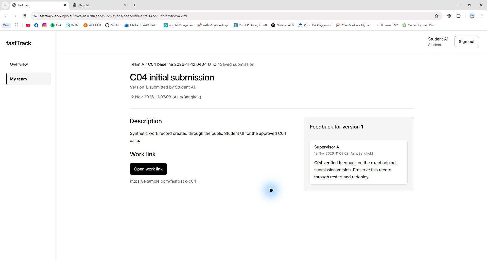
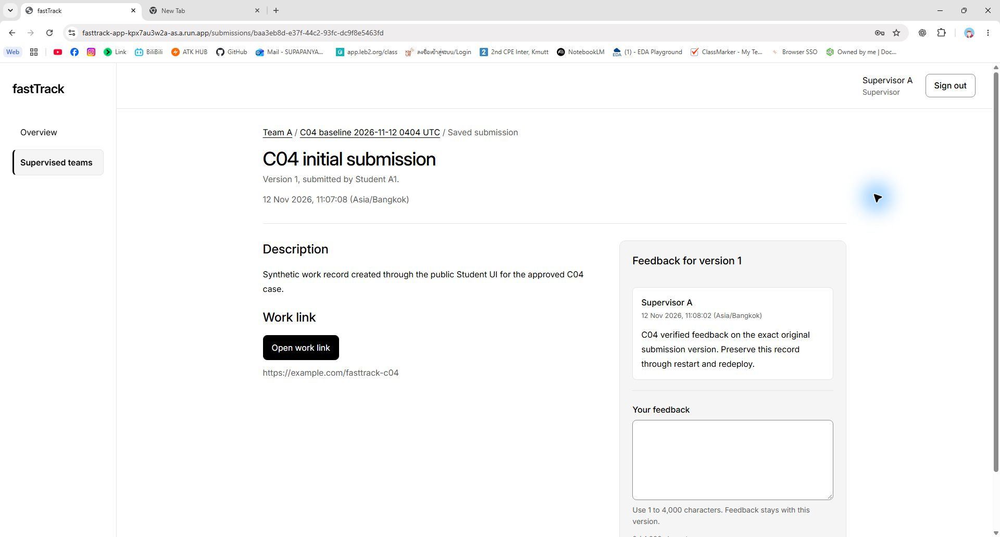
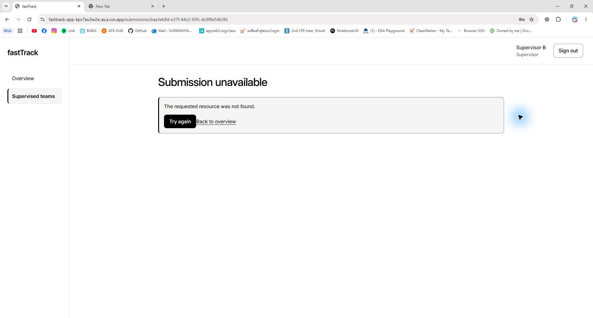

# C-04 native URL-visible role readback

Task R2-J01 / [Issue #16](https://github.com/zerotwobook/fastTrack/issues/16), continued in [PR #104](https://github.com/zerotwobook/fastTrack/pull/104). Observer: A (`zerotwobook`), AI-assisted native Windows Chrome. The user explicitly authorized the existing private credentials for Student A1, Supervisor A and Supervisor B at the exact public origin for read-only role evidence and sign-out.

**Outcome:** genuine browser-window images now show the public origin/route, both allowed role views of the original Version 1 and the foreign-role denial. These are later readbacks, not screenshots of the historical creation, restart or redeploy events. No milestone, submission or feedback was created or changed.

## Sources and method

- Canonical route: <https://fasttrack-app-kpx7au3w2a-as.a.run.app/submissions/baa3eb8d-e37f-44c2-93fc-dc9f8e5463fd>. The normal Chrome address bar displays the real host and route; no address-bar overlay or image reconstruction was used.
- Separate anonymous HTTPS health/readiness reads after capture reported application source `8e637e537cd037d630a5fffc1b5672d1b44371a8` and `database: connected`. They do not establish a new Cloud traffic inspection.
- Actual capture times, unedited image hashes/dimensions, UI cleanup observations and separate HTTP responses are in [R2-J01-native-captures.json](../../../../Project_code/docs/evidence/R2-J01-native-captures.json). The original baseline and B machine comparison are preserved unchanged.
- Roles were used sequentially in the same Chrome profile with UI sign-out between them. This is not a claim of three isolated Playwright contexts or new API equality checks.
- The private DPAPI clipboard helper supplied the authorized test credential without printing it. One initial attempt incorrectly used the encrypted-file reference and failed; that was corrected before the successful role readbacks. Password-save prompts were dismissed, all three sessions returned to the Sign in form after UI sign-out, and the task password was removed from the clipboard. No credential values, cookies or CSRF tokens are in these captures or the ledger.

## Captured evidence

*Figure N-1. C-04 / C-06: native Chrome at `https://fasttrack-app-kpx7au3w2a-as.a.run.app/login`, blank sign-in form and the accepted sign-in sentence. Saved at `2026-11-12T16:15:18.718639+00:00` (original file timestamp; exact screenshot-call time was not separately recorded). SHA-256 `6f527523331bfd32db8d5e2b2e0cee33a1306841694a51d72f553e729bd6c39a`.*

*Figure N-2. C-04 (R-03), original-record continuity supporting C-05: Student A1, `2026-11-12T16:20:10.698Z`, `https://fasttrack-app-kpx7au3w2a-as.a.run.app/submissions/baa3eb8d-e37f-44c2-93fc-dc9f8e5463fd`; Original submission Version 1, baseline milestone and Supervisor A feedback visible; actual browser origin and route visible. Serving source correlated separately as `8e637e537cd037d630a5fffc1b5672d1b44371a8`. SHA-256 `0a7429e6a311e64aa08de8af980e064f09ec819f6f6abe44ca3fe570ce162aea`.*

*Figure N-3. C-04 (R-03), original-record continuity supporting C-05: Supervisor A, `2026-11-12T16:21:45.115Z`, `https://fasttrack-app-kpx7au3w2a-as.a.run.app/submissions/baa3eb8d-e37f-44c2-93fc-dc9f8e5463fd`; Original submission Version 1 and exact existing feedback visible; empty feedback form left unchanged; actual browser origin and route visible. Serving source correlated separately as `8e637e537cd037d630a5fffc1b5672d1b44371a8`. SHA-256 `5653be138e244ce175d4b4ea2534d895da569df8443f0966025a425ac4df8a55`.*

*Figure N-4. C-04 (R-03), original-record continuity supporting C-05: Supervisor B, `2026-11-12T16:22:49.998Z`, `https://fasttrack-app-kpx7au3w2a-as.a.run.app/submissions/baa3eb8d-e37f-44c2-93fc-dc9f8e5463fd`; Submission unavailable and generic requested-resource-not-found message; no Team A content; Supervisor B and actual browser origin/route visible. Serving source correlated separately as `8e637e537cd037d630a5fffc1b5672d1b44371a8`. SHA-256 `17ea54f275d81bcfa63e770b5ce00169743ed9cd5975d31b2eb94ddf7040338d`.*

## Limits and final review

- The Supervisor B image shows the generic denial UI with no Team A content. The actual `404 NOT_FOUND` was captured in the earlier [B readback](B-post-release-readback.md); no new HTTP response code is inferred solely from this screenshot.
- UI sign-out was observed for all three roles. This native run did not recheck `/api/auth/me` HTTP status; the earlier B run separately records its three `401` cleanup checks.
- The original C-04 creation flow and exact IDs/content remain established by [C04-public-flow.md](C04-public-flow.md) and its machine baseline/results. These later screenshots supplement their missing browser chrome; they do not invent new creation or persistence events.
- C-02 has its own separately authorized [native blocked-control proof](C02-visual-proof.md), closed without merging. These role screenshots do not prove the GitHub merge gate.
- PR #104 follows the user's request for one consolidated review after final source checks and current-head CI. Its actual ready/review/merge state is recorded live in the PR and Issue #16. No peer approval, course submission, PDF export or main release is claimed by this evidence record.
