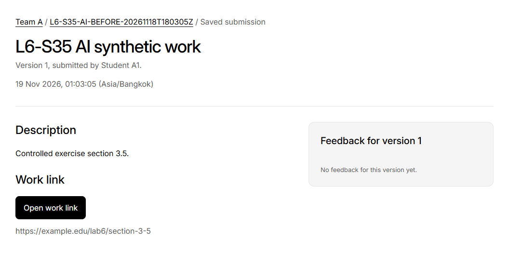
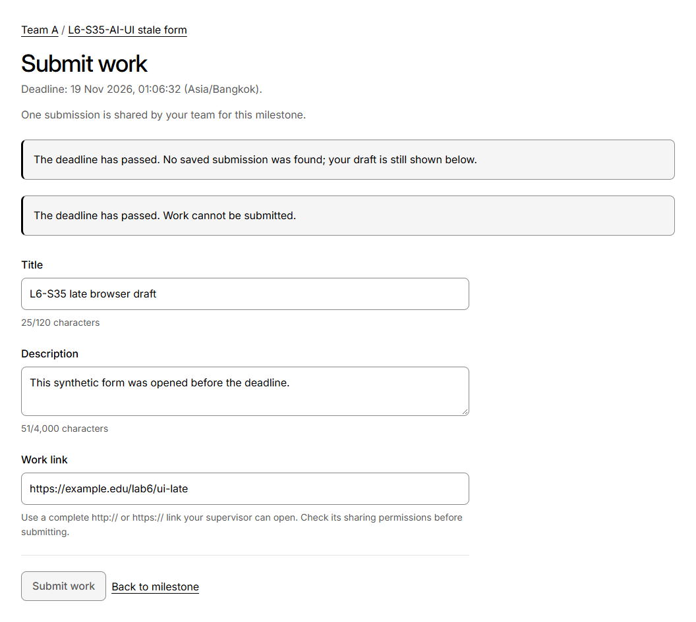

# Lab 6 simulated exercise section 3.5

## Deadline enforcement evidence

Recorded 19 November 2026, Asia/Bangkok. Task R2-B04, Issue #23, PR #115. Branch `fix/s2-a-lab6-deadline-simulation`.

The user relayed the TA-assigned scenario that a student can submit after the deadline. The original fastTrack baseline already enforced BR-04. This controlled exercise deliberately removed the server rejection on an isolated branch, demonstrated an actual forbidden database write, then restored the accepted rule. The final application source is `1bbe187c088b86d104a16e420058f17425f18828`.

All verification in this increment was operated by Codex. A owns the F-03 module and this implementation. B reviews the code and evidence and coordinates the defect loop. CoursePMS supplies independent execution and acceptance. Proposed severity is Major because the defective version accepts and persists work outside the submission window. B's triage confirmation remains pending.

| Deliverable | Actual state |
| --- | --- |
| Isolated branch and disposable automated-test DB | Prepared and verified |
| Deliberate defective commit and meaningful RED | Verified locally and in GitHub CI |
| GREEN and regression | 379 test cases PASS, seven separate upgrade cases PASS |
| Production image and socket verification | 12 checks PASS |
| Snapshot reader target boundaries | Three refusal checks PASS |
| Dedicated online preview deployment | Verified source, digest, revision and 100% traffic |
| Online API and browser checks | Before-deadline acceptance and late rejection/no-write PASS |
| B's human PR review and integration | PENDING |
| CoursePMS independent retest and acceptance | PENDING |

## Assignment provenance and scope

The scenario and authorization were relayed by the user in the 19 November conversation. The user separately authorized the dedicated Cloud Run, Cloud SQL, runtime identity, secrets and migration/seed job. The Issue records the actual lifecycle and consent times in UTC. The exercise is labeled section 3.5 throughout its artifacts. Existing UAT participation and acceptance records continue under Issue #22 and PR #114.

---

## RED reproduction

| Version | Recorded commit or run |
| --- | --- |
| Staging baseline | 01f61a9e2b3c0dde02e6acf8c5e4231086dbba2b |
| Deliberately omitted rejection | 94d2032 |
| New regression tests with defect present | ab632a2c824320a07e7a2f914803ccf8fa1a4ee0 |
| GitHub RED CI | Run 44362473412, FAILURE |

The removed guard rejected `acceptedAt > dueAt` after transaction locks and database clock selection. Session, role, membership, input validation and the submission insert remained active in the simulated version.

Command from Project_code follows.

```powershell
npm run test:a02:isolated
```

L6-S35-01 created an unrelated valid saved control, set a second synthetic milestone's deadline using the actual database clock, then attempted two late authenticated HTTP submissions. The test captured both the responses and persisted rows before asserting the required behavior.

| Observation | Expected | Actual RED |
| --- | --- | --- |
| First late POST | 409 DEADLINE_PASSED | 201, saved forbidden work |
| Second late POST | 409 DEADLINE_PASSED | 409 ALREADY_SUBMITTED |
| Global submission count | 1 -> 1 | 1 -> 2 |
| Late milestone saved rows | 0 | 1 |
| All saved rows unchanged | true | false |
| Before-deadline positive control | 201, one version 1 | PASS |
| Exact +1 ms boundary | Reject, zero rows | Accepted and persisted |

The F-03 suite reported 46 PASS and seven FAIL. Two new failing cases directly exposed the simulated defect. Five existing deadline and lock-wait cases also failed. The failed GitHub CI run confirms these failures in its isolated DB stage. The intentionally failing version remains in task-branch history.

Evidence is retained in `red-regression.json` and `red-observations.jsonl` beside this report.

---

## GREEN and regression

Commit `1771ca1a589f403158f2d053eadd4208c2af1a50` restored the accepted transactional guard. Commit `1bbe187c088b86d104a16e420058f17425f18828` adds the guarded read-only database evidence reader and partner runbook. The final submission service matches the staging baseline byte for byte.

| New deadline case | Actual GREEN |
| --- | --- |
| Repeated late POST | 409 DEADLINE_PASSED twice |
| Persisted rows across late attempts | Count 1 -> 1, all rows identical |
| Late milestone | Zero rows, empty authenticated list |
| Before-deadline POST | 201, one persisted version 1, matching fresh GET |
| Accepted time -1 ms and 0 ms | Accepted with the exact stored time |
| Accepted time +1 ms | 409 DEADLINE_PASSED, zero rows |

| Existing verification suite | PASS | FAIL |
| --- | --- | --- |
| Ordinary unit/API | 166 | 0 |
| G1 database, seed and compiled client | 38 | 0 |
| Authentication | 28 | 0 |
| Milestones B01 | 39 | 0 |
| First submissions A02, including five new cases | 53 | 0 |
| Feedback B02 | 42 | 0 |
| Compiled integrated journey and restart | 1 | 0 |
| Runtime and readiness | 12 | 0 |
| Total test cases | 379 | 0 |

Fresh/repeat migrations, typecheck and production build passed. Seven upgrade cases and 12 production Docker/socket checks passed with separate denominators. Three snapshot-reader checks confirmed rejection of the production database name, production instance name and invalid fixture IDs before connection. Newly created disposable test resources were cleaned by their runners.

The first full local Windows run encountered executable-resolution failures through deeply nested npm wrappers. Its F-03 tests passed 53/53 while other stages failed. The original report is retained as `green-initial-regression.json`. Rerunning the same existing G1 runner directly with all six suite selectors passed all 14 stages. This successful report is `green-full-regression.json`. An accidental source BOM was removed before the final source build.

```powershell
$env:G1_AUTH_CHECKS='1'
$env:G1_B01_CHECKS='1'
$env:G1_A02_CHECKS='1'
$env:G1_B02_CHECKS='1'
$env:G1_J03_CHECKS='1'
$env:G1_A01_CHECKS='1'
npm run test:g1:isolated
npm run verify:socket
```

GitHub CI run 44362911198 passed for restored head 1771ca1. Run 44363501281 passed for deployed application source 1bbe187. The live PR supplies the latest evidence-only head and check state.

---

## Dedicated online deployment

The GREEN application was deployed by CLI after its successful current-source GitHub CI. This is a branch-based isolated preview. Human PR review and integration remain pending.

| Deployment identity | Verified value |
| --- | --- |
| Public URL | https://fasttrack-lab6-970128017651.asia-southeast1.run.app |
| GCP project and region | fasttrack-se-002 / asia-southeast1 |
| Application source | 1bbe187c088b86d104a16e420058f17425f18828 |
| Cloud Run service and revision | fasttrack-lab6 / fasttrack-lab6-00001-74k |
| Verified serving traffic | 100% to fasttrack-lab6-00001-74k |
| Application image digest | sha256:3e9656d4ef08446aa78056f1ef9258db22be90a723c06a36a34656250ed49253 |
| Jobs image digest | sha256:dc6534458fb8f0eb349a2de8e34d444f42975148adfc120d4583f9090a34efdb |
| Dedicated SQL instance / database | fasttrack-lab6-db / fasttrack_lab6 |
| Instance edition and tier | PostgreSQL 16 Enterprise / db-f1-micro |
| Dedicated runtime identity | sa-fasttrack-lab6@fasttrack-se-002.iam.gserviceaccount.com |
| Scaling and pool | Cloud Run min 0, max 1, DB pool max 1 |
| Migration execution | fasttrack-lab6-migrate-gwprh, succeeded |
| Explicit synthetic seed | fasttrack-lab6-migrate-cpv7p, succeeded |

The SQL create request initially encountered an edition/tier validation error. The explicit Enterprise-edition request succeeded. Synthetic database credentials and demo passwords were generated privately, stored in dedicated secrets and supplied only to the dedicated runtime/job. A private synthetic-account handoff is prepared for the user to send to CoursePMS.

Health returned the expected source and readiness returned a connected database. The before-deadline online POST returned 201, created version 1 and matched a fresh saved GET. Two later HTTP requests to the separate overdue fixture returned 409 DEADLINE_PASSED and empty saved lists.

| Actual database read | Before late attempts | After late attempts |
| --- | --- | --- |
| Saved-control milestone 639a705c-7851-4a14-8282-1d86335ea374 | One version 1 | Same ID and content |
| Late milestone 9cae7283-98e6-41f2-98c7-a0c52085942a | Zero submissions | Zero submissions |
| Entire selected milestone/submission projection | Baseline snapshot | Identical projection |
| Read-only execution | fasttrack-lab6-migrate-cw7sk | fasttrack-lab6-migrate-br7kq |

The snapshot reader uses one repeatable-read transaction, checks the dedicated instance/database target and accepts explicit fixture UUIDs. The evidence files contain the actual database time and persisted rows. `database-comparison.json` confirms the selected rows are identical.

---

## Actual browser verification

Operator Codex, synthetic Student A1, dedicated URL and source 1bbe187. These screenshots record the AI-operated deployment verification. CoursePMS will produce its own independent evidence.



The browser opened a separate synthetic submission form before its deadline of 19 November 2026 at 01:06:32.142 Asia/Bangkok. It retained the draft while time passed and then submitted after the deadline. Recorded browser request 28 returned 409 with code DEADLINE_PASSED. Request 29 returned an empty submission array with serverTime 2026-11-18T18:06:56.847Z. The form displayed the rejection and preserved its entered values.



The late-browser milestone is `207d2957-ea2c-444c-b6aa-f456b94dc51b`. Dedicated read-only execution `fasttrack-lab6-migrate-mf8xh` confirms zero persisted submissions for it, zero for the API-late fixture and the original saved control. API sessions were logged out and the temporary browser was signed out and closed.

---

## Independent handoff and assessment status

### fastTrack B

1. Fetch the PR #115 branch into a separate checkout and review the actual RED/GREEN commits and test assertions.
2. Check the preserved row comparison, before/equal/after boundaries, lock-wait regressions, snapshot-reader target guards, CI and deployed source/digest/revision.
3. Submit a real GitHub PR review. Resolve actual findings on the same branch before accepted integration. Record the reviewed head.

### CoursePMS

1. Use the isolated URL and privately supplied synthetic accounts. Verify the health source before execution.
2. Create fresh uniquely named before-deadline and late milestones in Team A. Follow CPMS-S35-01 through CPMS-S35-03 in the linked runbook.
3. Demonstrate a before-deadline 201 and saved reload. Open the other form before its deadline and submit after it. Capture the actual 409 DEADLINE_PASSED.
4. Verify empty late saved lists, repeated rejection, the unchanged saved control and the observed read-only database snapshots for the same UUIDs.
5. Return actual tester names, execution time/timezone, URL/source/revision, fixture IDs/deadlines, expected/actual outcomes, original screenshots, redacted Network evidence and the independent decision.

| Independent result | State at this report |
| --- | --- |
| CPMS-S35-01 before-deadline control | PENDING CoursePMS execution |
| CPMS-S35-02 late rejection | PENDING CoursePMS execution |
| CPMS-S35-03 zero-write, retry and saved control | PENDING CoursePMS execution |
| Actual tester names and execution times | PENDING returned record |
| Independent acceptance decision | PENDING |
| B review and accepted integration | PENDING |

This PDF is the current implementation and deployment evidence package. Append the real review and CoursePMS results, then export the final submission version. Whole-task acceptance remains PENDING.

### Traceable sources

- [Task Issue #23](https://github.com/zerotwobook/fastTrack/issues/23)
- [Review PR #115](https://github.com/zerotwobook/fastTrack/pull/115)
- [RED CI run 44362473412](https://github.com/zerotwobook/fastTrack/actions/runs/44362473412)
- [Restored-rule CI run 44362911198](https://github.com/zerotwobook/fastTrack/actions/runs/44362911198)
- [Deployed-source CI run 44363501281](https://github.com/zerotwobook/fastTrack/actions/runs/44363501281)
- [CoursePMS independent runbook](https://github.com/zerotwobook/fastTrack/blob/fix/s2-a-lab6-deadline-simulation/docs/labs/lab-06/simulation-3.5/coursepms-retest.md)

Machine-readable records alongside this report include RED/GREEN regression and observations, socket verification, snapshot safety, deployment identity, online observations, database before/after/UI snapshots and their comparison. The source Markdown and original PNGs support final report assembly.
