# Project Deliverable 2 - fastTrack

**CPE 334 Software Engineering | Semester 1/2026** 
**Theme 6 - Course Project Management System** 
**Assembly draft | 21 November 2026 | Due 29 November 2026 at 23:59 Asia/Bangkok**

| Item | Record |
| --- | --- |
| Member A | `zerotwobook`. Add full name and student ID in the course submission copy. |
| Member B | `Atip-Infa`. Add full name and student ID in the course submission copy. |
| Repository | [zerotwobook/fastTrack](https://github.com/zerotwobook/fastTrack) |
| Accepted Sprint 1 | [v1.0.0-sprint-1](https://github.com/zerotwobook/fastTrack/tree/v1.0.0-sprint-1) at `ae7a60a6e3ed0a363dcee920ac1774a02f4f4ab8` |
| Accepted Sprint 2 | [v1.0.0-sprint-2](https://github.com/zerotwobook/fastTrack/tree/v1.0.0-sprint-2) at `f3ff8d9704c6e2a3705805412f538b2b216569ad` |
| Locally tested D2 application source | [Staging 84c4a31](https://github.com/zerotwobook/fastTrack/tree/84c4a31220898957be96c9a54cff0d6e37832821), verified with real sessions and PostgreSQL. |
| D2 release tag, source and deployed URL | [v1.0.0-d2](https://github.com/zerotwobook/fastTrack/tree/v1.0.0-d2) points to `7872a739147f7553e16e05a4d40b5d0de0c21f27`. Cloud Run revision `fasttrack-app-00005-rkz` serves [the public demo](https://fasttrack-app-kpx7au3w2a-as.a.run.app). D2 submission receipt is pending. |

| Rubric | Report location | Assessment pages |
| --- | --- | --- |
| A - Sprint 1 continuity and change status (5) | [Part A](#part-a---sprint-1-continuity-and-change-status) | Assign during assembly |
| B - Sprint 2 contracts and working increment (25) | [Part B](#part-b---sprint-2-contracts-and-working-increment) | Assign during assembly |
| C - Sprint 3 contracts and working progress (15) | [Part C](#part-c---sprint-3-contracts-and-working-progress) | Assign during assembly |
| D - Updated requirements and test traceability (10) | [Part D](#part-d---updated-requirements-and-test-traceability) | Assign during assembly |
| E - Integrated release candidate (15) | [Part E](#part-e---integrated-release-candidate) | Assign during assembly |

Assembly sources are A's [PR #139](https://github.com/zerotwobook/fastTrack/pull/139) at `76d8408` and B's [PR #142](https://github.com/zerotwobook/fastTrack/pull/142) at `e219628`. The selected figures are included with this draft. Assign final page numbers during layout.

## Part A - Sprint 1 continuity and change status

### A.1 Accepted baseline and original journey

The accepted Sprint 1 increment established one course context with seeded supervisor and student identities, milestone planning, on-time first submission and feedback attached to the exact submission. The accepted Sprint 2 release preserved that workflow and added planning, revisions and progress. D2's locally tested source contains both baselines plus the Sprint 3 supervisor Summary.

**A-01. Supervisor creates a milestone, a student submits, and the team retrieves feedback after restart.** F-01 through F-04, S1-AC-EXT-02/03 and tests T-21/22/25/31. Roles are an assigned supervisor, a student and teammate, and a supervisor assigned to another team. The compiled server starts with a seeded, disposable PostgreSQL database. The supervisor creates a future milestone, the student retrieves it and submits version 1, and the supervisor appends two messages with distinct request keys. The teammate retrieves the messages and confirms each references the saved submission. The test repeats seed, restarts the compiled app, and retrieves the same work and feedback. It expects durable records, a safe repeat seed, scoped access and one version 1.

**Observed at `84c4a31`.** The compiled HTTP journey passed. Responses preserved the same submission and feedback after restart and the database fingerprint stayed stable. A foreign supervisor received HTTP 404, a student feedback write received 403, and a duplicate first submission received 409 `ALREADY_SUBMITTED`. The guarded production-image socket run separately passed 17 checks, including the compiled business flow, restart, repeated seed and database outage readiness. [Test source](https://github.com/zerotwobook/fastTrack/blob/c83b2fed610797e3eae09739484e944a0cb4ea66/Project_code/server/src/testing/integrated-s1.j03.ts) · [Candidate run and results](https://github.com/zerotwobook/fastTrack/blob/c83b2fed610797e3eae09739484e944a0cb4ea66/Project_code/docs/evidence/R3-J01-f08-integration.md)

**Hosted persistence at `7872a739`.** After migration `fasttrack-migrate-4lvx5`, the assigned supervisor and team student retrieved the original Sprint 1 team, milestone, version 1 submission and its exact-version feedback. All four payloads matched the C04 baseline. The foreign supervisor received HTTP 404 for the submission and feedback. Part E records the deployed identity and hosted capture. [Hosted readback](https://github.com/zerotwobook/fastTrack/blob/c83b2fed610797e3eae09739484e944a0cb4ea66/Project_code/docs/evidence/R3-B02-d2-post-deploy-readback.json) · [C04 baseline](https://github.com/zerotwobook/fastTrack/blob/c83b2fed610797e3eae09739484e944a0cb4ea66/Project_code/docs/evidence/R2-J01-C04-baseline.json)

### A.2 Deadline and ownership continuity

**A-02.** F-03, BR-04/05, S1-AC-EXT-04 and T-26. Applicable to the assigned student, with an unsubmitted milestone. The boundary tests check exact equality and a request delayed beyond the deadline while waiting for a database lock. Equality may be accepted. A late first submit returns 409 with zero new rows. The candidate's submission/deadline suite passed 54 cases. The independent Lab 6 hosted deadline retest is historical evidence for its own corrected release. [Deadline boundary source](https://github.com/zerotwobook/fastTrack/blob/c83b2fed610797e3eae09739484e944a0cb4ea66/Project_code/server/src/testing/submissions.a02.ts) · [Lab 6 regression source](https://github.com/zerotwobook/fastTrack/blob/c83b2fed610797e3eae09739484e944a0cb4ea66/Project_code/server/src/testing/deadline-lab6.a02.ts) · [Lab 6 independent deadline retest](https://github.com/zerotwobook/fastTrack/blob/c83b2fed610797e3eae09739484e944a0cb4ea66/docs/labs/lab-06/simulation-3.5/coursepms-retest.md)

### A.3 Change and defect register

| ID and source | Requirement and decision | Status, release and retest |
| --- | --- | --- |
| Lab 5 C-01 to C-06, #16 and PRs #85, #84, #99/#100 | F-01 to F-04, NFR-03/04/06. Put the existing app behind the tested CI, Docker and Cloud Run path. Keep migration/seed explicit and PostgreSQL outside the app container. | Historical cloud flow and domain persistence passed on the Lab 5 release chain ending at source `8e637e5`. The deliberate C-02 failure showed the required check blocks merge. The controlled PRs were closed without merging. Long-running session survival remained unverified in Lab 5. Candidate local image/DB/restart verification passed at `84c4a31`. [Lab 5 register](https://github.com/zerotwobook/fastTrack/blob/c83b2fed610797e3eae09739484e944a0cb4ea66/docs/labs/lab-05/report.md) |
| Lab 6 UAT-01 to UAT-08, CoursePMS return, 19 November | F-01 to F-04, BR-02/04/05 and NFR-02/03. Independent team returned Accepted with no outstanding defects in the agreed S1 cases. | Eight reported passes on the historical live S1 workflow. Version probes observed `8e637e5`. The compiled journey and A-02 provide the local D2 continuity results. [Human decision and evidence limits](https://github.com/zerotwobook/fastTrack/blob/c83b2fed610797e3eae09739484e944a0cb4ea66/docs/labs/lab-06/sessions/2026-11-19-lab6-closeout.md) |
| Lab 6 `3.5, CPMS-S35-01 to 03, PR #115 | F-03, BR-04, T-26. Isolated exercise deliberately removed enforcement, then restored the existing post-lock deadline guard. | Corrected isolated preview `1bbe187`: independent acceptance with 16/16 comparison checks. On-time 201 and identical persisted version 1. Two late attempts returned 409 with zero late rows. Local D2 deadline regression passed. [Exercise and retest record](https://github.com/zerotwobook/fastTrack/blob/c83b2fed610797e3eae09739484e944a0cb4ea66/docs/labs/lab-06/simulation-3.5/execution-report.md) |
| CR-L7-01, #24/#25 and PR #128 | F-04, BR-08, L7-AC-01 to 05. TA approved enlarging the trimmed feedback limit from 4,000 to 6,000 Unicode code points. Emoji, trimming, authorization and exact-version association were tested. | Shipped in `v1.0.0-sprint-2`. Deployed L7-STS-05 saved and read back 5,999 and 6,000, denied 6,001 with no write, and preserved the original C-04 record. Local D2 feedback/revision regression passed 61 cases. [Contract](https://github.com/zerotwobook/fastTrack/blob/c83b2fed610797e3eae09739484e944a0cb4ea66/Project_code/docs/contracts/lab-7-feedback-limit.md) · [Hosted retest and release](https://github.com/zerotwobook/fastTrack/issues/26) |

### A.4 Selected TDD evidence - CR-L7-01

A wrote the approved contract at `b46b7de` and added the new boundary assertions at `e3758fb` on `maintenance/lab7-feedback-limit`. The assertions exercised 5,999 and 6,000 trimmed code points with plain text, emoji and padded input, plus direct database acceptance and valid escaped JSON reaching domain validation. At RED, the existing 4,000-point rule returned 400 for the newly valid requests and the database rejected the new bound. B implemented the shared validator, client counter, route body handling and forward database migration in `2368d71`. A strengthened the escaped JSON check at `d2b6c16`. The reviewed result merged through [PR #128](https://github.com/zerotwobook/fastTrack/pull/128) as `7357fd2`, then shipped in the Sprint 2 release via [PR #129](https://github.com/zerotwobook/fastTrack/pull/129).

| Stage | Reproduction from `Project_code/` | Actual result |
| --- | --- | --- |
| RED · `e3758fb` | `npm ci` and `npm run test:b02:isolated` | 51 passed, 8 expected rule failures. The matching [CI run](https://github.com/zerotwobook/fastTrack/actions/runs/44672187909) failed. [RED record](https://github.com/zerotwobook/fastTrack/blob/c83b2fed610797e3eae09739484e944a0cb4ea66/Project_code/docs/evidence/R2-A05-lab7-red.md) |
| GREEN · `2368d71` | `npm run test:runtime:isolated` on [CI 44675948834](https://github.com/zerotwobook/fastTrack/actions/runs/44675948834) | 61 feedback cases passed in the 458-case run with 0 failures. The widened validation and migration preserved prior feedback. [GREEN record](https://github.com/zerotwobook/fastTrack/blob/c83b2fed610797e3eae09739484e944a0cb4ea66/Project_code/docs/evidence/R2-B05-lab7-green.md) |
| Integration and deployment | Required CI [44679245716](https://github.com/zerotwobook/fastTrack/actions/runs/44679245716) on `5315c9e`, then [main CI](https://github.com/zerotwobook/fastTrack/actions/runs/44719877378) and [deployment](https://github.com/zerotwobook/fastTrack/actions/runs/44719877524) on `f3ff8d9` | Main CI recorded 458 passed, 0 failed, 0 skipped and 7/7 legacy migration upgrades. Hosted L7-STS-05 passed on that release. |

### A.5 Continuity screen capture for assembly

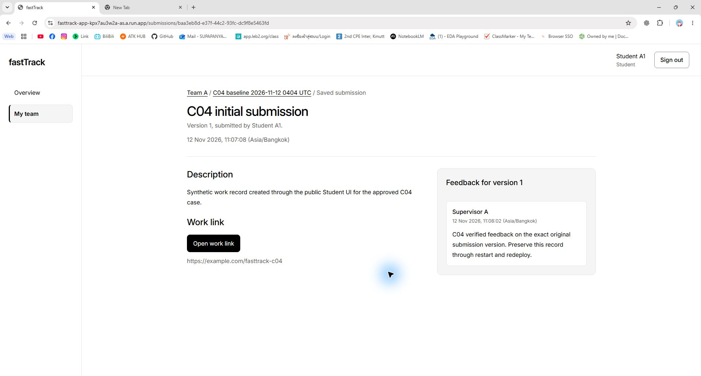

*Figure A-1. Historical F-03/F-04 readback (AC-03.6, AC-04.4, C-04), source `8e637e5`. The student signs in to the team that already submitted and opens the saved version. The expected version and supervisor feedback are visible. A-01 supplies the exact D2 local API/restart result. Part E, Figure E-1, records the production readback after D2 deployment. [Capture provenance](https://github.com/zerotwobook/fastTrack/blob/c83b2fed610797e3eae09739484e944a0cb4ea66/docs/labs/lab-05/evidence/C04-native-readback.md)*

## Part B - Sprint 2 contracts and working increment

**Accepted Release Baseline:** [`v1.0.0-sprint-2`](https://github.com/zerotwobook/fastTrack/tree/v1.0.0-sprint-2) at commit `f3ff8d9704c6e2a3705805412f538b2b216569ad` (Release PR [`#129`](https://github.com/zerotwobook/fastTrack/pull/129), merged `2026-11-20T10:30:51Z`; Sprint 2 G6 closed in [Issue #26](https://github.com/zerotwobook/fastTrack/issues/26) on `2026-11-20T12:01:52Z`).

### B.1 Sprint 2 Contracts (`F-05` to `F-07`) and Verification Summary

All Sprint 2 behavioral boundaries were agreed before implementation in [sprint-2-feature-interfaces.md](https://github.com/zerotwobook/fastTrack/blob/e219628e2e8e6421f4fba77e8091663cb08393e8/Project_code/docs/contracts/sprint-2-feature-interfaces.md) (`S2-AC-01` through `S2-AC-08` and `STS-01` through `STS-32`).

| Feature | Owner | Core API / UI Interface | Key Contract Invariants & Acceptance (`S2-AC-01..08`) | Automated / Release Status (`v1.0.0-sprint-2`) |
| --- | --- | --- | --- | --- |
| **F-05A — Team Creation & Member Management** | A | Team planning API (`STS-01..09`, `STS-28`); UI routes `/teams/new`, `/teams/:id/settings` (`TeamCreate`, `TeamSettings`) | Supervisor-only scoped team creation, rename, student candidate paging, and membership updates; one active team per student (`TeamMember`); membership locks once submission history exists (including cancelled milestones); foreign and absent lookups collapse identically. | Verified in `v1.0.0-sprint-2` `test:auth` (`46` passed, covering `F-05A STS-01..STS-09` & `STS-28`) and `test:g1` (`38` passed) |
| **F-05B — Milestone Edit & Cancel** | B | `PATCH /api/milestones/:id`, `POST /api/milestones/:id/cancel`, `MilestoneEdit`, `MilestoneDetail` | Assigned supervisor only (`403` for students, uniform `404` for foreign/absent milestones); millisecond-exact DB-clock `dueAt > now` check re-verified under row lock (`STS-13`); editing/cancelling blocked (`409 MILESTONE_HISTORY_LOCKED`) once any submission exists (`STS-11`); cancellation preserves record (`cancelledAt`) and rejects future writes (`409 MILESTONE_CANCELLED`, `STS-12`, `STS-14`). | Verified in `v1.0.0-sprint-2` `ordinary` + `test:b01` (`48` passed, including `STS-10..STS-14`, `STS-28`, `STS-30`) |
| **F-06 — Submission Revision History & Version-Pinned Feedback** | B | `POST /api/milestones/:id/revisions`, `GET /api/submissions/:id`, `GET /api/submissions/:id/feedback`, `RevisionCreate`, `SubmissionDetail`, `VersionHistoryList` | Requires existing `v1` and future/equal deadline in DB transaction lock (`STS-18`); requires `expectedVersion` matching latest row (`409 VERSION_CONFLICT` on stale/concurrent base, `STS-17`); inserts append-only `version = N + 1` leaving prior submissions and their `feedback.submissionId` links immutable (`STS-15..21`, `STS-28..30`). | Verified in `v1.0.0-sprint-2` `test:b02` (`61` passed, including `STS-15..STS-21`, `STS-28..STS-30`, plus Lab 7 `L7-STS-01..04`) |
| **F-07 — Team Progress Overview & Calculation** | A | Team progress endpoint (`STS-23..28`, `STS-32`); UI route `/teams/:id/progress` (`TeamProgress`) and shared progress calculation | Active completion excludes `CANCELLED` milestones from denominator; counts any non-cancelled milestone with `>= 1` submission once regardless of revision/feedback count; status precedence checks cancelled -> feedback on latest version -> submitted -> overdue (`asOf > dueAt`) -> pending (`asOf <= dueAt` for an active, unsubmitted milestone). | Verified in `v1.0.0-sprint-2` `ordinary` (`198` passed) & `test:auth` (`46` passed, including `STS-23..STS-28` & `STS-32`) and reused as F-08's shared reporting contract |

#### Verified Automated Test & Build Results (`v1.0.0-sprint-2` @ `f3ff8d9704c6e2a3705805412f538b2b216569ad`)

| Verification Run | Command / Workflow | Scope | Result (`PASS / FAIL / SKIPPED`) |
| --- | --- | --- | --- |
| Main CI & Docker Build | [GitHub Actions run 44719877378](https://github.com/zerotwobook/fastTrack/actions/runs/44719877378) (`test-and-docker`) | Clean build, `postgres:16.8` migrations, ordinary + G1 + auth + B01 + A02 + B02 + J03 + runtime suites + legacy upgrade check | **458 passed, 0 failed, 0 skipped** (`198` ordinary, `38` G1, `46` auth, `48` B01, `54` A02, `61` B02, `1` J03, `12` runtime) + **7/7** legacy upgrades passed |
| Local Clean Checkout `B01` & `B02` Re-verification (B, `2026-11-21`) | `npx vitest run --config vitest.b01.config.ts server/src/testing/milestones-f05b.b01.ts --reporter=verbose`; `npm run test:b01`; `npm run test:b02` | Clean detached clone of `f3ff8d97` against disposable `postgres:16.8` container | Targeted `milestones-f05b.b01.ts`: **9 passed, 0 failed** (`5.53s`); `test:b01`: **48 passed, 0 failed**; `test:b02`: **61 passed, 0 failed** |
| Sprint 2 Cloud Run Deployment | [GitHub Actions run 44719877524](https://github.com/zerotwobook/fastTrack/actions/runs/44719877524) | Migration job `fasttrack-migrate-8lncs`; Cloud Run revision `fasttrack-app-00004-jr2` (100% traffic) | Passed (`sha256:26916972...` web, `sha256:a26fb84e...` jobs); Sprint 1 production records preserved ([post-release readback](https://github.com/zerotwobook/fastTrack/blob/e219628e2e8e6421f4fba77e8091663cb08393e8/Project_code/docs/evidence/R2-J01-B-post-release-readback.json)) |

---

### B.2 Live Sprint 2 Demos with Direct PostgreSQL Readback (`v1.0.0-sprint-2`)

Both demos below were executed live on `2026-11-21` using headless Chromium (`1440x900`) against the compiled `client/dist` + `server/dist` build of **`v1.0.0-sprint-2`** (`f3ff8d9704c6e2a3705805412f538b2b216569ad`) backed by disposable `postgres:16.8`. Every step was cross-checked directly against PostgreSQL rows via Prisma (see [R3-B02-s2-demos.md](https://github.com/zerotwobook/fastTrack/blob/e219628e2e8e6421f4fba77e8091663cb08393e8/Project_code/docs/evidence/R3-B02-s2-demos.md) and [R3-B02-s2-demo-results.json](https://github.com/zerotwobook/fastTrack/blob/e219628e2e8e6421f4fba77e8091663cb08393e8/Project_code/docs/evidence/R3-B02-s2-demo-results.json)).

#### Demo B-1 — `F-05B` Milestone Edit, Cancellation & Post-Submission Locking (`S2-AC-03`)

- **Feature / AC:** `F-05B` (`S2-AC-03`, `STS-10..STS-14`).
- **Actor / Role:** Supervisor A (`supervisor.a@fasttrack.local`, `userId: 0c4b06e5-a4d3-49e7-a263-4abe23b92ad4`) for Team A (`dc5ae7bd-26c3-4dd4-9737-175b54c0c608`, `2` team members).
- **Preconditions:** Two future unsubmitted milestones created on Team A (`M1` `Demo M1 Initial`, `62d2794f-4abc-4a41-9f8e-65ff0510f5db`, due `2030-06-15T11:00:00.000Z`; `M2` `Demo M2 Sibling`, `e75f8527-c4e5-4340-ae56-2623ac3c0ae2`, due `2030-06-20T11:00:00.000Z`).
- **Steps Executed:**
  1. Supervisor A opens `M1`, clicks **Edit milestone**, updates title to `"Demo M1 Revised"`, description to `"Updated milestone scope approved after baseline check."`, and deadline to `2030-06-18 17:30 Asia/Bangkok` (`2030-06-18T10:30:00.000Z`), then clicks **Save changes**.
  2. Supervisor A opens sibling `M2`, clicks **Cancel milestone**, and confirms **Confirm cancel milestone** in the accessible modal dialog.
  3. Subsequent authenticated API calls test post-cancel rejection on `M2` (`PATCH` and `POST /submissions`), and post-submission locking on `M1` once Demo B-2 creates `v1`.
- **Expected vs. Actual Result:** `M1` updates in place with `"Milestone updated."` while keeping `id`, `teamId`, `createdById`, `createdAt`, sibling `M2`, and team memberships invariant; `M2` marks `cancelledAt` while staying visible read-only with `"Milestone cancelled."` and rejects writes with `409 MILESTONE_CANCELLED`; after `v1` is submitted on `M1`, UI hides edit/cancel controls and API returns `409 MILESTONE_HISTORY_LOCKED`. **Actual matched expected.**

| Record / Probe (`postgres:16.8`) | Before Action | After Edit / Cancel / Lock | Verified Invariant |
| --- | --- | --- | --- |
| `M1` (`62d2794f-...`) | `Demo M1 Initial`, `dueAt: 2030-06-15T11:00:00.000Z`, `createdAt = updatedAt = 2026-11-21T03:09:03.764Z`, `cancelledAt: null` | `Demo M1 Revised`, `dueAt: 2030-06-18T10:30:00.000Z`, `updatedAt: 2026-11-21T03:09:05.321Z`, `cancelledAt: null` | `id`, `teamId`, `createdById`, `createdAt` unchanged; Team A member count stayed `2` |
| `M2` (`e75f8527-...`) | `Demo M2 Sibling`, `cancelledAt: null` | Unchanged on `M1` edit; after cancel: `cancelledAt: 2026-11-21T03:09:06.232Z` | Sibling row untouched by `M1` edit; cancel preserves row cleanly |
| `M2` post-cancel `PATCH` / `POST /submissions` | — | HTTP `409` (`code: MILESTONE_CANCELLED`) on both calls | Cancelled precedence blocks edits and student submissions |
| `M1` post-`v1` `PATCH` & UI controls | Edit & Cancel buttons rendered | Edit/Cancel buttons removed; rail shows lock explanation; `PATCH` returns HTTP `409` (`MILESTONE_HISTORY_LOCKED`) | Prior submission permanently locks milestone definition |

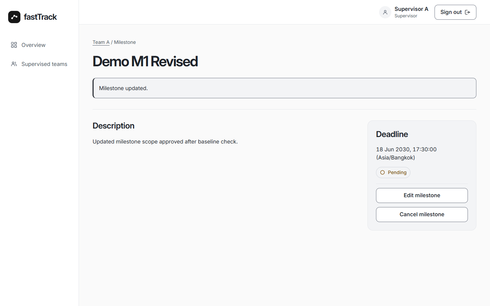
*Figure B-1 — `F-05B` (`S2-AC-03`, Supervisor A on `v1.0.0-sprint-2@f3ff8d9`): updated milestone `Demo M1 Revised` displaying `"Milestone updated."` banner and `18 Jun 2030, 17:30:00 (Asia/Bangkok)` deadline while retaining identity.*

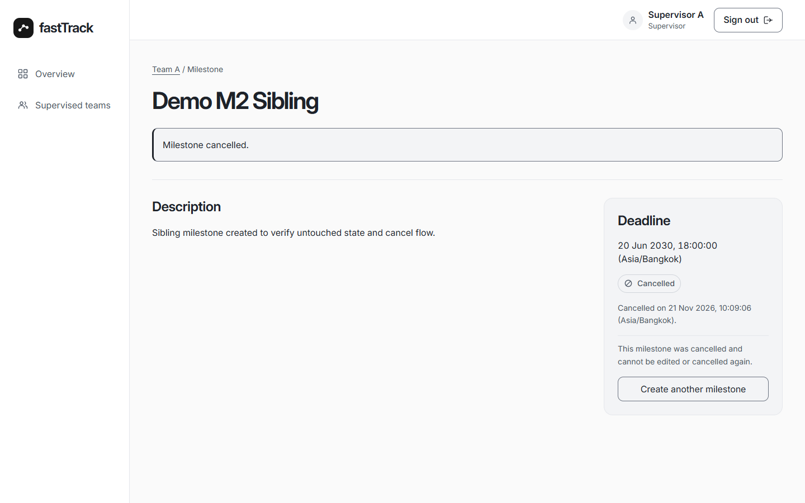
*Figure B-2 — `F-05B` (`S2-AC-03`, Supervisor A on `v1.0.0-sprint-2@f3ff8d9`): cancelled sibling milestone `Demo M2 Sibling` displaying `"Milestone cancelled."`, `Cancelled` status badge, timestamp `21 Nov 2026, 10:09:06 (Asia/Bangkok)`, and the cancellation explanation after the edit and cancel controls are hidden.*

---

#### Demo B-2 — `F-06` Revision History & Exact-Version Feedback Retention (`S2-AC-04`, `S2-AC-05`)

- **Feature / AC:** `F-06` (`S2-AC-04`, `S2-AC-05`, `STS-15..STS-22`).
- **Actors / Roles:** Student A1 (`student.a1@fasttrack.local`, `userId: 67e8b3e7-c18a-4046-9f97-c5ce1a3fd19f`) and Supervisor A (`supervisor.a@fasttrack.local`).
- **Preconditions:** Active future milestone `M1` (`62d2794f-4abc-4a41-9f8e-65ff0510f5db`) on Team A.
- **Steps Executed:**
  1. Student A1 submits `v1` (`Sprint 2 Architecture Draft`, `https://example.com/team-a/architecture-v1`).
  2. Supervisor A opens `v1` and saves feedback `"Feedback on version 1 baseline: clarify state diagram."` (`Save feedback` -> `"Feedback saved for version 1."`).
  3. Student A1 navigates to `/milestones/62d2794f-.../revisions/new` and submits `v2` (`Sprint 2 Architecture Revised`, `https://example.com/team-a/architecture-v2`).
  4. On `v2`, Student A1 confirms `No feedback for this version yet.`, then clicks **Open version 1** in the **Version history** list and inspects the retained `v1` submission and feedback.
- **Expected vs. Actual Result:** `v2` appears as `Latest` + `Current` with `0` feedback entries (`Feedback for version 2` panel empty); opening `v1` displays `"Viewing version 1; the latest version is version 2."`, a **View latest version** link, and `v1`'s exact original title/description/URL plus Supervisor A's feedback on `v1`. PostgreSQL confirms `v1` remained byte-for-byte immutable after `v2` creation. **Actual matched expected.**

| Table / Row (`postgres:16.8`) | Primary / Foreign IDs | Key Columns & Timestamp | Exactness Check |
| --- | --- | --- | --- |
| `submissions` (`v1`) | `id: 26aa7d8a-2712-473c-ae96-84b313b18063`, `milestoneId: 62d2794f-...`, `submittedById: 67e8b3e7-...` | `version: 1`, title `Sprint 2 Architecture Draft`, `submittedAt: 2026-11-21T03:09:07.409Z` | Deep-equal to pre-revision DB snapshot after `v2` saved |
| `feedback` (pinned to `v1`) | `id: 68158b43-5cbe-4128-aad4-86a0c9d916d7`, `submissionId: 26aa7d8a-...`, `clientRequestId: 97e2efe1-...` | `content: "Feedback on version 1 baseline: clarify state diagram."`, `createdAt: 2026-11-21T03:09:08.941Z` | Attached strictly to `v1.id`; zero migration onto `v2` |
| `submissions` (`v2`) | `id: 7dc92cdb-4c0d-451c-b1dc-f761d66bf901`, `milestoneId: 62d2794f-...`, `submittedById: 67e8b3e7-...` | `version: 2`, title `Sprint 2 Architecture Revised`, `submittedAt: 2026-11-21T03:09:09.734Z` | `feedback` count on `v2.id` = `0` |

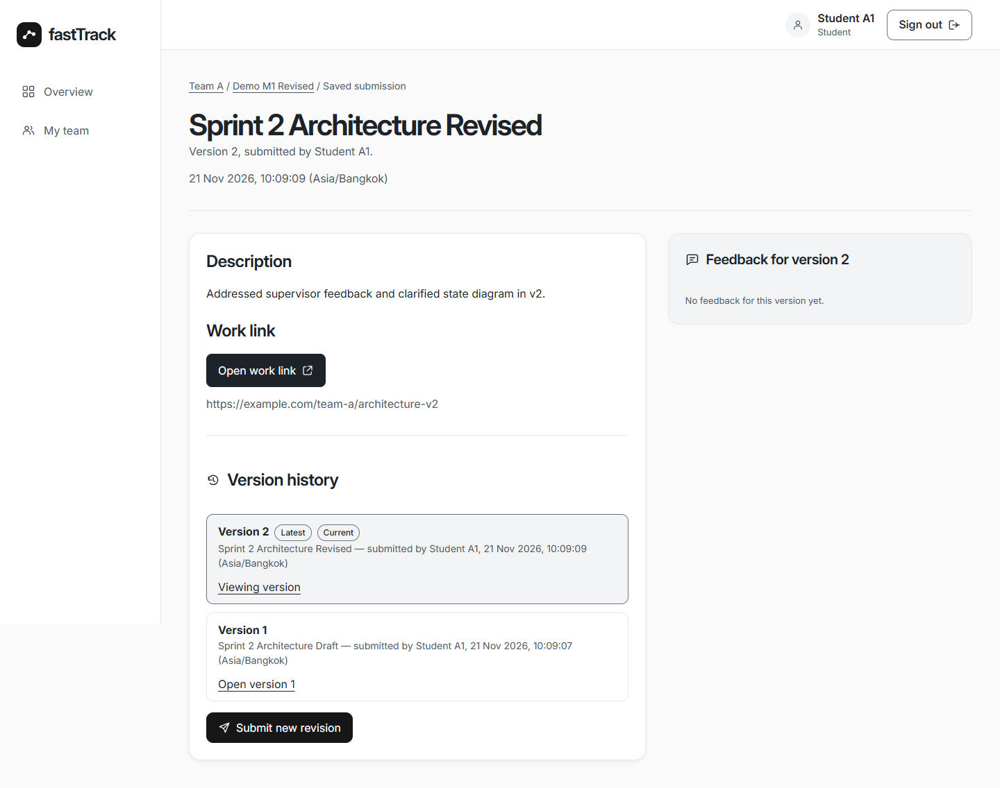
*Figure B-3 — `F-06` (`S2-AC-04`, `S2-AC-05`, Student A1 on `v1.0.0-sprint-2@f3ff8d9`): newly submitted `Version 2` marked `Latest` + `Current` with an isolated empty `Feedback for version 2` panel and navigation to `Open version 1`.*

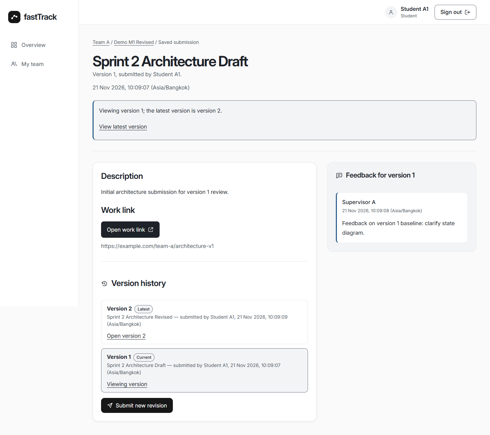
*Figure B-4 — `F-06` (`S2-AC-04`, `S2-AC-05`, Student A1 on `v1.0.0-sprint-2@f3ff8d9`): navigating back to `Version 1` renders `"Viewing version 1; the latest version is version 2."`, a `View latest version` link, unmodified `v1` payload, and retained feedback bound to version 1.*

---

### B.3 Role, Ownership & Boundary Test Excerpt (Owner: B)

- **Tested Target:** `v1.0.0-sprint-2` (`f3ff8d9704c6e2a3705805412f538b2b216569ad`)
- **Test File:** [`Project_code/server/src/testing/milestones-f05b.b01.ts#L263-L299`](https://github.com/zerotwobook/fastTrack/blob/e219628e2e8e6421f4fba77e8091663cb08393e8/Project_code/server/src/testing/milestones-f05b.b01.ts#L263-L299) (`STS-28`)
- **Setup & Fixtures:** Runs against an isolated disposable PostgreSQL 16.8 test database with seeded real HTTP sessions (`supA`, `stuA1`), an assigned Team A milestone (`ownId = milestoneFuture.id`), a foreign Team B milestone owned by Supervisor B (`foreignId = milestoneBTeam.id`), and a nonexistent UUID (`absentId = randomUUID()`). Helper calls send real cookies, `Origin`, and `X-CSRF-Token` headers matching production security middleware.
- **Assertions (`STS-28` verbatim code).**

~~~ts
  it('STS-28 enforces auth, role, CSRF/origin, media type, UUID validation, and equal 404 for foreign/absent milestones', async () => {
    const foreignId = fixtures.milestones.milestoneBTeam.id;
    const absentId = randomUUID();
    const ownId = fixtures.milestones.milestoneFuture.id;

    // 401 unauthenticated
    await request(app()).patch(`/api/milestones/${ownId}`).set('Content-Type', 'application/json').send(JSON.stringify(validEdit())).expect(401);
    await request(app()).post(`/api/milestones/${ownId}/cancel`).set('Content-Type', 'application/json').send('{}').expect(401);

    // 403 student role
    await patchMilestone(ownId, validEdit(), stuA1).expect(403);
    await cancelMilestone(ownId, {}, stuA1).expect(403);

    // 403 CSRF & foreign origin
    await request(app()).patch(`/api/milestones/${ownId}`).set('Cookie', supA.cookie).set('Origin', origin).set('Content-Type', 'application/json').send(JSON.stringify(validEdit())).expect(403);
    await request(app()).post(`/api/milestones/${ownId}/cancel`).set('Cookie', supA.cookie).set('Origin', 'https://foreign.example').set('X-CSRF-Token', supA.csrf).set('Content-Type', 'application/json').send('{}').expect(403);

    // 415 non-JSON
    await request(app()).patch(`/api/milestones/${ownId}`).set('Cookie', supA.cookie).set('Origin', origin).set('X-CSRF-Token', supA.csrf).set('Content-Type', 'text/plain').send('plain').expect(415);

    // 400 malformed UUID
    await patchMilestone('not-a-uuid', validEdit()).expect(400);
    await cancelMilestone('not-a-uuid', {}).expect(400);

    // Equal 404 for foreign vs absent milestone
    const foreignPatch = await patchMilestone(foreignId, validEdit(), supA);
    const absentPatch = await patchMilestone(absentId, validEdit(), supA);
    expect(foreignPatch.status).toBe(404);
    expect(absentPatch.status).toBe(404);
    expect(foreignPatch.body).toEqual(absentPatch.body);

    const foreignCancel = await cancelMilestone(foreignId, {}, supA);
    const absentCancel = await cancelMilestone(absentId, {}, supA);
    expect(foreignCancel.status).toBe(404);
    expect(absentCancel.status).toBe(404);
    expect(foreignCancel.body).toEqual(absentCancel.body);
  });
~~~

- **Executed command and suite result.** B ran this command on 21 November 2026 against `v1.0.0-sprint-2@f3ff8d9` with disposable PostgreSQL 16.8.

~~~text
npx vitest run --config vitest.b01.config.ts server/src/testing/milestones-f05b.b01.ts --reporter=verbose
~~~

B recorded nine passes and zero failures for the selected file. The excerpt above matches the accepted source. The machine record's `sts28Line` field currently names STS-10. Reconcile the individual STS-28 output from the original log before final acceptance.

---

### B.4 Member B Issue -> PR -> Substantive Review -> Fix -> Release Chain (Sprint 2)

| Stage | Artifact / Event | Recorded Timestamp & Commit / ID | Concrete Detail |
| --- | --- | --- | --- |
| 1. Issue & Branch | [Issue #18 (`R2-B02`)](https://github.com/zerotwobook/fastTrack/issues/18) -> `feat/s2-b-f05b-milestones` | Commits `efa9b0b` (`15:54:15Z`), `876e09a` (`16:02:49Z`), `ea480fb` (`16:08:11Z`) | Implemented `F-05B` backend edit/cancel endpoints, lock/clock guards, `MilestoneEdit` UI, cancel modal, and `STS-10..14 / STS-28 / STS-30` tests. |
| 2. Pull Request | [PR #118](https://github.com/zerotwobook/fastTrack/pull/118) targeting `staging/sprint-2` | Opened `2026-11-19T15:54:48Z` | Submitted `F-05B` implementation + tests for Member A peer review. |
| 3. Substantive Review Finding | Peer review (`COMMENTED`) by `zerotwobook` | `2026-11-19T16:23:07Z` on `ea480fb` | Identified **P2 millisecond truncation** in `MilestoneEdit` (`2030-05-10T11:30:59.501Z -> 18:30 -> 11:30:00.000Z`, risking unintended deadline shift when saving an unchanged timestamp) and flagged `session.ts` coordination with `a130a9f` on `staging/sprint-2`. |
| 4. Fix & Re-review | Fix commits `369b27b`, `fd045f5` -> `APPROVED` review | `369b27b` (`16:29:52Z`), `fd045f5` (`16:32:11Z`); approved `2026-11-19T16:51:42Z` | Preserved sub-second deadline precision (`step={0.001}` in edit form / input conversion) and cleanly resolved `session.ts` staging alignment before `zerotwobook` approved `fd045f5`. |
| 5. Merge, G3 & Release | `PR #118` merge -> `G3 #21` -> `PR #129` -> **`v1.0.0-sprint-2`** | `#118` merged `16:56:25Z` (`09cdf9f`); `G3 #21` (`63e81d1`, `2026-11-20T03:15:07Z`); `PR #129` merged `10:30:51Z` (`f3ff8d9`, `#26` closed `12:01:52Z`) | Shipped to production via CI `44719877378` (`458 passed`) and deploy `44719877524` (`fasttrack-app-00004-jr2`); full release handoff recorded in [R2-J03-B-release-handoff.md](https://github.com/zerotwobook/fastTrack/blob/e219628e2e8e6421f4fba77e8091663cb08393e8/Project_code/docs/evidence/R2-J03-B-release-handoff.md). |

## Part C - Sprint 3 contracts and working progress

### C.1 Accepted contract and implementation

F-08 completes the Sprint 3 baseline feature set. The team froze the [F-08 contract](https://github.com/zerotwobook/fastTrack/blob/c83b2fed610797e3eae09739484e944a0cb4ea66/Project_code/docs/contracts/sprint-3-f08-summary.md) through [#27](https://github.com/zerotwobook/fastTrack/issues/27) and [PR #133](https://github.com/zerotwobook/fastTrack/pull/133) before implementing the two slices. A owns F-08A overview, filters and weighted totals. B owns F-08B results, pagination and detail return. Their reviewed implementations are in local source `84c4a31` and hosted release `7872a739`.

- **Workflow and interface.** A supervisor opens `/summary`, selects a team/status, pages through the results, and opens an existing scoped milestone detail. Filters and page live in the URL. Filter or page-size changes reset to page 1. The detail return permits only the local `/summary` path and validated query fields. Sign-out or role/account changes discard previous data and pending responses. Loading, no teams, no matches, empty page, invalid filters and retryable errors each have a UI state.
- **API.** `GET /api/summary` accepts optional `teamId`, `status`, `page` and `pageSize`. Defaults are page 1 and size 20, maximum size 50. Valid statuses are `CANCELLED`, `FEEDBACK_AVAILABLE`, `SUBMITTED`, `OVERDUE` and `PENDING`. Auth precedes query validation: 401 without a session, 403 for a student, 400 for invalid/unknown/repeated filters, and equivalent scoped 404 responses for a missing or foreign team. The no-store response carries `asOf`, normalized filters, completion totals, team rows, `matchedCount`, paged items and `meta.serverTime`. Item fields are milestone/team IDs, team name, title, deadline, status and latest version.
- **Data and rules.** One read-only repeatable-read PostgreSQL snapshot derives team scope from the session and captures database time once. No migration was required for F-08. Completion includes all selected teams' active milestones and counts each milestone with any submission once. The percentage is rounded to one decimal from combined submitted and active counts, with zero when the denominator is zero. A status filter changes the result count and rows. Results sort by `dueAt ASC, id ASC` before paging. A valid out-of-range page returns empty items and retains the filtered count. Status precedence is cancelled, latest-version feedback, submitted, overdue after the deadline, then pending. The unfiltered list includes cancelled rows.
- **Definition of done.** Both slices passed peer review, scoped UI/API/PostgreSQL integration, F-07 parity, and Sprint 1/2 regression. The team matched the deployed source to the serving revision and repeated the critical hosted UI/API checks. [Accepted integration evidence](https://github.com/zerotwobook/fastTrack/blob/c83b2fed610797e3eae09739484e944a0cb4ea66/Project_code/docs/evidence/R3-J01-f08-integration.md)

### C.2 Acceptance and software test specifications

Each criterion below is implemented at `84c4a31`. Automated checks ran through `npm run test:runtime:isolated`, with the F-08 API cases in `test:b01`. Browser checks used the compiled candidate, real sessions and disposable PostgreSQL. [Local execution record and machine output](https://github.com/zerotwobook/fastTrack/blob/c83b2fed610797e3eae09739484e944a0cb4ea66/Project_code/docs/evidence/R3-J01-f08-integration.md)

| AC / planned STS | Expected verification | Executed evidence and result |
| --- | --- | --- |
| F08-AC-01 / F08-STS-01 | API/DB: combine scoped teams at 1/1 and 0/9 to get 1/10 and 10%, with foreign milestones excluded. | PASS locally. `summary-overview.b01.ts` and Chromium/SQL matched 10.0% and team rates of 100.0% and 0.0%. |
| F08-AC-02 / F08-STS-02 | Unit/API/DB: zero, cancelled, deadline equality/+1 ms, revisions and old/latest feedback follow F-07. | PASS locally. `summary-overview.b01.ts`, `summary-drilldown.b01.ts` and `calculation.test.ts` exercise the rules. One submitted milestone with two versions counted once; its v1 feedback stayed on v1. |
| F08-AC-03 / F08-STS-03 | API/DB: compare unfiltered, team/status-filtered and concurrent-write reads. One response uses a consistent snapshot; a new read observes the newly committed data. | PASS locally. Both summary suites checked a committed first submission during the snapshot. The independent browser refresh and SQL also agreed before and after the write. |
| F08-AC-04 / F08-STS-04 | API: 401 anonymous, 403 student, 400 invalid and equivalent 404 foreign/missing, including direct foreign detail. | PASS locally. Both summary suites, with student 403 and foreign detail 404 also reproduced through real sessions. |
| F08-AC-05 / F08-STS-05 | API/DB: tied due times, valid max size, invalid values, page boundaries, stable order and counts. | PASS locally. `summary-drilldown.b01.ts` checks the tie-break and out-of-range pages. The C-01 recovery also passed. Pager wording remains open. |
| F08-AC-06 / F08-STS-06 | Browser and API: filter, page, open detail, use return and Back/Forward/reload, reset page on filter change, reject invalid returns, refresh. | PASS locally. Candidate Chromium, `navigation.test.ts` and real authenticated requests. |
| F08-AC-07 / F08-STS-07 | Browser: switch disjoint supervisors during a pending response. Then try a foreign link and student access. | PASS locally. Candidate Chromium checked no stale rows, generic foreign detail and student omission/403. |
| F08-AC-08 / F08-STS-08 | Browser: empty/error/retry states, labelled controls, focus, narrow layout and zoom-equivalent reflow. | PASS locally at 320, 390, 640, 768 and 1280 CSS px. The 640 px check approximates the reflow width of a 1280 px viewport at 200% zoom. The pager label remains a wording follow-up. |

### C.3 Demonstration - filtered summary reacts to a saved submission

**C-01 · F08-AC-01/03/05/06/07 · staging `84c4a31`.** An assigned supervisor has two teams, ten active milestones, one cancelled milestone and one saved submission. A student belongs to the team with the pending milestone. A second supervisor has disjoint teams.

1. The supervisor opens Summary, selects Pending and page 2 at size 8. Expected: 1/10 completion and one row of nine matches. Actual: UI 10.0%, API `matchedCount: 9` with one row, and PostgreSQL independently reported one submitted and nine pending. The supervisor opens the row, uses Back to summary and repeats with browser Back. The original query is restored both times.
2. The student submits work. After HTTP 201, the supervisor refreshes with the same filter. Expected: the saved submission changes the completion and match count and the second page offers recovery. Actual: PostgreSQL and API agree on 2/10 submitted, eight pending, zero rows on page 2 and a later `asOf`. The UI shows 20.0%, explains the empty page and links to page 1 with the Pending filter and size 8 retained.
3. A student requests Summary directly and a foreign supervisor opens the same milestone address. Expected and actual: backend 403 and generic 404 respectively. Neither response exposes the other team's records.

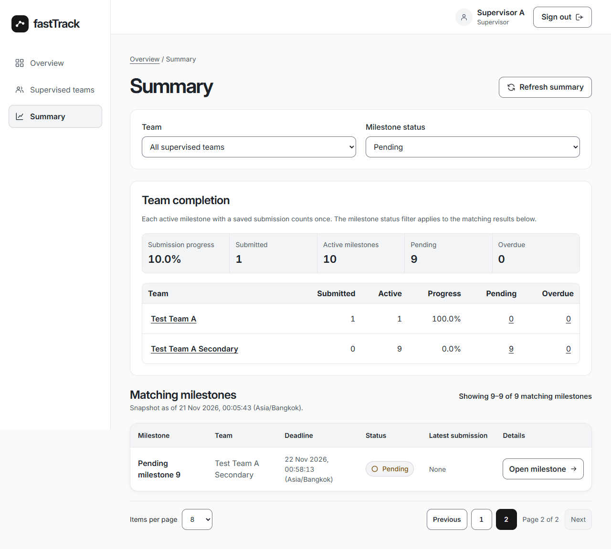

*Figure C-1. C-01 steps 1 and 2 precondition. Supervisor, Pending filter, size 8 and page 2. Expected and actual are 10.0% completion, nine matches and one visible row. Source `84c4a31`.*

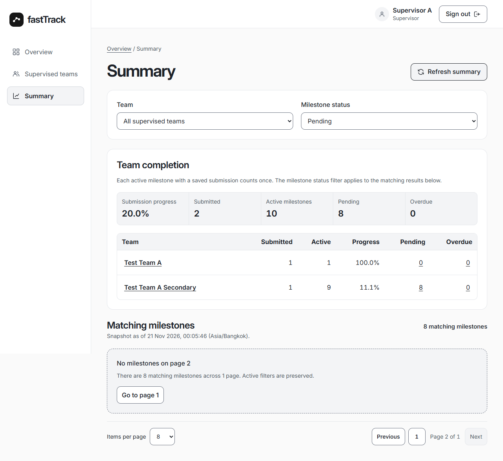

*Figure C-2. C-01 step 2 after a real student write. Expected and actual are 20.0% completion, eight matches and a working link back to page 1. Source `84c4a31`. The pager also displays “Page 2 of 1.”*

Atip-Infa independently repeated the complete runtime suite and the Summary UI/API/SQL comparison on the exact source and recorded local G2 acceptance in [#30](https://github.com/zerotwobook/fastTrack/issues/30) on 21 November Asia/Bangkok. The report includes 483 passed Vitest cases, zero failed, zero skipped, 7/7 historical migration scenarios, eight browser groups and 17/17 production-image/socket checks. Both runs exposed the pager wording. B recommended deferring it because the empty-page message, returning to page 1 and the totals all work. The staging source check [44777769845](https://github.com/zerotwobook/fastTrack/actions/runs/44777769845) passed. The hosted readback below passed, and the peer-approved evidence merged in #138. [Review of #138](https://github.com/zerotwobook/fastTrack/pull/138#pullrequestreview-6004566927)

**C-02 · F08-AC-01/04/05/06/07 · hosted `7872a739`.** An assigned supervisor, a team student and a second supervisor with a disjoint team used the Cloud Run service. Summary showed 6 submitted out of 14 active milestones (42.9%), eight overdue and zero pending. The scoped milestone list and team-progress endpoint independently matched the totals. With the team and overdue filters set, opening a milestone on page 2 and returning preserved the team, status, page and page size. Page-one recovery preserved the filters. The student received HTTP 403, and the foreign supervisor's team filter and milestone each returned HTTP 404. The hosted checks used scoped UI and database-backed HTTPS responses. C-01 provides the direct multi-team PostgreSQL evidence. [Hosted checks](https://github.com/zerotwobook/fastTrack/blob/c83b2fed610797e3eae09739484e944a0cb4ea66/Project_code/docs/evidence/R3-B02-d2-post-deploy-readback.json)

### C.4 Domain test excerpt - weighted completion versus result count

The real PostgreSQL API test signs in as a seeded supervisor, gives that supervisor a second team, and creates one submitted milestone and one cancelled milestone in the first team plus nine future pending milestones in the second team. These assertions are from the test body.

~~~ts
const totals = { total: 10, submitted: 1, pending: 9, overdue: 0, progressPercent: 10 };
const all = await getSummary(cookie).expect(200).expect('Cache-Control', 'no-store');
~~~

~~~ts
const filtered = await getSummary(cookie, '?status=PENDING&page=2&pageSize=8').expect(200);
expect(filtered.body.data).toMatchObject({ totals, matchedCount: 9, teams: all.body.data.teams,
  filters: { teamId: null, status: 'PENDING', page: 2, pageSize: 8 } });
expect(filtered.body.data.items).toEqual([expect.objectContaining({ milestoneId: pendingIds[8], status: 'PENDING' })]);
~~~

The criterion passed in the 57-case `test:b01` portion of the actual `npm run test:runtime:isolated` run at `84c4a31`. The unfiltered response in the full test has 11 visible rows with the cancelled entry and the same ten active milestones in completion. [Test source](https://github.com/zerotwobook/fastTrack/blob/c83b2fed610797e3eae09739484e944a0cb4ea66/Project_code/server/src/testing/summary-overview.b01.ts)

### C.5 Selected A Issue and PR chain

A implemented #28 on `feature/s3-a-summary-overview`. Atip-Infa [reviewed exact head `9070561`](https://github.com/zerotwobook/fastTrack/pull/135#pullrequestreview-5996002975) on 20 November at 16:31 UTC. The review checked the scoped read-only snapshot, 10% weighted fixture, independent result count, preserved URL and mobile table behavior. [PR #135](https://github.com/zerotwobook/fastTrack/pull/135) merged at 16:32 UTC as `416a830`. The merged source is part of `84c4a31` and was locally exercised with F-08B. Part E records the main release and hosted evidence.

### C.6 Remaining work and acceptance

Dates below are internal targets. The 1-11 December examination period is reserved for bounded fixes and retests as availability permits.

| Record / impact | Owner and target | Dependency and acceptance |
| --- | --- | --- |
| #32, D2 Parts B/E and B's evidence | B + A review · staging integration completed 21 Nov | Parts B/E merged in [#142](https://github.com/zerotwobook/fastTrack/pull/142). They cover two persisted S2 demonstrations, a real access-test excerpt, B's review chain and hosted D2 evidence. Package closeout remains in #33. |
| #30, hosted F-08 and continuity | A/B · accepted 21 Nov | Verified the main SHA, CI, registry digests, Cloud Run revision and health/readiness. Hosted Sprint 1 readback and C-02 passed. Peer-approved evidence merged in [#138](https://github.com/zerotwobook/fastTrack/pull/138). |
| #33, D2 and Lab 7 packages | A/B · by 28 Nov | After #30, #31 and #32 acceptance. Cross-check A-E, rubric navigation, submitted tag/URL, setup, contribution/AI disclosures and each separate package. Record course receipts after actual submissions due 29 Nov at 23:59 Asia/Bangkok. |
| #30 finding, F08-AC-05/08 | B with A review · target 30 Nov | Fix the documented `Page 2 of 1` label after D2. Preserve the URL, filters and working page-1 recovery. Retest refresh, pagination/filters, focus and narrow layout on the fix. |
| #34/#35, final domain and delivery retests | A/B · bounded retests during 1-11 Dec, freeze target 12 Dec | Close findings from D2 and UAT; confirm browser/access, durable data, regression and versioned rollout on the final candidate. Update setup and walkthrough. |
| Final report, video and release | A/B · freeze 12 Dec, submit by 13 Dec | Final verified release and substantive peer acceptance. Reconcile report/demo/version and use the actual course submission record. |

## Part D - Updated requirements and test traceability

### D.1 Updated SRS

fastTrack supports a single course-project context. Students read their team's milestones, submit work links, revise before the deadline and read exact-version feedback. Supervisors plan and supervise their assigned teams, append feedback, and inspect per-team progress and multi-team Summary. The course assessor uses the private seeded-account handoff or a local fixture. Grading, file upload, public feedback, self-registration, SSO, notifications and simultaneous multi-course administration are outside this baseline. All runtime roles are Student and Supervisor.

The requirements register in D.4 is the current Functional Requirements (FR), Business Rules (BR) and Non-Functional Requirements (NFR) specification. CR-L7-01 supersedes the original BR-08 feedback limit; the existing description and work-link limits stay at 4,000 and 2,048 respectively. The Lab 6 isolated deadline exercise confirmed enforcement of the unchanged deadline rule.

### D.2 Feature inventory

| Feature / sprint | Observable responsibility | Dependency and implementation status |
| --- | --- | --- |
| F-01 / 1 | Sign-in, current identity, sign-out, role-scoped team context | Seeded users and membership. Implemented and accepted in S1; regression executed on D2 local. |
| F-02 / 1 | Supervisor creates a milestone; authorized roles list/read it | F-01. Implemented and accepted in S1; regression executed on D2 local. |
| F-03 / 1 | Student's first submission, deadline, duplicate prevention and saved readback | F-01/02. Implemented and accepted in S1; regression executed on D2 local. |
| F-04 / 1 | Supervisor appends private feedback to an exact submission version | F-01/03. Implemented and accepted in S1; L7 size revision released in S2 and checked on D2 local. |
| F-05A / 2 | Supervisor creates/renames teams and manages eligible membership | F-01 and history locks. Implemented and accepted in S2; regression executed on D2 local. |
| F-05B / 2 | Supervisor edits or cancels eligible milestones | F-02/03 and history locks. Implemented and accepted in S2; regression executed on D2 local. |
| F-06 / 2 | Student revises with version conflict protection; old versions and feedback remain readable | F-03/04. Implemented and accepted in S2; regression executed on D2 local. |
| F-07 / 2 | Team progress and derived statuses for scoped team members or supervisors | F-05/06. Implemented and accepted in S2; regression executed on D2 local. |
| F-08A / 3 | Supervisor overview, scoped filters, weighted completion and response coordinator | F-07, shared F-08 contract. Implemented, peer-accepted in staging and locally verified. |
| F-08B / 3 | Filtered milestones, deterministic paging and detail return | F-02/07 and F-08 shared snapshot/URL. Implemented, peer-accepted in staging and locally verified. |
| Delivery / cross-cutting | Versioned build, migration, readiness, protected rollout and persistence checks | S2 and D2 rollouts verified. Part E records deployed identity, migration and persistence. |

### D.3 Current System-Level SDS

**Runtime boundaries.** React/TypeScript/Vite renders the routes for sign-in, teams, milestones, submissions, revisions, feedback, progress and Summary. Express serves the built application and `/api` from one origin in the production web image. The browser uses the API via HTTP with an allowlisted DTO, and never connects to PostgreSQL. Express handles actor identity, origin and CSRF, scope, validation, transactions and safe error responses. Prisma with its PostgreSQL adapter supplies persistent reads and writes. Shared validation and status/URL logic prevent drift between the client, API and report calculation. Feature modules group identity, team planning, milestones, submissions, feedback, progress and reporting.

**Interface ownership.** Identity uses `/api/auth/login`, `/api/auth/me` and `/api/auth/logout`. Teams expose scoped read endpoints and supervisor-only create, rename, membership and available-student operations. Milestones expose create/list under teams, individual scoped detail, eligible update and cancellation. First submit and revisions use separate milestone routes. Saved versions and feedback are scoped by their own resource IDs. Progress is `GET /api/teams/:id/progress`. F-08 extends the same API with `GET /api/summary` and C.1's filters, fields and snapshot. Success envelopes expose typed fields and server time where applicable. Errors carry a safe error code/message and field details when useful. Protected responses are no-store.

**Data and invariants.** `User` has one role with a hashed password. A `Session` belongs to a user and stores token-derived data and expiry. `AuthRateLimit` tracks rate-limit keys/counters. A `Team` has one supervisor and `TeamMember` links students, with uniqueness preventing one student from joining two teams. A `Milestone` belongs to a team, records its creator and stores `dueAt` and optional terminal `cancelledAt`. A `Submission` belongs to a milestone and is unique by milestone and version. It stores the author, accepted timestamp and work metadata. `Feedback` links to one submission and supervisor and enforces scoped request-key uniqueness and the migrated 6,000-point content bound. PostgreSQL foreign keys, unique constraints and forward migrations preserve the relationships.

**Concurrency and reporting.** Plan changes, membership and submit/revise operations serialize on shared locks, recheck actual ownership/history, and apply time-sensitive rules after locking. First submit creates v1 once. Revision checks `expectedVersion` against the locked latest state. Feedback preserves append/replay semantics and never moves across versions. F-07 and F-08 use scoped, snapshot-consistent reads, with F-08 consolidating totals, team rows and its paged list in one read-only repeatable-read transaction.

**Session and error design.** Production uses HTTPS, an HttpOnly Secure session cookie with SameSite protection, fixed expiry and logout revocation. Authentication uses designated bootstrap and CSRF responses; protected writes require the correct source, token, role and database authorization. Foreign and missing private objects have the same safe response. Response allowlists, no-store, and client cache clearing on identity change protect account transitions. Input is validated after trimming with documented length and time boundaries. Server diagnostics stay out of general user responses.

**Deployment design.** The npm workspace builds the client and API. Docker separates a web runner from a source-matched migration/jobs image. Cloud Run serves the app, with Cloud SQL supplying the PostgreSQL database. GitHub Actions runs required tests, builds immutable SHA-tagged artifacts and uses keyless GCP authentication, migration-before-rollout and smoke. `/api/health` identifies the compiled version without contacting the database. `/api/ready` checks database connectivity and fails closed when unavailable. Seeds are explicit and use synthetic data. A release readback ties source, tag, image digests, serving revision, traffic and post-deploy evidence together. [Architecture and repository setup](https://github.com/zerotwobook/fastTrack/blob/c83b2fed610797e3eae09739484e944a0cb4ea66/Project_code/README.md) · [Clean-container regression](https://github.com/zerotwobook/fastTrack/blob/c83b2fed610797e3eae09739484e944a0cb4ea66/Project_code/README.md#clean-container-regression) · [Physical data model](https://github.com/zerotwobook/fastTrack/blob/c83b2fed610797e3eae09739484e944a0cb4ea66/Project_code/server/prisma/schema.prisma) · [Delivery contract](https://github.com/zerotwobook/fastTrack/blob/c83b2fed610797e3eae09739484e944a0cb4ea66/Project_code/docs/contracts/sprint-2-lab-05-delivery-contract.md)

### D.4 Requirements-to-verification matrix

**Version key.** S1 = accepted tag `ae7a60a6`. S2 = accepted tag `f3ff8d9`. D2-local = `84c4a31`. D2-hosted = `7872a739`. A PASS in the last column refers to executed coverage on D2-local unless another version is explicitly shown. Planned test IDs identify the designed verification. Historical UI, human UAT and release results retain their original version. Coverage labels in each row distinguish implemented behavior, executed evidence and remaining checks.

| Requirement | Feature / sprint and planned verification | Actual evidence and result |
| --- | --- | --- |
| FR-01 · Login, current identity and logout | F-01 / 1 · AC-01.1-01.4, T-01-04; EXT-01/05, T-23/27 | Implemented · PASS: `sessions.auth.ts` and compiled J03 real login/me/logout/replay. |
| FR-02 · Read only team, membership and milestones within scope | F-01/02 / 1 · AC-01.5, AC-02.2, EXT-03; T-05/07/25 | Implemented · PASS: `sessions.auth.ts`, `milestones-review.b01.ts` and J03 list/detail parity. |
| FR-03 · Assigned supervisor creates and retrieves a milestone | F-02 / 1 · AC-02.1-02.3, T-06-08 | Implemented · PASS: `milestones-review.b01.ts` persists scoped content and deadline; A-01 compiled readback. |
| FR-04 · Student submits title, description and URL and retrieves the saved record | F-03 / 1 · AC-03.1-03.6, T-09-16/26 | Implemented · PASS: `submissions.a02.ts` and J03 persist exact v1 and exercise boundary, privacy, duplicate and restart checks. |
| FR-05 · Assigned supervisor appends exact-submission feedback; team reads it | F-04 / 1, L7 / 2 · AC-04.1-04.4, EXT-02, T-17-20/24; L7-AC/STS-01-05 | Implemented · PASS: `feedback-review.b02.ts` and J03; hosted L7-STS-05 at S2. |
| FR-06 · Create/rename teams and manage eligible students | F-05A / 2 · S2-AC-01/02, STS-01-09 | Implemented · PASS: `team-planning.auth.ts` verifies creation, rename, ownership, membership and concurrent assignment. |
| FR-07 · Edit or cancel a milestone before any submission | F-05B / 2 · S2-AC-03, STS-10-14 | Implemented · PASS: `milestones-f05b.b01.ts` checks lock, timing and terminal cancellation. |
| FR-08 · Append revisions and preserve history and feedback | F-06 / 2 · S2-AC-04/05, STS-15-22; T-29 | Implemented · PASS: `revisions-f06.b02.ts` and `integrated-s2.auth.ts` cover conflicting writers, exact versions and feedback retention. |
| FR-09 · Read the scoped progress board, statuses and completion | F-07 / 2 · S2-AC-06, STS-23-27; T-30 | Implemented · PASS: `progress.auth.ts` and `calculation.test.ts` match stored records and expected percentages. |
| FR-10 · Supervisor views, filters and drills into assigned-team Summary | F-08 / 3 · F08-AC/STS-01-08 | Implemented · PASS locally: both summary suites and C-01. PASS hosted: weighted completion, filters, detail return and pager recovery (C-02). |
| BR-01 · One role per account, at most one team per student, one supervisor per team | F-01/05A / 1-2 · AC-01.5, T-05; S2-AC-01/02, STS-01/07/08 | Implemented · PASS: `foundation.g1.ts`, `sessions.auth.ts` and `team-planning.auth.ts` retain ownership and assignment uniqueness. |
| BR-02 · Database membership/assignment gates every protected read and write | F-01-08 / 1-3 · T-05/07/14/18/25/27; STS-03/21/27/28; F08-STS-04/07 | Implemented · PASS: scoped real-session suites and C-01 deny foreign/student access. Hosted student 403 and foreign-team/milestone 404 passed (C-02). |
| BR-03 · Supervisors create milestones/feedback; student team members submit/revise | F-02/03/04/06 / 1-2 · AC-02.2, AC-03.5, AC-04.2, T-07/14/18; S2-AC-04/07, STS-15/28 | Implemented · PASS: milestone, submission, feedback and revision API suites, with A-01 student feedback write denied. |
| BR-04 · Accept up to and including database time at dueAt, store UTC and display Bangkok time | F-03/05B/06/07 / 1-2 · AC-03.2/03.3, EXT-04, T-10-13/26; STS-13/18/25 | Implemented · PASS: `submissions.a02.ts`, `deadline-lab6.a02.ts` and `revisions-f06.b02.ts` cover equal time, late rejection and lock crossing. Historical S1 UI and Lab 6 check display. |
| BR-05 · First submission creates unique immutable v1; duplicates add nothing | F-03/06 / 1-2 · AC-03.3, T-13/26; STS-15/17 | Implemented · PASS: `submissions.a02.ts`, J03 and revision suite; duplicate 409 and one committed v1. |
| BR-06 · Revisions increment atomically; earlier versions and exact feedback survive | F-04/06 / 1-2 · AC-04.4, T-20/29; S2-AC-04/05, STS-16/17/20/21 | Implemented · PASS: revision and integrated S2 suites plus C-01 version readback. |
| BR-07 · Private, append-only feedback with no grading decision | F-04 / 1 · AC-04.1-04.4, EXT-02, T-17-20/24 | Implemented · PASS: `feedback-review.b02.ts` and J03 check append, replay, changed-intent 409 and scope. |
| BR-08 · Trim and validate title 1-120, description 1-4,000, feedback 1-6,000 code points, HTTP(S) URL ≤2,048 | F-02/03/04/05/06 / 1-2 · AC-02.3, AC-03.4, AC-04.3; T-08/15/19; STS-04/10/19; L7-STS-01-04 | Implemented · PASS: scoped input suites and Lab 7 GREEN. Hosted 5,999/6,000/6,001 verified on S2. |
| BR-09 · Lock milestone plan and team membership once work exists; preserve history and supervisor assignment | F-05A/05B / 2 · S2-AC-02/03, STS-09/11/14, T-28 | Implemented · PASS: team planning and milestone planning API/DB suites check both operation orders and saved rows. |
| BR-10 · Count non-cancelled milestones; one completion per submitted milestone; weight by combined counts | F-07/08 / 2-3 · S2-AC-06, STS-23-27, T-30; F08-STS-01-03 | Implemented · PASS: calculation and progress API suites, C-01 UI/API/SQL 10.0% then 20.0%. |
| NFR-01 · Hash passwords, protect tokens, enforce expiry/revocation and limit CSRF disclosures | F-01 / 1-3 · EXT-01/05, T-01-04/23/27; STS-28 | Implemented · PASS: `sessions.auth.ts`, `runtime.a01.ts` and cookie/socket checks. Hosted configuration/observability to confirm on D2. |
| NFR-02 · Server enforces role and ownership for private lists, records and mutations | F-01-08 / 1-3 · T-05/07/14/18/25/27; STS-28; F08-STS-04/07 | Implemented · PASS: scope suites and C-01. PASS hosted: student 403 and foreign 404 (C-02). |
| NFR-03 · Durable submissions and feedback through restart and release | Persistence / 1-3 · T-16/20/31, STS-29/30 | Implemented · PASS: J03 and 17/17 local socket checks. Historical Lab 5 restart and redeploy PASS plus S2 original C-04 readback. PASS hosted: original Sprint 1 submission and feedback retained after migration (A.1). |
| NFR-04 · Reproduce install, migration, seed, build, run and tests from the tracked setup | Build / 1-3 · T-22/31, STS-29/31 | Implemented · PASS: clean D2-local clone, npm install, fresh/repeat migration, seven upgrades and compiled plus production-image checks. Reviewer handoff and final clean setup readback pending. |
| NFR-05 · Render usable loading, errors, success and empty states without internals | All UI / 1-3 · T-21/27, STS-31, F08-STS-06/08 | Implemented · PASS for selected local Summary states, focus and supported widths. Historical S1/S2 UI evidence remains versioned. Hosted detail return and page-one recovery passed (C-02). Pager wording remains open. |
| NFR-06 · Block release on failed required CI; match main, artifacts and serving release with smoke | Delivery / 2-3 · Lab 5 C-01-06, T-31; #30 hosted check | Implemented. Historical blocking proof and S2-hosted source identity PASS. D2 staging CI and local health/readiness passed. PASS hosted: main SHA, image digests, revision, traffic and smoke checks matched (Part E). |

**Acceptance reference.** The original Sprint 1 map covers all 18 numbered ACs and five extensions at its recorded verification source. The eight Sprint 2 ACs group STS-01-32. F-05A covers S2-AC-01/02 and F-05B covers 03. F-06 covers 04/05, F-07 covers 06, and the integration suites cover 07/08. The S2 G6 decision records the accepted release. D.4 maps representative executed results on the D2-local candidate, and Part B carries the detailed S2 completion and demonstration evidence. C.2 records every F-08 AC separately. [Sprint 1 coverage map](https://github.com/zerotwobook/fastTrack/blob/c83b2fed610797e3eae09739484e944a0cb4ea66/Project_code/docs/evidence/R1-J03-coverage.md) · [Sprint 2 planned and executed mappings](https://github.com/zerotwobook/fastTrack/blob/c83b2fed610797e3eae09739484e944a0cb4ea66/Project_code/docs/contracts/sprint-2-feature-interfaces.md) · [Accepted Sprint 2 G6](https://github.com/zerotwobook/fastTrack/issues/26)

### D.5 Feature acceptance coverage

Every Sprint 1 and Sprint 2 AC below is implemented in D2-local. The original S1 evidence records every AC at the S1 verification source. The D2-local column records the executed suite or scenario on `84c4a31` that covers each group of explicit AC IDs. Historical UI evidence and checks due on the hosted candidate are identified separately. Sections A and C provide the detailed continuity and F-08 checks.

| Criterion IDs | Planned test IDs | Executed result |
| --- | --- | --- |
| AC-01.1, AC-01.2, AC-01.3, AC-01.4, AC-01.5 | T-01, T-02, T-03, T-04, T-05 respectively | PASS, `test:auth`: real login, bad credentials, expiry, logout/CSRF and role scope. |
| AC-02.1, AC-02.2, AC-02.3 | T-06, T-07, T-08 respectively | PASS, `test:b01`: create/read, authorized/foreign actors and validation. |
| AC-03.1, AC-03.2, AC-03.3 | T-09; T-10/11/12; T-13 | PASS, `test:a02`: persisted version 1, deadline boundary and duplicate race. |
| AC-03.4, AC-03.5, AC-03.6 | T-15; T-14; T-16/31 local | PASS, `test:a02` and J03: content boundaries, denial and durable saved readback. |
| AC-04.1, AC-04.2, AC-04.3, AC-04.4 | T-17/20; T-18/19/20; T-17/19; T-20/31 local | PASS, `test:b02` and J03: append, scope, validation and durable exact-version readback. |
| S1-AC-EXT-01, S1-AC-EXT-02, S1-AC-EXT-03, S1-AC-EXT-04 | T-23, T-24, T-25, T-26 respectively | PASS, `test:auth`, `test:b02`, J03 and `test:a02`: auth bootstrap/CSRF, exact intent replay, scoped DTO and deadline lock wait. |
| S1-AC-EXT-05 | T-27 | PASS for historical S1 browser acceptance and D2-local selected account-switch checks. Hosted saved Sprint 1 work and feedback were read in A.1. A broader account-switch retest remains. |
| S2-AC-01, S2-AC-02 | STS-01-04, STS-05-09 respectively | PASS, `test:auth`, `team-planning.auth.ts`: team edit, eligible member and lock behaviors. |
| S2-AC-03 | STS-10-14 | PASS, `test:b01`, `milestones-f05b.b01.ts`: edit/cancel, saved history and deadline race. |
| S2-AC-04, S2-AC-05 | STS-15-19, STS-20-22 respectively | PASS, `test:b02`: atomic version and saved history. Historical S2 browser evidence covers draft retention. Hosted replay pending. |
| S2-AC-06 | STS-23-27 | PASS, `test:auth`, `progress.auth.ts` and the calculation suite: persisted status and percentages. |
| S2-AC-07 | STS-28-31 | PASS on documented local auth, migrations, S1 regression and selected UI. Hosted release identity passed. Broader final UI retests remain. |
| S2-AC-08 | STS-32 | PASS on integrated S2 API/DB test and independently accepted staging integration in #21. |
| L7-AC-01 to 04 | L7-STS-01 to 04 | PASS on `test:b02` and the guarded schema upgrade suite. A.4 preserves the expected pre-fix failures. |
| L7-AC-05 | L7-STS-05 | PASS on deployed S2, as recorded in A.3. D2 hosted repeat pending. |
| F08-AC-01 to 08 | F08-STS-01 to 08 | PASS locally. C.2 names the executed verification and current findings for each criterion. |

## Part E - Integrated release candidate

### E.1 Pre-Release Staging & `main` Release Verification

| Verification Source | Commit | Environment | Result Summary |
| --- | --- | --- | --- |
| Staging CI ([Run `44777769845`](https://github.com/zerotwobook/fastTrack/actions/runs/44777769845)) & `PR #143` CI ([`44874070498`](https://github.com/zerotwobook/fastTrack/actions/runs/44874070498), [`44881698859`](https://github.com/zerotwobook/fastTrack/actions/runs/44881698859)) | `84c4a31` -> `6db6a346f32f4d1cce7caa7cc77a1d6db4d872f2` | GitHub Actions, `postgres:16.8` (`Debian 16.8-1.pgdg120+1`) | **483 passed, 0 failed, 0 skipped** (`214` ordinary, `38` G1, `46` auth, `57` B01, `54` A02, `61` B02, `1` J03, `12` runtime) + `7/7` upgrades passed (`ci-runtime-report`); `PR #143` exact-head CI runs completed `success` |
| B Independent G2 & `PR #143` Review ([Issue #30](https://github.com/zerotwobook/fastTrack/issues/30)) | `84c4a31`, `6db6a34` | Separate clean checkouts (`npm ci`, `npm run test:runtime:isolated`, Docker `postgres:16.8`, Unix-socket images, headless Chromium) | **483 passed, 0 failed, 0 skipped**, **7/7** upgrade cases (`upgrades.passed: true`), **17/17** container/Unix-socket checks, DB/API/UI `1/10 (10.0%)` -> `2/10 (20.0%)` F-08 parity, filter/page `?status=PENDING&page=2&pageSize=8` preserved across milestone round-trip, student `403`, foreign supervisor `404`, `"Page 2 of 1"` label with working `Go to page 1` recovery; `GHSA-7589-6fvf-x4pw` (`effect@3.20.0`, `devOptional: true` via `@prisma/config@7.10.1` -> `prisma@7.10.1`) tracked as non-blocking post-D2 follow-up |
| Post-merge `main` CI & Docker Build ([Run `44885899889`](https://github.com/zerotwobook/fastTrack/actions/runs/44885899889)) | `7872a739147f7553e16e05a4d40b5d0de0c21f27` (`PR #143` merge) | GitHub Actions, `postgres:16.8` (`Debian 16.8-1.pgdg120+1`) | **483 passed, 0 failed, 0 skipped** (`214` ordinary, `38` G1, `46` auth, `57` B01, `54` A02, `61` B02, `1` J03, `12` runtime) + `7/7` upgrade cases (`upgrades.passed: true`) |

### E.2 Clean Setup & Verification Reproduction Steps (`NFR-04`)

All application source lives under `Project_code/` with runtime versions pinned in [`Project_code/.node-version`](https://github.com/zerotwobook/fastTrack/blob/9cb317cb89edd5acb3baacc4f6979700963fcb9c/Project_code/.node-version) (`Node 26.13.0`, `npm 11.20.0`) and base images pinned by SHA-256 digest in [`Project_code/Dockerfile`](https://github.com/zerotwobook/fastTrack/blob/9cb317cb89edd5acb3baacc4f6979700963fcb9c/Project_code/Dockerfile) and [`Project_code/compose.yaml`](https://github.com/zerotwobook/fastTrack/blob/9cb317cb89edd5acb3baacc4f6979700963fcb9c/Project_code/compose.yaml).

> The updated [technical setup guide](https://github.com/zerotwobook/fastTrack/blob/1caf711a834472fa2f41f7adacb3bb63b497e607/Project_code/README.md) covers clean-container regression and Sprint 2 and Sprint 3 workflow checks. It merged into staging/sprint-3 with Parts A, C and D in [PR #139](https://github.com/zerotwobook/fastTrack/pull/139).

1. **Prerequisites & Environment Files (Non-Production Placeholders Only):**
   - Install Node `26.13.0` (`npm 11.20.0`) and Docker Engine / Docker Desktop.
   - For local manual runs without Compose, copy [`Project_code/server/.env.example`](https://github.com/zerotwobook/fastTrack/blob/9cb317cb89edd5acb3baacc4f6979700963fcb9c/Project_code/server/.env.example) to `Project_code/server/.env`, provision PostgreSQL on `127.0.0.1:5433`, and supply private synthetic hex values for `DATABASE_URL`, `TEST_DATABASE_URL`, and `DEMO_SEED_PASSWORD` (no default credential exists).
   - For Docker Compose runs, copy [`Project_code/compose.env.example`](https://github.com/zerotwobook/fastTrack/blob/9cb317cb89edd5acb3baacc4f6979700963fcb9c/Project_code/compose.env.example) to `Project_code/.env.compose` with synthetic `LOCAL_DB_PASSWORD`, optional `DEMO_SEED_PASSWORD`, and 40-char `RELEASE_SHA`.
2. **Reproducible Isolated Verification (Disposable PostgreSQL `16.8` Container):**

~~~bash
cd Project_code
npm ci
npm run db:generate --workspace @fasttrack/server
npm run typecheck
npm run test:runtime:isolated
~~~

3. **Optional Containerized Local App Startup (`compose.yaml`, loopback `127.0.0.1:8080`):**

~~~bash
cd Project_code
docker compose --env-file .env.compose up -d db
docker compose --env-file .env.compose --profile tools run --rm jobs npm run db:migrate --workspace @fasttrack/server
docker compose --env-file .env.compose --profile tools run --rm jobs npm run db:seed --workspace @fasttrack/server
docker compose --env-file .env.compose up --build app
~~~

Seeded synthetic accounts for local evaluation only: `supervisor.a@fasttrack.local`, `supervisor.b@fasttrack.local`, `student.a1@fasttrack.local`, `student.a2@fasttrack.local`, `student.b1@fasttrack.local` (all authenticated via the synthetic `DEMO_SEED_PASSWORD` provided at seed time).

---

### E.3 Post-Deploy D2 Release Evidence (`main@7872a739`, Deployed `2026-11-21T09:25Z`)

Actual post-deployment results captured from [`Deploy demo` Run `44888588070`](https://github.com/zerotwobook/fastTrack/actions/runs/44888588070), live `/api/health` + `/api/ready` HTTP probes, and Chromium + API readback in [`R3-B02-d2-post-deploy-readback.json`](https://github.com/zerotwobook/fastTrack/blob/9cb317cb89edd5acb3baacc4f6979700963fcb9c/Project_code/docs/evidence/R3-B02-d2-post-deploy-readback.json):

#### 1. Release Commit, Tag, CI & Container Artifacts

| Evidence Item | Target / Format | Status | Recorded Value |
| --- | --- | --- | --- |
| Accepted `main` release PR & merge SHA | Release PR, 40-char commit SHA | **Recorded** | [PR `#143`](https://github.com/zerotwobook/fastTrack/pull/143) (`6db6a346f32f4d1cce7caa7cc77a1d6db4d872f2` -> `f3ff8d9704c6e2a3705805412f538b2b216569ad`), merged `2026-11-21T08:39:25Z` as `7872a739147f7553e16e05a4d40b5d0de0c21f27` |
| Release Git tag | Immutable reference for the deployed commit | **Verified** | [v1.0.0-d2](https://github.com/zerotwobook/fastTrack/tree/v1.0.0-d2) resolves to `7872a739147f7553e16e05a4d40b5d0de0c21f27`. |
| `main` CI & Docker Build run | GitHub Actions run URL + `PASS / FAIL / SKIPPED` totals (`ci-runtime-report`) | **Passed** | [Run `44885899889`](https://github.com/zerotwobook/fastTrack/actions/runs/44885899889): `483 passed, 0 failed, 0 skipped` (`214` ordinary, `38` G1, `46` auth, `57` B01, `54` A02, `61` B02, `1` J03, `12` runtime) + `7/7` upgrade cases (`upgrades.passed: true`); re-verified by `test / test-and-docker` (`136799431127`) in Run `44888588070` |
| `Deploy demo` workflow run | GitHub Actions deployment workflow (`demo` environment) | **Succeeded** | [Run `44888588070`](https://github.com/zerotwobook/fastTrack/actions/runs/44888588070) (`workflow_dispatch` on `main` triggered by `@zerotwobook`, `demo` approved by `@Atip-Infa`; `test` `136799431127` & `deploy` `136800312369` `completed/success` at `2026-11-21T09:25:55Z`; supersedes self-review-blocked push run [`44885899928`](https://github.com/zerotwobook/fastTrack/actions/runs/44885899928)) |
| Container image digests (`web` & `jobs`) | `sha256:...` pushed to Artifact Registry | **Recorded** | `web`: `asia-southeast1-docker.pkg.dev/fasttrack-se-002/fasttrack-docker/fasttrack-app@sha256:7b868cd51b62db518dde4e22601930a9be7b8483bffb9409efd70742faf2c458`; `jobs`: `asia-southeast1-docker.pkg.dev/fasttrack-se-002/fasttrack-docker/fasttrack-jobs@sha256:b49829f88464cc18f7aa6d2cb9be840e67cf9dd1b867eee18d3bf7e58ec4c718` |
| Cloud Run migration job & active service revision | Job execution ID, Cloud Run revision name (`100%` traffic) | **Recorded** | Job `fasttrack-migrate` execution **`fasttrack-migrate-4lvx5`** (`completed` `2026-11-21T09:25:17Z`); Cloud Run service `fasttrack-app` revision **`fasttrack-app-00005-rkz`** (`100%` traffic) |
| Public HTTPS URL & readiness endpoints | `https://...` + live HTTP `200` on `/api/health` and `/api/ready` (`version` matches `7872a739147f7553e16e05a4d40b5d0de0c21f27`) | **Passed** | Public URL: `https://fasttrack-app-kpx7au3w2a-as.a.run.app` (Cloud Run URL `https://fasttrack-app-970128017651.asia-southeast1.run.app`); smoke test passed (`/api/health`, `/api/ready`, `/`, `/api/nonexistent`); direct HTTPS probes returned HTTP `200` on `/api/health` (`{"status":"ok","version":"7872a739147f7553e16e05a4d40b5d0de0c21f27"}`) and `/api/ready` (`{"status":"ready","database":"connected","version":"7872a739147f7553e16e05a4d40b5d0de0c21f27"}`) |

#### 2. Original Sprint 1 Production Persistence Readback (Preserved Across Upgrades)

Live browser + API verification (`2026-11-21T09:30Z`, recorded in [`R3-B02-d2-post-deploy-readback.json`](https://github.com/zerotwobook/fastTrack/blob/9cb317cb89edd5acb3baacc4f6979700963fcb9c/Project_code/docs/evidence/R3-B02-d2-post-deploy-readback.json)) confirmed all Lab 5 baseline records documented in [`R2-J01-B-post-release-readback.json`](https://github.com/zerotwobook/fastTrack/blob/9cb317cb89edd5acb3baacc4f6979700963fcb9c/Project_code/docs/evidence/R2-J01-B-post-release-readback.json) (`canonicalRecordsSha256: c5396255105bfccd8f13ec0b8469aae6d1ab2a3a7923a13a55253e582bbe0f4e`) remain completely intact on revision `fasttrack-app-00005-rkz`:

- [x] **Team A preserved:** `teamId = 7c600ee0-a595-4c52-a093-f0ed5e08fded` (`GET /api/teams/7c600ee0-a595-4c52-a093-f0ed5e08fded` HTTP `200`, `2` team members)
- [x] **Original Sprint 1 Milestone preserved:** `milestoneId = b19ae7d5-d2a1-4ace-9b11-d2a94cb8177d` (`GET /api/milestones/b19ae7d5-d2a1-4ace-9b11-d2a94cb8177d` HTTP `200`)
- [x] **Original Sprint 1 Submission preserved:** `submissionId = baa3eb8d-e37f-44c2-93fc-dc9f8e5463fd` (`GET /api/submissions/baa3eb8d-e37f-44c2-93fc-dc9f8e5463fd` HTTP `200` for both Supervisor A and Student A1; `"C04 initial submission"`)
- [x] **Original Sprint 1 Feedback preserved:** `feedbackId = b9ebf7f7-a542-4b89-95a8-8f1de22a5357` (`GET /api/submissions/baa3eb8d-e37f-44c2-93fc-dc9f8e5463fd/feedback` HTTP `200` for both Supervisor A and Student A1; exact `canonicalRecordsSha256` baseline match = `true`)

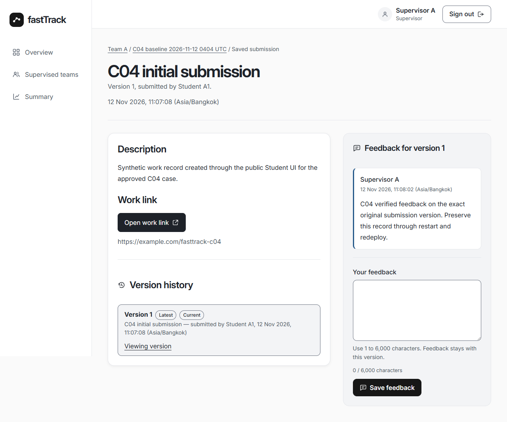
*Figure E-1 — Hosted D2 Cloud Run (`fasttrack-app-00005-rkz`, `7872a739`) preserving Sprint 1 baseline `C04 initial submission` (`baa3eb8d-...`) and its version-1 feedback (`b9ebf7f7-...`) unmodified after migration `fasttrack-migrate-4lvx5`.*

#### 3. Post-Deploy Hosted `F-08` Scope & Functional Verification Re-run

- [x] **Supervisor A `/summary` & `GET /api/summary`:** Verified on hosted UI and API (`asOf: 2026-11-21T09:30:22.331Z`): `/summary` displays `42.9%` (`submitted: 6`, `total: 14`, `pending: 0`, `overdue: 8`), reconciling exactly against `GET /api/summary` and per-team `GET /api/teams/:id/progress` (`Team A`: `6 / 14 = 42.9%`). Filtering `?teamId=7c600ee0-a595-4c52-a093-f0ed5e08fded&status=OVERDUE&page=2&pageSize=1`, clicking milestone `b001b3df-...`, and returning via both **Back to summary** and browser **Back** preserved `?teamId=7c600ee0-a595-4c52-a093-f0ed5e08fded&status=OVERDUE&page=2&pageSize=1` cleanly. *(Blocked check recorded honestly: direct SQL readback against Cloud SQL `fasttrack_prod` is blocked/unavailable from Member B's workspace environment because no `gcloud` CLI, GCP credential, Cloud SQL Proxy, or production `DATABASE_URL` is configured here.)*
- [x] **Student role enforcement:** Signed-in `student.a1@fasttrack.local` navigation rendered `0` `/summary` links, `/summary` rendered `"Summary is restricted to supervisors"`, and `GET /api/summary` returned HTTP **`403`** (`FORBIDDEN`).
- [x] **Cross-supervisor ownership isolation:** Signed-in `supervisor.b@fasttrack.local` `/summary` returned only Supervisor B's `1` team (`supBSummaryContainsTeamA: false`); `GET /api/summary?teamId=7c600ee0-a595-4c52-a093-f0ed5e08fded`, `GET /api/milestones/b19ae7d5-d2a1-4ace-9b11-d2a94cb8177d`, and `GET /api/submissions/baa3eb8d-e37f-44c2-93fc-dc9f8e5463fd` all returned HTTP **`404`** (`NOT_FOUND`), and `/milestones/b19ae7d5-...` showed `"Milestone unavailable"` with zero Team A disclosure.
- [x] **Page-label follow-up disposition (`F08-AC-05/08`):** Hosted probe `/summary?teamId=7c600ee0-...&status=OVERDUE&page=99&pageSize=8` (`matchedCount: 8`) rendered a working `Go to page 1` recovery link (`goToPage1Visible: true`); the non-blocking `"Page 2 of 1"` wording follow-up remains tracked for post-D2 maintenance.

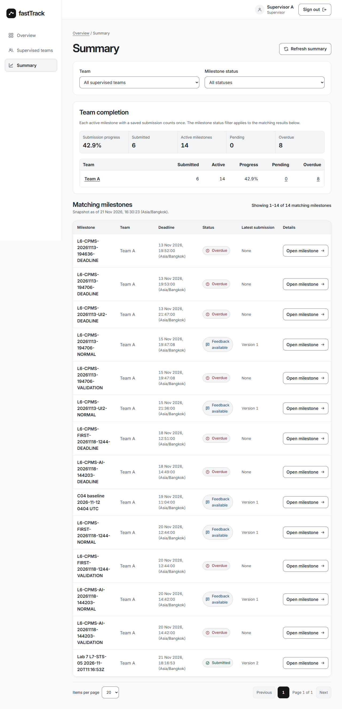
*Figure E-2 — Hosted `F-08` Supervisor A `/summary` (`42.9%`, `6` submitted / `14` active) on `7872a739` matching `/api/teams/:id/progress`.*

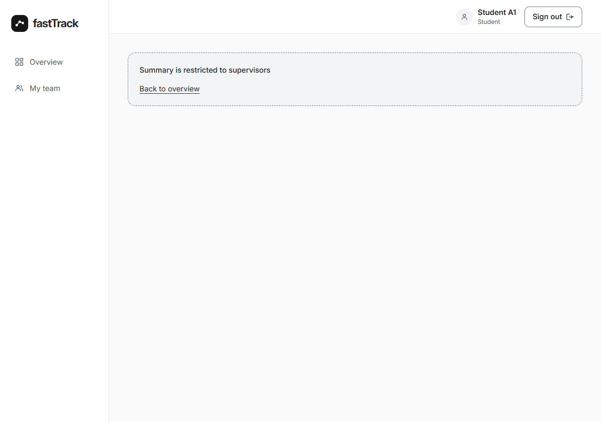
*Figure E-3 — Hosted `F-08` Student A1 `/summary` omitting navigation link and rendering `"Summary is restricted to supervisors"` (`GET /api/summary` HTTP `403`).*

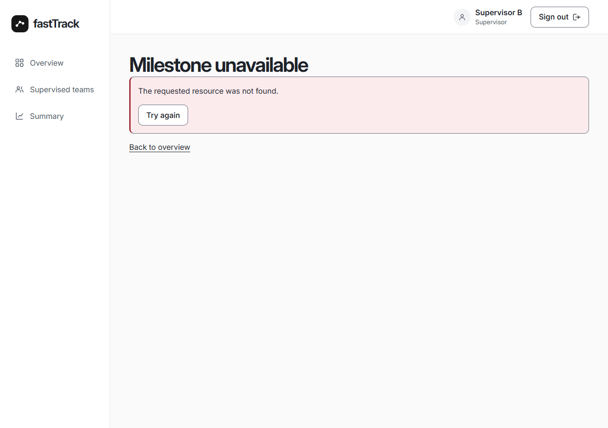
*Figure E-4 — Hosted `F-08` Supervisor B request for Supervisor A's milestone showing generic `"Milestone unavailable"` (`404 NOT_FOUND`) without disclosing Team A titles.*

**Independent hosted readback (A, 21 November 2026).** A's HTTP checks ran against commit `7872a739147f7553e16e05a4d40b5d0de0c21f27` before and after the readback. The original team, milestone, submission and exact-version feedback payloads matched the C04 baseline for both the assigned supervisor and the team student. Totals recomputed from the database-backed milestone list matched Summary (6/14, 42.9%). The two supervisors' assigned scopes were disjoint and foreign team and milestone errors matched absent-resource errors. A also repeated the hosted milestone return and page-one recovery in Chromium, preserving the filter and page size. Multi-team weighted aggregation and direct SQL remain covered by the separate isolated regression. Cloud Run resolved the web OCI index to its linux/amd64 image at sha256:440b3a4ac8fc41c76e14e5b72defcf264f597c19a272dde2f481a9f5ee82269a. [Deployment verification](https://github.com/zerotwobook/fastTrack/actions/runs/44888588070) ? [Hosted capture and output](https://github.com/zerotwobook/fastTrack/blob/9cb317cb89edd5acb3baacc4f6979700963fcb9c/Project_code/docs/evidence/R3-B02-d2-post-deploy-readback.json)

#### 4. Final Timeline, AI & Human Accountability Statement

| Milestone | Target Date (`Asia/Bangkok`) | Owner / Gate |
| --- | --- | --- |
| D2 `main@7872a739` Cloud Run rollout ([Run `44888588070`](https://github.com/zerotwobook/fastTrack/actions/runs/44888588070)) -> `fasttrack-app-00005-rkz` (`100%`) -> Sprint 1 & hosted `F-08` readback | Completed `2026-11-21` | `@zerotwobook` (`workflow_dispatch`) + `@Atip-Infa` (`demo` approval + readback) |
| Review and staging integration of PRs #138, #139 and #142 | Completed 21 November 2026 | A and B verified and accepted the integration evidence and Parts A–E. |
| D2 package and separate submission records (#33) | 29 November 2026 at 23:59 Asia/Bangkok | The owner reported Lab 7 submitted. The team still needs the final D2 PDF check, D2 submission and both receipts. |
| Course final project maintenance / closeout window (`"Page 2 of 1"` fix, `GHSA-7589-6fvf-x4pw` follow-up, final UAT) | `2026-12-01` – `2026-12-13 23:59` | A & B per [03_SPRINT3_D2_FINAL.md](https://github.com/zerotwobook/fastTrack/blob/9cb317cb89edd5acb3baacc4f6979700963fcb9c/workflow/03_SPRINT3_D2_FINAL.md) |

- **Human & AI Usage Disclosure:** Member A authored Sprint 1 core fixes (`#23`), F-05A, F-07, F-08A, and D2 Parts A/C/D; Member B authored Sprint 1 DB schema/seed, F-05B, F-06, F-08B, D2 Parts B/E, and release verification. AI coding assistants helped draft test harnesses, Playwright verification scripts, and English documentation under direct human/tool verification; every SHA, CI count, DB row UUID, timestamp, and screenshot cited above was inspected against executed tool output and live deployed/database/browser state rather than unverified memory.
- **Known Scope Limits Recorded Honestly:** All pre-deploy (`v1.0.0-sprint-2@f3ff8d9`, `staging/sprint-3@6db6a34`) and post-deploy hosted Cloud Run (`main@7872a739`, revision `fasttrack-app-00005-rkz`, [Run `44888588070`](https://github.com/zerotwobook/fastTrack/actions/runs/44888588070)) UI/API checks in Parts B & E are complete with zero skipped verifications beyond explicit access boundaries: (1) direct Cloud SQL DB readback against production `fasttrack_prod` is blocked/unavailable from Member B's workspace environment without `gcloud` / Cloud SQL Proxy / `DATABASE_URL` (totals reconciled via `/api/teams/:id/progress` + `/api/summary`), (2) [v1.0.0-d2](https://github.com/zerotwobook/fastTrack/tree/v1.0.0-d2) identifies the deployed source. Final PDF acceptance and receipt collection remain in Issue #33, and (3) non-blocking follow-ups (`"Page 2 of 1"` empty-page label under `F08-AC-05/08`, and upgrading `effect@3.20.0` under `GHSA-7589-6fvf-x4pw`) are tracked for post-D2 work (`1–13 Dec`).

## Evidence index and contribution record

| Evidence | Where to find it |
| --- | --- |
| Original journey, deadline and ownership | A-01, A-02, Figure A-1 and the hosted persistence capture in Part E |
| Approved maintenance and RED/GREEN evidence | A.3-A.4, CR-L7-01, commits and machine outputs |
| Sprint 3 operational workflow, test excerpt and peer history | C-01, C-02, Figures C-1/C-2, C.4 and PR #135 |
| Requirements, feature inventory and system design | D.1-D.4 |
| Two Sprint 2 demos, B's access-test excerpt and review chain | Part B.2–B.4. Reconcile the exact STS-28 log field before package acceptance. |
| D2 deployed identity, S1/S2/S3 readbacks and setup | Part E.1–E.3. Setup, release identity, hosted readback and scope checks included. |

A compiled the Sprint 1 continuity, domain evidence, F-08A and traceability. B implemented the F-08B slice, reviewed A's Summary, independently repeated local candidate verification, and owns the Sprint 2/release report sections. Codex assisted A with this draft and source reconciliation and with the recorded browser/API automation. Human review, user release authorization and CoursePMS acceptance retain their recorded attribution. The team verified public D2 execution. Final human/package acceptance remains pending.
