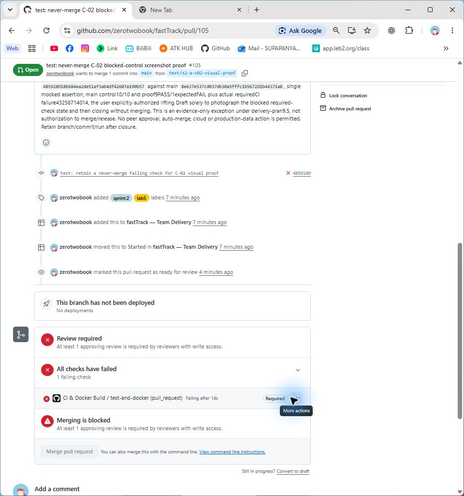
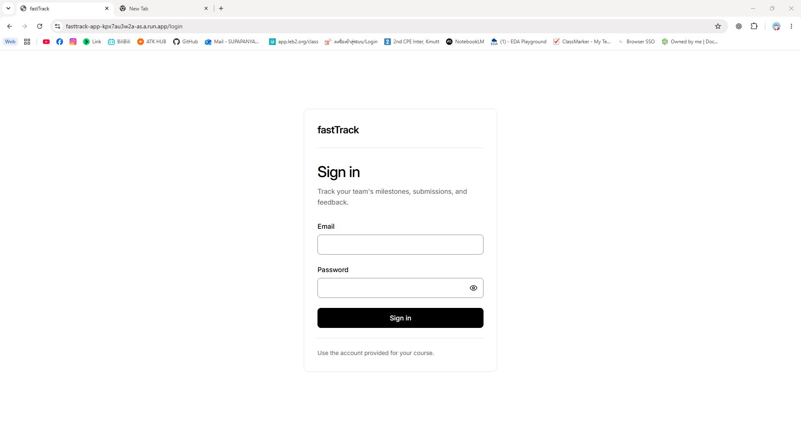
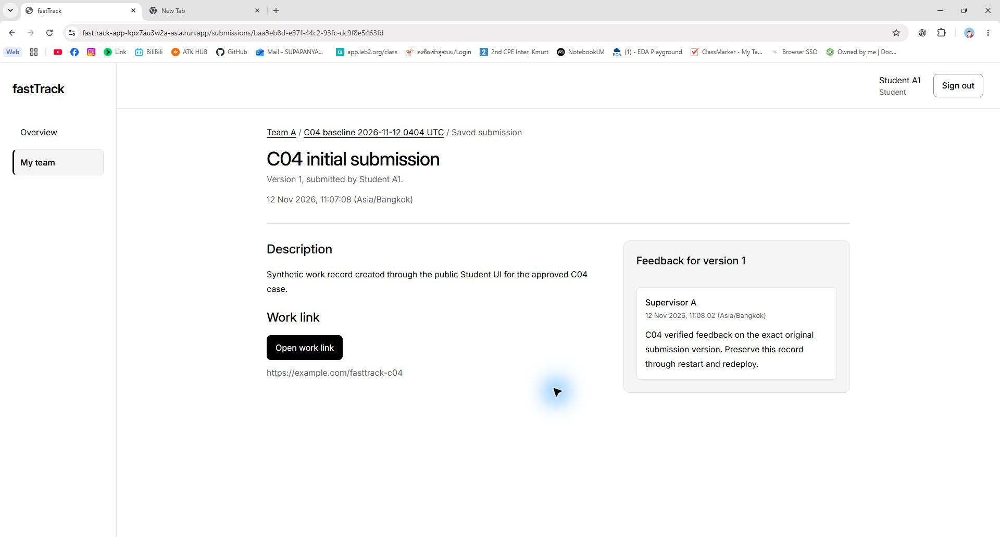
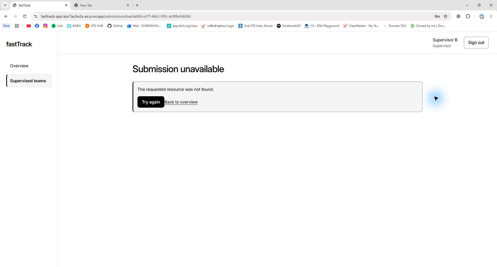
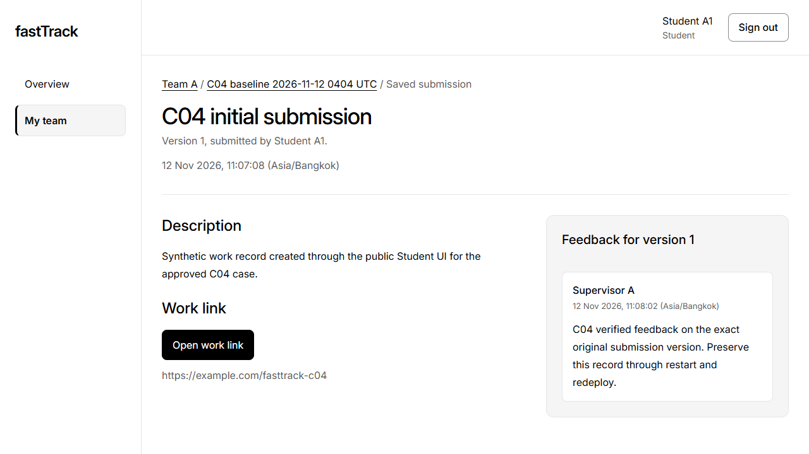

# fastTrack Lab 5 Deployment Report

We deployed fastTrack on Google Cloud with reviewed releases, required CI and a persistent PostgreSQL database. This report links the recorded checks C-01 to C-06 and the evidence for requirements R-01 to R-12; observations retain their tested commit and time.

## Answer Part 0: Team and Evidence Index

**Group:** EN-028, Section 31, InfaCompany. **Topic:** fastTrack, a milestone, submission and feedback tracker for supervisors and students. Theme 6 eligibility is recorded in [Issue #2](https://github.com/zerotwobook/fastTrack/issues/2).

| Member | Name and student ID | GitHub |
| --- | --- | --- |
| A | Supapanya Yathip, 67070503443 | [zerotwobook](https://github.com/zerotwobook) |
| B | Atip Infa-udom, 67070503446 | [Atip-Infa](https://github.com/Atip-Infa) |

[Public repository](https://github.com/zerotwobook/fastTrack)  |  [Live application](https://fasttrack-app-kpx7au3w2a-as.a.run.app)  |  [Team project board](https://github.com/users/zerotwobook/projects/3)

**Submitted application commit:** [8e637e537cd037d630a5fffc1b5672d1b44371a8](https://github.com/zerotwobook/fastTrack/tree/8e637e537cd037d630a5fffc1b5672d1b44371a8). The recorded serving revision is `fasttrack-app-00003-rc7`. **Accepted evidence source:** [4f3102a873b27fcff66e7e600e5da4febd781dfd](https://github.com/zerotwobook/fastTrack/tree/4f3102a873b27fcff66e7e600e5da4febd781dfd), the staging merge of [PR #104](https://github.com/zerotwobook/fastTrack/pull/104). B approved its exact head `c0fabac` on 13 November 2026. This Word/Markdown edition repackages that accepted evidence; it is not a new application release.

**Current readback:** anonymous HTTPS health and readiness requests on 13 November 2026 at approximately 02:13 UTC again returned the application commit above, with `status: ready` and `database: connected`. This confirms identity and database readiness at that time, not a new authenticated journey or traffic-allocation check.

| Member | Selected contribution and review evidence |
| --- | --- |
| A | [Runtime Issue #14](https://github.com/zerotwobook/fastTrack/issues/14); [PR #84](https://github.com/zerotwobook/fastTrack/pull/84) container/runtime, [PR #96](https://github.com/zerotwobook/fastTrack/pull/96) public flow, [PR #98](https://github.com/zerotwobook/fastTrack/pull/98) restart, [PR #101](https://github.com/zerotwobook/fastTrack/pull/101) redeploy readback, and review of [PR #103](https://github.com/zerotwobook/fastTrack/pull/103). |
| B | [Pipeline Issue #15](https://github.com/zerotwobook/fastTrack/issues/15); [PR #85](https://github.com/zerotwobook/fastTrack/pull/85) CI/release, [PR #95](https://github.com/zerotwobook/fastTrack/pull/95) failed-check proof, [PR #100](https://github.com/zerotwobook/fastTrack/pull/100) release review/merge and demo approval, and [PR #104](https://github.com/zerotwobook/fastTrack/pull/104) consolidated evidence review. |

| Part | Check and requirement | Primary evidence and result |
| --- | --- | --- |
| 0 | R-09 to R-12 | [Full evidence and contribution index](https://github.com/zerotwobook/fastTrack/blob/4f3102a873b27fcff66e7e600e5da4febd781dfd/docs/labs/lab-05/evidence-index.md); sources, members and review history recorded. |
| 1  30 pts | C-01, C-02; R-05, R-06 | [run 43179053148](https://github.com/zerotwobook/fastTrack/actions/runs/43179053148) passed; [PR #105](https://github.com/zerotwobook/fastTrack/pull/105) failed required CI and was blocked, then closed unmerged. |
| 2  20 pts | C-03; R-01, R-02 | [Clean-clone result](https://github.com/zerotwobook/fastTrack/blob/4f3102a873b27fcff66e7e600e5da4febd781dfd/Project_code/docs/evidence/R2-A01-container-results.json); 13 container checks passed with a real local database. |
| 3  35 pts | C-04, C-05; R-03, R-04 | [Public flow](https://github.com/zerotwobook/fastTrack/blob/4f3102a873b27fcff66e7e600e5da4febd781dfd/docs/labs/lab-05/evidence/C04-public-flow.md) and [three-stage persistence](https://github.com/zerotwobook/fastTrack/blob/4f3102a873b27fcff66e7e600e5da4febd781dfd/docs/labs/lab-05/evidence/C05-redeploy.md); original records retained. |
| 4  15 pts | C-06; R-07 to R-10 | [Release chain](https://github.com/zerotwobook/fastTrack/blob/4f3102a873b27fcff66e7e600e5da4febd781dfd/docs/labs/lab-05/evidence/C06-release-traceability.md); accepted main source matches delivered revision. |

## Answer Part 1: CI and Quality Gate

**C-01 passed.** [ci-docker.yml](https://github.com/zerotwobook/fastTrack/blob/4f3102a873b27fcff66e7e600e5da4febd781dfd/.github/workflows/ci-docker.yml) runs on relevant pull requests and pushes to `main` and `staging/sprint-*`. Job `test-and-docker` checks deploy scripts, installs from the lockfile, generates Prisma, type-checks, runs unit and real-database tests, builds the application, and builds both Docker targets.

[PR #100](https://github.com/zerotwobook/fastTrack/pull/100) / [run 43179053148](https://github.com/zerotwobook/fastTrack/actions/runs/43179053148) passed on `80ad1df62700c9aba5d1ac84441143b85e19c629`: **10 deploy tests, 166 unit tests and 374 isolated real-database cases across eight suites, with zero failures**. These are separate suite counts; they are not presented as unique tests across all runs. The first CI implementation is [PR #85](https://github.com/zerotwobook/fastTrack/pull/85) / [run 42847201049](https://github.com/zerotwobook/fastTrack/actions/runs/42847201049).

**Required-check setting.** Active [main ruleset 26666182](https://github.com/zerotwobook/fastTrack/rules/26666182) requires one approving review and the strict, up-to-date `test-and-docker` context from GitHub Actions (app 15368), with no bypass actors. This makes a failed check an independent merge blocker.

**C-02 proof passed through an intentional CI failure.** [PR #105](https://github.com/zerotwobook/fastTrack/pull/105) changed one mocked assertion from four calls to five on proof head `4859289`, based on main `8e637e5`. The main control passed 10/10; the proof passed nine tests and failed one with `AssertionError: 4 != 5`. [run 43258714014](https://github.com/zerotwobook/fastTrack/actions/runs/43258714014) failed the actual required check. Under explicit exact-candidate authorization, the non-Draft, conflict-free PR was photographed and then closed **without merging** at 16:35:23 UTC on 12 November 2026.



*Figure 1. C-02 (R-06). Native Chrome excerpts show the real PR URL, required failed check and disabled merge control before closure, captured 12 November 2026 at 16:34:20 UTC; head `4859289`, base `8e637e5`, CI run 43258714014. A missing peer approval is also visible; the required-check policy separately establishes failure as a blocker. [Original image](https://github.com/zerotwobook/fastTrack/blob/4f3102a873b27fcff66e7e600e5da4febd781dfd/docs/labs/lab-05/evidence/C02-blocked-pr105.png).*

The original [PR #95](https://github.com/zerotwobook/fastTrack/pull/95) and its failed run remain historical evidence; Figure 1 is the later controlled proof, not an invented old screenshot. [Proof narrative and capture ledger](https://github.com/zerotwobook/fastTrack/blob/4f3102a873b27fcff66e7e600e5da4febd781dfd/docs/labs/lab-05/evidence/C02-visual-proof.md) record its limits. The unused proof branch references were deleted during the user-authorized cleanup on 13 November; the closed PRs, commits, CI history and captured evidence remain available.

## Answer Part 2: Docker and Reproducible Configuration

**R-01 image design.** The [Dockerfile](https://github.com/zerotwobook/fastTrack/blob/4f3102a873b27fcff66e7e600e5da4febd781dfd/Project_code/Dockerfile) pins Node `26.13.0-bookworm-slim` by digest. Its `runner` target serves the compiled React client and Express API as the non-root `node` user. The separate `jobs` target retains the Prisma CLI for explicit migration and seed commands. Both receive the source SHA through `RELEASE_SHA`; web startup does not migrate, seed or clean data.

[.dockerignore](https://github.com/zerotwobook/fastTrack/blob/4f3102a873b27fcff66e7e600e5da4febd781dfd/Project_code/.dockerignore) excludes Git metadata, dependencies, build output, real environment files, tests and docs. [compose.yaml](https://github.com/zerotwobook/fastTrack/blob/4f3102a873b27fcff66e7e600e5da4febd781dfd/Project_code/compose.yaml) runs the local application with a separate PostgreSQL service and a persistent named volume. The stack is React/TypeScript/Vite, Express, Prisma and PostgreSQL, adapted to fastTrack rather than a second starter-kit application.

**R-02 configuration.** The [server environment example](https://github.com/zerotwobook/fastTrack/blob/4f3102a873b27fcff66e7e600e5da4febd781dfd/Project_code/server/.env.example) and [Compose environment example](https://github.com/zerotwobook/fastTrack/blob/4f3102a873b27fcff66e7e600e5da4febd781dfd/Project_code/compose.env.example) contain placeholders only. The complete [environment inventory and value sources](https://github.com/zerotwobook/fastTrack/blob/4f3102a873b27fcff66e7e600e5da4febd781dfd/docs/labs/lab-05/deployment.md#2-prerequisites-and-local-configuration) document purpose, validation/defaults, secret status and source for runtime, operational and review/test settings.

| Configuration | Purpose and value source |
| --- | --- |
| Origin and source | APP_ORIGIN is the verified public HTTPS origin; RELEASE_SHA is the full source built by the pipeline; PORT is supplied by Cloud Run. |
| Database access | DATABASE_URL is secret, from a private local file or scoped Secret Manager reference. Pool/query/readiness limits are non-secret runtime settings. |
| Authentication policy | SESSION_TTL_HOURS, TRUST_PROXY_HOPS and LOGIN_RATE_LIMIT_* are documented non-secret policy settings; demo seed credentials stay private. |
| Local and test inputs | LOCAL_DB_PASSWORD, TEST_DATABASE_URL and private review/seed passwords are never committed; the isolated verifier creates its own disposable database. |

### C-03 Clean clone and running database

A recorded [container verifier result](https://github.com/zerotwobook/fastTrack/blob/4f3102a873b27fcff66e7e600e5da4febd781dfd/Project_code/docs/evidence/R2-A01-container-results.json) on 10 November 2026, source `11e6c73fba391cce15f416c9b686cecd6bdb8e88`. It cloned that committed source, built both targets, migrated a fresh PostgreSQL database twice without reset, ran add-only seed and a production UI/API/database flow, restarted the app, and read the same original records. All **13 checks passed**; the machine output ends with `passed: true`. This is local Docker evidence, not a cloud/TLS claim.

The [isolated database regression](https://github.com/zerotwobook/fastTrack/blob/4f3102a873b27fcff66e7e600e5da4febd781dfd/Project_code/docs/evidence/R2-A01-regression.json) passed **374 cases**. B separately reports 374 regression cases and 13 container checks on [PR #84](https://github.com/zerotwobook/fastTrack/pull/84) head `0301f6f`; that reproduction is review text, not a separate machine artifact. These C-03 sources predate the deployed application SHA and are identified rather than silently relabelled.

**Reproduction commands.** From a clean checkout of the selected source, follow [deployment.md build and local configuration](https://github.com/zerotwobook/fastTrack/blob/4f3102a873b27fcff66e7e600e5da4febd781dfd/docs/labs/lab-05/deployment.md), copy/fill private local example values, and run from `Project_code/`:

```powershell
npm ci
npm run typecheck
npm test
npm run build
npm run test:runtime:isolated
npm run verify:container
```

`verify:container` performs the fresh-clone build, real database, migration, seed, business-flow and restart checks, then removes only its disposable resources. Normal local run/migrate/seed commands are in deployment.md sections 3-4. Actual image IDs, record IDs, timing and cleanup are retained in the linked result; this report does not invent a new test execution.

## Answer Part 3: GCP Deployment and Persistence

| Resource | Recorded deployed value |
| --- | --- |
| Project and region | fasttrack-se-002 / asia-southeast1 |
| Public service | [fasttrack-app](https://fasttrack-app-kpx7au3w2a-as.a.run.app); Cloud Run revision fasttrack-app-00003-rc7 |
| Database and secret | Cloud SQL fasttrack-db / fasttrack_prod; service attachment plus DATABASE_URL from Secret Manager reference fasttrack-database-url |
| Runtime and bounds | sa-fasttrack-runtime; min 0, service max 3, revision max 2, concurrency 8 |

The [deployed inventory and API/database evidence](https://github.com/zerotwobook/fastTrack/blob/4f3102a873b27fcff66e7e600e5da4febd781dfd/docs/labs/lab-05/evidence/C05-redeploy.md) bind the service, SQL attachment, secret reference and source to the recorded release. [Health](https://fasttrack-app-kpx7au3w2a-as.a.run.app/api/health) reports version `8e637e537cd037d630a5fffc1b5672d1b44371a8`; [readiness](https://fasttrack-app-kpx7au3w2a-as.a.run.app/api/ready) reports `database: connected`. A database name alone is not the connectivity proof. Repository visibility and these anonymous responses were read again on 13 November 2026 at approximately 02:13 UTC.

### C-04 Sign in and public business workflow

On the public URL, Supervisor A created a milestone; Student A1 submitted Version 1; Supervisor A added feedback to that exact submission; Student A1 then read it. The [original creation and action record](https://github.com/zerotwobook/fastTrack/blob/4f3102a873b27fcff66e7e600e5da4febd781dfd/docs/labs/lab-05/evidence/C04-public-flow.md), [baseline](https://github.com/zerotwobook/fastTrack/blob/4f3102a873b27fcff66e7e600e5da4febd781dfd/Project_code/docs/evidence/R2-J01-C04-baseline.json) and [action results](https://github.com/zerotwobook/fastTrack/blob/4f3102a873b27fcff66e7e600e5da4febd781dfd/Project_code/docs/evidence/R2-J01-C04-results.json) establish the UI/API/database flow. Later native screenshots show real URLs and saved role views; they do not claim to be screenshots of the earlier creation event.



*Figure 2. C-04 / C-06 (R-03, R-07, R-08). Cropped URL and form from the same native Chrome capture at the public /login route, saved 12 November 2026 at 16:15:18 UTC (file timestamp). The blank form and accepted release sentence are visible; no credential is shown. Source `8e637e5` was correlated separately by health/readiness. See the [capture provenance](https://github.com/zerotwobook/fastTrack/blob/4f3102a873b27fcff66e7e600e5da4febd781dfd/docs/labs/lab-05/evidence/C04-native-readback.md). [Original image](https://github.com/zerotwobook/fastTrack/blob/4f3102a873b27fcff66e7e600e5da4febd781dfd/docs/labs/lab-05/evidence/C04-native-login.png).*

### C-04 Saved work and access restriction

The following are enlarged excerpts from the original native captures, with the browser URL kept as a separate strip for readability. Word crops the embedded original PNGs; it does not reconstruct the browser chrome. [Full captures, times and hashes](https://github.com/zerotwobook/fastTrack/blob/4f3102a873b27fcff66e7e600e5da4febd781dfd/docs/labs/lab-05/evidence/C04-native-readback.md) are publicly linked.



*Figure 3. C-04 (R-03). Student A1 reads the original Version 1 submission and Supervisor A feedback at the displayed public submission URL, 12 November 2026 at 16:20:10 UTC; source `8e637e5`. The two lower excerpts are the submission and feedback regions of the same image. The [assigned Supervisor A view](https://github.com/zerotwobook/fastTrack/blob/4f3102a873b27fcff66e7e600e5da4febd781dfd/docs/labs/lab-05/evidence/C04-native-readback.md) records the matching readback at 16:21:45 UTC. [Original image](https://github.com/zerotwobook/fastTrack/blob/4f3102a873b27fcff66e7e600e5da4febd781dfd/docs/labs/lab-05/evidence/C04-native-student.png).*

**Access restriction.** Foreign Supervisor B, assigned to another team, could not read Team A's submission. The earlier [B live API readback](https://github.com/zerotwobook/fastTrack/blob/4f3102a873b27fcff66e7e600e5da4febd781dfd/docs/labs/lab-05/evidence/B-post-release-readback.md) independently records HTTP `404 NOT_FOUND`; the image below proves the generic denial UI and absence of Team A content, without inferring a new HTTP status from pixels. Original foreign-origin and missing-CSRF feedback probes separately returned 403 with no data change.



*Figure 4. C-04 (R-03). URL strip, generic Submission unavailable message and Supervisor B identity from the same native Chrome capture, 12 November 2026 at 16:22:49 UTC, source `8e637e5`. This later readback made no domain changes. All three authorized role sessions were signed out; no new API logout-status measurement is claimed. [Original image](https://github.com/zerotwobook/fastTrack/blob/4f3102a873b27fcff66e7e600e5da4febd781dfd/docs/labs/lab-05/evidence/C04-native-foreign.png).*

### C-05 Original records before and after restart

We froze the original milestone, submission Version 1 and feedback before disruption. The restart was distinct from the later deployment: a single authorized scale-zero/restore-auto operation preserved source `16ec6d2` and revision `fasttrack-app-00002-f75`. Cloud metrics recorded **active=0 and idle=0 at 06:14:00 UTC**, then a new instance started and readiness recovered by 06:15:03 UTC on 12 November. The [restart record and platform provenance](https://github.com/zerotwobook/fastTrack/blob/4f3102a873b27fcff66e7e600e5da4febd781dfd/docs/labs/lab-05/evidence/C05-persistence.md) provide the commands, exact times and instance IDs.



*Figure 5. C-05 (R-04), before disruption. Student-visible original Version 1 and exact-submission feedback on 12 November 2026, source `16ec6d2`, revision `fasttrack-app-00002-f75`. URL: [original submission](https://fasttrack-app-kpx7au3w2a-as.a.run.app/submissions/baa3eb8d-e37f-44c2-93fc-dc9f8e5463fd). This historical viewport image has no browser address bar. [Original image](https://github.com/zerotwobook/fastTrack/blob/4f3102a873b27fcff66e7e600e5da4febd781dfd/docs/labs/lab-05/evidence/C04-student-feedback.png).*


*Figure 6. C-05 (R-04), after the distinct restart. The original Version 1 and feedback remain, source `16ec6d2`, same revision, after the 06:14 UTC zero-instance boundary. The [restart narrative](https://github.com/zerotwobook/fastTrack/blob/4f3102a873b27fcff66e7e600e5da4febd781dfd/docs/labs/lab-05/evidence/C05-persistence.md) and [machine result](https://github.com/zerotwobook/fastTrack/blob/4f3102a873b27fcff66e7e600e5da4febd781dfd/Project_code/docs/evidence/R2-J01-C05-restart.json) bind the image to exact IDs and the new serving instance. [Original image](https://github.com/zerotwobook/fastTrack/blob/4f3102a873b27fcff66e7e600e5da4febd781dfd/docs/labs/lab-05/evidence/C05-restart-student.png).*

### C-05 Original records after redeploy


*Figure 7. C-05 (R-04), after the later pipeline redeploy. Student A1 reads the original Version 1 and feedback at 09:13:29 UTC on 12 November 2026, now source `8e637e5`, revision `fasttrack-app-00003-rc7`. The [redeploy comparison](https://github.com/zerotwobook/fastTrack/blob/4f3102a873b27fcff66e7e600e5da4febd781dfd/docs/labs/lab-05/evidence/C05-redeploy.md) separately establishes both-role equality and source/revision identity. This remains the actual historical viewport image. [Original image](https://github.com/zerotwobook/fastTrack/blob/4f3102a873b27fcff66e7e600e5da4febd781dfd/docs/labs/lab-05/evidence/C05-redeploy-student.png).*

| Stage on 12 November UTC | Source and revision | Recorded result |
| --- | --- | --- |
| Baseline, about 04:08 | 16ec6d2 / 00002-f75 | Original records frozen. |
| Distinct restart, 06:13-06:15 | 16ec6d2 / 00002-f75 | Same IDs, values and canonical hash. |
| Later redeploy, A at 09:12 | 8e637e5 / 00003-rc7 | Same IDs/values/hash in both roles; foreign read denied. |
| Independent B witness, 14:55 | 8e637e5 / 00003-rc7 | Same original projections; foreign 404; all three logout checks 401. |

**Exact original identifiers:** milestone `b19ae7d5-d2a1-4ace-9b11-d2a94cb8177d`; submission `baa3eb8d-e37f-44c2-93fc-dc9f8e5463fd`, Version 1; feedback `b9ebf7f7-a542-4b89-95a8-8f1de22a5357`. Canonical SHA-256 across the full compared domain projection: `c5396255105bfccd8f13ec0b8469aae6d1ab2a3a7923a13a55253e582bbe0f4e`. Matching visible titles alone is not the equality check.

The [three-stage result](https://github.com/zerotwobook/fastTrack/blob/4f3102a873b27fcff66e7e600e5da4febd781dfd/Project_code/docs/evidence/R2-J01-C05-redeploy.json) and [B independent live witness](https://github.com/zerotwobook/fastTrack/blob/4f3102a873b27fcff66e7e600e5da4febd781dfd/docs/labs/lab-05/evidence/B-post-release-readback.md) retain the actual role/API projections and limits. [PR #103](https://github.com/zerotwobook/fastTrack/pull/103) accepted B's witness; [PR #104](https://github.com/zerotwobook/fastTrack/pull/104) later accepted the consolidated visual package. **C-05 domain persistence passed.**

**Retained limits:** continuity of the original closed pre-release browser sessions is not established; the eight-hour session test and live rollback were not run. C-05 requires domain-record survival across restart and redeploy, which has separate evidence. These limits are not reported as passed tests.

## Answer Part 4: Repeatable Release Pipeline

**C-06 passed.** A small reviewed sign-in copy change travelled through the labelled Issue, staging integration and a release PR into main, then the deployment pipeline delivered that exact main commit. The live page changed from “Keep track of your team's work and feedback.” to “Track your team's milestones, submissions, and feedback.” Figure 2 shows the accepted sentence; source and digest evidence establish its identity.

| Step | Direct evidence | Observed identity or result |
| --- | --- | --- |
| Issue | [#16 R2-J01](https://github.com/zerotwobook/fastTrack/issues/16); [#15 R2-B01](https://github.com/zerotwobook/fastTrack/issues/15) | Both labelled lab5; technical and pipeline scopes recorded. |
| Task PR | [PR #99](https://github.com/zerotwobook/fastTrack/pull/99); [B specific approval](https://github.com/zerotwobook/fastTrack/pull/99#pullrequestreview-5870807872) | A-authored head 4ce9f93; passing CI [43176051762](https://github.com/zerotwobook/fastTrack/actions/runs/43176051762). |
| Staging | [PR #99](https://github.com/zerotwobook/fastTrack/pull/99) merge; [run 43177025988](https://github.com/zerotwobook/fastTrack/actions/runs/43177025988) | staging/sprint-2 integration commit 80ad1df. |
| Main release | [PR #100](https://github.com/zerotwobook/fastTrack/pull/100); [B specific approval](https://github.com/zerotwobook/fastTrack/pull/100#pullrequestreview-5871553249) | Exact-candidate user authorization; protected merge as 8e637e5 at 08:46:15 UTC on 12 November. |
| Main CI | [run 43185680079](https://github.com/zerotwobook/fastTrack/actions/runs/43185680079) | SUCCESS on the actual merged main source. |
| Delivery | [run 43186570077](https://github.com/zerotwobook/fastTrack/actions/runs/43186570077) | workflow_dispatch by A on main; independent demo approval by B; CI and deploy jobs SUCCESS. |
| Migration | [Full release trace](https://github.com/zerotwobook/fastTrack/blob/4f3102a873b27fcff66e7e600e5da4febd781dfd/docs/labs/lab-05/evidence/C06-release-traceability.md) | fasttrack-migrate-dnvqn; one task succeeded before rollout. |
| Serving proof | [Health](https://fasttrack-app-kpx7au3w2a-as.a.run.app/api/health); [readiness](https://fasttrack-app-kpx7au3w2a-as.a.run.app/api/ready) | fasttrack-app-00003-rc7 at recorded 100% traffic; source 8e637e5, database connected, reviewed copy visible. |

**Immutable artifacts.** The web image digest starts `sha256:d7606d79` and ends `cb99`; the jobs image starts `sha256:5e94cc94` and ends `f4d4`. Both were tagged with the full main SHA. The [complete source, digest, migration and revision ledger](https://github.com/zerotwobook/fastTrack/blob/4f3102a873b27fcff66e7e600e5da4febd781dfd/docs/labs/lab-05/evidence/C06-release-traceability.md) supplies the full digests, job links and timestamped identity checks.

**Actual delivery event.** Automatic push [run 43185679995](https://github.com/zerotwobook/fastTrack/actions/runs/43185679995) was cancelled at the demo approval gate with zero deploy steps because B had initiated it by merging and could not self-approve. The separately authorized replacement was manually dispatched by A and approved by B. It succeeded through the same pipeline; no automatic-push success is claimed.

### Release procedure and recovery

The [deploy.yml workflow](https://github.com/zerotwobook/fastTrack/blob/4f3102a873b27fcff66e7e600e5da4febd781dfd/.github/workflows/deploy.yml) and [deployment.md release procedure](https://github.com/zerotwobook/fastTrack/blob/4f3102a873b27fcff66e7e600e5da4febd781dfd/docs/labs/lab-05/deployment.md#7-ci-normal-release-rollback-and-version-lookup) define the repeatable sequence: (1) review a task PR into staging; (2) review and explicitly authorize the exact release PR into main; (3) pass CI and obtain independent demo approval; (4) authenticate using keyless WIF; (5) build web/jobs images tagged by full SHA and resolve digests; (6) migrate once before rollout; (7) update the service and check health, readiness, serving SHA and the visible change. Main-only guards exist in the trigger and release script.

The delivering smoke step passed four public checks; authenticated login smoke was **SKIP** because optional credentials were not configured. Separate C-04 role checks remain separate evidence. A rollback dispatch selects the full tag of an existing compatible image and requires a fresh independent demo approval; it skips migration/seed and does not reverse schema or data. Offline tests cover recovery; no live rollback was executed.

**Submission and availability.** The team must inspect this final edition, export one `lab5_sec31_InfaCompany.pdf` and submit it on LEB2 by **15 November 2026, 23:59 Asia/Bangkok**. No upload or receipt is claimed here. Keep the repository public, the live service available and the historical CI/PR/contract evidence accessible until grading ends. Full R-01 to R-12 mapping is in the [accepted evidence index](https://github.com/zerotwobook/fastTrack/blob/4f3102a873b27fcff66e7e600e5da4febd781dfd/docs/labs/lab-05/evidence-index.md#2-requirements-r-01-to-r-12).
