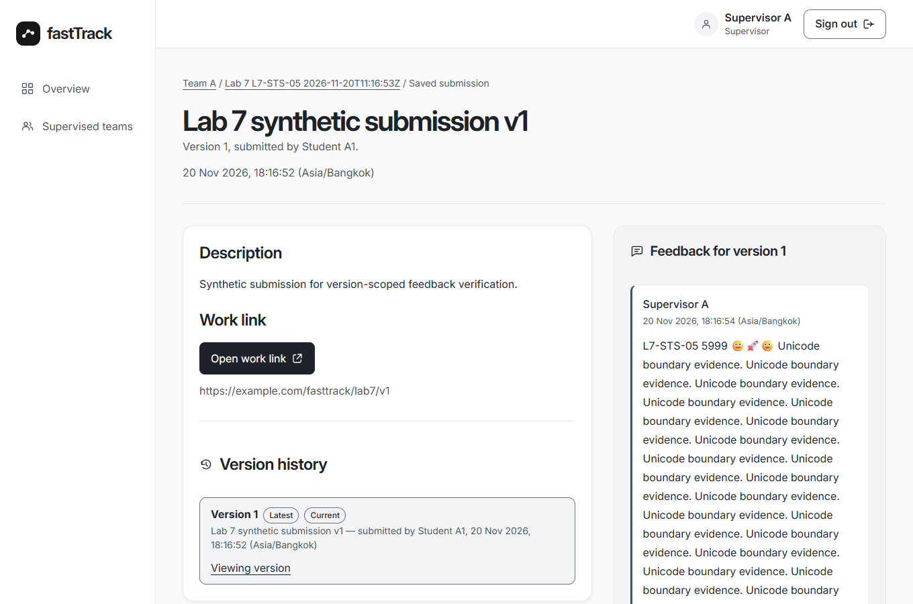
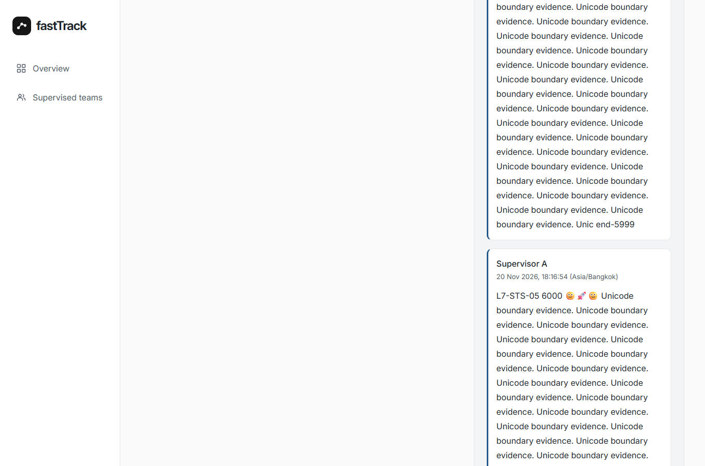
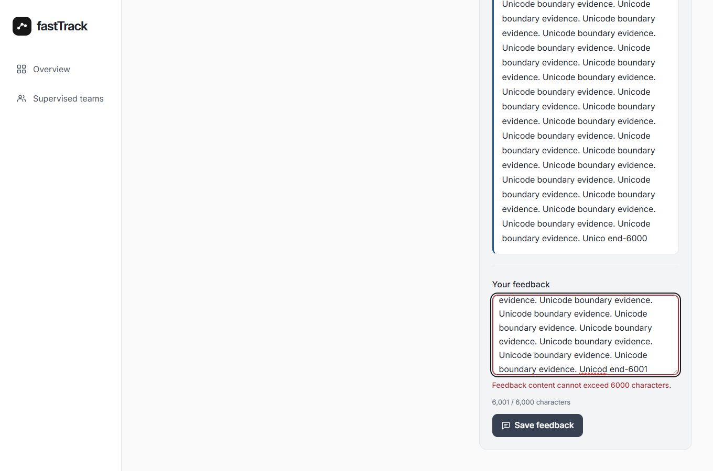
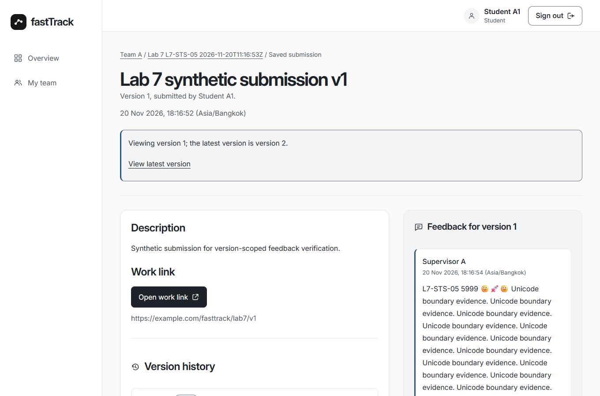
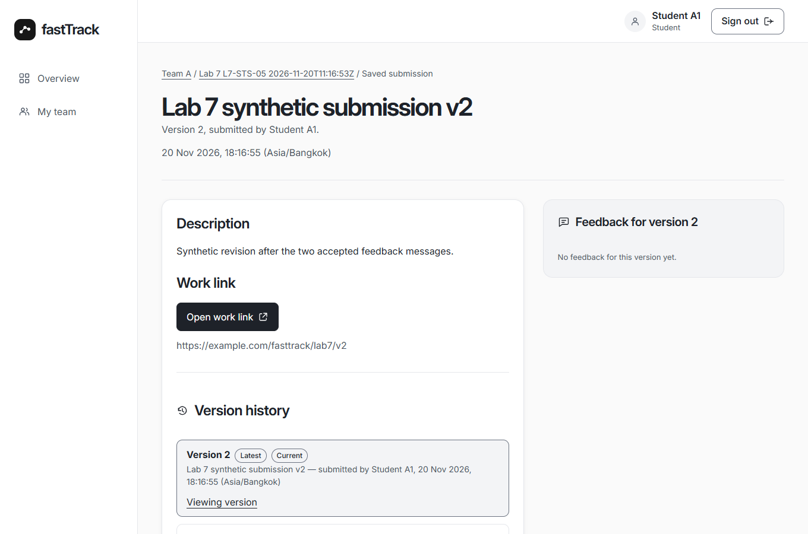
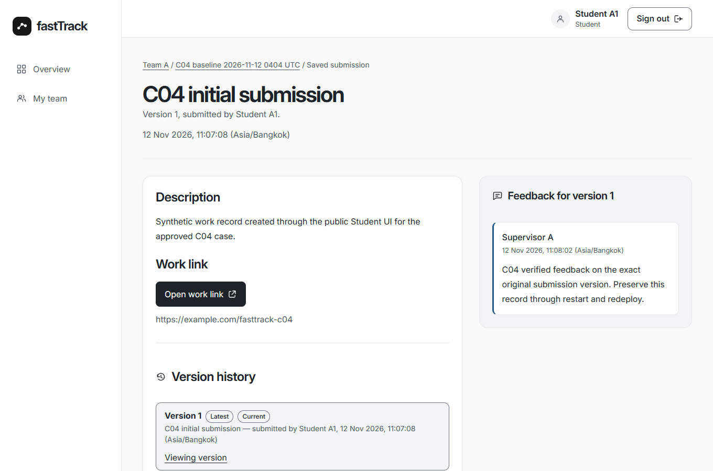

# CPE334 Lab 7 Software Maintenance, Metrics, and Release Readiness

**fastTrack** · InfaCompany · EN-028 · Section 31 · Semester 1/2026

| Field | Value |
| --- | --- |
| Topic and theme | Theme 6. fastTrack tracks team milestones, submissions, and supervisor feedback. |
| Member A | Supapanya Yathip · 67070503443 · [zerotwobook](https://github.com/zerotwobook) |
| Member B | Atip Infa-udom · 67070503446 · [Atip-Infa](https://github.com/Atip-Infa) |
| Repository | [zerotwobook/fastTrack](https://github.com/zerotwobook/fastTrack) |
| Application | [fastTrack on Cloud Run](https://fasttrack-app-kpx7au3w2a-as.a.run.app) |
| Submission | One Lab 7 team report in LEB2 by 29 November 2026 at 23:59 Asia/Bangkok. |
| Evidence snapshot | 20 November 2026. Times in the evidence tables are UTC unless stated otherwise. |

Team and theme details match the [Lab 5 team record](https://github.com/zerotwobook/fastTrack/blob/f3ff8d9704c6e2a3705805412f538b2b216569ad/docs/labs/lab-05/report.md#answer-part-0-team-and-evidence-index). The assessment requirements come from the [Lab 7 handout](https://github.com/zerotwobook/fastTrack/blob/f3ff8d9704c6e2a3705805412f538b2b216569ad/lab_file/Lab7/Lab_7_Sprint_1_Maintenance.pdf).

## Contents

| Part | Section | Evidence IDs |
| --- | --- | --- |
| A | [Change impact and updated contract](#part-a-change-impact-and-updated-contract) | L7-A01, L7-A02, L7-AC-01 to L7-AC-05 |
| B | [Implementation and regression-safe delivery](#part-b-implementation-and-regression-safe-delivery) | L7-B01 to L7-B05, L7-STS-01 to L7-STS-05 |
| C | [Objective engineering metrics](#part-c-objective-engineering-metrics) | L7-M01 to L7-M05 |
| D | [Release readiness and retrospective](#part-d-release-readiness-and-retrospective) | L7-D01, L7-D02 |

Record the page ranges for Parts A–D after laying out the team PDF.

## Version record

| Role | Version | Evidence |
| --- | --- | --- |
| Accepted Sprint 1 tag | `v1.0.0-sprint-1` at `ae7a60a6e3ed0a363dcee920ac1774a02f4f4ab8` | [Tag](https://github.com/zerotwobook/fastTrack/tree/v1.0.0-sprint-1) |
| Accepted deployed behavior reference | `main@8e637e537cd037d630a5fffc1b5672d1b44371a8`, last recorded Cloud Run revision `fasttrack-app-00003-rc7` | [Lab 6 closeout](https://github.com/zerotwobook/fastTrack/blob/f3ff8d9704c6e2a3705805412f538b2b216569ad/docs/labs/lab-06/sessions/2026-11-19-lab6-closeout.md) · [Recorded revision and UTC preflight](https://github.com/zerotwobook/fastTrack/issues/26) |
| Actual pre-change implementation | `staging/sprint-2@63e81d1a91f7f288825100b47786823460943e5c` | [Baseline CI 44663918612](https://github.com/zerotwobook/fastTrack/actions/runs/44663918612) |
| RED test source | `e3758fb541e48716545868c6f435907b83a67aec` | [RED CI 44672187909](https://github.com/zerotwobook/fastTrack/actions/runs/44672187909) · [Local result](https://github.com/zerotwobook/fastTrack/blob/f3ff8d9704c6e2a3705805412f538b2b216569ad/Project_code/docs/evidence/R2-A05-lab7-red-results.json) |
| GREEN implementation and staging integration | `2368d71813541bacc0bc9b9ecba58b3ae9ea7c86` → approved merge `7357fd2f3e172120af39e32a1ed4fd1284844aa0` | [PR #128](https://github.com/zerotwobook/fastTrack/pull/128) · [Exact-head CI 44679245716](https://github.com/zerotwobook/fastTrack/actions/runs/44679245716) |
| Reviewed release candidate | `staging/sprint-2@1185f3ffc3954a18dd883e451767dc6ad8a3ee6f` against prior `main@8e637e537cd037d630a5fffc1b5672d1b44371a8` | [Release PR #129](https://github.com/zerotwobook/fastTrack/pull/129) · [Candidate CI 44697610558](https://github.com/zerotwobook/fastTrack/actions/runs/44697610558) |
| Lab 7 assessed release | `v1.0.0-sprint-2` at `main@f3ff8d9704c6e2a3705805412f538b2b216569ad`, Cloud Run `fasttrack-app-00004-jr2` | [Accepted tag](https://github.com/zerotwobook/fastTrack/tree/v1.0.0-sprint-2) · [G6 release record](https://github.com/zerotwobook/fastTrack/issues/26) |

The baseline `63e81d1` includes intervening Sprint 2 planning, revisions, progress, and integration work. The feedback validator, form, Prisma schema, and migrations matched the deployed rule in the pre-change comparison. The RED commit added the revised contract and test cases. The staging merge packages the reviewed maintenance alongside Sprint 2, and the later [PR #131](https://github.com/zerotwobook/fastTrack/pull/131) contributes UI work to the same release. The authorized merge created `f3ff8d9` with the same source tree as the reviewed candidate `1185f3f`. CI and Cloud Run identify the merge SHA. L7-B05 records the deployed revision and image digests. [Pre-change comparison and RED evidence](https://github.com/zerotwobook/fastTrack/blob/f3ff8d9704c6e2a3705805412f538b2b216569ad/Project_code/docs/evidence/R2-A05-lab7-red.md)

## Part A. Change impact and updated contract

### L7-A01 Approved change request

**CR-L7-01, F-04.** The implemented Sprint 1 rule permitted the assigned supervisor to save 1–4,000 Unicode code points of feedback after trimming outer whitespace. The approved revision permits **1–6,000 Unicode code points after the same trim** so supervisors can include more detailed guidance. Interior whitespace counts. A single astral emoji counts as one code point and a compound emoji counts by its constituent code points. Empty or whitespace-only content, NUL and unpaired surrogate characters are invalid. A 6,001-point input receives a content error and produces zero rows. Existing access checks and the link to the exact submission version still apply.

**Approval record (L7-A01).** Course TA Tik approved CR-L7-01 on **20 November 2026 (20 November 2569 BE), Asia/Bangkok**. The project owner confirmed the approver and date. The chat screenshot shows **10:48 AM** and the TA's instruction to test the 5,999, 6,000 and 6,001 boundaries, including emoji and whitespace. The approval preceded the versioned contract, RED tests and implementation recorded below. [Approved change record](https://github.com/zerotwobook/fastTrack/issues/24) · [Versioned approval and baseline](https://github.com/zerotwobook/fastTrack/blob/f3ff8d9704c6e2a3705805412f538b2b216569ad/Project_code/docs/contracts/lab-7-feedback-limit.md#approval-and-baseline)

> **TA reply, translated from Thai:** Go ahead. Test the 5,999, 6,000 and 6,001 boundaries, including emoji and whitespace.

*Evidence L7-A01. TA Tik approved the feedback limit change and specified the boundary tests. Insert the original chat screenshot from the project conversation here during PDF layout. The English translation above records the decision in this Markdown source.*

### L7-A02 Contract and impact trace

| Requirement and design source | Change and affected module | Acceptance and tests |
| --- | --- | --- |
| FR-05, BR-08 · F-04 · SRS and feedback input validation | Replace the 4,000-point maximum with 6,000 after trim in [shared feedback validation](https://github.com/zerotwobook/fastTrack/blob/f3ff8d9704c6e2a3705805412f538b2b216569ad/Project_code/shared/feedback.mjs). The existing minimum and rules for title, description and work-link fields still apply. | L7-AC-01 and 02 · L7-STS-01 and 02 |
| FR-05, NFR-05 · F-04 Feature SDS | The [Feedback panel](https://github.com/zerotwobook/fastTrack/blob/f3ff8d9704c6e2a3705805412f538b2b216569ad/Project_code/client/src/features/feedback/FeedbackPanel.tsx) uses the shared counter and limit. Render the saved body with its exact version. | L7-AC-01 and 02 · L7-STS-01, 02 and 05 |
| FR-05, BR-07, NFR-02 · F-04 API and authorization | The [feedback router](https://github.com/zerotwobook/fastTrack/blob/f3ff8d9704c6e2a3705805412f538b2b216569ad/Project_code/server/src/modules/feedback/router.ts) accepts `{content, clientRequestId}`. Apply the bounded feedback POST parser after session, supervisor, source/CSRF and JSON checks. Assigned supervisors write. Authorized team members read. | L7-AC-03 and 04 · L7-STS-03 and 04 |
| BR-07, BR-08, NFR-03 · System-Level SDS and persistence | [Prisma schema](https://github.com/zerotwobook/fastTrack/blob/f3ff8d9704c6e2a3705805412f538b2b216569ad/Project_code/server/prisma/schema.prisma) and the [forward migration](https://github.com/zerotwobook/fastTrack/blob/f3ff8d9704c6e2a3705805412f538b2b216569ad/Project_code/server/prisma/migrations/20261120042000_lab7_feedback_content_6000/migration.sql) widen the column and named bounds check. Existing IDs, times, uniqueness, indexes and the submission foreign key carry forward. | L7-AC-03 and 04 · L7-STS-03 and 04 |
| FR-05, BR-07 · F-04 with submission history | Exact-version feedback, replay handling and team scope remain the regression targets. Deadline and progress calculations are outside the approved rule because the change only concerns feedback body length. | L7-AC-04 and 05 · L7-STS-04 and 05 |

Design sources are the [project SRS and SDS](https://github.com/zerotwobook/fastTrack/blob/f3ff8d9704c6e2a3705805412f538b2b216569ad/Project_doc/project_detail.md), the [original Sprint 1 F-04 contract](https://github.com/zerotwobook/fastTrack/blob/f3ff8d9704c6e2a3705805412f538b2b216569ad/Project_code/docs/contracts/sprint-1-feedback.md), and the [versioned Lab 7 contract and STS](https://github.com/zerotwobook/fastTrack/blob/f3ff8d9704c6e2a3705805412f538b2b216569ad/Project_code/docs/contracts/lab-7-feedback-limit.md). The Lab 7 contract records the revised requirements in relation to those baselines.

| AC / STS | Preconditions and input | Expected behavior |
| --- | --- | --- |
| L7-AC-01 / L7-STS-01 | Assigned supervisor and a saved submission. Plain text, astral emoji and outer-whitespace forms at 5,999 and 6,000 points after trim. | New feedback returns 201. The counter, stored text and authorized readback agree. |
| L7-AC-02 / L7-STS-02 | Same fixture at 6,001 points and invalid empty, NUL or unpaired-surrogate controls. | Validation identifies the content field. HTTP 400 `INVALID_INPUT` when the request reaches the API, with zero new rows. |
| L7-AC-03 / L7-STS-03 | A valid 6,000-point payload represented by escaped surrogate pairs. Direct SQL boundary and seeded upgrade checks. | Transport admits the valid input. SQL admits 6,000, rejects overflow, and preserves the seeded rows and links on upgrade. |
| L7-AC-04 / L7-STS-04 | Assigned and foreign supervisors, students, repeated request keys, and v1/v2 history. | Foreign scope and forbidden writes are denied. Same-input replay returns the same record. Conflicting key reuse fails. v1 feedback remains on v1. |
| L7-AC-05 / L7-STS-05 | Authorized deployed candidate and synthetic team, roles and submission versions. | Browser/API boundary results and the preserved access/persistence journey are recorded against the serving revision. |

**Pre-implementation review sequence.** A committed the contract and STS at `b46b7de` at 04:04:04, then committed the RED cases at `e3758fb` at 04:06:31. B recorded review of the contract and RED baseline at 04:17:00 before checking out the handoff at 04:19:20. B committed the implementation at `2368d71` at 04:40:02. [B's review checkpoint](https://github.com/zerotwobook/fastTrack/issues/25) · [PR commit timeline](https://github.com/zerotwobook/fastTrack/pull/128/commits)

## Part B. Implementation and regression-safe delivery

### L7-B01 RED on the old rule

From `Project_code/`, run `npm run test:b02:isolated` on the tested source. The runner started disposable PostgreSQL 16.8, created an actual student submission and authenticated its assigned supervisor. The test compared HTTP status, exact trimmed content, stored author/submission identity, and student readback. The local run on 20 November ran from 04:06:48 to 04:08:43 and exited 1. The feedback suite returned **51 passed and eight expected failures**, with its 48 existing cases passing. GitHub CI reproduced the same feedback counts. [A's recorded RED run](https://github.com/zerotwobook/fastTrack/blob/f3ff8d9704c6e2a3705805412f538b2b216569ad/Project_code/docs/evidence/R2-A05-lab7-red.md) · [Machine-readable local output](https://github.com/zerotwobook/fastTrack/blob/f3ff8d9704c6e2a3705805412f538b2b216569ad/Project_code/docs/evidence/R2-A05-lab7-red-results.json)

| Assertion | Expected | RED output or control |
| --- | --- | --- |
| 5,999 and 6,000 in three shapes | 201, saved and readable | Six failures. `Feedback content cannot exceed 4000 characters.` Expected 400 to be 201. |
| 6,001 in three shapes | 400 and zero inserts | Three rejection controls passed. |
| 6,000 escaped astral emoji | 201 and stored decoded string | One failure. `Provide a valid JSON body within the size limit.` Expected 400 to be 201. |
| Direct database write at 6,000 | Exact 6,000-point readback | One failure. `The provided value for the column is too long for the column's type.` |

Selected lines from the [boundary tests](https://github.com/zerotwobook/fastTrack/blob/f3ff8d9704c6e2a3705805412f538b2b216569ad/Project_code/server/src/testing/feedback-review.b02.ts) show persistence and authorized readback checks.

~~~ts
expect(response.status, 'Expected feedback to be saved. API error: ' + JSON.stringify(response.body.error)).toBe(201);
const saved = response.body.data;
const row = await prisma.feedback.findUniqueOrThrow({ where: { id: saved.id } });
expect(row).toMatchObject({ content: expected, submissionId: id, supervisorId: fixtures.users.supA.id });
expect(saved.content).toBe(expected);
const student = await login('stu-a1@test.local');
expect((await get(id, student).expect(200)).body.data).toEqual([saved]);
~~~

### L7-B02 GREEN change and migration

B updated the shared bound and made it the feedback form's source for the live count, hint and checks. The route's strict JSON parser admits up to 96 KiB for feedback POST only. This supports valid 6,000-point astral input represented by JSON surrogate escapes while the shared 64 KiB cap remains on other routes. The forward migration widens only `feedback.content` and `feedback_content_bounds`. Old overflow assertions now test 6,001 and the 4,000 acceptance control remains.

| Selected diff | Before | After |
| --- | --- | --- |
| `FEEDBACK_LIMITS.CONTENT_MAX_CHARS` | `4000` | `6000` |
| Feedback POST body parser | Shared `64kb` | `express.json({ limit: '96kb', strict: true })` after the existing guards |
| `Feedback.content` and SQL check | `VarChar(4000)`, `BETWEEN 1 AND 4000` | `VarChar(6000)`, `BETWEEN 1 AND 6000` after the existing SQL trim |
| Regression overflow fixture | 4,001 rejected | 6,001 rejected and 4,000 accepted |

The seeded PostgreSQL 14.23 upgrade kept two existing feedback rows byte-for-byte and preserved their v1 associations with v2 present. A direct insert of 6,000 astral emoji succeeded and SQL rejected 6,001. A disposable compiled-app Chromium session separately verified 5,999 and 6,000, the 6,001 field error with zero new rows, and v1/v2 separation through student readback. [Implementation diff](https://github.com/zerotwobook/fastTrack/commit/2368d71813541bacc0bc9b9ecba58b3ae9ea7c86) · [B's GREEN execution and upgrade evidence](https://github.com/zerotwobook/fastTrack/blob/f3ff8d9704c6e2a3705805412f538b2b216569ad/Project_code/docs/evidence/R2-B05-lab7-green.md)

### L7-B03 Regression and exact candidate

The GREEN run `44675948834` used `npm run test:runtime:isolated` on GitHub Actions with PostgreSQL 16.8. The approved PR head `5315c9e` passed run `44679245716`. Candidate push run `44697610558`, on `1185f3f`, retained the following counts. The `ci-runtime-report` artifact for this push provides the run's case outcomes and verifies the zero skipped count below.

| Suite | Coverage relevant to the change | Passed | Failed | Skipped |
| --- | --- | ---: | ---: | ---: |
| `test` | Core unit/API, including feedback input handling | 198 | 0 | 0 |
| `test:g1` | Schema bounds, migrations and persistence | 38 | 0 | 0 |
| `test:auth` | Session, scope and source protection | 46 | 0 | 0 |
| `test:b01` | Milestone domain and access behavior | 48 | 0 | 0 |
| `test:a02` | Submission domain, authorization and deadlines | 54 | 0 | 0 |
| `test:b02` | Feedback boundaries, authentication, replay and version retention | 61 | 0 | 0 |
| `test:j03` | Compiled end-to-end Sprint 1 journey | 1 | 0 | 0 |
| `test:runtime` | Isolated runtime and database behavior | 12 | 0 | 0 |
| **Total** | | **458** | **0** | **0** |

All seven legacy upgrade scenarios passed. Typecheck, production build and both CI image builds passed. The release candidate feedback tests confirmed foreign supervisor denial (404), student write denial (403), same-input replay (200), conflict on reuse with different content (409), and version retention. [GREEN CI](https://github.com/zerotwobook/fastTrack/actions/runs/44675948834) · [Candidate CI and artifact](https://github.com/zerotwobook/fastTrack/actions/runs/44697610558)

### L7-B04 Peer review and staging integration

A reviewed the implementation and tightened the parser-boundary test at `d2b6c16`. It checks independent padding against both route limits. B approved the exact PR head `5315c9e` at 05:17:13 after required CI success. PR #128 merged to `staging/sprint-2` at 05:18:43 as `7357fd2`. [A's review amendment](https://github.com/zerotwobook/fastTrack/commit/d2b6c16a9d25d8c44724d323eabbc2b63a4be36c) · [Reviewed and merged PR](https://github.com/zerotwobook/fastTrack/pull/128)

### L7-B05 Deployed verification record

A authorized release PR #129 for the reviewed candidate on 20 November 2026 at 09:44:40 UTC. A approved the exact head, and the PR merged into `main` at 10:30:51 UTC as `f3ff8d9704c6e2a3705805412f538b2b216569ad`. The accepted tag `v1.0.0-sprint-2` resolves to that commit. A and B each recorded G6 acceptance for that deployed source. [Reviewed release](https://github.com/zerotwobook/fastTrack/pull/129) · [Acceptance record](https://github.com/zerotwobook/fastTrack/issues/26)

| Deployment check | Observed evidence |
| --- | --- |
| Main CI | Run `44719877378` reported **458 passed, 0 failed, 0 skipped**, plus **7/7** separate legacy upgrade scenarios. Typecheck, production build and CI deployment checks passed. [Main CI and test artifact](https://github.com/zerotwobook/fastTrack/actions/runs/44719877378) |
| Migration and Cloud Run | Deployment run `44719877524` passed. Migration execution `fasttrack-migrate-8lncs` succeeded. Revision `fasttrack-app-00004-jr2` took **100%** of traffic. [Deployment](https://github.com/zerotwobook/fastTrack/actions/runs/44719877524) |
| Immutable images | Web `sha256:2691697231b6ed8c4eeb11910261e8b9e2826de8a5bafe6fc56a3adf60d5619a`. Jobs `sha256:a26fb84ecf6cfc37e7b273472e4d732df8844c02d42b375f0a13bb28c570bd61`. [Deployment summary](https://github.com/zerotwobook/fastTrack/issues/26) |
| Public smoke and readback | The pipeline smoke passed. Its optional login was skipped. At 11:35:55 UTC on 20 November, public `/api/health` and `/api/ready` returned the main merge SHA, with the database connected. L7-STS-05 separately exercised authenticated roles. [Public smoke and technical verification](https://github.com/zerotwobook/fastTrack/issues/26) |

**L7-STS-05 passed.** The A-authorized, AI-assisted Playwright and API run finished on **20 November 2026 at 18:16:57 Asia/Bangkok (11:16:57 UTC)** on revision `fasttrack-app-00004-jr2`. An assigned synthetic supervisor, a student on the same team, and a foreign synthetic supervisor used separate authenticated sessions. Three test inputs each contained three single-code-point emoji, internal spaces, and leading and trailing spaces. The run used a new synthetic milestone with two saved versions and read the historical C04 records without editing them. [Production app](https://fasttrack-app-kpx7au3w2a-as.a.run.app/) · [Recorded results](https://github.com/zerotwobook/fastTrack/issues/26)

| Evidence ID | Action and expected result | Actual result |
| --- | --- | --- |
| L7-B05a | Assigned supervisor saves 5,999 trimmed code points. Expect a successful save and exact v1 readback. | The counter showed 5,999. Browser save returned **201**. The API read back the complete trimmed input. |
| L7-B05b | Assigned supervisor saves 6,000 trimmed code points. Expect a successful save at the maximum. | The counter showed 6,000. Browser save returned **201**. The API read back the complete trimmed input. |
| L7-B05c | Assigned supervisor submits 6,001 trimmed code points. Expect a validation error and no new entry. | The browser showed the limit error and sent no feedback POST. A separate API request returned **400 `INVALID_INPUT`**. The list still contained two entries after reload. |
| L7-B05d | Student inspects v1 and v2. Expect v1 feedback to stay on v1 and no editor in the student view. | Browser and API confirmed **two entries on v1, zero on v2**. The student view showed no feedback editor. |
| L7-B05e | Read the original C04 records and request the same feedback as a foreign supervisor. Expect preserved data and scoped denial. | The original submission and feedback matched their recorded IDs and content. The foreign supervisor's feedback read returned **404**. |

**Production evidence figures.** All six captures are from the L7-STS-05 run that finished on 20 November 2026 at 18:16:57 Asia/Bangkok against Cloud Run revision `fasttrack-app-00004-jr2`. The screenshots document browser behavior. API statuses and exact readbacks are in the [machine result](evidence/production-results.json).

*L7-B05a. The assigned supervisor saved a 5,999-point input. The browser displayed the success notice.*

*L7-B05b. The assigned supervisor saved a 6,000-point input at the approved maximum. The browser displayed the success notice.*

*L7-B05c. The browser blocked the 6,001-point input and showed a field error. A separate API request confirmed HTTP 400 and no additional entry.*

*L7-B05d. The student returned to v1 and saw the two saved entries.*

*L7-B05d. The student opened v2 and saw zero feedback entries and no feedback editor.*

*L7-B05e. The historical C04 submission and its original feedback remained visible after the migration.*

## Part C. Objective engineering metrics

Each metric uses the selected scope and historical time window below. The current release candidate's test matrix is reported in L7-B03.

| ID | Definition and scope | Window or snapshot | Value | Evidence |
| --- | --- | --- | --- | --- |
| L7-M01 | Completed Issues in the five selected Sprint 2 product and integration tasks #17–#21. Count `CLOSED / COMPLETED` once per Issue. | As of 20 November 2026, Asia/Bangkok | **5 of 5** | Embedded Issue and PR ledger below · [A's snapshot](https://github.com/zerotwobook/fastTrack/blob/f3ff8d9704c6e2a3705805412f538b2b216569ad/Project_code/docs/evidence/R2-A05-lab7-red.md#as-metrics-inputs-for-the-report) |
| L7-M02 | PRs #117, #118, #119, #120 and #123 merged into `staging/sprint-2` for the same five tasks. | As of 20 November 2026, Asia/Bangkok | **5 of 5** | Embedded Issue and PR ledger below |
| L7-M03 | Feedback suite `test:b02` from `npm run test:runtime:isolated` at pre-change staging `63e81d1`. | CI 44663918612, completed 20 November 2026 | **48 passed, 0 failed, 0 skipped** | `ci-runtime-report` names 48 passed B02 cases · [Baseline CI artifact](https://github.com/zerotwobook/fastTrack/actions/runs/44663918612) |
| L7-M04 | Product UAT defects opened and resolved. Count only validated application defects. Resolution requires an accepted fix and independent retest. Keep the controlled Section 3.5 exercise separate. | 18–19 November 2026, tested on `8e637e5` | **0 opened, 0 resolved, 0 open** for product UAT (8/8 passed). Controlled exercise **1 opened, 1 resolved** (16/16 retests passed). | [Independent UAT return](https://github.com/zerotwobook/fastTrack/blob/f3ff8d9704c6e2a3705805412f538b2b216569ad/docs/labs/lab-06/sessions/2026-11-18-coursepms-fasttrack-returned-results.md) · [Controlled exercise closeout](https://github.com/zerotwobook/fastTrack/blob/f3ff8d9704c6e2a3705805412f538b2b216569ad/docs/labs/lab-06/sessions/2026-11-19-lab6-closeout.md) · [Fix PR #115](https://github.com/zerotwobook/fastTrack/pull/115) |
| L7-M05 | Repository-wide `CI & Docker Build` workflow runs, including push and pull request events on all branches. Count each completed run ID once, including cancelled runs. Use the GitHub completion record timestamp in the stated window. | 19 November 2026 00:00 to 20 November 2026 04:43 UTC, inclusive | **33/37 passed (89.2%), 2 failed, 2 cancelled** | Embedded run ledger below · [Workflow run history](https://github.com/zerotwobook/fastTrack/actions/workflows/ci-docker.yml) |

### Embedded source ledger for L7-M01 and L7-M02

GitHub records all five Issues as `CLOSED / COMPLETED`. All five linked PRs target `staging/sprint-2` and have a merge commit. Dates and times below are UTC.

| Issue and scope | Completed at | PR | Merged at | Merge SHA |
| --- | --- | --- | --- | --- |
| [#17](https://github.com/zerotwobook/fastTrack/issues/17) Team planning | 19 Nov 16:24:02 | [#117](https://github.com/zerotwobook/fastTrack/pull/117) | 19 Nov 16:15:03 | `a130a9f` |
| [#18](https://github.com/zerotwobook/fastTrack/issues/18) Milestone planning | 19 Nov 17:00:10 | [#118](https://github.com/zerotwobook/fastTrack/pull/118) | 19 Nov 16:56:25 | `09cdf9f` |
| [#19](https://github.com/zerotwobook/fastTrack/issues/19) Progress | 20 Nov 01:57:15 | [#119](https://github.com/zerotwobook/fastTrack/pull/119) | 19 Nov 17:57:27 | `3a22d5e` |
| [#20](https://github.com/zerotwobook/fastTrack/issues/20) Revisions | 19 Nov 18:29:10 | [#120](https://github.com/zerotwobook/fastTrack/pull/120) | 19 Nov 18:27:03 | `18e7a25` |
| [#21](https://github.com/zerotwobook/fastTrack/issues/21) Integration | 20 Nov 03:15:07 | [#123](https://github.com/zerotwobook/fastTrack/pull/123) | 20 Nov 02:53:11 | `63e81d1` |

### Embedded run ledger for L7-M05

The recheck enumerated completed runs from `gh run list --repo zerotwobook/fastTrack --workflow ci-docker.yml --created 2026-11-18..2026-11-20 --limit 220 --json databaseId,status,conclusion,createdAt,updatedAt,headBranch,event`. It filtered `updatedAt` to the stated UTC window and counted distinct run IDs. The 18 November lookback covers runs that could have started before the window. B's original note recorded 34 successes in 38 runs. The dated query reproduced the two failed and two cancelled runs and found 33 successful runs, so this report uses the enumerated count. [B's original snapshot](https://github.com/zerotwobook/fastTrack/blob/f3ff8d9704c6e2a3705805412f538b2b216569ad/Project_code/docs/evidence/R2-B05-lab7-green.md#bs-metrics-inputs-for-the-lab-7-report)

| Outcome | Run IDs |
| --- | --- |
| Passed (1–6 of 33) | 44457216895, 44485930297, 44533933170, 44552520434, 44555985504, 44559747424 |
| Passed (7–12 of 33) | 44560152466, 44561392857, 44561667067, 44562686593, 44563945533, 44567224113 |
| Passed (13–18 of 33) | 44571700672, 44575110109, 44575854739, 44575901302, 44577015287, 44577507328 |
| Passed (19–24 of 33) | 44582680149, 44584322572, 44587929453, 44589204099, 44590514541, 44657570531 |
| Passed (25–30 of 33) | 44658240013, 44663918612, 44668069604, 44669217984, 44671873763, 44673993297 |
| Passed (31–33 of 33) | 44674216198, 44675390382, 44675948834 |
| Failed (2 intentional RED) | [44672187909](https://github.com/zerotwobook/fastTrack/actions/runs/44672187909), [44672653191](https://github.com/zerotwobook/fastTrack/actions/runs/44672653191) |
| Cancelled (2) | [44552042274](https://github.com/zerotwobook/fastTrack/actions/runs/44552042274), [44671938323](https://github.com/zerotwobook/fastTrack/actions/runs/44671938323) |

### Interpretation and next action

The selected Sprint 2 workstream completed five issues and merged five PRs. All 48 baseline feedback cases passed, and the independent product UAT found zero application defects. Two of the 37 CI runs failed intentionally during RED, so the raw 89.2% success rate can misstate release health. Before the Sprint 2 readiness review, B should label expected RED runs explicitly and attach the successful regression run for the exact release SHA to Issue #26.

## Part D. Release readiness and retrospective

### L7-D01 Readiness for the maintained Sprint 1 scope

**READY for the maintained Sprint 1 feedback scope.** The authorized change is serving on `v1.0.0-sprint-2`. Main CI, legacy upgrades, the forward migration, public smoke, and the deployed feedback boundary and continuity checks passed. A and B accepted the deployed release in G6. This decision covers CR-L7-01 and the preserved paths in L7-B05. [G6 acceptance](https://github.com/zerotwobook/fastTrack/issues/26)

| Area | Status and evidence | Owner and next action |
| --- | --- | --- |
| Version and deployment | Main `f3ff8d9` is tagged `v1.0.0-sprint-2`. Cloud Run `fasttrack-app-00004-jr2` served 100% of traffic. Migration and public health and readiness checks passed. | A and B retain the accepted tag and deployed evidence for grading. |
| Automated checks and smoke | Main CI reported 458 passed, 0 failed, 0 skipped, plus 7/7 upgrades. The retained RED run has eight expected failures. The deployment smoke skipped its optional login. Separate authenticated browser and API checks passed under L7-STS-05. | A and B retain exact-version CI and production evidence. |
| Defects by severity and disposition | The accepted eight-case product UAT found no open defects in its tested scope. The separate Section 3.5 simulation had one resolved defect. L7-STS-05 found no issue in its verified scope. | A and B record and triage any later findings against the affected version. |
| Configuration and secrets | The pre-release read-only database probe returned UTC. The new revision's readiness returned the deployed SHA and database connectivity. The deployment evidence records the migration and pinned images. | B maintains the release configuration and redacts credentials from grading evidence. |
| Documentation and setup | The versioned F-04 contract and STS, repository setup, deployment steps, and post-deploy verification are documented. | A and B maintain these records with the release. [Setup](https://github.com/zerotwobook/fastTrack/blob/f3ff8d9704c6e2a3705805412f538b2b216569ad/Project_code/README.md) · [Deployment guide](https://github.com/zerotwobook/fastTrack/blob/f3ff8d9704c6e2a3705805412f538b2b216569ad/docs/labs/lab-05/deployment.md) |
| Technical debt | The workflow outcome summary and exact release evidence are currently gathered through separate records. The mismatch between one saved metrics count and the reproducible window shows the cost of hand-counted snapshots. | Medium priority. B saves the dated run-ID list and exact tested SHA with the release evidence. A checks the denominator before Final Delivery. |

### L7-D02 Retrospective

**What helped.** The TA gave concrete Unicode boundaries. Testing plain text, emoji and whitespace on a real database exposed distinct validation, transport and schema limits early.

**What hurt.** The shared request cap rejected valid escaped emoji before field validation. Intentional RED runs also appeared as ordinary CI failures in the raw metrics, which made the success rate easy to misread.

**What will change.** Before the final release, B should keep one dated evidence record connecting expected RED runs, exact-head regression and the serving revision. A will cross-check the live boundary and preserved version-access results before signing off.

### Contributions and AI use

- **A** recorded the TA decision, wrote the impact trace, versioned contract and STS, captured RED, and strengthened the transport-cap regression after reviewing GREEN. A supplied the initial completed-issue, merged-PR and feedback-suite evidence. [Issue #24](https://github.com/zerotwobook/fastTrack/issues/24)
- **B** reviewed the contract and RED handoff, implemented the validator, UI, parser and migration changes, ran GREEN and upgrade checks, and supplied the UAT and CI observations. B verified the updated PR head before staging integration. [Issue #25](https://github.com/zerotwobook/fastTrack/issues/25) · [PR #128](https://github.com/zerotwobook/fastTrack/pull/128)
- **AI use.** AI assisted with organizing this Markdown, tracing evidence to sources, recounting the dated CI run list, and checking the interpretation length. Under A’s authorization, AI ran the recorded Playwright and API checks using synthetic production accounts. A and B reviewed the resulting release evidence and separately confirmed G6 acceptance.
