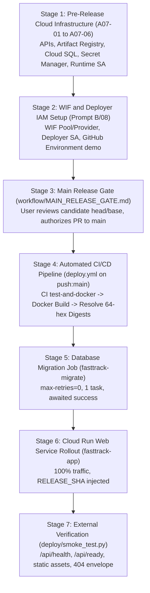

# R2-J01 Cloud Runtime and Provisioning Plan (Phase A/B Handoff)

**Task ID:** `R2-J01` (Joint Cloud Delivery & Lab 5 Evidence)  
**Issue:** [#16](https://github.com/zerotwobook/fastTrack/issues/16)  
**Author / Owner:** A (`@zerotwobook`)  
**Reviewer:** B (`@Atip-Infa`)  
**Branch:** `ops/s2-a-cloud-runtime`  
**Base:** `staging/sprint-2` (`8edab6f30c051a1a8f6c0d1a2222af5f2125fc9e`)  
**Execution Mode:** `Prepare` (Phase A discovery + Phase B concrete plan & offline verification; stops before cloud mutation or main release)

---

## 1. Executive Summary and Operational Boundaries

This handoff establishes the concrete, reproducible cloud runtime and provisioning architecture for fastTrack Lab 5. It fulfills the independent preparation phase owned by A under `prompt_project/prompt_lab5/A/07_R2-J01_CLOUD_RUNTIME.md`, respecting all repository rules (`AGENTS.md`, `skill/SKILL_Project.md`, `skill/SKILL_Github.md`, `workflow/04_LAB5_DELIVERY_PLAN.md`, and `workflow/MAIN_RELEASE_GATE.md`).

### Strict Operational Boundaries
1. **Zero Unapproved Cloud Mutations:** No GCP commands modifying billing, IAM, SQL, secrets, or compute are executed during this preparation phase.
2. **Main Release Gate Hold:** Staging head (`8edab6f`) contains the verified container and delivery workflows, while `main` remains at planning baseline `b7174a7`. No deployment will occur from staging; all production releases require an explicit user-authorized candidate targeting `main` via B's release preparation ([B/08](../../prompt_project/prompt_lab5/B/08_R2-B01_J01_WIF_GATE_AND_RELEASE_PREP.md)).
3. **Secret Redaction:** No actual connection strings, database passwords, session secrets, cookies, or CSRF tokens appear in this plan, repository code, or chat logs.

---

## 2. Phase A: Tooling and Cloud State Discovery

### 2.1 Tooling & Environment Verification
A pre-execution discovery check was performed on the local execution host on 11 November 2026:

| Tool | Checked Command | Observed Status | Implications |
|---|---|---|---|
| **gcloud CLI** | `Get-Command gcloud` | `NOT INSTALLED` on local PATH | Cloud mutations cannot be run directly via local CLI without installation. Concrete gcloud commands and console instructions are fully documented below for account-holder review. |
| **Docker Engine** | `docker --version` | `Docker version 29.9.2, build a82e528` (VERIFIED PRESENT) | Available for clean image builds (`runner` and `jobs` targets) and local validation. |
| **Git** | `git --version` | `git version 2.47.1.windows.1` (VERIFIED PRESENT) | Clean repository tree verified on `ops/s2-a-cloud-runtime`. |
| **Bash** | `C:\Program Files\Git\bin\bash.exe` | GNU bash 5.2.37 (VERIFIED PRESENT) | Successfully executes delivery test stubs and offline verification scripts. |
| **Python** | `python --version` | `Python 3.13.16` (VERIFIED PRESENT) | Successfully executes `deploy/tests/test_smoke.py` unittest suite. |

### 2.2 GCP Project Discovery Lead
Based on accepted delivery contracts (`docs/labs/lab-05/deployment.md` and `Project_code/docs/contracts/sprint-2-lab-05-delivery-contract.md`):
- **Proposed Project ID:** `fasttrack-se-002`
- **Proposed Project Number:** `970128017651`
- **Target Region:** `asia-southeast1` (Singapore; minimal latency for Thailand/Bangkok)
- **Account Type:** Personal Gmail Free Trial ($300 credit tier), adhering strictly to handout section 4.4 and Student Guide Episode 1. No prepayments or paid account upgrades are permitted.

### 2.3 Cloud Resource Inventory
As gcloud CLI is not locally available in the agent workspace, all live cloud resources are classified in accordance with Section 5 of Prompt A/07:

| Resource Type | Resource Name / ID | Planned Target | Current State | Verification Source / Time |
|---|---|---|---|---|
| **Artifact Registry** | `fasttrack-docker` | `asia-southeast1` | `UNKNOWN` | Requires Console or authorized gcloud inspection (11 Nov 2026) |
| **Cloud SQL Instance** | `fasttrack-db` | PostgreSQL 16 Enterprise (`db-f1-micro`) | `UNKNOWN` | Requires Console or authorized gcloud inspection (11 Nov 2026) |
| **Database** | `fasttrack_prod` | In `fasttrack-db` | `UNKNOWN` | Requires Console or authorized gcloud inspection (11 Nov 2026) |
| **Database User** | `fasttrack_user` | Scoped DB user | `UNKNOWN` | Requires Console or authorized gcloud inspection (11 Nov 2026) |
| **Runtime Identity** | `sa-fasttrack-runtime` | Service Account | `UNKNOWN` | Requires Console or authorized gcloud inspection (11 Nov 2026) |
| **Deployer Identity** | `sa-fasttrack-deployer`| Service Account (WIF) | `UNKNOWN` | Managed via B/08 handoff (11 Nov 2026) |
| **Secret: DB URL** | `fasttrack-database-url`| Secret Manager | `UNKNOWN` | Requires Console or authorized gcloud inspection (11 Nov 2026) |
| **Secret: Demo Pass** | `fasttrack-demo-password`| Secret Manager (optional) | `UNKNOWN` | Requires Console or authorized gcloud inspection (11 Nov 2026) |
| **Cloud Run Job** | `fasttrack-migrate` | Migration Job | `UNKNOWN` | Requires Console or authorized gcloud inspection (11 Nov 2026) |
| **Cloud Run Service** | `fasttrack-app` | Web Service | `UNKNOWN` | Requires Console or authorized gcloud inspection (11 Nov 2026) |

*Note: In accordance with project rules, permission failure or absence of CLI is recorded as `UNKNOWN`, not absence.*

---

## 3. Phase B: Concrete Runtime and Resource Plan

### 3.1 Change Matrix (A07-01 to A07-10)

| Action ID | Current State and Evidence | Exact Project / Region / Resource | Proposed Command or Console Action | Purpose | IAM / DB / Secret / Cost Impact | Recovery Limit | Authorization | Verification |
|---|---|---|---|---|---|---|---|---|
| **A07-01** | `UNKNOWN` (discovery lead) | `fasttrack-se-002` (Project-level APIs) | `gcloud services enable run.googleapis.com sqladmin.googleapis.com artifactregistry.googleapis.com cloudbuild.googleapis.com secretmanager.googleapis.com iam.googleapis.com --project fasttrack-se-002` | Enable required Google Cloud APIs for Cloud Run, Cloud SQL, Artifact Registry, Secrets, and IAM | Free tier API enablement; no direct cost. | Disable unneeded services if enabled by mistake. | `PENDING` user review | `gcloud services list --enabled --project fasttrack-se-002` |
| **A07-02** | `UNKNOWN` | `fasttrack-docker` in `asia-southeast1` | `gcloud artifacts repositories create fasttrack-docker --repository-format=docker --location=asia-southeast1 --description="fastTrack container repository" --project=fasttrack-se-002` | Container registry for web and jobs immutable images | Storage cost negligible (<$0.10/mo for 2 images). | Repository can be deleted if misconfigured. | `PENDING` user review | `gcloud artifacts repositories describe fasttrack-docker --location=asia-southeast1 --project=fasttrack-se-002` |
| **A07-03** | `UNKNOWN` | `fasttrack-db` in `asia-southeast1` | `gcloud sql instances create fasttrack-db --database-version=POSTGRES_16 --edition=enterprise --tier=db-f1-micro --region=asia-southeast1 --storage-size=10GB --storage-type=SSD --backup-start-time=03:00 --project=fasttrack-se-002` | Provision minimal supported persistent PostgreSQL 16 database | Covered by Free Trial $300 credit (~$10-15/month for db-f1-micro). Backup daily at 03:00 UTC. | Instance deletion requires explicit flag; preserve data. | `PENDING` user review | `gcloud sql instances describe fasttrack-db --project=fasttrack-se-002` |
| **A07-04** | `UNKNOWN` | `fasttrack_prod` in `fasttrack-db` | `gcloud sql databases create fasttrack_prod --instance=fasttrack-db --project=fasttrack-se-002` | Production application database catalog | Logical database catalog creation; no additional cost. | Database can be dropped if corrupted before data entry. | `PENDING` user review | `gcloud sql databases list --instance=fasttrack-db --project=fasttrack-se-002` |
| **A07-05** | `UNKNOWN` | `sa-fasttrack-runtime` | `gcloud iam service-accounts create sa-fasttrack-runtime --display-name="fastTrack Cloud Run Runtime" --project=fasttrack-se-002` && `gcloud projects add-iam-policy-binding fasttrack-se-002 --member="serviceAccount:sa-fasttrack-runtime@fasttrack-se-002.iam.gserviceaccount.com" --role="roles/cloudsql.client" --condition=None --quiet` | Scoped least-privilege runtime service account | Grants `cloudsql.client` ONLY; no Owner/Editor permissions; zero cost. | IAM role binding can be removed or revoked. | `PENDING` user review | `gcloud iam service-accounts describe sa-fasttrack-runtime@fasttrack-se-002.iam.gserviceaccount.com --project=fasttrack-se-002` |
| **A07-06** | `UNKNOWN` | `fasttrack_user` & `fasttrack-database-url` | Generate 24-byte hex password -> create DB user `fasttrack_user` -> store socket URL in `fasttrack-database-url` -> grant `roles/secretmanager.secretAccessor` on secret | Secure database credential generation and Secret Manager storage | Secret Manager pricing ($0.06/secret/mo; free tier covers 6 active secrets). Runtime SA gets access to this secret ONLY. | Password can be rotated; secret versions are retained. | `PENDING` user review | `gcloud secrets describe fasttrack-database-url --project=fasttrack-se-002` (do NOT print payload) |
| **A07-07** | `UNKNOWN` | `fasttrack-app` & `fasttrack-jobs` images | Build web and jobs targets from clean accepted `main` commit -> push to Artifact Registry -> resolve immutable 64-hex SHA-256 digests | Produce reproducible, immutable deployment artifacts | Bandwidth and storage within standard free tier limits. | Images are immutable by SHA; old tags remain accessible. | `PENDING` main release | `gcloud artifacts docker images list asia-southeast1-docker.pkg.dev/fasttrack-se-002/fasttrack-docker` |
| **A07-08** | `UNKNOWN` | `fasttrack-migrate` Cloud Run Job | `gcloud run jobs create fasttrack-migrate --image=$JOBS_DIGEST --max-retries=0 --tasks=1 --parallelism=1 --region=asia-southeast1 --service-account=sa-fasttrack-runtime@... --set-cloudsql-instances=... --set-secrets=DATABASE_URL=fasttrack-database-url:latest --command=npm --args=run,db:migrate,--workspace,@fasttrack/server` | Run Prisma schema migration before web rollout with zero automatic retries | Job compute is billed per-second during run (<$0.01). Halts on error without rolling out web app. | Job specification can be updated; migration failures halt rollout. | `PENDING` user review | `gcloud run jobs describe fasttrack-migrate --region=asia-southeast1 --project=fasttrack-se-002` |
| **A07-09** | `UNKNOWN` | `fasttrack-app` Cloud Run Service | `gcloud run deploy fasttrack-app --image=$APP_DIGEST --region=asia-southeast1 --service-account=sa-fasttrack-runtime@... --set-cloudsql-instances=... --set-secrets=DATABASE_URL=fasttrack-database-url:latest --set-env-vars=NODE_ENV=production,APP_ORIGIN=https://fasttrack-app-970128017651.asia-southeast1.run.app,SESSION_TTL_HOURS=8,TRUST_PROXY_HOPS=1,RELEASE_SHA=$RELEASE_SHA --port=8080 --memory=512Mi --min-instances=0 --max-instances=2 --allow-unauthenticated` | Deploy public web application serving frontend + API | Cloud Run scale-to-zero (min=0, max=2 instances). Free tier covers 2M requests/month. | Previous revision can receive 100% traffic immediately on rollback. | `PENDING` user review & main release | `gcloud run services describe fasttrack-app --region=asia-southeast1 --project=fasttrack-se-002` |
| **A07-10** | `UNKNOWN` | Public URL Verification | Run `python deploy/smoke_test.py https://fasttrack-app-970128017651.asia-southeast1.run.app $RELEASE_SHA` | External automated verification of `/api/health`, `/api/ready`, static assets, and 404 envelope | Read-only HTTP traffic; no state change. | N/A (read-only verification). | `PENDING` deployment | Smoke test exit code 0; sanitized JSON response matching contracts. |

---

## 4. Resolution of the 10 Technical Architecture Points

### 1. Registry and Image Identity
- **Web Service Target:** `asia-southeast1-docker.pkg.dev/fasttrack-se-002/fasttrack-docker/fasttrack-app:<RELEASE_SHA>`
- **Migration Jobs Target:** `asia-southeast1-docker.pkg.dev/fasttrack-se-002/fasttrack-docker/fasttrack-jobs:<RELEASE_SHA>` (`--target jobs`)
- **Immutable Digests:** All deployment commands (`deploy.sh`, `release.sh`, GitHub Actions) resolve and use the immutable 64-hex SHA-256 digest (`@sha256:[0-9a-f]{64}`).
- **Source SHA Differentiation:** The built and deployed `RELEASE_SHA` must be the exact 40-character git commit from `main` that was built. The PR head commit on staging and the eventual merge commit on main can differ; runtime `/api/health` asserts the exact deployed main commit.

### 2. SQL Architecture and Cloud SQL Connection
- **Instance Configuration:** PostgreSQL 16 on Cloud SQL Enterprise edition, tier `db-f1-micro` (1 vCPU, 0.614 GB RAM), 10GB SSD storage, automated daily backups at 03:00 UTC.
- **Connection Mechanism:** Unix domain socket integration via Cloud Run built-in connector (`--set-cloudsql-instances=fasttrack-se-002:asia-southeast1:fasttrack-db`).
- **Connection String Format:**
  `postgresql://fasttrack_user:<REDACTED>@127.0.0.1:5432/fasttrack_prod?host=/cloudsql/fasttrack-se-002:asia-southeast1:fasttrack-db`
- **Driver Compatibility:** Fully compatible with `@prisma/adapter-pg` and PostgreSQL pool. Validated offline in `deploy/tests/test_deploy_stub.sh`.

### 3. Identity and Access Management (Least Privilege)
- **Runtime Identity:** `sa-fasttrack-runtime@fasttrack-se-002.iam.gserviceaccount.com`
  - Scoped role `roles/cloudsql.client` on the project.
  - Scoped role `roles/secretmanager.secretAccessor` granted strictly on individual secrets (`fasttrack-database-url` and optionally `fasttrack-demo-password`).
  - Prohibited: No project-wide Secret Accessor, no Owner, no Editor.
- **Deployer Identity:** `sa-fasttrack-deployer@fasttrack-se-002.iam.gserviceaccount.com` (owned by B in B/08)
  - Scoped permissions to push images to Artifact Registry, update Cloud Run service/job, and impersonate `sa-fasttrack-runtime` (`roles/iam.serviceAccountUser`).
  - Keyless authentication via GitHub Actions Workload Identity Federation (WIF). Zero service account JSON keys.

### 4. Secret Management
- **Storage:** Google Secret Manager (`fasttrack-database-url`).
- **Input Method:** Generated securely via `openssl rand -hex 24` and piped directly via stdin (`--data-file=-`) without ever writing password files or echoing to stdout.
- **Consumers:** Injected exclusively into `fasttrack-app` (server runtime) and `fasttrack-migrate` (job) via `--set-secrets=DATABASE_URL=fasttrack-database-url:latest`.
- **Client Security:** Never exposed to Vite client build, browser HTML, or git.

### 5. Runtime Configuration and Connection Capacity
- **Port:** 8080 (Cloud Run injected `PORT=8080`).
- **Canonical Origin:** `APP_ORIGIN=https://fasttrack-app-970128017651.asia-southeast1.run.app` (HTTPS, no trailing slash).
- **Session Security:** 8-hour absolute TTL (`SESSION_TTL_HOURS=8`), HttpOnly, Secure, SameSite=Lax cookie.
- **Proxy Trust:** `TRUST_PROXY_HOPS=1` (trusts single Cloud Run Google Frontend hop; prevents header spoofing).
- **Connection Pool Bounds:**
  - `DB_POOL_MAX=2` per container instance.
  - With `max-instances=2`, total concurrent connections = 4 (well within `db-f1-micro` connection limits).
  - Deadlines: `DB_CONNECT_TIMEOUT_MS=1000`, `DB_STATEMENT_TIMEOUT_MS=1000`, `DB_QUERY_TIMEOUT_MS=1500`, `READINESS_TIMEOUT_MS=3000`.

### 6. Origin Bootstrap and Security
- **Deterministic Service URL:** In Google Cloud Run, default regional URLs follow `https://<service>-<project-number>.<region>.run.app`.
  For `fasttrack-app`, Project Number `970128017651`, and Region `asia-southeast1`, the deterministic canonical URL is:
  `https://fasttrack-app-970128017651.asia-southeast1.run.app`
- **Zero CSRF Compromise:** The origin is known deterministically before deployment; CSRF checks (`X-CSRF-Token`, `Origin` header validation, and `X-fastTrack-Request: 1`) remain 100% active. No wildcard origins or lax settings are allowed.

### 7. Migration Job Execution
- **Image:** Built from `--target jobs`, packaging Prisma CLI, TypeScript runner, and schema migrations.
- **Execution Command:** `npm run db:migrate --workspace @fasttrack/server`
- **Execution Safeguards:** `--max-retries=0`, `--tasks=1`, `--parallelism=1`.
- **Gate:** Executed with `--wait`. If migration fails, deployment script aborts with exit code 1 immediately; Cloud Run web service rollout is never attempted.

### 8. Seed Policy
- **Synthetic Demo Data Only:** Seed is an explicit, add-only operation (`npm run db:seed --workspace @fasttrack/server`).
- **Separation:** `deploy/deploy.sh --demo` provisions the optional demo password secret, but does NOT trigger automatic seed execution.
- **Data Safety:** Never performs table truncate, schema push, or user overwrite. Preserves existing accounts and passwords.

### 9. Cost Controls and Quotas
- **Cloud Run Instance Bounds:** `min-instances=0` (scale-to-zero when idle, zero compute charges when not receiving traffic), `max-instances=2` (caps burst compute).
- **Cloud SQL Tier:** `db-f1-micro`, 10GB SSD, backup retention standard.
- **Budget Notification:** Recommended Google Cloud Budget Alert set at $10.00 / 300 THB with email alerts to account holder (note: budget alerts notify; they do not hard-terminate running instances).
- **Availability Obligation:** Assessed services will not be paused or stopped during grading and Lab 6 peer UAT.

### 10. Bootstrap and Release Sequencing

---

## 5. Offline Verification and Test Results

To guarantee that deployment scripts and safeguards function reliably without incurring cloud mutations or costs, all delivery scripts were exercised locally through the project's offline test suites:

### 5.1 Deployment Script Offline Stubs (`deploy/tests/test_deploy_stub.sh`)
Executed via Git Bash (`C:\Program Files\Git\bin\bash.exe deploy/tests/test_deploy_stub.sh`):
- `PASS: scenario first_run` (verifies initial creation of all resources, `--edition=enterprise`, and scoped secretAccessor)
- `PASS: scenario rerun` (verifies idempotency: existing SQL, secrets, and SA are preserved without rotating credentials)
- `PASS: scenario partial` (verifies missing DB secret triggers password reset and secret recreation)
- `PASS: job-fail prevents service deployment` (verifies that migration failure aborts before `gcloud run deploy`)
- `PASS: scenario demo` (verifies `--demo` provisions secret without running unauthorized seed)
- `PASS: DRY_RUN=1 made 0 gcloud calls` (verifies command preview isolation)
- `PASS: non-main, dirty and divergent sources rejected before cloud calls` (verifies source branch integrity guards)

### 5.2 Release Pipeline Offline Stubs (`deploy/tests/test_release_stub.sh`)
Executed via Git Bash (`C:\Program Files\Git\bin\bash.exe deploy/tests/test_release_stub.sh`):
- `PASS normal release uses web/jobs digests, awaits migration, and sets RELEASE_SHA`
- `PASS rollback reuses web image without touching migration job`
- `PASS non-main GITHUB_REF rejected before GCP calls`
- `PASS image failure blocks service update`
- `PASS jobs_image failure blocks service update`
- `PASS migration failure blocks service update`
- `PASS malformed_web failure blocks service update`
- `PASS malformed_jobs failure blocks service update`
- `PASS invalid tag rejected before GCP calls`
- `PASS split traffic is rejected instead of reporting success`

### 5.3 Smoke Test Suite (`deploy/tests/test_smoke.py`)
Executed via Python (`python -m unittest discover -s deploy/tests -p test_smoke.py`):
- `Ran 10 tests in 0.017s: OK`
- Covers: `/api/health` 200 and version matching; `/api/ready` 503 DB-down handling; static HTML fastTrack branding; `/api/nonexistent` exact 404 error envelope; scoped `/api/teams` read-only check; cookie jar and CSRF verification; guaranteed session logout in `finally` block.

### 5.4 Command Preview (`DRY_RUN=1 ./deploy/deploy.sh`)
Executed from repository root on `ops/s2-a-cloud-runtime`:
- Verified exact command generation for APIs, Artifact Registry, Cloud SQL Enterprise `db-f1-micro`, Database, Service Account, Secret Manager, Docker build/push, Migration Job, and Cloud Run service rollout. Zero cloud API calls were made.

---

## 6. Handoff to B (`Atip-Infa` / Prompt B/08)

To proceed with Lab 5 delivery, B can now execute [Prompt B/08](../../prompt_project/prompt_lab5/B/08_R2-B01_J01_WIF_GATE_AND_RELEASE_PREP.md) with the following agreed delivery interface inputs:

1. **GCP Project Lead:** `fasttrack-se-002` (Project Number: `970128017651`, Region: `asia-southeast1`)
2. **Runtime Service Account:** `sa-fasttrack-runtime@fasttrack-se-002.iam.gserviceaccount.com`
3. **Deployer Service Account:** `sa-fasttrack-deployer@fasttrack-se-002.iam.gserviceaccount.com`
4. **WIF Provider Format:** `projects/970128017651/locations/global/workloadIdentityPools/github-pool/providers/github-provider`
5. **Canonical Origin:** `https://fasttrack-app-970128017651.asia-southeast1.run.app`
6. **Required GitHub Environment:** `demo` (restricted strictly to branch `main`) with variables:
   - `GCP_PROJECT_ID`: `fasttrack-se-002`
   - `GCP_REGION`: `asia-southeast1`
   - `WIF_PROVIDER`: `projects/970128017651/locations/global/workloadIdentityPools/github-pool/providers/github-provider`
   - `WIF_SERVICE_ACCOUNT`: `sa-fasttrack-deployer@fasttrack-se-002.iam.gserviceaccount.com`
7. **Main Candidate Preparation:** B prepares the Draft PR from `staging/sprint-2` to `main`, keeping it Draft until user review and explicit release authorization.

---

## 7. Status, Verification, and Next Steps

- **Owner:** A (`@zerotwobook`)
- **Issue:** [#16](https://github.com/zerotwobook/fastTrack/issues/16) (Status: `Started`)
- **Verification:** `PASSED` (local offline tests, command preview, syntax, and delivery matrix)
- **Acceptance:** `PENDING` (awaits cloud execution authorization and main release gate)
- **Next Human Action:**
  1. Review this cloud runtime plan and Change Matrix (A07-01 to A07-10).
  2. Confirm GCP project account access in Google Cloud Console.
  3. Authorize B to proceed with Prompt B/08 (WIF setup and initial main candidate preparation).
